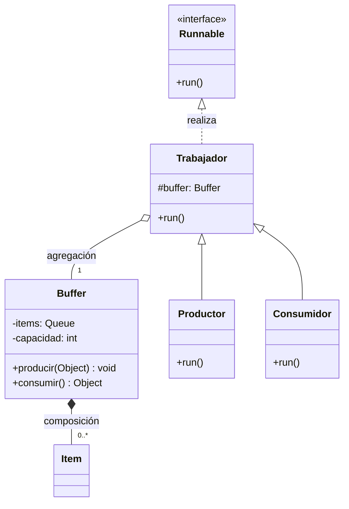
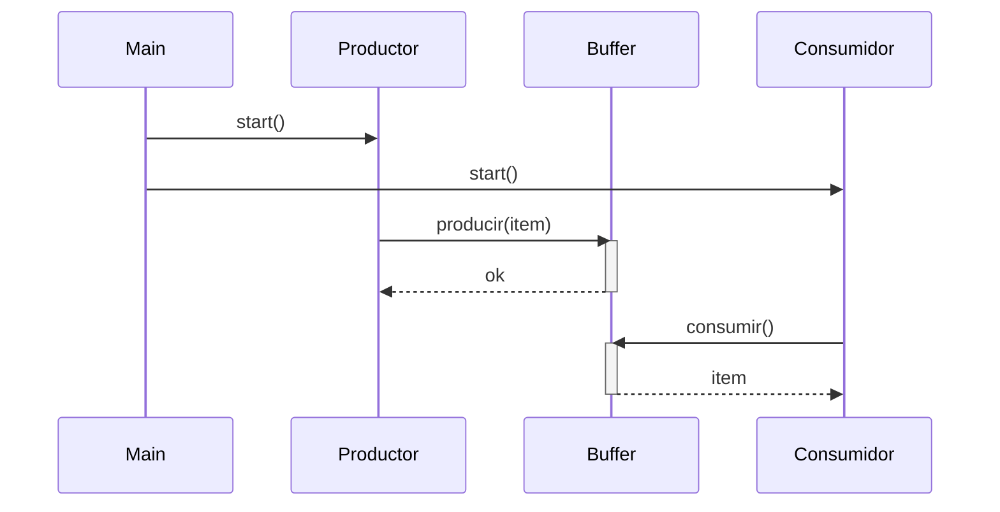
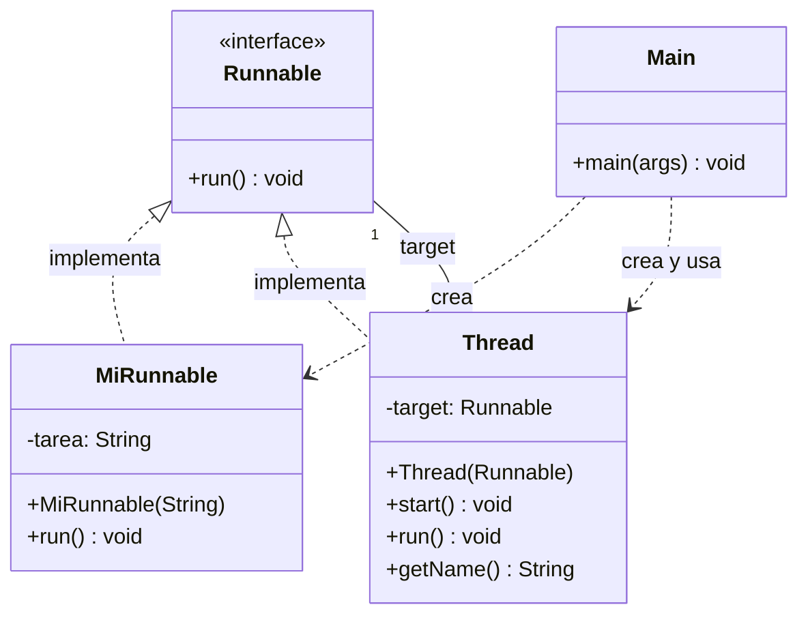
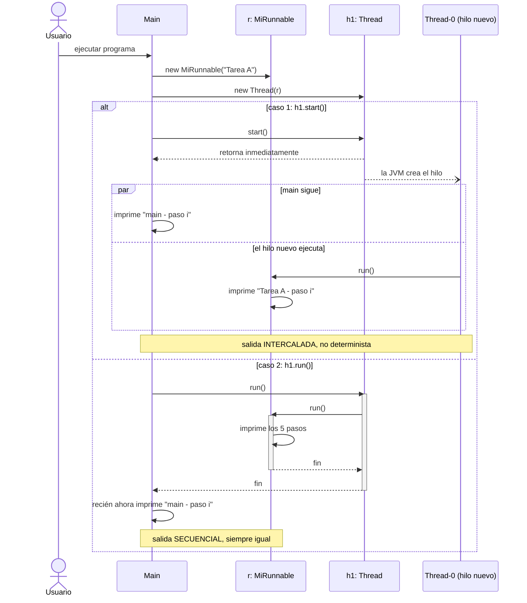
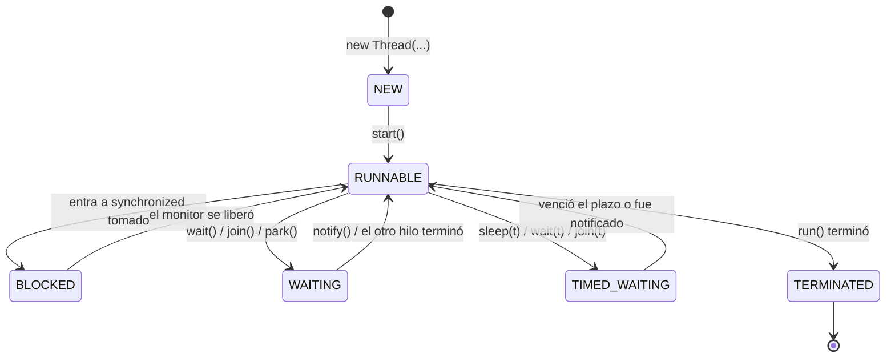

# Java — Conceptos Básicos

###### **Modificadores de acceso**
Java tiene **cuatro** niveles, no tres. El cuarto es el Package-Private, el que queda cuando no escribís ningún modificador, y es fácil olvidarlo.

| Modificador                           | Misma clase | Mismo paquete | Subclase (otro paquete) | Cualquiera |
| ------------------------------------- | ----------- | ------------- | ----------------------- | ---------- |
| `private`                             | ✔           | ✗             | ✗                       | ✗          |
| *(sin modificador)* — package-private | ✔           | ✔             | ✗                       | ✗          |
| `protected`                           | ✔           | ✔             | ✔                       | ✗          |
| `public`                              | ✔           | ✔             | ✔                       | ✔          |

Un detalle fino es que **`protected` también da acceso a todo el paquete**, no solo a las subclases. Y en una subclase de otro paquete el acceso es solo a través de referencias del tipo de la subclase, no de la superclase.

###### **`static` y `final`**

```java
public class Contador {
    static int instancias;              // pertenece a la CLASE, no a la instancia
    static final int MAX = 100;         // constante: static + final, en MAYUSCULAS
    private final int id;               // final de instancia: se fija en el constructor

    static { instancias = 0; }          // bloque de inicialización estática

    public Contador(int id) { this.id = id; instancias++; }
    public static int getInstancias() { return instancias; }  // se usa sin instanciar
}
// final también aplica a métodos (no se sobrescriben) y a clases (no se heredan)
```

Dos cosas que importan para la materia:
- Un campo `static` es **estado compartido por todos los hilos**, la primera fuente de condiciones de carrera. `instancias++` del ejemplo no es atómico: son tres operaciones (leer, incrementar, escribir).
- Un campo `final` correctamente inicializado se ve **completo** desde otros hilos sin sincronización, y en eso se basa el uso de objetos inmutables para evitar locks.

###### **Clases abstractas e interfaces**

```java
public abstract class Tarea {
    protected String nombre;
    public abstract void ejecutar();                    // sin cuerpo: la subclase DEBE implementarlo
    public void log() { System.out.println(nombre); }   // sí puede implementar métodos
}

public interface Reiniciable {
    int LIMITE = 3;                                     // implícitamente public static final
    void reiniciar();                                   // implícitamente public abstract
    default boolean puedeReiniciar() { return true; }   // Java 8+
    static Reiniciable nula() { return () -> {}; }      // Java 8+
}
```

|                                 | Clase abstracta                          | Interfaz                                                  |
| ------------------------------- | ---------------------------------------- | --------------------------------------------------------- |
| Estado (atributos de instancia) | Sí                                       | No, solo constantes                                       |
| Constructor                     | Sí                                       | No                                                        |
| Herencia múltiple               | No (`extends` una sola)                  | Sí (`implements` varias)                                  |
| Métodos con cuerpo              | Sí, siempre                              | `default` y `static` desde Java 8, `private` desde Java 9 |
| Para qué                        | Compartir implementación entre parientes | Unificar clases sin parentesco / definir un contrato      |

Eso es lo que cambia a partir de Java 9. Como criterio práctico, conviene preferir interfaces salvo que necesites compartir estado o código.
###### **JavaDoc**

```java
/**
 * Consume un elemento del buffer, bloqueando si está vacío.
 * @param timeout milisegundos máximos de espera
 * @return el elemento consumido
 * @throws InterruptedException si el hilo es interrumpido mientras espera
 * @see Buffer#producir(Object)
 */
public Object consumir(long timeout) throws InterruptedException { ... }
```

Se genera con `javadoc -d docs src/*.java`. La API completa está en https://docs.oracle.com/javase/8/docs/api/

###### **Versiones del JDK**
Las versiones LTS, ordenadas:

| Versión      | Fecha           | Qué aporta                                             | Relevancia para concurrencia                                         |
| ------------ | --------------- | ------------------------------------------------------ | -------------------------------------------------------------------- |
| **8 (LTS)**  | Marzo 2014      | Lambdas, Streams API, *default methods*, Date/Time API | Streams **paralelos**, `CompletableFuture`                           |
| **11 (LTS)** | Septiembre 2018 | HTTP Client, `var` en lambdas, Epsilon GC              | Cliente HTTP asincrónico                                             |
| **17 (LTS)** | Septiembre 2021 | Sealed classes, pattern matching en `switch`, Records  | Records: inmutables por defecto                                      |
| **21 (LTS)** | Septiembre 2023 | Scoped Values, Sequenced Collections                   | **Virtual Threads** (JEP 444) y **Structured Concurrency** (JEP 453) |

###### **Dónde reaparece todo esto en la materia**
- `Runnable` y `Callable<V>` son interfaces funcionales, por eso se instancian con lambdas: 
  `new Thread(() -> tarea()).start()`.
- Implementar `Runnable` es preferible a heredar de `Thread`, porque `extends` gasta la única herencia disponible y acopla la tarea con el mecanismo que la ejecuta.
- `final` + sin setters = objeto inmutable = *thread-safe* gratis, sin `synchronized`.
- `static` = memoria compartida entre hilos = sección crítica en potencia.

# Modelado de un sistema con diagramas UML

UML es un lenguaje gráfico de modelado, no una metodología. Sirve para visualizar, especificar, construir y documentar un sistema de software.

| Estructurales (vista estática)                                                     | De interacción y comportamiento (vista dinámica)                                     |
| ---------------------------------------------------------------------------------- | ------------------------------------------------------------------------------------ |
| Clases, Objetos, Componentes, Despliegue, Paquetes, Perfiles, Estructura compuesta | Secuencia, Actividades, Casos de uso, Comunicación, Tiempos, Global de interacciones |

###### **Diagrama de clases**
Tres bandas: 
- Nombre 
- Atributos 
- Operaciones. 
Visibilidad de los miembros: 
- `+` Public 
- `-` Private 
- `#` Protected, 
- `~` Package. 
Multiplicidad: `1..*` uno o muchos, `0..*` cero o muchos, `m` número fijo.

| Relación                  | Notación                         | Semántica                                                     |
| ------------------------- | -------------------------------- | ------------------------------------------------------------- |
| Herencia (generalización) | Línea llena + triángulo vacío    | La subclase hereda atributos y métodos `public` y `protected` |
| Realización               | Línea punteada + triángulo vacío | La clase implementa una interfaz                              |
| Asociación                | Línea llena                      | Objetos que colaboran; relación débil, vidas independientes   |
| Agregación                | Rombo **vacío**                  | "Tiene un", pero la parte sobrevive al todo (ej. cliente)     |
| Composición               | Rombo **lleno**                  | La vida de la parte está atada a la del todo (ej. cuentas)    |
| Dependencia / uso         | Flecha punteada                  | Una clase instancia o usa puntualmente a otra                 |



###### **Diagrama de secuencia**
Muestra cómo un grupo de objetos se comunica a lo largo del tiempo; el tiempo avanza de arriba hacia abajo. Se modela uno por caso de uso.

| Elemento                     | Notación                            | Qué representa                                       |
| ---------------------------- | ----------------------------------- | ---------------------------------------------------- |
| Línea de vida                | Línea vertical punteada             | Un participante durante la interacción               |
| Actor                        | Monigote al tope de la línea        | Participante externo al sistema                      |
| Ocurrencia de ejecución      | Rectángulo sombreado sobre la línea | Período en que el participante ejecuta una operación |
| Mensaje sincrónico           | Flecha llena, punta rellena         | Llamada donde el emisor **espera** la respuesta      |
| Mensaje asincrónico          | Flecha llena, punta abierta         | El emisor sigue sin esperar: **arranque de un hilo** |
| Mensaje de retorno           | Flecha punteada                     | Valor devuelto por la llamada                        |
| Mensaje a sí mismo           | Flecha que vuelve a la misma línea  | Llamada a un método propio                           |
| Mensaje de creación          | Flecha a un objeto que nace ahí     | Debe ser el primer mensaje que ese objeto recibe     |
| Evento de destrucción        | `X` al pie de la línea              | El objeto fue eliminado o ya no es accesible         |
| Mensaje perdido / encontrado | Flecha hacia / desde un círculo     | Participante no especificado                         |

Si hay demora entre el envío y la atención, la flecha se dibuja oblicua.



###### **Fragmentos combinados**
Rectángulo con un operador de interacción en la esquina y uno o más operandos separados por línea punteada. Cada operando puede llevar una guarda, que es una expresión booleana entre corchetes que cubre la línea de vida (*interaction constraint*, UML 2.4). Si el operando no tiene guarda, se asume verdadera.

| Operador              | Significado                                                                                                        |
| --------------------- | ------------------------------------------------------------------------------------------------------------------ |
| `alt`                 | Alternativas: se ejecuta **solo uno** de los operandos, el de guarda verdadera                                     |
| `opt`                 | Opción: el único operando ocurre o no ocurre nada (equivale a un `alt` con la otra rama vacía)                     |
| `loop`                | Iteración; admite límites `loop(min, max)` y guarda. Sin límites, bucle potencialmente infinito                    |
| `break`               | Escenario excepcional: si la guarda es verdadera se ejecuta y se **ignora el resto** del fragmento que lo encierra |
| `par`                 | Ejecución paralela: los operandos se **intercalan de cualquier forma**, respetando el orden interno de cada uno    |
| `strict`              | Secuencia estricta de los operandos del primer nivel: la coordenada vertical importa en todo el fragmento          |
| `seq`                 | Secuencia débil: solo se ordena lo que ocurre sobre una misma línea de vida                                        |
| `critical`            | Región crítica: **atómica**, no puede ser intercalada por otras ocurrencias (ni por un `par`)                      |
| `ignore` / `consider` | Mensajes que se descartan / que sí se tienen en cuenta dentro del fragmento                                        |
| `assert`              | La secuencia de operandos es la **única** válida en ese punto                                                      |
| `neg`                 | Traza inválida: lo que **no** debe ocurrir                                                                         |

###### **Por qué UML sirve acá**
- `par` es la representación gráfica del interleaving, con dos operandos concurrentes cuyo entrelazado no está determinado.
- `critical` es literalmente la sección crítica, el fragmento que `par` no puede intercalar. 
  Un caso típico es el de `agregar()` y `eliminar()`, que pueden llamarse en paralelo, pero cada uno debe funcionar como región crítica.
- El mensaje asincrónico modela el `start()` de un hilo; el sincrónico, una llamada común que bloquea al emisor.

###### **Ejemplos**
- **Ej. 1 — préstamo de un libro**: actores *Socio* y *Encargado*, objetos *Libro*, *Ficha socio*, *Ficha libro*, *Préstamo*. Secuencia: coger libro → solicitar préstamo → verificar situación del socio (respuesta punteada "situación socio ok") → verificar situación del libro → introducir préstamo → autorizar préstamo. Es el caso típico de mensajes sincrónicos con su retorno.
- **Ej. 2a/2b — los tres chanchitos** (tracemodeler.com): un fragmento `par` con tres operandos, uno por chanchito construyendo su casa (`new()` de *StrawHouse*, *WoodHouse*, *BrickHouse*). El 2b agrega los elementos que conviene saber etiquetar, que son el **comentario** (nota con la esquina doblada), **fin de la vida de un objeto** (la `X` cuando el lobo sopla y la casa colapsa), **pila de llamadas** (ocurrencias de ejecución apiladas) y **retorno explícito**.
- **Apéndice — pedido de comida**: muestra todos los elementos numerados de la tabla de arriba, incluyendo un fragmento **`ref`** (*Interaction Use*): una caja que **referencia otro diagrama de secuencia** ("Completar pedido y pagar") en lugar de dibujarlo, y mensajes **encontrado** (desde un punto negro, "hambre") y **perdido** (hacia un punto negro, "actualización de existencias").

Algunas herramientas para dibujarlos son **Visual Paradigm**, **StarUML**, **Trace Modeler** y **Papyrus**. Tutorial: http://www.tracemodeler.com/articles/a_quick_introduction_to_uml_sequence_diagrams/

# Primer hilo: `start()` vs `run()`

El primer programa con hilos crea un `Thread` que ejecuta un objeto que implementa `Runnable`, y compara qué pasa al llamar a `start()` y al llamar a `run()`. Los dos compilan y dan la misma salida, pero solo uno crea concurrencia, y la diferencia se ve en el debugger.

###### **Código**
Una versión posible:

```java
public class MiRunnable implements Runnable {
    private final String tarea;

    public MiRunnable(String tarea) { this.tarea = tarea; }

    @Override
    public void run() {
        for (int i = 0; i < 5; i++) {
            System.out.println(tarea + " - paso " + i
                + " - ejecutando en: " + Thread.currentThread().getName());
        }
    }
}
```

```java
public class Main {
    public static void main(String[] args) {
        MiRunnable r = new MiRunnable("Tarea A");
        Thread h1 = new Thread(r);          // el hilo recibe el objeto a ejecutar

        h1.start();                          // <-- caso 1
        // h1.run();                         // <-- caso 2

        for (int i = 0; i < 5; i++) {
            System.out.println("main - paso " + i
                + " - ejecutando en: " + Thread.currentThread().getName());
        }
    }
}
```

###### **`h1.start()` vs `h1.run()`: la respuesta**

| | `h1.start()` | `h1.run()` |
|---|---|---|
| Qué hace | Le pide a la JVM que cree un **hilo nuevo** del SO y que ejecute `run()` **en ese hilo** | Es una **llamada a método común**, como cualquier otra |
| Hilos en ejecución | **Dos**: `main` y `Thread-0` | **Uno**: solo `main` |
| Quién ejecuta `run()` | El hilo nuevo | El hilo `main` |
| Nombre que imprime | `Thread-0` | `main` |
| Orden de la salida | **Intercalado y no determinista**: cambia entre corridas | **Secuencial y siempre igual**: primero los 5 pasos de la tarea, después los 5 de `main` |
| Retorno | Retorna **inmediatamente**; `main` sigue en paralelo | Retorna **cuando `run()` terminó**; `main` estuvo bloqueado mientras tanto |
| Estado del `Thread` | Pasa a *runnable* y luego a *terminated* | El objeto `h1` **nunca arranca**: queda en estado *new* |

El punto es que **`run()` no crea concurrencia**. Es el método que contiene el trabajo; `start()` es el que le pide al sistema operativo un hilo donde correrlo. Llamar a `run()` directamente compila, no da error y produce la salida "correcta" — por eso es el error clásico, y por eso el ejercicio lo hace ver en el debugger.

Dos detalles que conviene fijar:
- Llamar `h1.start()` **dos veces** lanza `IllegalThreadStateException`, porque un `Thread` no se reinicia. Para volver a ejecutar la tarea hay que crear un `Thread` nuevo sobre el mismo `Runnable`.
- El orden de la salida con `start()` **no está garantizado** ni siquiera al principio, porque `main` puede imprimir todo antes de que el hilo nuevo arranque. Eso **es** el interleaving de la teoría.

###### **Qué se ve en el debug**
- Con **`start()`**: el panel *Threads / Frames* de IntelliJ (o *Debug* en Eclipse) muestra **dos** hilos vivos — `main` y `Thread-0` — y se puede cambiar de uno a otro. Un breakpoint dentro de `run()` detiene al hilo `Thread-0` mientras `main` **sigue corriendo**. La pila de `Thread-0` arranca en `run()`, sin `main` debajo.
- Con **`run()`**: hay un solo hilo. El breakpoint dentro de `run()` detiene a `main`, y la pila de llamadas muestra `main() → run()`, igual que cualquier método.

La diferencia observable está en **la pila de llamadas**. Con `start()` los dos métodos están en pilas **distintas** (cada hilo tiene la suya, como dice la teoría de hilos más arriba); con `run()` están en la **misma** pila.

###### **Diagrama de clases**



###### **Diagrama de secuencia**
Las dos variantes en un solo diagrama, separadas con un fragmento `alt`. En el caso `start()` el mensaje hacia el hilo nuevo es **asincrónico** (`->>` sin retorno inmediato) y `main` sigue trabajando en paralelo; en el caso `run()` es un mensaje **sincrónico** que bloquea a `main` hasta terminar.



# Threads en Java — atributos, estados y prioridades

*(Los ejemplos de código son del Java 7 Concurrency Cookbook.)*

## Creación de hilos

> Cuando hablamos de concurrencia en el mundo de los procesadores nos referimos a **tareas independientes que se ejecutan simultáneamente** en una computadora. Esta simultaneidad puede ser **real**, si los recursos lo permiten.

Ese "si los recursos lo permiten" es la distinción concurrencia/paralelismo que ya está más arriba. La estructura concurrente existe siempre, y el paralelismo real depende de que haya núcleos disponibles.

En Java **los hilos son objetos**, y hay dos formas de crearlos:

| Forma | Cómo | Cuándo |
|---|---|---|
| **Extender `Thread`** | Heredar de `Thread` y sobrescribir `run()`; después `new MiHilo().start()` | Casi nunca. Gasta la única herencia disponible |
| **Implementar `Runnable`** | Escribir una clase que implemente `Runnable`, y pasarle el objeto al constructor de `Thread` | **La recomendada**: separa la tarea del mecanismo que la ejecuta |

De estas dos maneras podemos "darle vida" a una clase.

```java
// Forma 1: extendiendo Thread
public class MiHilo extends Thread {
    @Override
    public void run() { /* tarea */ }
}
new MiHilo().start();

// Forma 2: implementando Runnable  (preferida)
public class MiTarea implements Runnable {
    @Override
    public void run() { /* tarea */ }
}
new Thread(new MiTarea()).start();
```

## Thread safe

> **Thread safe** es la característica que brinda la posibilidad de ejecutar el código en un entorno con múltiples hilos **garantizando que el recurso no se corrompe**.

Queda una pregunta para pensar:

> **¿Los atributos `static` son thread safe?**

**No.** Es exactamente al revés, porque un atributo `static` pertenece a la **clase**, así que **todos** los hilos del proceso ven la misma variable — es el caso más puro de estado compartido, y por lo tanto el candidato número uno a condición de carrera. Ser `static` no agrega ninguna garantía de sincronización.

Las únicas excepciones son:

- `static final` de un tipo **inmutable** (`String`, `Integer`, un objeto sin setters). Nadie lo puede modificar, así que no hay carrera. Además el JMM garantiza su publicación segura.
- Tipos declarados `volatile`, que garantizan **visibilidad** (que el cambio se vea) pero **no atomicidad** (`contador++` sigue rompiéndose).
- Las clases atómicas de `java.util.concurrent.atomic` (`AtomicInteger`, etc.).

Todo lo demás hay que protegerlo con `synchronized`, un `Lock` o un semáforo — que es justo el tema de la sección siguiente.

###### **El ejemplo del práctico: la red `y1`/`y2` pasada a Java con `static`**
El práctico abre con el mismo ejemplo Promela de la Introducción (`process_1`/`process_2` con `y1`, `y2`, `in_critical`) y lo traduce a Java usando **atributos estáticos** como memoria compartida:

```java
public abstract class Tarea implements Runnable {
    protected static int y1 = 0, y2 = 0;
    protected static int critical = 0;       // un solo valor para TODAS las tareas
}

public class T1 extends Tarea {
    @Override
    public void run() {
        while (true) {
            Tarea.y1 = Tarea.y2 + 1;
            while (!(Tarea.y2 == 0) && !(Tarea.y1 <= Tarea.y2)) { }   // espera activa
            Tarea.critical++;
            Tarea.critical--;
            Tarea.y1 = 0;
            if (Tarea.critical != 0) {
                System.out.println("Valor CRITICAL desde T1 = " + Tarea.critical);
                System.out.println("Valor Y1 desde T1 = " + Tarea.y1);
                System.out.println("Valor Y2 desde T1 = " + Tarea.y2);
            }
        }
    }
}
// T2 es simétrica: y2 = y1 + 1; espera (y1 == 0) || (y2 < y1); usa y2.

public class Proceso {
    public Proceso() {
        new Thread(new T1()).start();
        new Thread(new T2()).start();
    }
}
public class Main {
    public static void main(String[] args) { new Proceso(); }
}
```

Las dos tareas son objetos **distintos**, pero como `y1`, `y2` y `critical` son `static`, comparten las mismas variables. Si el protocolo de entrada funcionara, `critical` sería siempre 0 al salir, y el `if` nunca imprimiría nada. Al correrlo, la consola se llena de líneas `Valor CRITICAL desde T1 = -1` (y `= 1` desde T2), porque los `++`/`--` de los dos hilos se intercalan, se pierden actualizaciones, y la exclusión mutua **no** se cumple. Es la respuesta experimental a la pregunta. Los `static` no son thread-safe, son exactamente lo contrario.

## Atributos de la clase Thread

La clase `Thread` almacena atributos de información que ayudan a identificar un hilo, conocer su estado o controlar su prioridad:

| Atributo | Método | Qué guarda |
|---|---|---|
| **Id** | `getId()` | Identificador único de cada hilo. **No se puede modificar** |
| **Nombre** | `getName()` / `setName()` | Nombre del hilo. Por defecto `Thread-XX` |
| **Prioridad** | `getPriority()` / `setPriority()` | Entero de **1 a 10**. `Thread.MIN_PRIORITY = 1`, `NORM_PRIORITY = 5`, `MAX_PRIORITY = 10` |
| **Estado** | `getState()` | Un valor del enum `Thread.State`. **No se puede modificar** directamente |

Sobre la prioridad, el libro advierte que **no es recomendable cambiarla**. La prioridad es apenas una *sugerencia* al planificador del sistema operativo; no garantiza ningún orden de ejecución, y su efecto real cambia de un SO a otro. Un programa cuya corrección dependa de las prioridades está mal diseñado — recordá el principio de que el resultado debe ser **independiente de la velocidad relativa** de los procesos.

## Estados de un hilo en Java

Acá hay una diferencia que conviene tener clara para el parcial. Es común leer que **"en Java los estados posibles de un hilo son 7"**, pero el enum `Thread.State` de la API tiene **seis** valores, y Fernández González (*Java 7 Concurrency Cookbook*, cap. 1) también habla de seis:

| `Thread.State` | Significado |
|---|---|
| **NEW** | El objeto `Thread` fue creado pero todavía **no se llamó a `start()`** |
| **RUNNABLE** | Ejecutándose en la JVM, **o** listo esperando el procesador. Java **no distingue** *ready* de *running* |
| **BLOCKED** | Bloqueado esperando un **monitor**: quiere entrar a un `synchronized` que otro hilo tiene tomado |
| **WAITING** | Esperando **indefinidamente** a otro hilo: `wait()`, `join()`, `park()` sin timeout |
| **TIMED_WAITING** | Igual, pero **con plazo**: `sleep(t)`, `wait(t)`, `join(t)` |
| **TERMINATED** | `run()` terminó, por retorno normal o por excepción |

El "séptimo estado" sale de **desdoblar `RUNNABLE`** en *preparado* y *en ejecución*, que es el modelo del sistema operativo de la sección de procesos del apunte teórico. Es decir, 7 estados en el modelo del SO y 6 en el enum de Java, porque la JVM no puede saber si el hilo está efectivamente sobre el procesador en este instante.



Notar que **de `BLOCKED`, `WAITING` y `TIMED_WAITING` siempre se vuelve a `RUNNABLE`**, nunca directo a ejecución. Es el mismo detalle que en la teoría de hilos del sistema operativo, donde el desbloqueo devuelve el hilo a la **cola de listos**.

## Ejemplo: seguir los estados de 10 hilos

El ejercicio del práctico consiste en crear 10 hilos, fijarles nombre y prioridad —**pares en máxima, impares en mínima**—, y escribir en un archivo LOG cada vez que alguno **cambia de estado**.

La tarea es una clase `Calculator` que implementa `Runnable`. En el libro calcula la tabla de multiplicar de un número; el práctico la cambia por el **cálculo y conteo de números primos hasta un límite**, y el motivo es importante. La tabla de multiplicar termina tan rápido que casi no se alcanzan a ver transiciones de estado. Con los primos, subiendo el límite, el hilo tarda lo suficiente como para que el LOG muestre algo.

```java
public class Calculator implements Runnable {
    private final int limite;

    public Calculator(int limite) { this.limite = limite; }

    @Override
    public void run() {
        int cuenta = 0;
        for (int n = 2; n <= limite; n++) {
            if (esPrimo(n)) cuenta++;
        }
        System.out.printf("%s: %d primos hasta %d%n",
            Thread.currentThread().getName(), cuenta, limite);
    }

    private boolean esPrimo(int n) {
        for (int i = 2; i * i <= n; i++) {
            if (n % i == 0) return false;
        }
        return true;
    }
}
```

```java
public class Main {
    public static void main(String[] args) {
        Thread threads[] = new Thread[10];
        Thread.State status[] = new Thread.State[10];

        // 10 tareas, prioridad máxima a los pares y mínima a los impares
        for (int i = 0; i < 10; i++) {
            threads[i] = new Thread(new Calculator(200000));
            if ((i % 2) == 0) {
                threads[i].setPriority(Thread.MAX_PRIORITY);
            } else {
                threads[i].setPriority(Thread.MIN_PRIORITY);
            }
            threads[i].setName("Thread " + i);
        }

        try (FileWriter file = new FileWriter(".\\data\\log.txt");
             PrintWriter pw = new PrintWriter(file)) {

            // antes de start(): todos en NEW
            for (int i = 0; i < 10; i++) {
                pw.println("Main : Status of Thread " + i + " : " + threads[i].getState());
                status[i] = threads[i].getState();
            }

            for (int i = 0; i < 10; i++) {
                threads[i].start();
            }

            // sondeo: cada vez que un hilo cambia de estado, se registra
            boolean finish = false;
            while (!finish) {
                for (int i = 0; i < 10; i++) {
                    if (threads[i].getState() != status[i]) {
                        writeThreadInfo(pw, threads[i], status[i]);
                        status[i] = threads[i].getState();
                    }
                }
                finish = true;
                for (int i = 0; i < 10; i++) {
                    finish = finish && (threads[i].getState() == Thread.State.TERMINATED);
                }
            }
        } catch (IOException e) {
            e.printStackTrace();
        }
    }

    private static void writeThreadInfo(PrintWriter pw, Thread thread, Thread.State state) {
        pw.printf("Main : Id %d - %s%n", thread.getId(), thread.getName());
        pw.printf("Main : Priority: %d%n", thread.getPriority());
        pw.printf("Main : Old State: %s%n", state);
        pw.printf("Main : New State: %s%n", thread.getState());
        pw.printf("Main : ************************************%n");
    }
}
```

Una variante del ejercicio es un poco distinta. `run()` cuenta primos con `current` de 1 a `max = 200L` (con el comentario "pocos números, ¿qué pasa con prioridad?"), `isPrime` prueba divisores de 2 a `number - 1` y devuelve `true` para `number <= 2`, `main` imprime antes los valores `MIN_PRIORITY`, `NORM_PRIORITY` y `MAX_PRIORITY` (1, 5 y 10) y los hilos se llaman `"My Thread " + i`. En la salida todos terminan con `Number of Primes: 47` (46 primos hasta 200, más el 1 que esa versión de `isPrime` cuenta como primo) y en un orden que **no** respeta las prioridades. El LOG muestra justamente el fenómeno de la "foto": `My Thread 0` pasa de `NEW` directo a `TERMINATED`.

###### **Las preguntas del práctico, respondidas**

**¿Qué sucedió con la prioridad?** En general, **nada de lo que uno esperaría**. Los hilos con `MAX_PRIORITY` no terminan sistemáticamente antes que los de `MIN_PRIORITY`. Tres razones:

1. La prioridad de Java se **mapea** a las prioridades del sistema operativo, y ese mapeo depende de la plataforma; en varios sistemas los 10 niveles se aplastan en muchos menos.
2. Con más de un núcleo, todos los hilos pueden estar corriendo **de verdad al mismo tiempo**, y entonces no hay competencia por el procesador que resolver, así que la prioridad no interviene.
3. Aunque haya competencia, la prioridad influye en la **probabilidad** de ser elegido, no en un orden garantizado.

**¿Qué parámetros conviene modificar para verificar el funcionamiento?** El **límite de primos** (si es chico, los hilos terminan antes de que el bucle de sondeo alcance a registrar nada), la **cantidad de hilos** (más hilos que núcleos fuerza competencia real por el procesador, que es cuando la prioridad empieza a notarse) y la **diferencia de prioridades**.

**Sobre el LOG**: el bucle `while (!finish)` es un **sondeo activo** (*busy waiting*) — consume un núcleo entero preguntando por los estados. Eso es didáctico para ver las transiciones, pero en un programa real sería un error, porque es la definición misma de desperdiciar CPU sin avanzar. En producción se usa `join()`, un `ExecutorService` o un `CountDownLatch`.

Además, `getState()` es **una foto**, porque entre que se lee el estado y se lo escribe, el hilo ya puede haber cambiado. Por eso en el LOG aparecen transiciones "perdidas" — se ve `NEW → RUNNABLE → TERMINATED` sin los estados intermedios, aunque el hilo haya pasado por `TIMED_WAITING`.

# Sincronización con `synchronized` — fundamentos

*(Los ejemplos `Account`/`Bank`/`Company` y `Cinema` son del Java 7 Concurrency Cookbook, cap. 2. El de la playa de estacionamiento es del Java 9 Concurrency Cookbook, cap. 2, recipe 1, paquete `com.packtpub.java9.concurrency.cookbook.chapter02.recipe01`.)*

Esta sección es el escalón anterior a `ReadWriteLock` y `Semaphore`, que se desarrollan en la sección siguiente. Antes de esos mecanismos "de biblioteca", Java tiene uno **integrado en el lenguaje**, la palabra reservada `synchronized`.

## El problema y la palabra clave

Una de las situaciones más comunes en programas concurrentes es que **más de un hilo comparta un recurso** — varios hilos que leen y escriben los mismos datos, por ejemplo una fila de una base de datos. El acceso compartido sin control produce errores o inconsistencia.

La solución es la **sección crítica** (SC), un bloque de código que accede al recurso y que **no puede ser ejecutado por más de un hilo a la vez**. Java ofrece varios mecanismos para implementarla; el más básico es `synchronized`.

> Cuando más de un hilo espera a que otro termine dentro de la SC, la JVM elige uno y el resto espera su turno — sin garantía de orden, salvo que se pida explícitamente *fairness*, cosa que `synchronized` no permite y `Lock` sí (se ve en la sección siguiente).

## `synchronized` en un método

```java
public synchronized void addAmount(double amount) { ... }
```

Sólo **un hilo a la vez** puede ejecutar el método de un objeto declarado `synchronized`. Si otro hilo intenta acceder a **cualquier otro** método `synchronized` del **mismo objeto**, queda suspendido hasta que el primero termine — cada método `synchronized` es una sección crítica, y Java sólo permite ejecutar **una** SC por instancia a la vez.

**Detalle sobre `static`**: un método `static synchronized` sincroniza sobre la **clase**, no sobre la instancia. Eso significa que un hilo puede estar ejecutando un método estático sincronizado mientras **otro hilo distinto ejecuta, al mismo tiempo, un método de instancia sincronizado del mismo objeto** — son dos monitores distintos (el de la clase y el del objeto). Si ambos métodos modifican la misma variable, hay inconsistencia igual, aunque los dos estén marcados `synchronized`.

###### **Ejemplo: `Account`**

```java
public class Account {
    private double balance;

    public double getBalance() { return balance; }
    public void setBalance(double balance) { this.balance = balance; }

    public synchronized void addAmount(double amount) {
        double tmp = balance;
        try {
            Thread.sleep(10);           // fuerza la condición de carrera si se saca el synchronized
        } catch (InterruptedException e) {
            e.printStackTrace();
        }
        tmp += amount;
        balance = tmp;
    }

    public synchronized void subtractAmount(double amount) {
        double tmp = balance;
        try {
            Thread.sleep(10);
        } catch (InterruptedException e) {
            e.printStackTrace();
        }
        tmp -= amount;
        balance = tmp;
    }
}
```

```java
public class Bank implements Runnable {          // retira dinero
    private final Account account;
    public Bank(Account account) { this.account = account; }

    @Override
    public void run() {
        for (int i = 0; i < 100; i++) {
            account.subtractAmount(1000);
        }
    }
}

public class Company implements Runnable {       // deposita dinero
    private final Account account;
    public Company(Account account) { this.account = account; }

    @Override
    public void run() {
        for (int i = 0; i < 100; i++) {
            account.addAmount(1000);
        }
    }
}
```

Con `synchronized`, el `Thread.sleep(10)` **adentro** del método no rompe nada, porque mientras un hilo duerme dentro de la sección crítica, ningún otro puede entrar. Sin el `synchronized`, ese mismo `sleep` es lo que expone la condición de carrera. Un segundo hilo lee `balance` mientras el primero todavía tiene el valor viejo en `tmp`, y una de las dos actualizaciones se pierde.

## Sincronizar un bloque en vez de un método completo

Sincronizar el método entero a veces es demasiado. Si el método hace trabajo que no toca el recurso compartido, ese trabajo también queda serializado sin necesidad. Java permite sincronizar sólo el bloque que hace falta, usando un objeto como **llave** (*lock* implícito, también llamado monitor):

```java
synchronized (llave) {
    // sólo esto es sección crítica
}
```

###### **Ejemplo: la playa de estacionamiento**
El ejercicio es una playa de estacionamiento con tres clases —**Caja** (`ParkingCash`, contabiliza el dinero), **Estadística** (`ParkingStats`, cuenta autos y motos, y cuando sale un vehículo ejecuta el pago en la Caja) y **Sensor** (detecta entradas y salidas y actualiza la Estadística). El punto del ejercicio es que **autos y motos son contadores independientes**, así que conviene usar **dos llaves distintas** —una por cada contador— en vez de sincronizar todo el objeto con una sola.

```java
public class ParkingCash {
    private static final int cost = 2;
    private long cash;

    public ParkingCash() { cash = 0; }

    public synchronized void vehiclePay() {        // un solo vehículo a la vez accede a la caja
        cash += cost;
    }

    public void close() {
        System.out.printf("Closing accounting");
        long totalAmmount;
        synchronized (this) {                       // bloque sincronizado sobre el propio objeto
            totalAmmount = cash;
            cash = 0;
        }
        System.out.printf("The total amount is : %d", totalAmmount);
    }
}
```

```java
public class ParkingStats {
    private long numberCars;
    private long numberMotorcycles;
    private final Object controlCars, controlMotorcycles;   // dos llaves independientes
    private ParkingCash cash;

    public ParkingStats(ParkingCash cash) {
        numberCars = 0;
        numberMotorcycles = 0;
        controlCars = new Object();
        controlMotorcycles = new Object();
        this.cash = cash;
    }

    public void carComeIn() {
        synchronized (controlCars) { numberCars++; }
    }
    public void carGoOut() {
        synchronized (controlCars) { numberCars--; }
        cash.vehiclePay();
    }
    public void motoComeIn() {
        synchronized (controlMotorcycles) { numberMotorcycles++; }
    }
    public void motoGoOut() {
        synchronized (controlMotorcycles) { numberMotorcycles--; }
        cash.vehiclePay();
    }

    public long getNumberCars() {
        synchronized (controlCars) { return numberCars; }
    }
    public long getNumberMotorcycles() {
        synchronized (controlMotorcycles) { return numberMotorcycles; }
    }
}
```

```java
public class Sensor implements Runnable {
    private ParkingStats stats;
    public Sensor(ParkingStats stats) { this.stats = stats; }

    @Override
    public void run() {
        for (int i = 0; i < 10; i++) {
            stats.carComeIn();
            stats.carComeIn();
            try { TimeUnit.MILLISECONDS.sleep(50); } catch (InterruptedException e) { e.printStackTrace(); }
            stats.motoComeIn();
            try { TimeUnit.MILLISECONDS.sleep(50); } catch (InterruptedException e) { e.printStackTrace(); }
            stats.motoGoOut();
            stats.carGoOut();
            stats.carGoOut();
        }
    }
}
```

```java
public class Main {
    public static void main(String[] args) {
        ParkingCash cash = new ParkingCash();
        ParkingStats stats = new ParkingStats(cash);

        System.out.println("Parking Simulator");
        int numberSensors = 2 * Runtime.getRuntime().availableProcessors();
        Thread[] threads = new Thread[numberSensors];
        for (int i = 0; i < numberSensors; i++) {
            Sensor sensor = new Sensor(stats);
            Thread thread = new Thread(sensor);
            thread.start();
            threads[i] = thread;
        }

        for (int i = 0; i < numberSensors; i++) {
            try {
                threads[i].join();
            } catch (InterruptedException e) {
                e.printStackTrace();
            }
        }

        System.out.printf("Number of cars: %d\n", stats.getNumberCars());
        System.out.printf("Number of motorcycles: %d\n", stats.getNumberMotorcycles());
        cash.close();
    }
}
```

**Cómo funciona**: cada `Sensor` hace, 10 veces, la secuencia "2 autos entran, 1 moto entra, 1 moto sale, 2 autos salen" —entran y salen la misma cantidad de veces—. La cantidad de sensores es `2 × availableProcessors()`; la cuenta que sigue supone **8 sensores** (una máquina de 4 núcleos):

- **Autos y motos esperados al final**: 0.
- **Recaudación esperada**: hay 3 salidas por vuelta (2 autos + 1 moto) y cada una paga 2: $8 \text{ sensores} \times 10 \text{ vueltas} \times 3 \text{ vehículos} \times 2 = 480$.

Tres salidas posibles:

| Versión | Autos | Motos | Recaudación |
|---|---|---|---|
| Con todos los `synchronized` | 0 | 0 | **480** |
| Sin `synchronized` en `vehiclePay()` | 0 | 0 | **468** — se perdieron 6 pagos en carreras sobre `cash += cost` |
| Sin **ningún** `synchronized` | **−4** | **4** | **416** — también se rompen los contadores |

Es la condición de carrera de `contador++`/`contador--` de la sección de interleaving del apunte teórico, ahora medida. El `sleep(50)` entre operaciones es el "delay" que sirve para **forzar** que los hilos se intercalen.

**Regla de diseño**: `synchronized` penaliza el rendimiento porque serializa. Hay que usarlo sólo donde hace falta, y mantener la sección crítica **lo más corta posible** (*SC as short as possible*).

## Ejemplo: `Cinema` — dos recursos independientes con dos llaves

El mismo patrón, ahora con el ejemplo **literal del libro**: un cine con dos salas cuyas vacantes son independientes.

```java
public class Cinema {
    private long vacanciesCinema1;
    private long vacanciesCinema2;
    private final Object controlCinema1, controlCinema2;

    public Cinema() {
        controlCinema1 = new Object();
        controlCinema2 = new Object();
        vacanciesCinema1 = 20;
        vacanciesCinema2 = 20;
    }

    public boolean sellTickets1(int number) {
        synchronized (controlCinema1) {
            if (number < vacanciesCinema1) {
                vacanciesCinema1 -= number;
                return true;
            } else {
                return false;
            }
        }
    }

    public boolean sellTickets2(int number) {
        synchronized (controlCinema2) {
            if (number < vacanciesCinema2) {
                vacanciesCinema2 -= number;
                return true;
            } else {
                return false;
            }
        }
    }

    public boolean returnTickets1(int number) {
        synchronized (controlCinema1) { vacanciesCinema1 += number; return true; }
    }

    public boolean returnTickets2(int number) {
        synchronized (controlCinema2) { vacanciesCinema2 += number; return true; }
    }

    public long getVacanciesCinema1() { return vacanciesCinema1; }
    public long getVacanciesCinema2() { return vacanciesCinema2; }
}
```

```java
public class TicketOffice1 implements Runnable {
    private final Cinema cinema;
    public TicketOffice1(Cinema cinema) { this.cinema = cinema; }

    @Override
    public void run() {
        cinema.sellTickets1(3);
        cinema.sellTickets1(2);
        cinema.sellTickets2(2);
        cinema.returnTickets1(3);
        cinema.sellTickets1(5);
        cinema.sellTickets2(2);
        cinema.sellTickets2(2);
        cinema.sellTickets2(2);
    }
}
```

```java
public class TicketOffice2 implements Runnable {
    private final Cinema cinema;
    public TicketOffice2(Cinema cinema) { this.cinema = cinema; }

    @Override
    public void run() {
        cinema.sellTickets2(2);
        cinema.sellTickets2(4);
        cinema.sellTickets1(2);
        cinema.sellTickets1(1);
        cinema.returnTickets2(2);
        cinema.sellTickets1(3);
        cinema.sellTickets2(2);
        cinema.sellTickets1(2);
    }
}
```

```java
public class Main {
    public static void main(String[] args) throws InterruptedException {
        Cinema cinema = new Cinema();

        Thread thread1 = new Thread(new TicketOffice1(cinema), "TicketOffice1");
        Thread thread2 = new Thread(new TicketOffice2(cinema), "TicketOffice2");

        thread1.start();
        thread2.start();
        thread1.join();
        thread2.join();

        System.out.println("Vacantes sala 1: " + cinema.getVacanciesCinema1());
        System.out.println("Vacantes sala 2: " + cinema.getVacanciesCinema2());
    }
}
```

El **resultado esperado** es `Room 1 Vacancies: 5` y `Room 2 Vacancies: 6`. Se puede verificar a mano. En la sala 1 se venden $3+2+5+2+1+3+2 = 18$ y se devuelven 3, así que quedan $20 - 18 + 3 = 5$; en la sala 2 se venden $2+2+2+2+2+4+2 = 16$ y se devuelven 2, quedan $20 - 16 + 2 = 6$. Como todas las ventas caben (el `if` nunca rechaza en este orden), el resultado no depende del interleaving — **si** la sincronización es correcta.

El diagrama de secuencia del cine dibuja este mismo programa. `Main` crea `Cinema` y las dos boleterías, las arranca y hace `join`; cada venta o devolución aparece dentro de un fragmento **`critical`** con guarda `[controlCinema1]` o `[controlCinema2]`, y las operaciones sobre salas distintas se agrupan en un **`par`** — la notación UML exacta para "dos regiones críticas con llaves distintas pueden correr en paralelo".

Cuando se sincroniza con un objeto como llave, la JVM garantiza que **sólo un hilo a la vez** puede ejecutar **cualquiera** de los bloques que usan esa misma llave — no importa en qué método estén. `sellTickets1` y `returnTickets1` comparten `controlCinema1`, así que se excluyen mutuamente entre sí; pero `sellTickets1` y `sellTickets2` usan llaves distintas, así que **sí pueden ejecutarse en paralelo**, porque protegen recursos independientes.

## El error clásico: sincronizar con el objeto equivocado

Casi todo en Java hereda de `Object`, así que la tentación es usar **cualquier objeto a mano** como llave, y ahí está la trampa. El caso típico es sincronizar con la variable que se está modificando, cuando esa variable es un **wrapper** de un tipo primitivo (`Integer`, `Long`, etc.).

> Un wrapper no es más que un puntero al objeto inmutable que representa ese valor. Sincronizar con un `Integer` en realidad toma el monitor **del objeto al que apunta en ese momento**. Si dentro del bloque se reasigna esa variable a un valor distinto, la próxima vez que otro hilo sincronice con ella va a tomar el monitor de **otro objeto** — porque los `Integer` son inmutables y cada valor nuevo es una instancia distinta.

Se pueden probar cinco variantes del mismo ejemplo del cine, corriendo cada una 100.000 veces:

| Caso | Con qué se sincroniza | Resultado |
|---|---|---|
| 1 | Dos objetos `Object` creados para tal fin (como `controlCinema1`/`controlCinema2` de arriba) | **OK** |
| 2 | La misma variable `Integer vacancies` que el método recibe y modifica | **ERRÓNEO** |
| 3 | Un arreglo de elementos, usando el arreglo completo como llave | **OK** |
| 4 | Un **elemento** de ese mismo arreglo | **ERRÓNEO** |
| 5 | Un objeto nuevo con su propio atributo y métodos para encapsular la operación | **OK** |

El patrón es claro. **Funciona sincronizar con un objeto cuya identidad no cambia** durante la vida del programa (un `Object` dedicado, el arreglo en sí, un objeto propio); **falla sincronizar con algo cuyo valor —y por lo tanto identidad, si es un wrapper— puede cambiar** dentro del bloque protegido.

El detalle inquietante es que con **10 ejecuciones** del caso erróneo, "todo parece funcionar OK". Recién con **100.000** ejecuciones aparecen las inconsistencias — porque hace falta que las dos llaves *coincidan por casualidad* apuntando al mismo valor, algo que en 1000 corridas pasó unas 10 veces.

> **El testing puede engañarte.** Es la misma idea de Dijkstra de la sección de Introducción, con un ejemplo concreto: un bug de concurrencia puede pasar cientos de corridas sin manifestarse.

Referencia: *CERT LCK01-J. Do not synchronize on objects that may be reused* — https://www.securecoding.cert.org/confluence/display/java/LCK01-J.+Do+not+synchronize+on+objects+that+may+be+reused

## Comunicación entre hilos: `wait()`, `notify()`, `notifyAll()`

`synchronized` da exclusión mutua, pero muchas veces hace falta además que un hilo **espere una condición** sin consumir CPU en un bucle de sondeo. Estos tres métodos están definidos en `Object` — los hereda **cualquier** clase — y sólo se pueden llamar **dentro de un bloque `synchronized`** sobre el mismo objeto; si no, la JVM lanza `IllegalMonitorStateException`.

| Método | Qué hace |
|---|---|
| `wait()` | El hilo **libera el monitor** del objeto y pasa al *wait set* (conjunto de espera), dormido, hasta que otro hilo lo despierte |
| `notify()` | Despierta a **un** hilo arbitrario del *wait set*, elegido por el planificador, y lo pasa a *listo* |
| `notifyAll()` | Despierta a **todos** los hilos del *wait set* |

Es exactamente el estado `WAITING` de `Thread.State` que ya vimos en el capítulo de Threads. `wait()` sin plazo lleva a `WAITING`; con plazo (`wait(t)`) lleva a `TIMED_WAITING`.

###### **Ejemplo: productor/consumidor con `wait`/`notifyAll`**
El caso de uso clásico es un buffer acotado donde el productor no puede escribir si está lleno, y el consumidor no puede leer si está vacío.

```java
public class EventStorage {
    private final int maxSize;
    private final List<Date> storage;

    public EventStorage() {
        maxSize = 10;
        storage = new LinkedList<>();
    }

    public synchronized void set() {
        while (storage.size() == maxSize) {     // ¡while, no if! — se explica abajo
            try {
                wait();
            } catch (InterruptedException e) {
                e.printStackTrace();
            }
        }
        storage.add(new Date());
        System.out.printf("Set: %d%n", storage.size());
        notifyAll();
    }

    public synchronized void get() {
        while (storage.size() == 0) {
            try {
                wait();
            } catch (InterruptedException e) {
                e.printStackTrace();
            }
        }
        System.out.printf("Get: %d%n", storage.size());
        storage.remove(0);
        notifyAll();
    }
}
```

Dos detalles de diseño que son la parte que hay que entender, no memorizar:

- **`while`, nunca `if`**. `notifyAll()` despierta a **todos** los hilos dormidos, pero no garantiza que la condición siga siendo válida para cada uno cuando les toque correr — puede que otro hilo se haya adelantado y vuelto a llenar el buffer. Por eso, al despertar, hay que **volver a chequear** la condición; con `if` se seguiría de largo con una condición que ya no vale.
- **`notifyAll()` y no `notify()`**. Con productores y consumidores mezclados en el mismo *wait set*, `notify()` podría despertar a un hilo del tipo equivocado (otro productor, cuando lo que hace falta es despertar a un consumidor). `notifyAll()` es más caro pero seguro, porque despierta a todos, y cada uno vuelve a evaluar su propio `while`.

Esta es, en código, la misma idea que se modela como red de Petri en el capítulo de Redes de Petri del apunte teórico (sección de modelos básicos), el buffer con plazas "libres"/"ocupadas" donde *producir* y *consumir* se autolimitan por el propio marcado. `wait()`/`notifyAll()` es la implementación en Java de esa misma restricción estructural.

## `synchronized` vs `Lock`: cuándo usar cada uno

`Lock`, `ReentrantLock`, `ReadWriteLock` y `Semaphore` se desarrollan en la sección siguiente. Adelantando, la pregunta natural es cuándo conviene cada mecanismo:

**Ventajas de `Lock` sobre `synchronized`**:
- Permite estructurar bloques de forma más flexible (por ejemplo, tomar el lock en un método y liberarlo en otro — aunque es peligroso y hay que ser muy cuidadoso).
- `tryLock()`: preguntar si el lock está tomado **sin bloquearse**. `synchronized` no tiene equivalente.
- `lockInterruptibly()`: adquirir el lock de forma interrumpible.
- `ReadWriteLock` separa lectura de escritura — `synchronized` no distingue.
- Mejor rendimiento en varios escenarios de alta contención.

Como **regla práctica**, *keep it simple*. Usar `synchronized` por defecto, y reservar `ReentrantLock` para cuando hace falta específicamente alguna de sus capacidades especiales, como consultar sin bloquear (`tryLock`), adquirir de forma interrumpible, esperar con timeout, fairness explícita, o sincronizar bloques que no siguen la estructura anidada que `synchronized` exige.

Y la advertencia de deadlock que ya vale para ambos mecanismos: si el hilo A toma el lock X y espera Y, mientras el hilo B toma Y y espera X, los dos quedan bloqueados para siempre. El problema es el **orden opuesto** de adquisición. La solución de diseño es fijar un orden global y que todo el código lo respete.

## En resumen

- Sección crítica.
- `synchronized` en métodos (con la salvedad de `static`).
- `synchronized` en bloques de código, con una llave explícita.
- Los errores de sincronizar con el objeto equivocado (wrappers, elementos de arreglo).
- `wait()` / `notify()` / `notifyAll()` para comunicación entre hilos.
- `Lock` como alternativa más potente y más peligrosa si se usa mal.

# Sincronización básica en Java — Locks, ReadWriteLocks y Semáforos

*(Los ejemplos son del Java 7 Concurrency Cookbook de Javier Fernández González, caps. 2 y 3.)*

Sincronización es la situación en la que **más de una tarea concurrente comparte un recurso**, y el bloque de código que accede a ese recurso es la **sección crítica**. Los mecanismos que ofrece Java, de más bajo a más alto nivel:

| Mecanismo | Qué da | Limitación |
|---|---|---|
| `synchronized` (método o bloque) | Exclusión mutua sobre el monitor de un objeto | No se puede intentar sin bloquear, ni elegir a quién le toca, ni separar lectura de escritura |
| `Lock` / `ReentrantLock` | Lo mismo, pero explícito: `tryLock()`, `lockInterruptibly()`, condiciones | Sigue siendo "uno a la vez" |
| `ReadWriteLock` | **Varios lectores** simultáneos, un solo escritor | Sólo sirve si se lee mucho más de lo que se escribe |
| `Semaphore` | Permite **N** accesos simultáneos; sin dueño | No es reentrante ni recuerda quién lo tomó |

## Lock: el punto de partida

```java
private final Lock queueLock = new ReentrantLock();

public void printJob(Object document) {
    queueLock.lock();
    try {
        long duration = (long) (Math.random() * 10000);
        System.out.println(Thread.currentThread().getName()
            + ": PrintQueue: Printing a Job during " + (duration / 1000) + " seconds");
        Thread.sleep(duration);
    } catch (InterruptedException e) {
        e.printStackTrace();
    } finally {
        queueLock.unlock();   // SIEMPRE en el finally
    }
}
```

Tres reglas que hay que saber de memoria:

- El `unlock()` va **en el `finally`**. Si una excepción sale de la sección crítica sin liberar el lock, los demás hilos esperan **para siempre**, o sea, deadlock.
- `tryLock()` **no duerme al hilo**, sino que devuelve `true` si consiguió el lock y `false` si no. Es responsabilidad del programador actuar según el valor devuelto. Si devuelve `false` y aun así ejecutás la sección crítica, tenés resultados incorrectos.
- `ReentrantLock` es **reentrante**, o sea que si un hilo que ya tiene el lock lo vuelve a pedir (por ejemplo en una llamada recursiva), se lo dan de inmediato.

Y la advertencia clásica del libro sobre deadlock: si el hilo A toma el lock X y el hilo B toma el lock Y, y después A pide Y mientras B pide X, los dos quedan bloqueados para siempre. El problema es que **toman los locks en orden opuesto**; la solución es fijar un orden global de adquisición.

## ReadWriteLock

La gran ventaja de los `Lock` es la interfaz `ReadWriteLock` y su implementación `ReentrantReadWriteLock`, que tiene **dos locks asociados**: uno de lectura y uno de escritura, implementados de manera que:

- Puede haber **más de un lector** a la vez.
- Sólo puede haber **un escritor**.
- Cuando hay un escritor, **no puede haber lectores** ejecutando.

Es la traducción directa del problema de lectores/escritores. Leer no modifica nada, así que varios pueden hacerlo en simultáneo sin corromper el dato, mientras que escribir sí modifica y necesita exclusión total.

###### **Ejemplo: `PricesInfo`**

```java
public class PricesInfo {
    private double price1;
    private double price2;
    private final ReadWriteLock lock;

    public PricesInfo() {
        price1 = 1.0;
        price2 = 2.0;
        lock = new ReentrantReadWriteLock();
    }

    public double getPrice1() {
        lock.readLock().lock();
        double value = price1;
        lock.readLock().unlock();
        return value;
    }

    public double getPrice2() {
        lock.readLock().lock();
        double value = price2;
        lock.readLock().unlock();
        return value;
    }

    public void setPrices(double price1, double price2) {
        lock.writeLock().lock();
        this.price1 = price1;
        this.price2 = price2;
        lock.writeLock().unlock();
    }
}
```

```java
public class Reader implements Runnable {
    private final PricesInfo pricesInfo;

    public Reader(PricesInfo pricesInfo) { this.pricesInfo = pricesInfo; }

    @Override
    public void run() {
        for (int i = 0; i < 10; i++) {
            System.out.printf("%s: Price 1: %f%n",
                Thread.currentThread().getName(), pricesInfo.getPrice1());
            System.out.printf("%s: Price 2: %f%n",
                Thread.currentThread().getName(), pricesInfo.getPrice2());
        }
    }
}

public class Writer implements Runnable {
    private final PricesInfo pricesInfo;

    public Writer(PricesInfo pricesInfo) { this.pricesInfo = pricesInfo; }

    @Override
    public void run() {
        for (int i = 0; i < 3; i++) {
            System.out.printf("Writer: Attempt to modify the prices.%n");
            pricesInfo.setPrices(Math.random() * 10, Math.random() * 8);
            System.out.printf("Writer: Prices have been modified.%n");
            try {
                Thread.sleep(2);
            } catch (InterruptedException e) {
                e.printStackTrace();
            }
        }
    }
}
```

```java
public class Main {
    public static void main(String[] args) {
        PricesInfo pricesInfo = new PricesInfo();

        Reader readers[] = new Reader[5];
        Thread threadsReader[] = new Thread[5];
        for (int i = 0; i < 5; i++) {
            readers[i] = new Reader(pricesInfo);
            threadsReader[i] = new Thread(readers[i]);
        }

        Writer writer = new Writer(pricesInfo);
        Thread threadWriter = new Thread(writer);

        for (int i = 0; i < 5; i++) {
            threadsReader[i].start();
        }
        threadWriter.start();
    }
}
```

En la salida se ve el efecto. Los cinco lectores imprimen intercalados sin estorbarse, y cuando el escritor toma el `writeLock` todos quedan esperando hasta que termina.

###### **La responsabilidad es del programador**
El libro lo remarca: **es responsabilidad del programador usar los locks para el propósito para el que fueron diseñados**. Si tomás el `readLock` y desde ahí modificás la variable, tenés un error de inconsistencia de datos y el mecanismo no te va a avisar. El lock de lectura permite que **varios hilos entren a la vez** — si uno de ellos escribe, se rompió la exclusión mutua.

###### **¿Cuándo conviene un `ReadWriteLock`?**
Para pensarlo, dos escenarios:

- **A)** Una base de datos cuyos valores se modifican muy esporádicamente y que se consulta continuamente por muchos lectores.
- **B)** Una base de datos en la que los precios cambian continuamente y hay muy poco acceso de consulta.

La respuesta es **A**. El `ReadWriteLock` gana cuando la proporción lectura/escritura es alta, porque ahí los lectores **realmente** corren en paralelo. En el escenario B casi todos los accesos son de escritura, que son exclusivos igual, y encima se paga el costo extra de administrar dos locks y de decidir a quién dar paso.

> Ojo: si el escenario no es el correcto, la implementación del `ReadWriteLock` puede salir **más cara que una sección crítica clásica**.

## Fairness: quién entra primero

Los constructores de `ReentrantLock` y `ReentrantReadWriteLock` admiten un parámetro booleano llamado **`fair`**:

| Modo | Valor | Comportamiento |
|---|---|---|
| **NON-FAIR** | `false` (por defecto) | Cuando se libera el lock y hay varios hilos esperando, se elige uno **sin ningún criterio** |
| **FAIR** | `true` | Se elige el hilo que **hace más tiempo** que está esperando |

Dos aclaraciones importantes:

- Esto vale **sólo** para `lock()` y `unlock()`. Como `tryLock()` no duerme ni bloquea al hilo, el atributo `fair` **no lo afecta**.
- El modo fair evita la inanición, pero cuesta más porque hay que mantener el orden de llegada.

###### **Un experimento**
Se toma el `PrintQueue` anterior, se lo construye con `new ReentrantLock(true)`, y se parte el `printJob()` en **dos bloques protegidos**, liberando el lock entre medio:

```java
public class PrintQueue {
    private final Lock queueLock = new ReentrantLock(true);   // FAIR

    public void printJob(Object document) {
        queueLock.lock();
        try {
            long duration = (long) (Math.random() * 10000);
            System.out.println(Thread.currentThread().getName()
                + ": PrintQueue: Printing a Job during " + (duration / 1000) + " seconds");
            Thread.sleep(duration);
        } catch (InterruptedException e) {
            e.printStackTrace();
        } finally {
            queueLock.unlock();
        }

        queueLock.lock();          // segunda etapa: vuelve a pedirlo enseguida
        try {
            long duration = (long) (Math.random() * 10000);
            System.out.println(Thread.currentThread().getName()
                + ": PrintQueue: Printing a Job during " + (duration / 1000) + " seconds");
            Thread.sleep(duration);
        } catch (InterruptedException e) {
            e.printStackTrace();
        } finally {
            queueLock.unlock();
        }
    }
}
```

Y en `Main` los hilos se lanzan con **100 ms de diferencia**, para que el orden de llegada sea conocido:

```java
for (int i = 0; i < 10; i++) {
    thread[i].start();
    try {
        Thread.sleep(100);
    } catch (InterruptedException e) {
        e.printStackTrace();
    }
}
```

**En FAIR MODE**: `Thread 0` toma el lock y los otros nueve se bloquean. Cuando `Thread 0` termina su primera etapa libera el lock e **inmediatamente lo vuelve a pedir**, así que hay 10 hilos compitiendo. Como el modo es fair, la JVM elige al que hace más tiempo espera: `Thread 1`. Después `Thread 2`, y así. **Ningún hilo ejecuta su segunda etapa hasta que todos pasaron por la primera**; recién ahí vuelve a ser el turno de `Thread 0`.

**En NON-FAIR MODE** no hay criterio. Lo típico es que cada hilo ejecute **sus dos etapas seguidas** antes de soltar el turno, es decir, el mismo hilo que acaba de liberar el lock lo vuelve a adquirir, porque ya está corriendo y es lo más barato para el planificador. Pero esto **no está garantizado**, porque la JVM no promete ningún orden.

Ese contraste es la mejor ilustración del requisito de exclusión mutua que dice "sin demora indefinida". El modo non-fair es más rápido, pero **admite inanición**; el fair la elimina a costa de rendimiento.

## Semáforos

> Un semáforo puede comprenderse como **un contador que protege el acceso a uno o más recursos compartidos**. Concepto introducido por **Edsger Dijkstra en 1965**, y usado por primera vez en el sistema operativo **THE**.

Es el mismo Dijkstra y el mismo año que aparecen en la tabla de hitos de la sección de Introducción, porque el semáforo fue el primer mecanismo de sincronización entre procesos concurrentes.

**Cómo funciona:**

1. Cuando un hilo quiere acceder al recurso compartido, primero debe **adquirir** el semáforo.
2. Si el contador es **mayor que 0**, se decrementa y el hilo **accede** al recurso. Un contador mayor que cero significa que hay recursos libres.
3. Si el contador es **0**, el acceso se niega y el hilo **va a dormir** a una cola del semáforo. Cero significa que todos los recursos están en uso.
4. Cuando el hilo termina de usar el recurso debe **liberar** el semáforo, lo que **incrementa** el contador.

###### **Semáforo binario**
Cuando el semáforo protege un solo recurso, su contador sólo toma los valores 0 y 1. Es un **semáforo binario**, y funciona como un lock.

```java
public class PrintQueue {
    private final Semaphore semaphore;

    public PrintQueue() {
        semaphore = new Semaphore(1);      // binario
    }

    public void printJob(Object document) {
        try {
            semaphore.acquire();                                   // 1. adquirir

            long duration = (long) (Math.random() * 10);           // 2. operar
            System.out.printf("%s: PrintQueue: Printing a Job during %d seconds%n",
                Thread.currentThread().getName(), duration);
            Thread.sleep(duration);

        } catch (InterruptedException e) {
            e.printStackTrace();
        } finally {
            semaphore.release();                                   // 3. liberar
        }
    }
}
```

```java
public class Job implements Runnable {
    private final PrintQueue printQueue;

    public Job(PrintQueue printQueue) { this.printQueue = printQueue; }

    @Override
    public void run() {
        System.out.printf("%s: Going to print a job%n", Thread.currentThread().getName());
        printQueue.printJob(new Object());
        System.out.printf("%s: The document has been printed%n", Thread.currentThread().getName());
    }
}

public class Main {
    public static void main(String args[]) {
        PrintQueue printQueue = new PrintQueue();
        Thread thread[] = new Thread[10];
        for (int i = 0; i < 10; i++) {
            thread[i] = new Thread(new Job(printQueue), "Thread" + i);
        }
        for (int i = 0; i < 10; i++) {
            thread[i].start();
        }
    }
}
```

Los **tres pasos** del método `printJob()` son el patrón completo de uso de un semáforo: adquirir con `acquire()`, operar con el recurso compartido, liberar con `release()` **en el `finally`**. El otro punto clave es la **inicialización** en el constructor, donde el `1` es lo que lo hace binario.

###### **Los semáforos no tienen dueño**
La diferencia conceptual con un lock es esta:

> Los semáforos **no tienen concepto de ownership**: cualquiera que tenga acceso al semáforo puede liberarlo, no hace falta ser el hilo que lo adquirió.

¿Para qué sirve eso? Para los casos en que **quien toma el permiso no es quien lo devuelve**, que es justo lo que un lock no puede modelar:

- **Productor/consumidor**: el productor hace `release()` sobre el semáforo "hay elementos" y el consumidor hace `acquire()`. Nadie devuelve lo que tomó.
- **Señalización entre hilos**: un hilo espera con `acquire()` a que otro le avise con `release()` — un semáforo inicializado en 0 es un mecanismo de espera/aviso.
- **Barreras y control de arranque**: soltar de golpe N permisos para largar N hilos que estaban esperando.

Por eso el semáforo es más general que el lock, que impone que quien entra es quien sale.

###### **Otros métodos de `Semaphore`**

| Método | Qué hace |
|---|---|
| `acquire()` | Adquiere un permiso; si el contador es 0, **bloquea**. Puede lanzar `InterruptedException` |
| `acquireUninterruptibly()` | Igual, pero **ignora la interrupción** del hilo y no lanza excepciones |
| `tryAcquire()` | Intenta adquirir: devuelve `true` y lo toma, o devuelve `false` **sin bloquearse** |
| `release()` | Libera un permiso e incrementa el contador |
| `availablePermits()` | Cantidad de permisos disponibles en este momento |
| `getQueueLength()` | Estimación de cuántos hilos están esperando para adquirir |
| `acquire(int)` / `release(int)` | Sobrecargas que toman o devuelven **varios permisos** de una vez |

Las versiones con parámetro `int` existen también para `acquireUninterruptibly` y `tryAcquire`. Si el contador es **menor** que la cantidad pedida, el hilo se bloquea hasta que llegue a ese valor o más. En eso se basa la implementación de lectores/escritores con semáforos, donde el escritor pide **todos** los permisos de golpe.

###### **Fairness en semáforos**
Es el mismo concepto que en los locks, y por la misma razón el constructor acepta un **segundo parámetro booleano**. `new Semaphore(1)` y `new Semaphore(1, false)` son non-fair; `new Semaphore(1, true)` elige siempre al hilo que hace más tiempo espera.

## Semáforo de N permisos

El semáforo binario protege **un** recurso. Inicializándolo en N protege **N copias** de un recurso, o una sección crítica que pueden ejecutar hasta N hilos a la vez. El ejemplo es una cola de impresión con **tres impresoras**.

```java
public class PrintQueue {
    private final Semaphore semaphore;
    private final boolean freePrinters[];
    private final Lock lockPrinters;

    public PrintQueue() {
        semaphore = new Semaphore(3);          // 3 permisos = 3 impresoras
        freePrinters = new boolean[3];
        for (int i = 0; i < 3; i++) {
            freePrinters[i] = true;
        }
        lockPrinters = new ReentrantLock();
    }

    public void printJob(Object document) {
        try {
            semaphore.acquire();                       // ¿hay impresora libre?
            int assignedPrinter = getPrinter();        // ¿cuál me tocó?

            long duration = (long) (Math.random() * 10);
            System.out.printf("%s: PrintQueue: Printing a Job in Printer %d during %d seconds%n",
                Thread.currentThread().getName(), assignedPrinter, duration);
            TimeUnit.SECONDS.sleep(duration);

            freePrinters[assignedPrinter] = true;      // devuelvo la impresora
        } catch (InterruptedException e) {
            e.printStackTrace();
        } finally {
            semaphore.release();
        }
    }

    private int getPrinter() {
        int ret = -1;
        try {
            lockPrinters.lock();
            for (int i = 0; i < freePrinters.length; i++) {
                if (freePrinters[i]) {
                    ret = i;
                    freePrinters[i] = false;
                    break;
                }
            }
        } catch (Exception e) {
            e.printStackTrace();
        } finally {
            lockPrinters.unlock();
        }
        return ret;
    }
}
```

Las clases `Job` y `Main` **no cambian**.

El **diagrama de secuencia** de este programa vale como ejemplo de cómo se dibuja concurrencia en UML. `Main` crea la `PrintQueue` (que hace `new Semaphore(3)`) y, en un `loop [12]`, crea y arranca los `Job`. Después hay un fragmento **`par [3 Job Threads]`** (sólo tres a la vez, porque el semáforo deja pasar tres), donde cada `Job` llama a `printJob(o)`, que hace `acquire()` sobre el `Semaphore`, después `getPrinter()`, cuyo interior es un fragmento **`critical [lockPrinter]`** con un `loop [3]` y un `alt [si freePrinter]` que elige la impresora; luego `print` y `release()`. El `critical` es el `Lock`, el `par` acotado es el semáforo.

Dos observaciones sobre el diseño, que son el punto del ejercicio:

- El semáforo inicializado en 3 limita el acceso a los **primeros tres hilos** que llamen a `acquire()`; el resto queda bloqueado hasta que alguno haga `release()`. Lo único que hace el semáforo es **contar**.
- Elegir **cuál** de las tres impresoras usar no es trabajo del semáforo. Esa parte usa un `Lock` aparte (`lockPrinters`) para proteger el arreglo `freePrinters`, y está sólo para darle realismo al ejemplo. El semáforo garantiza que **hay** una libre; el lock garantiza que dos hilos no se lleven **la misma**.

Acá aparece el enganche con lo que sigue, porque **este ejemplo es literalmente una red de Petri** con una plaza "recursos" con 3 fichas, una transición de entrada a la sección crítica y una de salida. El invariante que lo hace correcto es $M(\text{en uso}) + M(\text{recursos}) = 3$.

# Interrupción, sleep y join de hilos

*(Los ejemplos son del Java Concurrency Cookbook, cap. 1.)*

Un programa Java con varios hilos termina recién cuando **todos** sus hilos no-daemon terminan su ejecución. A veces hace falta terminar un hilo antes de tiempo —para cortar un programa, o cancelar una tarea— y Java da tres mecanismos relacionados con el ciclo de vida de un hilo: **interrupción**, **sleep** y **join**.

## Interrumpir un hilo

Java ofrece un mecanismo para indicarle a un hilo nuestra **voluntad de detenerlo**, pero con una peculiaridad importante:

> El hilo **puede ignorar** la petición y seguir trabajando. `interrupt()` no mata al hilo, sólo levanta una **bandera** interna. Es una petición gentil, no una orden.

Qué hace exactamente `interrupt()` depende de en qué está el hilo en ese momento:

- Si el hilo está **corriendo código normal**, no pasa nada automáticamente, sólo se pone en `true` el flag interno. El propio código tiene que consultarlo y decidir qué hacer.
- Si el hilo está **bloqueado** en `sleep()`, `wait()` o `join()`, esos métodos **lanzan `InterruptedException`** inmediatamente, y **el flag se borra** (queda en `false`) en el momento de lanzar la excepción.

Hay dos formas de consultar el flag, y la diferencia importa:

| Método | Sobre qué hilo | ¿Borra el flag? |
|---|---|---|
| `isInterrupted()` (de instancia) | El hilo sobre el que se llama | **No** |
| `Thread.interrupted()` (estático) | El hilo **actual** | **Sí**: devuelve el valor y lo deja en `false` |

###### **Ejemplo: `PrimeGenerator`**
El programa crea un hilo que genera números primos y, 10 segundos después, pide su fin con el mecanismo de interrupción:

```java
public class PrimeGenerator extends Thread {
    @Override
    public void run() {
        long number = 1L;
        while (true) {
            if (isPrime(number)) {
                System.out.println("Number" + number + " is Prime");
            }
            if (isInterrupted()) {                       // consulta el flag de ESTE hilo
                System.out.printf("The prime generator has been interrupted\n");
                return;
            }
            number++;
        }
    }

    private boolean isPrime(long number) {
        if (number <= 2) return true;
        for (long i = 2; i < number; i++) {
            if ((number % i) == 0) return false;
        }
        return true;
    }
}
```

```java
public class Main {
    public static void main(String[] args) {
        Thread task = new PrimeGenerator();
        task.start();
        try {
            Thread.sleep(10000);
        } catch (InterruptedException e) {
            e.printStackTrace();
        }
        task.interrupt();
    }
}
```

La salida es una lista de primos (en una corrida típica, hasta alrededor de 148 000) y al final `The prime generator has been interrupted`. Como el hilo consulta el flag en **cada vuelta**, reacciona casi de inmediato.

###### **La versión 2 del cookbook y la pregunta del `sleep`**
La versión 2 agrega, después del `interrupt()`, la impresión del estado del hilo desde `main`. Dos corridas posibles:

| | Sin `sleep` después del `interrupt()` | Con `sleep` después del `interrupt()` |
|---|---|---|
| `Status of the Thread` | `RUNNABLE` | `TERMINATED` |
| `isInterrupted` | `true` | `false` |
| `isAlive` | `true` | `false` |
| Dónde aparece "has been Interrupted" | **Después** de las líneas de `main` | **Antes** |

**Qué pasa si se coloca un `sleep` en el `main` después del `interrupt()`**. Sin la pausa, `main` lee el estado **antes** de que el generador haya llegado a consultar el flag, y el hilo sigue vivo, en `RUNNABLE`, con el flag en `true`. Con la pausa, el generador alcanza a ver el flag, imprimir su mensaje y retornar, así que cuando `main` mira, el hilo ya está `TERMINATED`, no está vivo, y `isInterrupted()` da `false` porque en Java 9 el flag de un hilo **terminado** ya no se informa. Ojo si lo probás con un JDK moderno: desde Java 14 el estado de interrupción se conserva después de terminar, y esa última línea daría `true`. Es el mismo fenómeno de "foto" de `getState()`, donde lo que se lee depende de **cuándo** se lee.

###### **Mecanismo por excepción: `InterruptedException`**
El chequeo manual de flag es adecuado sólo para programas simples. Cuando hay **recursividad** o varios métodos involucrados, conviene usar el mecanismo de excepción: comprobar la interrupción y **lanzar** `InterruptedException` explícitamente, para que se propague y se capture en un solo lugar (en `run()`).

## Ejemplo: buscador de archivos interrumpible

El ejemplo completo es un hilo que busca un archivo por nombre, recorriendo un directorio y sus subdirectorios recursivamente, y que puede cancelarse a mitad de camino.

```java
public class FileSearch implements Runnable {
    private String initPath;
    private String fileName;

    public FileSearch(String initPath, String fileName) {
        super();
        this.initPath = initPath;
        this.fileName = fileName;
    }

    @Override
    public void run() {
        File file = new File(initPath);
        if (file.isDirectory()) {
            try {
                directoryProcess(file);
            } catch (InterruptedException e) {
                System.out.printf("%s: La busqueda ha sido interrumpida",
                    Thread.currentThread().getName());
            }
        }
    }

    private void directoryProcess(File file) throws InterruptedException {
        File list[] = file.listFiles();
        if (list != null) {
            for (int i = 0; i < list.length; i++) {
                if (list[i].isDirectory()) {
                    directoryProcess(list[i]);          // recursión sobre subdirectorios
                } else {
                    fileProcess(list[i]);
                }
            }
        }
        if (Thread.interrupted()) {                     // después de procesar TODO el directorio
            throw new InterruptedException();
        }
    }

    private void fileProcess(File file) throws InterruptedException {
        if (file.getName().equals(fileName)) {
            System.out.printf("%s : %s\n", Thread.currentThread().getName(), file.getAbsolutePath());
        }
        if (Thread.interrupted()) {
            throw new InterruptedException();
        }
    }
}
```

```java
public class Main {
    public static void main(String[] args) {
        FileSearch buscador = new FileSearch("C:\\", "log.txt");
        Thread hilo = new Thread(buscador);

        hilo.start();      // si pongo run, el hilo nunca se detiene, ¿por qué?

        try {
            TimeUnit.SECONDS.sleep(10);
        } catch (InterruptedException e) {
            e.printStackTrace();
        }

        hilo.interrupt();
    }
}
```

Tanto `directoryProcess` como `fileProcess` chequean la interrupción **después** de hacer su trabajo, y **lanzan** la excepción en vez de simplemente cortar. Eso permite que la recursión se **desenrolle limpiamente**, propagando la interrupción hacia arriba en la pila de llamadas hasta el `catch` de `run()`. Usan `Thread.interrupted()`, que **borra** el flag al leerlo, y no importa porque la información ya viaja en la excepción.

###### **La pregunta trampa del ejercicio**
> Si se modifica el código para llamar a `buscador.run()` **desde el main**, en vez de `hilo.start()`, el buscador **SÍ** encuentra el archivo. Si se ejecuta con `start()`, **no** lo encuentra. ¿Cuál es el problema? ¿Alguna solución?

**Con `start()`** la búsqueda corre en un hilo aparte, y `main` sigue, duerme 10 segundos y llama a `hilo.interrupt()`. Recorrer `C:\` completo lleva **mucho más** que 10 segundos, así que el buscador ve el flag en el próximo `fileProcess`, lanza la excepción y termina con "La busqueda ha sido interrumpida" **antes de llegar** al `log.txt`. No es que `main` "no espere", porque la JVM no cierra el proceso mientras quede un hilo no-daemon vivo. Es que `main` **lo corta** a los 10 segundos.

**Con `run()`** la búsqueda se ejecuta **en el hilo `main`**, de forma secuencial y sin límite de tiempo. `main` no llega al `sleep` ni al `interrupt()` hasta que la búsqueda terminó, así que recorre todo el disco y encuentra el archivo. Y cuando por fin se ejecuta `hilo.interrupt()`, es sobre un `Thread` que **nunca arrancó**, así que no tiene ningún efecto. Por eso el comentario del código dice "si pongo run, el hilo nunca se detiene", porque la interrupción nunca le llega a la búsqueda.

**Soluciones**, según lo que se quiera:
- Si lo que se quiere es **encontrar** el archivo, darle más tiempo (o no interrumpir) y usar `hilo.join()` para que `main` espere el final, o `hilo.join(ms)` para esperar con un plazo.
- Si lo que se quiere es un **límite de tiempo**, mantener el `interrupt()` pero arrancar desde un directorio más chico o con menos profundidad.

En los dos casos, `run()` no es solución, porque elimina la concurrencia y, con ella, la posibilidad de cancelar.

## `sleep()`: suspender la ejecución un tiempo

Para suspender un hilo por un tiempo determinado —por ejemplo, un hilo que lee un sensor y después no hace nada durante un minuto— está el método estático `Thread.sleep(long ms)`, o `sleep()` del enumerado `TimeUnit`.

```java
Thread.sleep(1000);                          // milisegundos
TimeUnit.SECONDS.sleep(1);                   // equivalente, más legible
```

Cuando el plazo termina, el hilo **no se ejecuta inmediatamente**, sino que pasa a la cola de listos y continúa con la instrucción siguiente **cuando la JVM le asigne tiempo de CPU**. De `TIMED_WAITING` siempre se vuelve a `RUNNABLE`, no directo a ejecutar.

###### **Ejemplo: `FileClock`**
Un hilo que muestra la fecha por consola cada segundo, diez veces:

```java
public class FileClock implements Runnable {
    @Override
    public void run() {
        for (int i = 0; i < 10; i++) {
            System.out.printf("%s\n", new Date());
            try {
                TimeUnit.SECONDS.sleep(1);
            } catch (InterruptedException e) {
                System.out.printf("The FileClock has been interrupted");
                return;
            }
        }
    }
}

public class FileMain {
    public static void main(String[] args) {
        FileClock clock = new FileClock();
        Thread thread = new Thread(clock);
        thread.start();
        try {
            TimeUnit.SECONDS.sleep(5);
        } catch (InterruptedException e) {
            e.printStackTrace();
        }
        thread.interrupt();
    }
}
```

###### **¿Qué pasa al ejecutar `interrupt()`, y por qué?**
Se imprimen unas cinco fechas y después `The FileClock has been interrupted`. El hilo **termina**, igual que en el ejercicio anterior, pero por un camino distinto. El hilo pasa casi todo el tiempo dormido, así que el `interrupt()` lo encuentra **dentro de `sleep()`**, y el `sleep` se despierta antes de tiempo lanzando `InterruptedException` (y borrando el flag). Lo que decide que el hilo termine es el **`return` del `catch`**, que escribió el programador. Si el `catch` sólo imprimiera el mensaje, el bucle seguiría con la próxima vuelta y el hilo completaría sus diez fechas. La interrupción habría acortado **un** `sleep` y nada más, porque el flag ya está en `false` y nadie lo vuelve a consultar.

Esa es la **gentileza** del mecanismo y la diferencia con el método **deprecado** `Thread.stop()`. `stop()` mataba el hilo de inmediato, en cualquier punto de su ejecución, sin darle chance de liberar recursos, cerrar archivos o dejar datos en un estado consistente —por eso está deprecado desde Java 1.2—. Con `interrupt()`, la decisión de cómo y cuándo terminar queda en manos del código de la tarea.

## `join()`: esperar a que un hilo termine

Para esperar a que otro hilo termine antes de seguir —por ejemplo, un programa que debe inicializar recursos antes del resto de la ejecución— está `join()`.

> Cuando un hilo llama a `hiloB.join()`, el hilo que llama **se suspende** hasta que `hiloB` termina su ejecución.

`join()` puede lanzar `InterruptedException` (si el hilo que espera es interrumpido mientras espera), así que va dentro de un `try/catch`, o el método que lo contiene declara `throws InterruptedException`.

###### **Ejemplo 1: mensajes de grupos en orden**
En una clase hay varios grupos; el programa crea un hilo por grupo para imprimir sus mensajes, y se quiere que se impriman **ordenados**, así que `main` debe esperar que cada grupo haya impreso todo antes de arrancar el siguiente.

```java
public class Grupo implements Runnable {
    String mensaje;

    public Grupo(String nombre) {
        mensaje = "Hola, somos el grupo " + nombre + " y este es nuestro mensaje numero: ";
    }

    @Override
    public void run() {
        for (int i = 1; i < 100; i++) {
            String msj = mensaje + i;
            System.out.println(msj);
        }
    }
}

public class Main {
    public static void main(String[] args) throws InterruptedException {
        Thread teapots   = new Thread(new Grupo("Teapots"));
        Thread venThread = new Thread(new Grupo("VenThread"));
        Thread giA       = new Thread(new Grupo("GiA"));

        teapots.start();
        teapots.join();

        venThread.start();
        venThread.join();

        giA.start();
        giA.join();

        //teapots.join();
        //venThread.join();
        //giA.join();

        System.out.printf("Main: Se finalizo la impresion de mensajes %s\n", new Date());
    }
}
```

Como cada `start()` va seguido de su `join()`, en todo momento hay **un solo** hilo de grupo vivo. Primero salen los 99 mensajes de Teapots, después los de VenThread, después los de GiA, y al final el mensaje de `main`.

###### **Tres preguntas, respondidas**
- **¿Qué pasa si se comenta el primer `join()`?** `main` arranca Teapots y sigue de largo a arrancar VenThread sin esperar, y los mensajes de **Teapots y VenThread se mezclan** entre sí. GiA sí queda ordenado respecto de VenThread, porque `venThread.join()` sigue estando antes de `giA.start()`.
- **¿Y si se comentan todos los `join()` y se los pone después de todos los `start()`?** (las tres líneas comentadas del código). Los tres hilos arrancan casi juntos y sus mensajes **se intercalan**, así que se pierde el orden entre grupos, que era el objetivo. Lo que sí se conserva es que `main` imprime su mensaje final **después** de que los tres terminaron, porque los tres `join()` siguen estando antes de esa línea. En conclusión, `join()` ordena **respecto de lo que viene después del `join`**, no fuerza nada sobre hilos que ya están corriendo.
- **¿Y si no se pone ningún `join()`?** Los grupos se intercalan **y** el mensaje de `main` puede salir en cualquier punto —casi seguro al principio—, porque `main` no espera a nadie. El programa igual no termina hasta que los tres grupos terminen (son hilos no-daemon), pero nada garantiza ningún orden.

###### **Ejemplo 2: cargar la configuración antes de seguir**
El caso del cookbook tiene dos cargadores de recursos que corren **en paralelo**, y `main` que espera a ambos antes de declarar la configuración cargada.

```java
public class DataSourcesLoader implements Runnable {
    @Override
    public void run() {
        System.out.printf("Beginning data sources loading: %s\n", new Date());
        try {
            TimeUnit.SECONDS.sleep(4);
        } catch (InterruptedException e) {
            e.printStackTrace();
        }
        System.out.printf("Data sources loading has finished: %s\n", new Date());
    }
}
// NetworkConnectionsLoader: igual, con sleep(9)
// (el enunciado dice 6 segundos).

public class Main {
    public static void main(String[] args) {
        DataSourcesLoader dsLoader = new DataSourcesLoader();
        Thread thread1 = new Thread(dsLoader, "DataSourceThread");
        NetworkConnectionsLoader ntLoader = new NetworkConnectionsLoader();
        Thread thread2 = new Thread(ntLoader, "NetworkConnectionsLoader Thread");

        thread1.start();
        thread2.start();

        try {
            thread1.join();   // es lo mismo que hacer join sólo con el segundo
            thread2.join();   // el main detiene su ejecución hasta que finalice
        } catch (InterruptedException e) {
            e.printStackTrace();
        }
        System.out.printf("Main: Configuration has been loaded: %s\n", new Date());
    }
}
```

Acá los dos `join()` van **después** de los dos `start()` a propósito, porque se quiere que las cargas sean **concurrentes** (tardan $\max(4, 9) = 9$ s, no $4 + 9 = 13$ s) y sólo sincronizar el final. En una corrida, las dos cargas empiezan a las 16:51:02, la de datos termina a las 16:51:06, la de red a las 16:51:11, y `main` imprime a las 16:51:11. Como el segundo tarda más, `thread1.join()` es en la práctica redundante, aunque conviene dejarlo porque no se puede **saber** de antemano cuál termina último.

Comparando los dos ejemplos, en `Grupo`, `start()` + `join()` intercalados **serializan** los hilos (se busca orden); en `DataSourcesLoader`, todos los `start()` primero y todos los `join()` después **paralelizan** el trabajo y sincronizan sólo el final (se busca velocidad).

## Cómo se relacionan los tres mecanismos

| Mecanismo | Qué resuelve | Estado de `Thread.State` que produce |
|---|---|---|
| `interrupt()` | Pedirle a un hilo que pare, sin forzarlo | No cambia el estado por sí solo; despierta de `WAITING`/`TIMED_WAITING` con excepción |
| `sleep(t)` | Pausar la ejecución un tiempo | `TIMED_WAITING` |
| `join()` | Esperar la finalización de otro hilo | El que llama pasa a `WAITING` (o `TIMED_WAITING` si se usa `join(ms)`) |

Los tres reaparecen constantemente en el resto de la materia: `interrupt()` es la forma correcta de cancelar tareas (en vez de banderas propias o `stop()`), `sleep()` simula trabajo o espera en casi todos los ejemplos, y `join()` es el mecanismo de sincronización de finalización más simple —el que reemplaza al `while (!finish)` de sondeo activo que vimos en el ejercicio de `Calculator`—.

# Excepciones no controladas, hilos daemon, variables locales de hilo y CountDownLatch

*(Ejemplos basados en el Java Concurrency Cookbook, cap. 1.)*

## Excepciones no controladas en un hilo

Java clasifica las excepciones en dos familias:

| Tipo | Ejemplos | Verificación |
|---|---|---|
| **Checked** | `IOException`, `FileNotFoundException`, `SQLException` | El compilador **exige** manejarlas: `try/catch` o `throws` en la firma |
| **Unchecked** | `NullPointerException`, `ArrayIndexOutOfBoundsException`, `IllegalArgumentException` | El compilador **no** exige nada; el manejo queda en manos del programador |

Esto tiene una consecuencia concreta para los hilos:

- Si una **checked exception** se produce dentro de `run()`, hay que tratarla **sí o sí**, porque la firma de `run()` (heredada de `Runnable`) **no acepta `throws`**.
- Si una **unchecked exception** se escapa de `run()` sin capturar, la JVM por defecto imprime el *stack trace* en consola **y termina ese hilo**, no todo el programa, sólo el hilo que la lanzó. Eso puede ser peor de lo que parece, porque un hilo que muere silenciosamente puede dejar el sistema en un estado a medio hacer, sin que nadie se entere.

Afortunadamente Java provee un mecanismo para interceptar esto, `Thread.UncaughtExceptionHandler`.

###### **`UncaughtExceptionHandler`**

```java
public class ExceptionHandler implements Thread.UncaughtExceptionHandler {
    @Override
    public void uncaughtException(Thread t, Throwable e) {
        System.out.printf("Excepción no controlada en el hilo %s: %s%n", t.getName(), e.getMessage());
    }
}
```

```java
public class Task implements Runnable {
    @Override
    public void run() {
        int[] arr = new int[3];
        System.out.println(arr[5]);      // fuerza ArrayIndexOutOfBoundsException, no controlada
    }
}
```

```java
public class Main {
    public static void main(String[] args) {
        Thread hilo = new Thread(new Task());
        hilo.setUncaughtExceptionHandler(new ExceptionHandler());   // línea clave
        hilo.start();
    }
}
```

**¿Cómo funciona?** Cuando una excepción unchecked se escapa de un hilo, la JVM busca un manejador en **tres niveles**, en orden:

1. El **handler propio** del objeto `Thread`, seteado con `setUncaughtExceptionHandler()` — como en el ejemplo.
2. Si no hay, el handler del **grupo de hilos** (`ThreadGroup`) al que pertenece — más general.
3. Si tampoco hay, el handler **por defecto para toda la JVM**, seteado con el método **estático** `Thread.setDefaultUncaughtExceptionHandler()` — aplica a **todos** los hilos del programa que no tengan uno propio.

Si ninguno de los tres existe, se cae al comportamiento original, en el que se imprime el *stack trace* y el hilo termina.

Probar variantes del ejemplo sirve para recorrer esos tres niveles. Comentar la línea que setea el handler propio hace que se busque el del grupo o el default; envolver la línea que produce la excepción en un `try/catch` hace que **nunca llegue** a ser "no controlada", y el handler ni se entera, porque la excepción se resolvió antes.

## Hilos daemon

Java tiene una categoría especial de hilo, el **daemon**:

- Tiene una prioridad de ejecución muy baja, en la práctica se ejecuta cuando **ningún otro hilo** del programa lo está haciendo.
- Cuando los **únicos** hilos vivos de un programa son daemons, la JVM **los termina** y cierra el programa — no espera a que un daemon "termine solo".
- Se usan para dar **servicios en segundo plano** (limpieza, monitoreo, *garbage collection* interno), nunca para tareas importantes, justamente por la incertidumbre de cuándo van a tener CPU.

###### **Ejemplo: limpiador de eventos viejos**
$n$ hilos principales escriben eventos en una cola compartida; un hilo **daemon** se encarga de ir sacando los eventos que ya tienen más de 10 segundos.

```java
public class EventQueue {
    private final Queue<Long> eventos = new ConcurrentLinkedQueue<>();

    public void agregar() { eventos.add(System.currentTimeMillis()); }

    public void limpiarViejos(long maxAntiguedadMs) {
        long ahora = System.currentTimeMillis();
        eventos.removeIf(t -> (ahora - t) > maxAntiguedadMs);
    }

    public int size() { return eventos.size(); }
}
```

```java
public class Writer implements Runnable {
    private final EventQueue cola;
    public Writer(EventQueue cola) { this.cola = cola; }

    @Override
    public void run() {
        while (true) {
            cola.agregar();
            try { TimeUnit.SECONDS.sleep(1); } catch (InterruptedException e) { return; }
        }
    }
}

public class Cleaner implements Runnable {
    private final EventQueue cola;
    public Cleaner(EventQueue cola) { this.cola = cola; }

    @Override
    public void run() {
        while (true) {
            cola.limpiarViejos(10_000);
            try { TimeUnit.SECONDS.sleep(1); } catch (InterruptedException e) { return; }
        }
    }
}
```

```java
public class Main {
    public static void main(String[] args) throws InterruptedException {
        EventQueue cola = new EventQueue();

        for (int i = 0; i < 12; i++) {
            new Thread(new Writer(cola)).start();
        }

        Thread limpiador = new Thread(new Cleaner(cola));
        limpiador.setDaemon(true);      // ¡ANTES de start()!
        limpiador.start();

        TimeUnit.SECONDS.sleep(30);
        System.out.println("Tamaño final de la cola: " + cola.size());
        // main termina; como el limpiador es daemon, la JVM lo mata y cierra el programa
    }
}
```

El código de arriba es una versión simplificada. La del cookbook, que es la de los diagramas UML de este ejemplo, usa un `Deque<Event>` compartido, donde `Event` guarda una fecha y un texto:

- **`WriterTask`** (implementa `Runnable`): en un bucle de 100 vueltas crea un `Event`, le pone la fecha y el texto, lo agrega al **principio** del deque (`addFirst`) y duerme 1 segundo. `Main` lanza **tantos `WriterTask` como procesadores** tenga la máquina (12 en la corrida que se analiza abajo).
- **`CleanerTask`** (extiende `Thread`, con `setDaemon(true)` en el constructor): en un bucle infinito toma la fecha actual y llama a `clean(date)`, que mira el **último** elemento del deque (el más viejo): si tiene más de 10 segundos (`diferencia > 10000` ms) lo saca con `removeLast` y repite; si borró algo, imprime el tamaño de la cola.

El diagrama de clases lo resume. `Main` 1→1..* `WriterTask` (que realiza `Runnable`), `Main` 1→1 `CleanerTask` (que hereda de `Thread`), los dos asociados al mismo `Deque`, y el `Deque` compuesto por `Event`. El de secuencia muestra el `loop [3]` de creación de escritores, el `par` con el `loop [100]` de cada uno, y el `loop [infinito]` del limpiador con un `alt [d > 10000]` para el `removeLast`.

**Cómo funciona la ejecución** (con 12 hilos escritores creando un evento por segundo cada uno):

- Durante los primeros 10 segundos, **nadie borra nada** (todavía ningún evento tiene más de 10 segundos), así que la cola crece, y con 12 escritores llega a **120 eventos** justo al pasar el umbral.
- A partir de ahí, el *cleaner* empieza a encontrar eventos viejos para borrar. En régimen estable, borra **12 por segundo** —los que se crearon 10 segundos atrás— mientras los 12 escritores crean **1 cada uno** por segundo, y la cola **mantiene su tamaño**, oscilando en un rango (108–119 en la corrida de ejemplo, en vez de un número fijo, por la falta de sincronía exacta entre escritura y limpieza). También puede aparecer un pico de **139** eventos al principio, que probablemente corresponde al momento en que los escritores ya superaron los 10 segundos pero el limpiador —que tiene muy baja prioridad— todavía no había tenido CPU para ponerse al día.

Vale la pena jugar con el tiempo de antigüedad para borrar. Con un umbral de $t$ segundos y $n$ escritores, el tamaño en régimen ronda $n \cdot t$.

Dos detalles de la API:

- `setDaemon(true)` **sólo puede llamarse antes de `start()`**. Una vez arrancado el hilo, su condición de daemon queda fija — llamarlo después lanza `IllegalThreadStateException`.
- `isDaemon()` consulta si un hilo es daemon (`true`/`false`).

## Variables locales de hilo (`ThreadLocal`)

Uno de los puntos más delicados de la concurrencia son las **variables compartidas**, y esto se vuelve crítico específicamente cuando **varios hilos comparten el mismo objeto `Runnable`**:

> Si creás un objeto de una clase que implementa `Runnable` y lanzás **varios hilos con ese mismo objeto** como argumento, **todos los hilos comparten los mismos atributos** del objeto `Runnable`. Si un hilo modifica un atributo, afecta a **todos**.

###### **El problema, sin `ThreadLocal`**

```java
public class UnsafeTask implements Runnable {
    private Date startDate;         // ¡un solo atributo, compartido por los 3 hilos!

    @Override
    public void run() {
        startDate = new Date();
        System.out.printf("%s: inicio: %s%n", Thread.currentThread().getName(), startDate);
        try {
            TimeUnit.SECONDS.sleep((long) (Math.random() * 10));
        } catch (InterruptedException e) {
            e.printStackTrace();
        }
        // startDate puede haber sido pisado por OTRO hilo mientras este dormía
        System.out.printf("%s: fin, inicio registrado: %s%n", Thread.currentThread().getName(), startDate);
    }
}
```

```java
public class Main {
    public static void main(String[] args) throws InterruptedException {
        UnsafeTask tarea = new UnsafeTask();       // UN SOLO objeto Runnable
        for (int i = 0; i < 3; i++) {
            new Thread(tarea).start();
            TimeUnit.SECONDS.sleep(2);
        }
    }
}
```

Como resultado, cada hilo imprime un **inicio distinto** (porque `System.out.printf` corre justo después de asignar), pero el **valor final** de `startDate` que cada uno imprime está **corrompido**, porque `startDate` es un solo campo del único objeto `tarea`, y el último hilo en escribirlo pisa el valor que los demás creían que era el suyo.

###### **La solución: `ThreadLocal<T>`**
Java provee un mecanismo para tener, dentro del **mismo** objeto, un valor **distinto por cada hilo** que lo toca:

```java
public class SafeTask implements Runnable {
    private final ThreadLocal<Date> startDate = new ThreadLocal<Date>() {
        @Override
        protected Date initialValue() { return new Date(); }
    };

    @Override
    public void run() {
        System.out.printf("%s: inicio: %s%n", Thread.currentThread().getName(), startDate.get());
        try {
            TimeUnit.SECONDS.sleep((long) (Math.random() * 10));
        } catch (InterruptedException e) {
            e.printStackTrace();
        }
        // startDate.get() devuelve el valor de ESTE hilo, nunca el de otro
        System.out.printf("%s: fin, inicio registrado: %s%n", Thread.currentThread().getName(), startDate.get());
    }
}
```

`ThreadLocal<T>` guarda, internamente, **un mapa por hilo**, donde cada `Thread` tiene su propia copia del valor, indexada por la instancia de `ThreadLocal`. `initialValue()` define qué valor tiene la variable la primera vez que un hilo la consulta con `get()`, antes de que ese hilo la haya seteado explícitamente con `set()`. Con `SafeTask`, aunque los tres hilos compartan el **mismo objeto** `tarea`, cada uno ve **su propio** `startDate`, sin pisarse.

Esto se conecta directamente con la teoría de hilos del apunte teórico. Lo que **no** se comparte entre hilos es el contador de programa, la pila y los registros; `ThreadLocal` es la forma de agregar, **a mano**, un cuarto tipo de dato "privado por hilo" a una clase que de otro modo compartiría todo.

## Esperar múltiples eventos concurrentes: `CountDownLatch`

`join()` sirve para esperar a que **un hilo puntual** termine. `CountDownLatch` generaliza la idea a esperar a que se completen **N acciones**, sin que esas acciones tengan que ser hilos completos.

- Se inicializa con un entero: la cantidad de acciones a esperar.
- Los hilos que necesitan esperar llaman a `await()`, que los duerme hasta que el contador llega a 0.
- Cada acción que se completa llama a `countDown()`, que decrementa el contador en uno.
- Cuando el contador llega a 0, **todos** los hilos dormidos en `await()` se despiertan.

###### **Ejemplo: sala de videoconferencia**
El sistema debe esperar la llegada de **todos** los participantes antes de empezar.

```java
public class VideoConference implements Runnable {
    private final CountDownLatch latch;

    public VideoConference(int numeroDeParticipantes) {
        latch = new CountDownLatch(numeroDeParticipantes);
    }

    public void arrive(String nombre) {
        System.out.printf("%s ha llegado.%n", nombre);
        latch.countDown();
        System.out.printf("Faltan %d participantes.%n", latch.getCount());
    }

    @Override
    public void run() {
        System.out.printf("Esperando %d participantes.%n", latch.getCount());
        try {
            latch.await();
        } catch (InterruptedException e) {
            e.printStackTrace();
        }
        System.out.println("Todos los participantes han llegado. Comenzando la reunión.");
    }
}
```

```java
public class Participant implements Runnable {
    private final VideoConference conferencia;
    private final String nombre;

    public Participant(VideoConference conferencia, String nombre) {
        this.conferencia = conferencia;
        this.nombre = nombre;
    }

    @Override
    public void run() {
        conferencia.arrive(nombre);
    }
}
```

```java
public class Main {
    public static void main(String[] args) {
        VideoConference conferencia = new VideoConference(10);
        Thread hiloConferencia = new Thread(conferencia);
        hiloConferencia.start();

        for (int i = 0; i < 10; i++) {
            Thread participante = new Thread(new Participant(conferencia, "Participante " + i));
            participante.start();
            try { TimeUnit.SECONDS.sleep(1); } catch (InterruptedException e) { e.printStackTrace(); }
        }
    }
}
```

###### **Detalles que hay que saber**
- El `CountDownLatch` tiene **tres elementos**: el valor inicial (cuántos eventos espera), `await()` (llamado por quien espera) y `countDown()` (llamado por cada evento que termina).
- El contador **no se puede resetear ni modificar** salvo decrementarlo. Una vez que llega a 0, **queda en 0**: nuevas llamadas a `countDown()` no tienen ningún efecto, y `await()` retorna **inmediatamente** para cualquiera que lo llame después.
- **No protege un recurso compartido ni una sección crítica** — no es un sustituto de `Lock` o `synchronized`. Sirve para **sincronizar la finalización** de un conjunto de tareas con quien las espera, que es un problema distinto.
- **Uso único**: no se puede reutilizar el mismo objeto para una segunda ronda de sincronización. Si hace falta repetir el patrón, hay que crear **otro** `CountDownLatch`.
- Existe una sobrecarga de `await(long, TimeUnit)` que acepta un plazo, y el hilo se duerme hasta que el contador llega a 0 **o** se cumple el plazo, lo que pase primero.

| | `join()` | `CountDownLatch` |
|---|---|---|
| Qué espera | Un hilo específico | N eventos, no necesariamente N hilos completos |
| Quién dispara el aviso | La JVM, automáticamente al terminar `run()` | El código, explícitamente con `countDown()` |
| Reutilizable | No aplica (el hilo ya terminó) | No — un solo uso por objeto |

# Thread Factory y Executors

*(Ejemplos del Java 9 Concurrency Cookbook, cap. 1, recipe 10 (ThreadFactory) y cap. 4, recipe 1 (Executor).)*

Hasta acá cada ejemplo crea sus hilos a mano con `new Thread(...)` y los arranca con `start()`. Este capítulo presenta las dos formas que da Java de **sacar la creación y la gestión de hilos del código de la aplicación**: centralizarla en una fábrica (`ThreadFactory`), o directamente delegarla en un administrador de hilos (`Executor`).

## El patrón Factory

El **Factory** es uno de los patrones más usados en programación orientada a objetos. Es un patrón **creacional**, que provee una interfaz para crear una familia de objetos **sin especificar la clase concreta**, y abstrae al usuario de los tipos concretos que existen. Para crear una instancia se le pide al Factory, en lugar de usar `new`.

Centralizar la creación tiene ventajas concretas:

- Es fácil **cambiar** la clase de los objetos creados, o la manera en que se crean.
- Es fácil **limitar** la creación de objetos de recursos limitados (por ejemplo, permitir sólo $n$ objetos de una clase).
- Es fácil generar **información estadística** sobre la creación de objetos.

###### **Ejemplo: facturas**
Una clase abstracta `Factura` (con `id`, `importe` y el método abstracto `getImporteIva()`) y dos concretas que calculan el IVA distinto:

```java
public abstract class Factura {
    protected int id;
    protected double importe;

    public abstract double getImporteIva();

    public Factura(int id, double importe) {
        this.id = id;
        this.importe = importe;
    }
    public int getId() { return id; }
}

public class FacturaA extends Factura {
    public FacturaA(int id, double importe) { super(id, importe); }
    @Override
    public double getImporteIva() { return this.importe * 1.07; }
}

public class FacturaB extends Factura {
    public FacturaB(int id, double importe) { super(id, importe); }
    @Override
    public double getImporteIva() { return this.importe * 1.21; }
}
```

```java
public class FacturasFactory {
    private int facturasContador;

    public FacturasFactory() { this.facturasContador = 1; }

    public Factura getFactura(String tipoCliente, double importe) {
        Factura factura;
        if (tipoCliente.equals("monotributista") || tipoCliente.equals("responsable inscripto")) {
            factura = new FacturaA(facturasContador, importe);
        } else {
            factura = new FacturaB(facturasContador, importe);
        }
        this.facturasContador++;
        return factura;
    }
}

public class Main {
    public static void main(String[] args) {
        FacturasFactory facturasFactory = new FacturasFactory();
        Factura f1 = facturasFactory.getFactura("monotributista", 1000);
        Factura f2 = facturasFactory.getFactura("comun", 1000);
        System.out.println(String.format("ID de f1: %d. Importe IVA: %.2f", f1.getId(), f1.getImporteIva()));
        System.out.println(String.format("ID de f2: %d. Importe IVA: %.2f", f2.getId(), f2.getImporteIva()));
    }
}
// Salida:  ID de f1: 1. Importe IVA: 1070.00
//          ID de f2: 2. Importe IVA: 1210.00
```

El Factory tiene como responsabilidades conocer los tipos de factura que existen; crear la factura que corresponde según el cliente; llevar la cuenta y asignar los identificadores; y **abstraer** a las demás clases, que sólo usan `Factura` sin saber cuál es la concreta. Centraliza, encapsula y simplifica la creación.

## `ThreadFactory`: crear hilos con una fábrica

Java trae una interfaz para aplicar este patrón a la creación de hilos: **`java.util.concurrent.ThreadFactory`**. Tiene **un solo método**:

```java
Thread newThread(Runnable r);
```

que recibe el `Runnable` y devuelve el `Thread` que lo va a ejecutar. Muchas fábricas son de una línea (`return new Thread(r);`), pero el punto es la flexibilidad para crear hilos **personalizados** (nombre, prioridad, daemon, *handler* de excepciones), **guardar estadísticas**, o **validar** la cantidad de hilos creados con algún criterio.

###### **Ejemplo: fábrica que lleva estadísticas**

```java
public class MyThreadFactory implements ThreadFactory {
    private int counter;
    private String name;
    private List<String> stats;

    public MyThreadFactory(String name) {
        counter = 0;
        this.name = name;
        stats = new ArrayList<String>();
    }

    @Override
    public Thread newThread(Runnable r) {
        Thread t = new Thread(r, name + "-Thread_" + counter);    // crea el hilo con un nombre propio
        counter++;
        stats.add(String.format("Created thread %d with name %s on %s\n",
            t.getId(), t.getName(), new Date()));                 // registra la creación
        return t;
    }

    public List<String> getStats() { return stats; }
}

public class Task implements Runnable {
    @Override
    public void run() {
        try {
            TimeUnit.SECONDS.sleep(1);
        } catch (InterruptedException e) {
            e.printStackTrace();
        }
    }
}

public class Main {
    public static void main(String[] args) {
        MyThreadFactory factory = new MyThreadFactory("MyThreadFactory");
        Task task = new Task();
        Thread thread;

        System.out.printf("Starting the Threads\n");
        for (int i = 0; i < 10; i++) {
            thread = factory.newThread(task);
            thread.start();
        }

        System.out.printf("Factory stats:\n");
        List<String> stats = factory.getStats();
        stats.forEach(System.out::println);
    }
}
```

La salida lista diez líneas `Created thread 10 with name MyThreadFactory-Thread_0 on ...` hasta `Thread_9`. Si se usa un Factory, hay que asegurarse de que **todos** los hilos del programa se creen de la misma manera. Si algunos se crean con `new Thread` por fuera, las estadísticas y las políticas de la fábrica dejan de valer.

Notar que `stats` es una `ArrayList` común, y funciona porque `newThread` sólo se llama desde `main`. Si varios hilos pidieran hilos a la misma fábrica, `newThread` tendría que ser `synchronized` (o usar contadores y listas concurrentes).

## Executors: un pool de hilos administrado

En una aplicación concurrente "a mano" hay que implementar **todo** el código de creación y manejo de hilos, y crear **un hilo por tarea**; con muchas tareas, eso afecta el rendimiento —crear un hilo es caro, y miles de hilos compiten por pocos núcleos—. Java resuelve esto con el **Executor framework** y la clase **`ThreadPoolExecutor`**:

- El programador sólo se ocupa de crear los objetos **`Runnable`** (las tareas) y **enviarlos** al executor.
- El executor es responsable de la **ejecución**: crea, reutiliza y administra los hilos necesarios.
- Mejora la performance con un **pool** de hilos: cuando llega una tarea, intenta ejecutarla con un hilo **ocioso** del pool, en vez de crear uno nuevo.

El ciclo de uso:

1. **Crear** el executor. La clase `Executors` tiene métodos de fábrica para distintos tipos; el del ejemplo es **`Executors.newFixedThreadPool(n)`**, que crea y **reutiliza como máximo $n$ hilos**. La ventaja de reutilizar es ahorrarse el tiempo de creación.
2. **Enviar** tareas con `execute(Runnable)`. Si todos los hilos del pool están ocupados, la tarea espera en una cola interna.
3. Opcionalmente, asignarle un **handler** para las tareas que el executor **no puede** ejecutar.
4. **Finalizar** el executor. Es obligatorio, porque un executor sin tareas **sigue esperando** que lleguen nuevas, y sus hilos (no-daemon) impiden que el programa termine.

| Método | Qué devuelve / hace |
|---|---|
| `getPoolSize()` | Cantidad actual de hilos en el pool |
| `getActiveCount()` | Cantidad de hilos que están efectivamente ejecutando una tarea |
| `getTaskCount()` | Cantidad de tareas que alguna vez fueron enviadas para ejecutarse |
| `getCompletedTaskCount()` | Cantidad de tareas que el executor ya terminó |
| `shutdown()` | Deja de **aceptar** tareas nuevas; termina las que ya tiene (las en ejecución **y** las encoladas) y después se cierra |
| `shutdownNow()` | Finaliza **de inmediato**: no ejecuta las pendientes y las **devuelve** en una lista; a las que están corriendo las **interrumpe** (terminan sólo si su código responde a la interrupción) |
| `isTerminating()` / `isTerminated()` | Si está en proceso de cierre / si ya cerró del todo |

###### **Ejemplo: un servidor que recibe 100 pedidos**

```java
public class Server {
    private final ThreadPoolExecutor executor;

    public Server() {
        executor = (ThreadPoolExecutor) Executors.newFixedThreadPool(
            Runtime.getRuntime().availableProcessors());
        RejectedTaskController controller = new RejectedTaskController();
        executor.setRejectedExecutionHandler(controller);     // handler para tareas rechazadas
    }

    public void executeTask(Task task) {
        System.out.printf("Server: A new task has arrived\n");
        executor.execute(task);
        System.out.printf("Server: Pool Size: %d\n", executor.getPoolSize());
        System.out.printf("Server: Active Count: %d\n", executor.getActiveCount());
        System.out.printf("Server: Task Count: %d\n", executor.getTaskCount());
        System.out.printf("Server: Completed Tasks: %d\n", executor.getCompletedTaskCount());
    }

    public void endServer() { executor.shutdown(); }
}
```

```java
public class Task implements Runnable {
    private final Date initDate;
    private final String name;

    public Task(String name) {
        initDate = new Date();
        this.name = name;
    }

    @Override
    public void run() {
        System.out.printf("%s: Task %s: Created on: %s\n", Thread.currentThread().getName(), name, initDate);
        System.out.printf("%s: Task %s: Started on: %s\n", Thread.currentThread().getName(), name, new Date());
        try {
            Long duration = (long) (Math.random() * 10);
            System.out.printf("%s: Task %s: Doing a task during %d seconds\n",
                Thread.currentThread().getName(), name, duration);
            TimeUnit.SECONDS.sleep(duration);
        } catch (InterruptedException e) {
            e.printStackTrace();
        }
        System.out.printf("%s: Task %s: Finished on: %s\n", Thread.currentThread().getName(), new Date(), name);
    }
}
```

```java
public class RejectedTaskController implements RejectedExecutionHandler {
    @Override
    public void rejectedExecution(Runnable r, ThreadPoolExecutor executor) {
        System.out.printf("RejectedTaskController: The task %s has been rejected\n", r.toString());
        System.out.printf("RejectedTaskController: %s\n", executor.toString());
        System.out.printf("RejectedTaskController: Terminating: %s\n", executor.isTerminating());
        System.out.printf("RejectedTaskController: Terminated: %s\n", executor.isTerminated());
    }
}

public class Main {
    public static void main(String[] args) {
        Server server = new Server();

        System.out.printf("Main: Starting.\n");
        for (int i = 0; i < 100; i++) {
            Task task = new Task("Task " + i);
            server.executeTask(task);
        }

        System.out.printf("Main: Shuting down the Executor.\n");
        server.endServer();

        System.out.printf("Main: Sending another Task.\n");
        Task task = new Task("Rejected task");
        server.executeTask(task);                   // el executor ya está apagado

        System.out.printf("Main: End.\n");
    }
}
```

**Qué muestra la salida**:

- Las tareas corren en hilos con nombres `pool-1-thread-1`, `pool-1-thread-2`, … —los crea el executor, no el programador—. `Pool Size` crece de a uno con las primeras tareas hasta el tamaño fijo, y a partir de ahí **se mantiene**, porque las tareas siguientes reutilizan los mismos hilos.
- `Task Count` cuenta las tareas **enviadas** (incluidas las que esperan en cola), no las que están corriendo; por eso puede ser mucho mayor que `Active Count`.
- Después de `shutdown()`, la tarea "Rejected task" **no se ejecuta**. El executor la rechaza y llama al `rejectedExecution()` del handler, que informa `Terminating: true` y `Terminated: false` —el executor está cerrándose, pero todavía tiene tareas en curso—.
- Un detalle del código es que en el último `printf` de `Task` los argumentos están **invertidos** (`new Date(), name`), por eso la salida dice `Task Sat May 16 21:38:06 ART 2020: Finished on: Task 1`.
- `Main: End.` se imprime **antes** de que terminen las tareas, porque `shutdown()` no bloquea. Si `main` necesitara esperar, el método es `awaitTermination(timeout, unidad)`.

###### **Executor vs hilos a mano**

| | `new Thread(r).start()` por tarea | `ThreadPoolExecutor` |
|---|---|---|
| Creación de hilos | Uno por tarea, siempre | Un pool acotado, reutilizado |
| Cantidad de hilos vivos | Sin límite | Como máximo el tamaño del pool |
| Qué pasa si no hay hilo libre | Se crea otro | La tarea espera en la cola del executor |
| Finalización | El programa termina cuando terminan los hilos | Hay que llamar a `shutdown()` explícitamente |
| Qué escribe el programador | Tareas **y** gestión de hilos | Sólo las tareas |

El executor es, en el fondo, otra aplicación del Factory, porque internamente usa una `ThreadFactory` para crear los hilos del pool, y se le puede pasar una propia —por ejemplo `MyThreadFactory`— para que esos hilos tengan nombres o estadísticas a medida.

# Monitores en Java

La teoría del monitor (definición, variables de condición, políticas de señalización y el monitor guiado por una red de Petri) está en el apunte teórico. Este capítulo junta su implementación en Java.

## Buffer acotado con semáforos

Es el punto de partida, y el ejemplo de por qué no alcanza con semáforos.

El productor/consumidor con los **tres semáforos** clásicos corresponde a esta red de Petri, que está explicada en "Redes clásicas", en el capítulo de Redes de Petri del apunte teórico:

![[pn-productor-consumidor.svg]]

El código:

```java
public interface BufferI {
    public abstract void insert(Object item);   // inserta un ítem; puede ser bloqueante o no
    public abstract Object remove();            // saca un ítem; puede ser bloqueante o no
}

public class Buffer implements BufferI {
    private static final int BUFFER_SIZE = 3;   // tamaño máximo del arreglo
    private int count;                           // cantidad de ítems en el buffer
    private int in;                              // próxima posición libre
    private int out;                             // primera posición ocupada
    private Object[] buffer;
    private Semaphore mutex;                     // acceso exclusivo al buffer
    private Semaphore empty;                     // cuenta los lugares VACÍOS
    private Semaphore full;                      // cuenta los lugares LLENOS

    public Buffer() {
        count = 0; in = 0; out = 0;
        buffer = new Object[BUFFER_SIZE];
        mutex = new Semaphore(1);                // 1 para exclusión mutua
        empty = new Semaphore(BUFFER_SIZE);      // arranca con todos los lugares vacíos
        full = new Semaphore(0);                 // arranca sin elementos
    }

    public void insert(Object item) {
        try {
            empty.acquire();     // ¿hay lugar? si no, el productor se bloquea
            mutex.acquire();     // exclusión mutua sobre el arreglo
        } catch (InterruptedException e) {
            System.out.println("ERROR in insert(): " + e);
        }
        ++count;
        buffer[in] = item;
        in = (in + 1) % BUFFER_SIZE;             // buffer circular
        System.out.println("Producer inserted \"" + item + "\" count=" + count
            + ", in=" + in + ", out=" + out);
        mutex.release();
        full.release();          // hay un elemento más; despierta a un consumidor
    }

    public Object remove() {
        Object item = null;
        try {
            full.acquire();      // ¿hay elementos? si no, el consumidor se bloquea
            mutex.acquire();
        } catch (InterruptedException e) {
            System.out.println("ERROR in remove(): " + e);
        }
        --count;
        item = buffer[out];
        out = (out + 1) % BUFFER_SIZE;
        System.out.println("Consumer removed \"" + item + "\" count=" + count
            + ", in=" + in + ", out=" + out);
        mutex.release();
        empty.release();         // hay un lugar libre más; despierta a un productor
        return item;
    }
}
```

```java
public class Productor implements Runnable {
    private Buffer buffer;
    public Productor(Buffer b) { buffer = b; }

    public void run() {
        Date message;
        while (true) {
            System.out.println("Producer napping");
            SleepUtilities.nap();
            message = new Date();                       // produce un ítem
            System.out.println("Producer produced \"" + message + "\"");
            buffer.insert(message);
        }
    }
}
// Consumidor: simétrico, con message = (Date) buffer.remove();
// SleepUtilities.nap(): duerme un tiempo aleatorio entre 0 y NAP_TIME = 5 segundos.
// ThreadApp2: crea el Buffer compartido, un Productor y un Consumidor, y los arranca.
```

Funciona, y la correspondencia con la red es exacta. `empty` es la plaza *Huecos*, `full` es *Productos* y `mutex` es *Mutex*, y cada `acquire()` o `release()` es parte de una transición. Pero ilustra todos los problemas de la lista. El **orden** de los `acquire` importa (si se invierte `empty.acquire()` con `mutex.acquire()`, un productor puede bloquearse **con el mutex tomado** y el sistema entra en deadlock), y nada en el código distingue cuál semáforo es de exclusión mutua y cuál de sincronización por condición.

## Esquema de `dispararTransicion`

La estructura del monitor sin tiempo, con la política *Signal and Exit*, en Java:

```java
// Esquema del monitor (estructura, no implementación completa)
public boolean dispararTransicion(int t) throws InterruptedException {
    mutex.acquire();
    while (true) {
        if (red.intentarDisparo(t)) {                        // dispara y actualiza el marcado
            boolean[] despertables = and(red.sensibilizadas(), colas.quienesEstan());
            if (hayAlguno(despertables)) {
                int elegida = politica.cual(despertables);   // la política resuelve el conflicto
                colas.despertar(elegida);                    // pasa el mutex: NO hago release
            } else {
                mutex.release();
            }
            return true;
        } else {
            mutex.release();
            colas.esperar(t);   // bloquea en la cola de t; al despertar ya tiene el mutex
        }
    }
}
```

## El monitor con tiempo

El diagrama de secuencia "monitor con tiempo" muestra cómo se usa todo esto dentro del monitor del trabajo práctico. Cuando un hilo llama a `disparar()` sobre la red:

1. La red pregunta `estaSensibilizado()` (con el vector de sensibilizadas) y, si la transición es temporal, `testVentanaTiempo()`: compara $\alpha < (\text{ahora} - \text{timeStamp}) < \beta$.
2. **Dentro de la ventana y sin nadie esperando**: se puede disparar ($k = \text{true}$). Si ya hay un hilo esperando esa transición, $k = \text{false}$.
3. **Antes de la ventana**: el hilo **libera el mutex** (`release()`), se marca como esperando, **duerme** `sleep(timeStamp + α − ahora)` —exactamente lo que falta para que se abra la ventana— y vuelve a intentar.
4. **Después de la ventana**: $k = \text{false}$, no se dispara.
5. Si $k$ es verdadero, se calcula el nuevo **vector de estado** con la ecuación de estado (estado $=$ estado $+$ columna de la matriz de incidencia), se recalculan las sensibilizadas y se actualizan los **timestamps** de las transiciones que acaban de sensibilizarse.

El paso 3 es la clave de la semántica de tiempo de sensibilización. Un hilo que llega **antes** del instante $\alpha$ no consume CPU ni bloquea a los demás, porque soltó el mutex, y tampoco pierde su lugar, ya que se despierta justo a tiempo.

# Expresiones regulares en la práctica: verificar T-invariantes

*(Los scripts y las corridas de ejemplo están verificados con Python 3.)*

En el apunte teórico, el capítulo de lenguajes formales presenta las expresiones regulares como **metalenguaje** para los lenguajes de tipo 3. Este capítulo muestra su uso práctico en la materia, como herramienta para **analizar el log** de una ejecución y comprobar que una red de Petri implementada con hilos cumplió con sus **T-invariantes**.

## Expresiones regulares como herramienta

> Una expresión regular es una **descripción compacta** que representa un lenguaje regular. En la práctica se usan para expresar **patrones de búsqueda** —combinaciones de caracteres— dentro de cadenas.

Los lenguajes de programación (Python, Java, JavaScript) usan una sintaxis más rica que la de JFLAP, aunque describen los mismos lenguajes. Los **metacaracteres** son los que **no** se interpretan literalmente:

$$[\ ]\quad \hat{}\quad \{\ \}\quad .\quad |\quad ?\quad *\quad +\quad (\ )\quad \backslash\quad \$$$

| Metacarácter | Significado | Ejemplos |
|---|---|---|
| `[ ]` | Lista de caracteres posibles **en una posición** | `[abc]` alguno de `a`, `b`, `c`; `[a-z]` cualquiera entre `a` y `z`; `7[Pp][Mm]` → `7pm`, `7PM`, `7pM`… |
| `[^ ]` | Un carácter que **no** esté en la lista | `[^ab]` cualquier carácter que no sea `a` ni `b` |
| `{n}` / `{n,}` / `{n,m}` | Repetición: exactamente $n$ / al menos $n$ / entre $n$ y $m$ veces | `a{4}` → `aaaa` |
| `.` | Cualquier carácter, **salvo** el salto de línea (comodín) | `T.` → `T0`, `T1`, `Tx`… |
| `\|` | Alternativa (el "o"; en JFLAP era `+`) | `T1\|T2` |
| `( )` | Agrupa (y **captura** lo que coincidió) | `(abc)+` |
| `\` | Escapa un metacarácter para usarlo literal | `\.` un punto |
| `^` / `$` | Comienzo / fin de la cadena (o de la línea) | `^T0` |

###### **Cuantificadores**
| Cuantificador | Coincide | Equivale a |
|---|---|---|
| `?` | Cero o una vez | `{0,1}` |
| `*` | Cero o más veces | `{0,}` |
| `+` | Una o más veces | `{1,}` |

Por ejemplo, `(abc)+` es una o más veces la cadena `abc`, y `(a|b)*` es cero o más veces `a` o `b`. Ojo con el cambio de notación respecto de la teoría y de JFLAP, porque acá `+` es el **cierre positivo**, no la unión.

###### **Codicioso vs perezoso (*greedy* vs *lazy*)**
Los cuantificadores `*`, `+` y `?` son **codiciosos**, o sea que coinciden con la **mayor** cantidad de texto posible. Con el patrón `<.*>` sobre la cadena `<a>b<c>`, el resultado es **toda** la cadena, no `<a>`, porque el `.*` se come todo lo que puede y retrocede sólo lo necesario para que el `>` final coincida.

Poniendo un `?` **después** de un cuantificador, su comportamiento pasa a ser **perezoso** (*lazy*, o mínimo) y coincide con la **menor** cantidad posible. Con `<.*?>` sobre `<a>b<c>`, el resultado es `<a>`. Para analizar logs esta diferencia es clave, porque un `.*` codicioso entre dos transiciones salta por encima de invariantes enteros.

###### **Herramientas**
- **Python**: el módulo `re` (https://docs.python.org/es/3/library/re.html). Funciones a conocer: `re.match` (coincidencia al **principio** de la cadena), `re.search` (la primera coincidencia en **cualquier** posición), `re.sub` (reemplaza todas las coincidencias) y `re.subn` (igual, pero devuelve también **cuántos** reemplazos hizo).
- Para **ver** gráficamente una expresión como autómata: Debuggex (https://www.debuggex.com/).
- Para probar expresiones: Regex101 (https://regex101.com/) y RegExr (https://regexr.com/). Sobre *greedy* y *lazy*: https://javascript.info/regexp-greedy-and-lazy

## Expresiones regulares y redes de Petri

###### **El problema**
Como ejemplo sirve un **productor/consumidor con buffer acotado y múltiples agentes**. La red tiene plazas para los *Productores* y los *Consumidores* (con varias fichas cada uno, una por agente), los *huecos* y los *productos* del buffer, y un *mutex*. Cada productor recorre $T_0 \to T_1 \to T_2$ (con $T_1$ depositando en *productos*) y cada consumidor $T_3 \to T_4 \to T_5$ (con $T_3$ tomando de *productos*). El análisis de invariantes de PIPE da un **único T-invariante**:

| $T_0$ | $T_1$ | $T_2$ | $T_3$ | $T_4$ | $T_5$ |
|---|---|---|---|---|---|
| 1 | 1 | 1 | 1 | 1 | 1 |

y PIPE agrega: *"The net is covered by positive T-Invariants, therefore it might be bounded and live"*. Es decir, un ciclo completo es un productor **y** un consumidor completando su trabajo. Sólo el productor no devuelve la red al marcado de partida, porque pasó una ficha de *huecos* a *productos*.

Supongamos que se implementa esa red con hilos (cada hilo dispara su secuencia de transiciones a través del monitor) y se registra en un **log** cada transición disparada. **¿Cómo se puede asegurar que, después de $n$ disparos, la ejecución cumplió con los T-invariantes?** Por la ecuación fundamental, si el log se puede **descomponer** en invariantes completos, la red volvió al marcado inicial; si sobran transiciones, sobra un "pedazo" de invariante en curso, o hubo un disparo que no debería haber ocurrido.

###### **El método**
Escribir un script (por ejemplo en Python) que lea el log —un archivo de texto con las transiciones, como `T0T1T3T0T4...`— y lo procese con una expresión regular que reconozca un invariante **completo**, aunque esté **intercalado** con transiciones de otros. Las transiciones intercaladas se capturan con `(.*?)` **perezosos** y se conservan; el invariante reconocido se borra; y se repite hasta que no haya más coincidencias.

**Importante**: si la red tiene **más de un T-invariante**, hay que agruparlos en **una sola** expresión regular.

###### **Por qué una sola expresión**
Supongamos una red con dos invariantes que **comparten su transición inicial**: $T_0T_1T_2$ y $T_0T_2T_3$. Si se busca primero el invariante 1 con una regex y después el 2 con otra, se corre el riesgo de asignarle a un invariante transiciones que pertenecían al otro. Un ejemplo corto donde se ve el error:

```python
import re

def quitar(patron, log):
    """Borra invariantes completos hasta que no haya más; conserva lo intercalado."""
    total = 0
    while True:
        log, n = patron.subn(lambda m: "".join(g for g in m.groups() if g), log)
        if n == 0:
            return log, total
        total += n

log = "T0T2T0T1T2T3"     # válido: T0 T2 ... T3 (inv. 2) con T0 T1 T2 (inv. 1) en el medio

inv1 = re.compile(r"T0(.*?)T1(.*?)T2")
inv2 = re.compile(r"T0(.*?)T2(.*?)T3")
resto, a = quitar(inv1, log)
resto, b = quitar(inv2, resto)
print(a, b, resto)       # 1 0 'T2T0T3'  ->  ¡falso error!

unica = re.compile(r"T0(.*?)(?:T1(.*?)T2|T2(.*?)T3)")
print(quitar(unica, log))  # ('', 2)    ->  correcto
```

Con regex **separadas**, la del invariante 1 toma el primer `T0`, salta por encima del `T2` y del segundo `T0` hasta encontrar `T1`, y se lleva el `T2` siguiente, así que le "robó" el `T0` al invariante 2. Lo que queda, `T2T0T3`, ya no es un invariante, y el script informa un error que no existe. Con **una sola** expresión, el motor prueba las alternativas **a cada largo** del hueco perezoso. Apenas después del primer `T0` encuentra un `T2`, así que reconoce primero el invariante 2 (con `T0T1T2` intercalado adentro), y la siguiente pasada reconoce el 1. La conclusión es usar **una sola regex con todos los caminos posibles** (los invariantes o sus combinaciones).

###### **Las combinaciones del mismo invariante**
El segundo problema es que **un mismo** invariante puede aparecer en el log en **distinto orden**. En el productor/consumidor, el consumidor puede empezar en cuanto hay un producto, o sea después de $T_1$; así que el $T_2$ del productor puede quedar **antes**, **entre** o **después** de $T_3$, $T_4$ y $T_5$. La regex se construye por pasos, agregando una alternativa cada vez que aparece otra combinación posible del mismo invariante, hasta cubrir todas:

```python
import re

# T0 T1 y después: T2 T3 T4 T5 | T3 T2 T4 T5 | T3 T4 T2 T5 | T3 T4 T5 T2
PATRON = re.compile(
    r"T0(.*?)T1(.*?)"
    r"(?:T2(.*?)T3(.*?)T4(.*?)T5"
    r"|T3(.*?)(?:T2(.*?)T4(.*?)T5"
    r"|T4(.*?)(?:T2(.*?)T5"
    r"|T5(.*?)T2)))"
)

def quitar_invariantes(log):
    total = 0
    while True:
        log, n = PATRON.subn(lambda m: "".join(g for g in m.groups() if g), log)
        if n == 0:
            return log, total
        total += n

with open("log.txt") as f:
    resto, n = quitar_invariantes(f.read().strip())
print(f"Invariantes completos: {n}")
print(f"Transiciones sobrantes: '{resto}'")
```

Probado con algunos logs:

| Log | Invariantes | Resto |
|---|---|---|
| `T0T1T2T3T4T5` | 1 | (vacío) |
| `T0T1T3T4T5T2` | 1 | (vacío) |
| `T0T1T0T3T2T1T4T3T5T2T4T5` (dos intercalados) | 2 | (vacío) |
| `T0T1T3T4T5T2T0T1` (un ciclo en curso al cortar) | 1 | `T0T1` |

Si el resto no está vacío, hay que poder explicarlo con transiciones de invariantes que quedaron **a medias** cuando se cortó la ejecución (como el `T0T1` del último caso), y nada más. Cualquier otra cosa indica que se disparó una transición fuera de lugar.

Dos cuidados prácticos. Primero, la regex tiene que ser **perezosa** en todos los huecos, porque un `.*` codicioso se saltearía invariantes enteros. Segundo, con más de 10 transiciones, `T1` coincide también con el comienzo de `T10`, `T11`…, así que hay que usar un separador en el log (`T1-T10-…`) o anclar el número, por ejemplo `T1(?!\d)`.

# Bibliografía

###### **Material de cátedra**
- Ventre, L. O. — *Modelado de un Sistema con Diagramas UML*, Programación Concurrente, 2020 (reeditada 2025).
- Ventre, L. O. — *Ejercicio Práctico Clase 1* / *CreacionHilo*, Programación Concurrente, 2020.
- Cátedra — *Threads en Java*, Práctico Clase 2, 2025.
- Ventre, L. O.; Ludemann, M. — *Basic Thread Synchronization*, Programación Concurrente, 2021 (fundamentos de `synchronized`) y 2026 (ReadWriteLocks y Semáforos).
- Ventre, L. O.; Ludemann, M. — *Threads – Java Concurrency Cookbook: Interrupting, Sleeping & Resuming, Waiting for Finalization*, Programación Concurrente, 2024.
- Ventre, L. O.; Ludemann, M. — *Uncontrolled Exceptions, Daemon Threads, Local Thread Variables, Count Down Latch*, Práctico Clase 7, 2026.
- Cátedra — *Java: Conceptos Básicos*, 2024.
- Ventre, L. O.; Ludemann, M. — *Thread Factory, Executors*, Programación Concurrente, 2024.
- Cátedra — *Monitores*, Programación Concurrente (con los diagramas de secuencia del monitor con red de Petri, con y sin tiempo).
- Ventre, L. O. — *Expresiones Regulares*, Programación Concurrente, 2021.
- Diagramas de secuencia y de clases: monitor con red de Petri (sin y con tiempo), `Cinema`, `PrintQueue` con semáforo, y el ejemplo de hilos daemon (`WriterTask`/`CleanerTask`).

###### **Libros de referencia**
- Stallings, W. — *Operating Systems: Internals and Design Principles*, 6.ª ed. — cap. 3 (Process Description and Control), cap. 4 (Threads, SMP and Microkernels), cap. 5 (Concurrency: Mutual Exclusion and Synchronization), cap. 6 (Concurrency: Deadlock and Starvation). Hay además la 5.ª ed. en español.
- Fernández González, J. — *Java 7 Concurrency Cookbook* — cap. 1 (Thread Management, incluida la recipe 10 de `ThreadFactory`), cap. 2 (Basic Thread Synchronization), cap. 3 (Thread Synchronization Utilities), cap. 4 (Thread Executors). También la 2.ª ed., *Java 9 Concurrency Cookbook*.

###### **Java, UML y herramientas**
- Gosling, Joy, Steele, Bracha, Buckley — *The Java Language Specification* (§6.6 control de acceso, §17.5 campos `final`).
- Bloch, J. — *Effective Java*, 3.ª ed. (ítems 15, 17 y 20).
- Goetz, B. et al. — *Java Concurrency in Practice*, caps. 2 y 3.
- Fowler, M. — *UML Distilled*, 3.ª ed., caps. 1, 3 y 4.
- OMG — *Unified Modeling Language Specification*, v2.5.1 (fragmentos combinados).
- Oracle — API de Java SE 8: https://docs.oracle.com/javase/8/docs/api/ · JEP 444 (Virtual Threads) · JEP 453 (Structured Concurrency).
- Python — módulo `re`: https://docs.python.org/es/3/library/re.html · Debuggex: https://www.debuggex.com/ · Regex101: https://regex101.com/ · RegExr: https://regexr.com/
