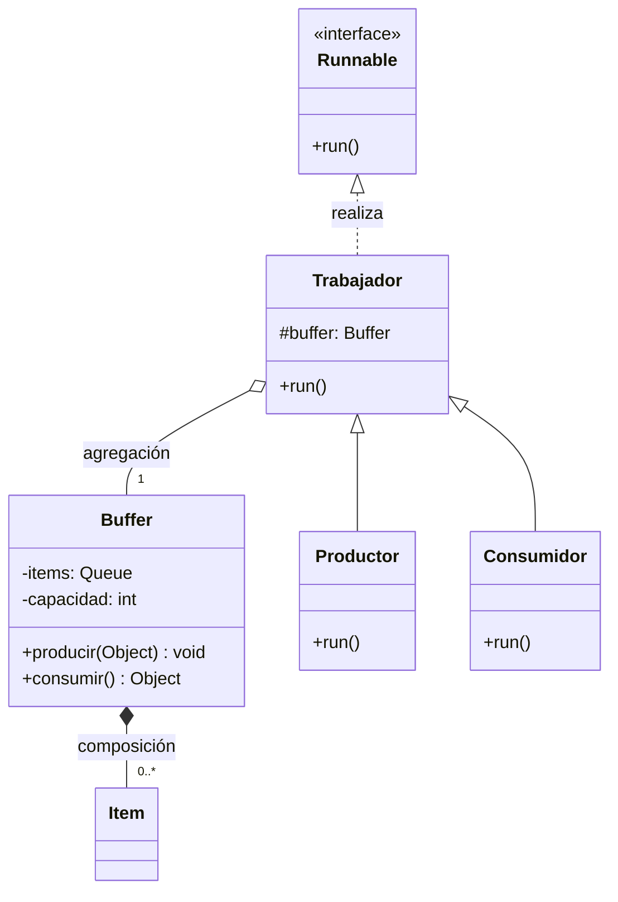
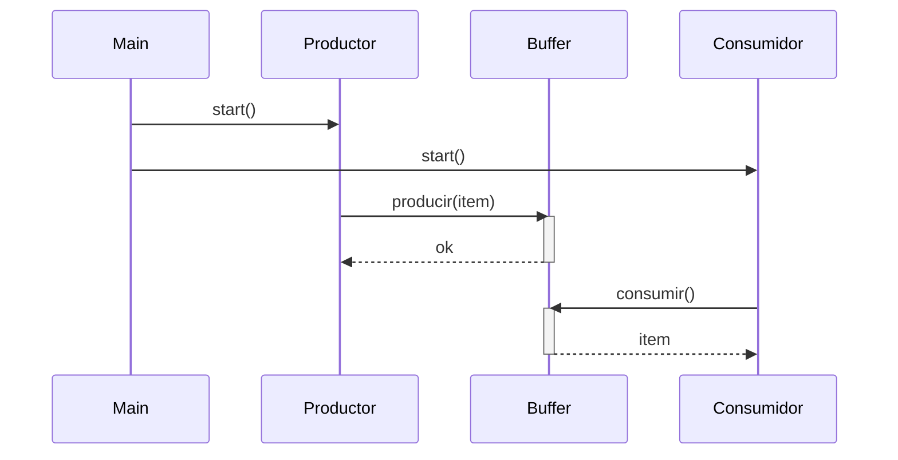
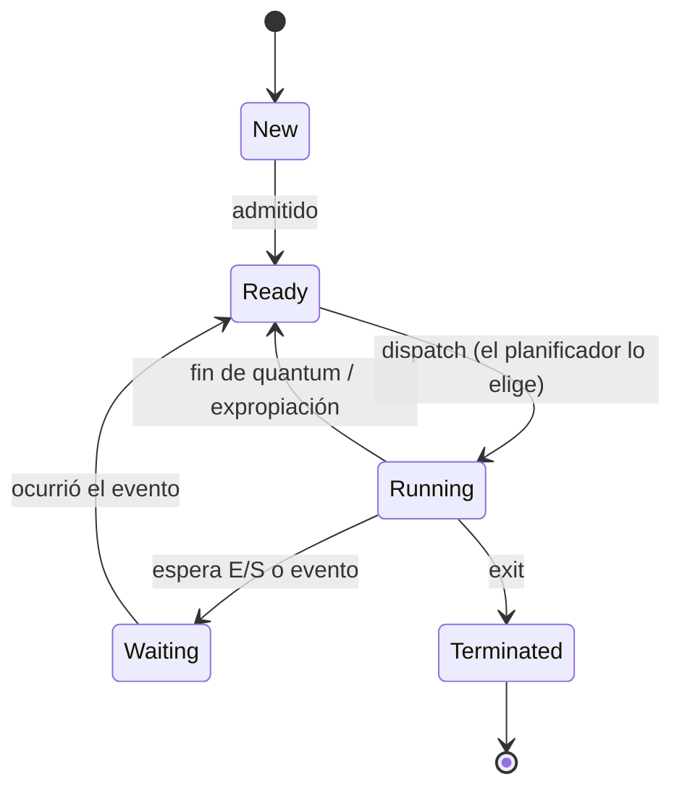
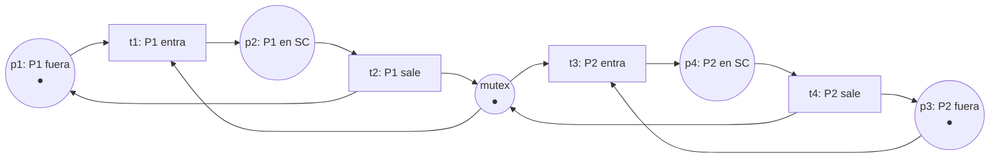
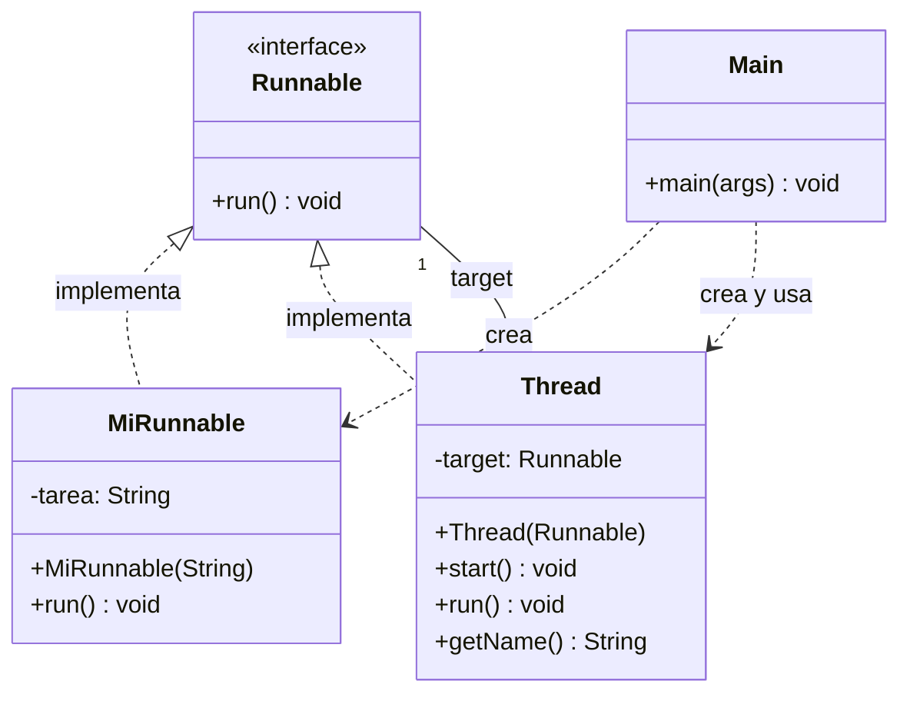
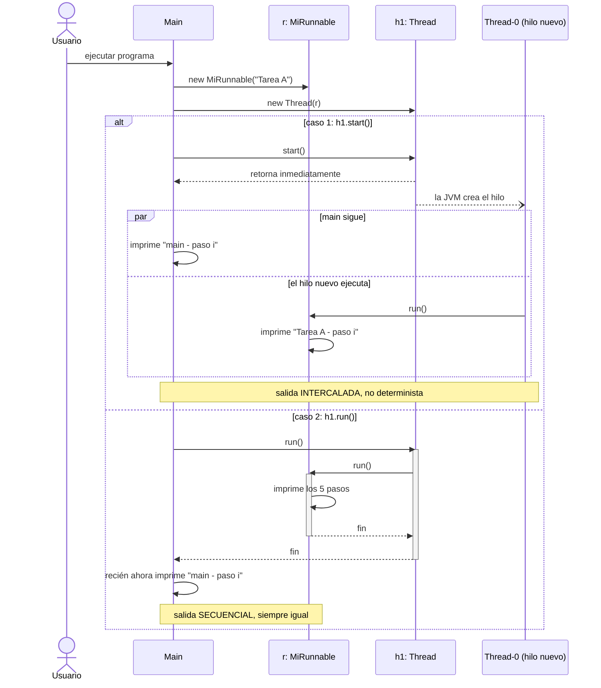
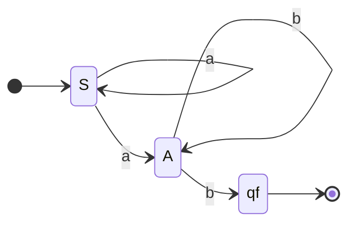
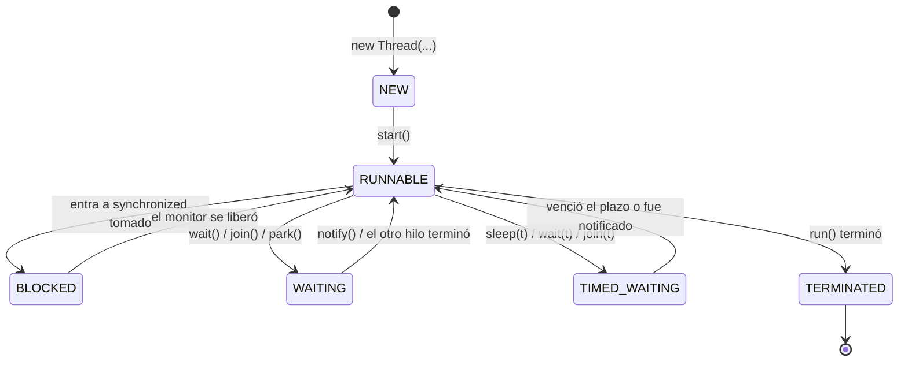

-
# Java — Conceptos Básicos

###### **Modificadores de acceso**
Java tiene **cuatro** niveles, no tres: las filminas omiten el Package-Private (el que queda cuando no escribís ningún modificador).

| Modificador                           | Misma clase | Mismo paquete | Subclase (otro paquete) | Cualquiera |
| ------------------------------------- | ----------- | ------------- | ----------------------- | ---------- |
| `private`                             | ✔           | ✗             | ✗                       | ✗          |
| *(sin modificador)* — package-private | ✔           | ✔             | ✗                       | ✗          |
| `protected`                           | ✔           | ✔             | ✔                       | ✗          |
| `public`                              | ✔           | ✔             | ✔                       | ✔          |

Detalle fino: **`protected` también da acceso a todo el paquete**, no solo a las subclases. Y en una subclase de otro paquete el acceso es solo a través de referencias del tipo de la subclase, no de la superclase.

###### **`static` y `final`**

```java
public class Contador {
    static int instancias;              // pertenece a la CLASE, no a la instancia
    static final int MAX = 100;         // constante: static + final, en MAYUSCULAS
    private final int id;               // final de instancia: se fija en el constructor

    static { instancias = 0; }          // bloque de inicialización estática

    public Contador(int id) { this.id = id; instancias++; }
    public static int getInstancias() { return instancias; }  // se usa sin instanciar
}
// final también aplica a métodos (no se sobrescriben) y a clases (no se heredan)
```

Dos cosas que importan para la materia:
- Un campo `static` es **estado compartido por todos los hilos**, la primera fuente de condiciones de carrera. `instancias++` del ejemplo no es atómico: son tres operaciones (leer, incrementar, escribir).
- Un campo `final` correctamente inicializado se ve **completo** desde otros hilos sin sincronización: es la base de usar objetos inmutables para evitar locks.

###### **Clases abstractas e interfaces**

```java
public abstract class Tarea {
    protected String nombre;
    public abstract void ejecutar();                    // sin cuerpo: la subclase DEBE implementarlo
    public void log() { System.out.println(nombre); }   // sí puede implementar métodos
}

public interface Reiniciable {
    int LIMITE = 3;                                     // implícitamente public static final
    void reiniciar();                                   // implícitamente public abstract
    default boolean puedeReiniciar() { return true; }   // Java 8+
    static Reiniciable nula() { return () -> {}; }      // Java 8+
}
```

|                                 | Clase abstracta                          | Interfaz                                                  |
| ------------------------------- | ---------------------------------------- | --------------------------------------------------------- |
| Estado (atributos de instancia) | Sí                                       | No, solo constantes                                       |
| Constructor                     | Sí                                       | No                                                        |
| Herencia múltiple               | No (`extends` una sola)                  | Sí (`implements` varias)                                  |
| Métodos con cuerpo              | Sí, siempre                              | `default` y `static` desde Java 8, `private` desde Java 9 |
| Para qué                        | Compartir implementación entre parientes | Unificar clases sin parentesco / definir un contrato      |

Eso resuelve el "() en Java 9 cambia" de la filmina. Criterio práctico: preferir interfaces salvo que necesites compartir estado o código.
###### **JavaDoc**

```java
/**
 * Consume un elemento del buffer, bloqueando si está vacío.
 * @param timeout milisegundos máximos de espera
 * @return el elemento consumido
 * @throws InterruptedException si el hilo es interrumpido mientras espera
 * @see Buffer#producir(Object)
 */
public Object consumir(long timeout) throws InterruptedException { ... }
```

Se genera con `javadoc -d docs src/*.java`. La API completa está en https://docs.oracle.com/javase/8/docs/api/

###### **Versiones del JDK**
La tabla de la filmina tiene las fechas desalineadas respecto de las versiones. Las LTS ordenadas:

| Versión      | Fecha           | Qué aporta                                             | Relevancia para concurrencia                                         |
| ------------ | --------------- | ------------------------------------------------------ | -------------------------------------------------------------------- |
| **8 (LTS)**  | Marzo 2014      | Lambdas, Streams API, *default methods*, Date/Time API | Streams **paralelos**, `CompletableFuture`                           |
| **11 (LTS)** | Septiembre 2018 | HTTP Client, `var` en lambdas, Epsilon GC              | Cliente HTTP asincrónico                                             |
| **17 (LTS)** | Septiembre 2021 | Sealed classes, pattern matching en `switch`, Records  | Records: inmutables por defecto                                      |
| **21 (LTS)** | Septiembre 2023 | Scoped Values, Sequenced Collections                   | **Virtual Threads** (JEP 444) y **Structured Concurrency** (JEP 453) |

###### **Dónde reaparece todo esto en la materia**
- `Runnable` y `Callable<V>` son interfaces funcionales, por eso se instancian con lambdas: 
  `new Thread(() -> tarea()).start()`.
- Implementar `Runnable` es preferible a heredar de `Thread`: `extends` gasta la única herencia disponible y acopla la tarea con el mecanismo que la ejecuta.
- `final` + sin setters = objeto inmutable = *thread-safe* gratis, sin `synchronized`.
- `static` = memoria compartida entre hilos = sección crítica en potencia.

# Modelado de un sistema con diagramas UML

UML es un lenguaje gráfico de modelado, no una metodología: sirve para visualizar, especificar, construir y documentar un sistema de software.

| Estructurales (vista estática)                                                     | De interacción y comportamiento (vista dinámica)                                     |
| ---------------------------------------------------------------------------------- | ------------------------------------------------------------------------------------ |
| Clases, Objetos, Componentes, Despliegue, Paquetes, Perfiles, Estructura compuesta | Secuencia, Actividades, Casos de uso, Comunicación, Tiempos, Global de interacciones |

###### **Diagrama de clases**
Tres bandas: 
- Nombre 
- Atributos 
- Operaciones. 
Visibilidad de los miembros: 
- `+` Public 
- `-` Private 
- `#` Protected, 
- `~` Package. 
Multiplicidad: `1..*` uno o muchos, `0..*` cero o muchos, `m` número fijo.

| Relación                  | Notación                         | Semántica                                                     |
| ------------------------- | -------------------------------- | ------------------------------------------------------------- |
| Herencia (generalización) | Línea llena + triángulo vacío    | La subclase hereda atributos y métodos `public` y `protected` |
| Realización               | Línea punteada + triángulo vacío | La clase implementa una interfaz                              |
| Asociación                | Línea llena                      | Objetos que colaboran; relación débil, vidas independientes   |
| Agregación                | Rombo **vacío**                  | "Tiene un", pero la parte sobrevive al todo (ej. cliente)     |
| Composición               | Rombo **lleno**                  | La vida de la parte está atada a la del todo (ej. cuentas)    |
| Dependencia / uso         | Flecha punteada                  | Una clase instancia o usa puntualmente a otra                 |



###### **Diagrama de secuencia**
Muestra cómo un grupo de objetos se comunica a lo largo del tiempo; el tiempo avanza de arriba hacia abajo. Se modela uno por caso de uso.

| Elemento                     | Notación                            | Qué representa                                       |
| ---------------------------- | ----------------------------------- | ---------------------------------------------------- |
| Línea de vida                | Línea vertical punteada             | Un participante durante la interacción               |
| Actor                        | Monigote al tope de la línea        | Participante externo al sistema                      |
| Ocurrencia de ejecución      | Rectángulo sombreado sobre la línea | Período en que el participante ejecuta una operación |
| Mensaje sincrónico           | Flecha llena, punta rellena         | Llamada donde el emisor **espera** la respuesta      |
| Mensaje asincrónico          | Flecha llena, punta abierta         | El emisor sigue sin esperar: **arranque de un hilo** |
| Mensaje de retorno           | Flecha punteada                     | Valor devuelto por la llamada                        |
| Mensaje a sí mismo           | Flecha que vuelve a la misma línea  | Llamada a un método propio                           |
| Mensaje de creación          | Flecha a un objeto que nace ahí     | Debe ser el primer mensaje que ese objeto recibe     |
| Evento de destrucción        | `X` al pie de la línea              | El objeto fue eliminado o ya no es accesible         |
| Mensaje perdido / encontrado | Flecha hacia / desde un círculo     | Participante no especificado                         |

Si hay demora entre el envío y la atención, la flecha se dibuja oblicua.



###### **Fragmentos combinados**
Rectángulo con un operador de interacción en la esquina y uno o más operandos separados por línea punteada. Cada operando puede llevar una guarda: expresión booleana entre corchetes que cubre la línea de vida (*interaction constraint*, UML 2.4). Si el operando no tiene guarda, se asume verdadera.

| Operador              | Significado                                                                                                        |
| --------------------- | ------------------------------------------------------------------------------------------------------------------ |
| `alt`                 | Alternativas: se ejecuta **solo uno** de los operandos, el de guarda verdadera                                     |
| `opt`                 | Opción: el único operando ocurre o no ocurre nada (equivale a un `alt` con la otra rama vacía)                     |
| `loop`                | Iteración; admite límites `loop(min, max)` y guarda. Sin límites, bucle potencialmente infinito                    |
| `break`               | Escenario excepcional: si la guarda es verdadera se ejecuta y se **ignora el resto** del fragmento que lo encierra |
| `par`                 | Ejecución paralela: los operandos se **intercalan de cualquier forma**, respetando el orden interno de cada uno    |
| `strict`              | Secuencia estricta de los operandos del primer nivel: la coordenada vertical importa en todo el fragmento          |
| `seq`                 | Secuencia débil: solo se ordena lo que ocurre sobre una misma línea de vida                                        |
| `critical`            | Región crítica: **atómica**, no puede ser intercalada por otras ocurrencias (ni por un `par`)                      |
| `ignore` / `consider` | Mensajes que se descartan / que sí se tienen en cuenta dentro del fragmento                                        |
| `assert`              | La secuencia de operandos es la **única** válida en ese punto                                                      |
| `neg`                 | Traza inválida: lo que **no** debe ocurrir                                                                         |

###### **Por qué UML sirve acá**
- `par` es la representación gráfica del interleaving: dos operandos concurrentes cuyo entrelazado no está determinado.
- `critical` es literalmente la sección crítica, el fragmento que `par` no puede intercalar. 
  Caso típico de la filmina: `agregar()` y `eliminar()` pueden llamarse en paralelo, pero cada uno debe funcionar como región crítica.
- El mensaje asincrónico modela el `start()` de un hilo; el sincrónico, una llamada común que bloquea al emisor.

# Introducción a la Programación Concurrente

## Historia y motivación

###### **Dijkstra: los hitos que fundan la materia**
Casi todo el vocabulario de la asignatura sale de un solo autor. Dijkstra recibió el Premio Turing de la ACM en 1972 por sus contribuciones a la "ciencia y arte" de los lenguajes de programación, y sus aportes atraviesan diseño de algoritmos, lenguajes, sistemas operativos, procesamiento distribuido y verificación formal.

| Año     | Aporte                                                                                                    | Por qué importa acá                                                   |
| ------- | --------------------------------------------------------------------------------------------------------- | --------------------------------------------------------------------- |
| 1960    | ALGOL 60: escribió el primer compilador                                                                   | Segundo lenguaje de alto nivel de la historia                         |
| 1965    | Documento de una página que plantea el problema de la exclusión mutua para $n$ procesos y da una solución | Introduce la noción hoy estándar de sección crítica                   |
| 1965-68 | Sistema operativo THE, organizado en capas identificables                                                 | Primer SO diseñado por niveles de abstracción                         |
| 1968    | *Cooperating Sequential Processes*, ensayo de 70 páginas                                                  | Origina el campo de la programación concurrente                       |
| 1968    | El semáforo                                                                                               | Primer mecanismo de sincronización entre procesos concurrentes        |
| 1968    | Identifica el problema del Deadlock y propone el *algoritmo del banquero*                                 | Prevención de interbloqueo por asignación segura de recursos          |
| 1971    | Problema de los filósofos comensales                                                                      | Ilustra el interbloqueo; abre la línea que termina en el monitor      |
| 1974    | Sistemas autoestabilizadores con control distribuido                                                      | Origen de un enfoque central de la tolerancia a fallas                |
| 1976    | *A Discipline of Programming*                                                                             | Desarrollo sistemático de programas junto con su prueba de corrección |

Su método de trabajo es parte del legado: escribía a máquina o a mano, numeraba consecutivamente sus manuscritos y los hacía circular entre colegas en vez de publicarlos en revistas. Su idea de fondo, sostenida en la entrevista de 1985 que cita la filmina, es que pensar primero sale más barato que codificar rápido: el costo desmedido del software viene de apurarse a escribir código.

###### **El problema de la corrección del software**
Garantizar que el software que construimos es correcto siempre es deseable, pero en algunos dominios es directamente crucial: equipamiento médico, control de vehículos, control de procesos industriales, aplicaciones financieras. Son los llamados sistemas críticos: aquellos cuya falla puede provocar pérdida de vidas, catástrofes ecológicas o pérdidas financieras enormes.

Las técnicas de la materia (modelado, verificación, Model checking) apuntan justamente a los sistemas críticos con comportamiento reactivo, concurrente y/o de tiempo real.

| Caso                                                            | Año     | Causa                                                                                                                    |
| --------------------------------------------------------------- | ------- | ------------------------------------------------------------------------------------------------------------------------ |
| Pentium **FDIV**                                                | 1994    | Tabla de división incompleta en el hardware                                                                              |
| **Therac-25**                                                   | 1985-87 | Software de radioterapia: seis personas sobreexpuestas a radiación (condición de carrera entre la interfaz y el control) |
| **Patriot Missile**                                             | 1991    | Error de redondeo acumulado en el reloj del sistema de control                                                           |
| **Ariane 5**                                                    | 1996    | Conversión de punto flotante de 64 bits a entero de 16 bits: **overflow aritmético**                                     |
| **Mars Climate Orbiter**                                        | 1999    | Un módulo usaba sistema imperial y otro sistema métrico                                                                  |
| **HMS Sheffield**, **Airbus A320**, voto electrónico en Florida | varios  | Identificación de amigo/enemigo, software de control, integridad y confidencialidad                                      |

El punto de la lista no es el anecdotario: en varios de estos casos el error no era detectable con testing convencional porque dependía de una combinación puntual de datos o de tiempos.

###### **Límites del testing y de la simulación**
Tanto el testing como la simulación son experimentos previos al uso masivo: se le dan entradas al software y se estudia su **comportamiento** en esos casos. De ahí la frase de Dijkstra que resume el problema: 

>*El testing puede confirmar la presencia de errores, pero nunca garantizar su ausencia*.

La alternativa es la verificación, que sí puede hacerlo en teoría. Pero la verificación automática tiene límites duros: decidir si un programa cualquiera termina no es computable (problema de la parada). La salida práctica es restringir el problema — si acotamos las propiedades que queremos verificar, ciertas tareas sí pueden verificarse automáticamente. **Model checking** es exactamente eso, y se estudia más adelante en la materia.

## El enfoque de modelar

###### **Por qué modelar**
Razonar directamente sobre el código concurrente es inviable. La estrategia es construir un **modelo**: una representación abstracta del programa que conserva lo que queremos analizar y descarta el resto.

> Abstracción: aislar conceptualmente una propiedad o función concreta de un objeto, ignorando sus otras propiedades.

Los modelos de la materia representan el comportamiento **verdadero** de programas concurrentes escritos en Java, pero dejan afuera la representación de datos, la asignación de recursos y la interacción con el usuario, para concentrarse solo en la concurrencia. Sobre ese modelo se verifican dos familias de propiedades:

- **Seguridad** (*safety*): nada malo ocurre nunca. Ej.: nunca hay dos procesos en la sección crítica, nunca se viola un invariante.
- **Progreso** (*liveness*): algo bueno termina ocurriendo. Ej.: todo proceso que pide el recurso eventualmente lo obtiene (ausencia de inanición).

La ventaja de tener un modelo formal es que la comprobación puede ser **exhaustiva y mecánica**: se recorren todas las secuencias posibles de eventos y acciones, incluyendo las que ningún test hubiera generado.

###### **Máquinas de estados finitos y Redes de Petri**
Las **FSM** son el primer formalismo: semántica intuitiva, representación gráfica simple, propiedades matemáticas bien definidas que permiten el análisis formal, y ya conocidas por cualquiera que haya hecho diseño orientado a objetos o circuitos digitales. Su límite es el tamaño: la representación gráfica restringe seriamente la complejidad de los problemas abordables, porque el grafo explota.

Por eso la materia usa **Redes de Petri**, que expresan concurrencia de forma compacta. Ambas pertenecen a la familia de las álgebras de procesos, junto con **CSP**, **CCS**, **ACP** y **LOTOS**: formalismos que se concentran en los eventos en los que cada proceso participa y en los patrones de ocurrencia que siguen.

###### **Sistemas reactivos vs transformacionales**

| Sistema transformacional (funcional)              | Sistema reactivo                                                    |
| ------------------------------------------------- | ------------------------------------------------------------------- |
| Recibe entradas, computa una salida y **termina** | Interactúa **permanentemente** con el ambiente y con otros procesos |
| La corrección es una relación entrada/salida      | En general **no computa un resultado** y no se espera que termine   |
| Ej.: un compilador, un cálculo científico         | Ej.: sistemas operativos, software de control, hardware, servidores |

La programación concurrente casi siempre cae del lado reactivo, y eso cambia qué significa "correcto": ya no alcanza con verificar el resultado final, hay que razonar sobre secuencias infinitas de interacciones.

## Semántica: transiciones de estado e interleaving

###### **Sistemas de transición de estados**
La semántica típica de un programa concurrente se da con un sistema de transición de estados: un grafo dirigido donde

- Los **nodos** son los estados del sistema (posiblemente infinitos),
- Las **aristas** son las transiciones **atómicas** de estado a estado, dadas por las sentencias del programa,
- Hay un nodo distinguido: el **estado inicial**.

Un estado no es solo el valor de las variables globales. Incluye también dos variables implícitas: los program counters de cada proceso, que indican en qué sentencia está parado cada uno. Por eso, con dos variables booleanas `y1`, `y2`, un contador `in_critical` y dos procesos, el espacio de estados es el producto de todos los valores posibles por todas las posiciones posibles de los dos pc.

Cada sentencia atómica define un conjunto de transiciones. `in_critical++`, por ejemplo, relaciona cada estado con aquel en el que `y1` e `y2` no cambian, `in_critical` se incrementa en uno, y el pc del proceso que la ejecutó avanza.

###### **Interleaving**
Este es el concepto central del modelo computacional de la materia:

> Los procesos concurrentes se ejecutan intercalando las acciones atómicas que los componen.

A eso se lo llama interleaving. Dos consecuencias inmediatas:

1. El orden en que se ejecutan las acciones atómicas no puede decidirse en general. No lo controla el programador ni es reproducible.
2. Un mismo par de procesos puede tener distintas ejecuciones en corridas distintas, por el no determinismo en la elección de la próxima acción atómica.

Una ejecución es una secuencia de estados alcanzables desde el inicial siguiendo transiciones. El conjunto de todas las ejecuciones posibles es el comportamiento del programa. Por eso, dada una secuencia de estados cualquiera, la pregunta "¿es una ejecución válida?" se responde verificando que cada paso corresponda a una transición atómica de algún proceso: si entre dos estados consecutivos cambian dos variables que pertenecen a sentencias distintas, esa traza es imposible.

###### **Por qué razonar sobre esto es tan difícil**
- Distintos interleavings llevan a distintos resultados, y todos son ejecuciones legítimas del mismo programa.
- La cantidad de interleavings posibles es enorme: el espacio de estados crece exponencialmente con el número de componentes y de variables (*state explosion*).
- Por eso el testing casi no da confianza: en el ejemplo del overflow de la filmina, es prácticamente imposible construir el test que produzca justo la intercalación que rompe.

```java
// Ejemplo mínimo: dos hilos ejecutando el mismo incremento
int contador = 0;          // compartido

// Cada "contador++" NO es atómico: son tres acciones
//   1. leer contador     (registro <- memoria)
//   2. incrementar       (registro <- registro + 1)
//   3. escribir contador (memoria  <- registro)

// Interleaving posible con dos hilos, partiendo de contador = 0:
//   H1: leer(0)
//   H2: leer(0)          <- todavía ve 0
//   H1: incrementar -> 1, escribir(1)
//   H2: incrementar -> 1, escribir(1)
// Resultado: contador == 1, cuando debería valer 2. Y es una ejecución válida.
```

Este es el mismo fenómeno que en la sección de Java aparece como "`static` es estado compartido": lo que allá era una advertencia, acá es la definición formal del problema.

## Procesos

###### **Definición**
> Un proceso es una unidad de actividad que se caracteriza por la ejecución de una secuencia de instrucciones, un estado actual, y un conjunto de recursos del sistema asociados.

Informalmente, un proceso es un programa en ejecución. La diferencia entre programa y proceso es que el programa es una entidad estática (el archivo, el código) mientras que el proceso es una actividad que contiene el programa, sus entradas/salidas y su estado (Stallings, *Operating Systems*, cap. 3.1).

- Un proceso simple tiene un hilo de ejecución.
- Al ejecutar un programa, el SO inicia un proceso, que a su vez puede crear otros (proceso padre / proceso hijo); una vez creado el hijo, padre e hijo transcurren de manera concurrente.
- **Procesos cooperantes**: interactúan entre sí. **Procesos independientes**: no requieren información de otros.
- El SO es el que provee los servicios necesarios para que el usuario pueda ejecutar procesos, en sistemas de tiempo compartido o **SMP**.

###### **Estados de un proceso**
El modelo mínimo tiene **3 estados**: *Listo* (puede pasar a ejecución), *En ejecución* (tiene el procesador) y *Bloqueado* (espera la respuesta de otro proceso o de una E/S). El modelo estándar de los sistemas operativos usa 5 estados:

| Estado                            | Significado                                                               |
| --------------------------------- | ------------------------------------------------------------------------- |
| **New** (nonato)                  | El proceso está siendo creado: existe pero el SO todavía no lo admitió    |
| **Ready** (preparado)             | Listo para ejecutar, esperando que se libere la CPU                       |
| **Running** (activo / ejecución)  | Tiene el control del procesador. En un monoprocesador, solo uno a la vez  |
| **Waiting / Blocked** (bloqueado) | Espera un evento: fin de una E/S, una señal de sincronización, un mensaje |
| **Terminated** (muerto)           | Terminó su ejecución, o el SO detectó un error fatal                      |



Hay que agregar además la distinción entre procesos activos (ejecución, preparado, bloqueado: compiten por el procesador o están en condiciones de hacerlo) e inactivos, que son los suspendidos y sacados de memoria principal:

- **Suspendido bloqueado**: fue suspendido esperando un evento, y las causas de su bloqueo siguen vigentes.
- **Suspendido programado** (*suspended ready*): fue suspendido, pero ya no tiene causa para estar bloqueado; podría ejecutar si volviera a memoria.

###### **Bloque de Control de Proceso (BCP / PCB)**
Es el registro donde el SO agrupa toda la información que necesita saber de un proceso. Es lo que se guarda y se restaura en cada cambio de contexto, y es lo que hace que un proceso sea caro comparado con un hilo (Stallings, cap. 3.3).

| Campo                                 | Para qué                                       |
| ------------------------------------- | ---------------------------------------------- |
| **PID** (Process Identificator)       | Identifica el proceso ante el SO               |
| **Estado**                            | Listo, en espera, bloqueado, etc.              |
| **Contador de programa**              | Dirección de la próxima instrucción a ejecutar |
| **Valores de registros de CPU**       | Se salvan y restauran en el cambio de contexto |
| **Espacio de direcciones de memoria** | Qué memoria le pertenece                       |
| **Prioridad**                         | Si el algoritmo de planificación la usa        |
| **Lista de recursos asignados**       | Descriptores de archivos, sockets abiertos     |
| **Estadísticas**                      | Tiempo de CPU consumido, etc.                  |
| **Datos del propietario y permisos**  | Control de acceso                              |
| **Señales pendientes**                | Almacenadas en un mapa de bits                 |

La lista es indicativa: cada SO agrega lo suyo.

## Hilos
###### **Qué es un hilo y qué comparte**
Un hilo permite que una misma aplicación realice varias tareas a la vez. Los hilos de un proceso comparten:

- El espacio de memoria (por lo tanto, todas las variables de instancia y estáticas).
- Los archivos abiertos.
- La autenticación y los permisos del proceso.

Y lo que es propio de cada hilo es:
- El contador de programa.
- La pila de ejecución.
- El estado de la CPU (el valor de los registros). 

Al conjunto de hilos más los recursos que comparten se lo llama proceso, y el proceso sigue vivo mientras al menos uno de sus hilos siga activo.

La consecuencia directa —y la razón de ser de toda la materia— es que cualquier hilo puede modificar los recursos compartidos, y cuando lo hace los demás ven el dato modificado inmediatamente. Ahí aparece la necesidad de exclusión mutua.

###### **Proceso vs hilo**

|                       | Proceso                                                        | Hilo                                                                            |
| --------------------- | -------------------------------------------------------------- | ------------------------------------------------------------------------------- |
| Independencia         | Generalmente independientes                                    | Comparten recursos de forma directa                                             |
| Información de estado | Mucha (BCP completo)                                           | Poca (contexto + pila)                                                          |
| Interacción           | Solo por mecanismos que provee el SO                           | Directa, por memoria compartida                                                 |
| Costo de creación     | Alto                                                           | Bajo — del orden de **10x** más barato según las mediciones que cita la filmina |
| Costo de terminación  | Hay que liberar el BCP entero                                  | Solo su contexto y su pila                                                      |
| Cambio de contexto    | Caro: el *dispatcher* genera **overhead**                      | Casi despreciable: no cambia el espacio de direcciones                          |
| Comunicación          | Requiere intervenir el **núcleo** (protección + transferencia) | **No requiere** invocar al núcleo                                               |

Por eso Windows y Linux tienen fama de hilos "baratos" y procesos "costosos", y por eso una aplicación que se descompone en unidades de ejecución relacionadas conviene implementarla como una colección de hilos y no de procesos separados (Stallings, cap. 4.1).

###### **Estados de un hilo**
Los mismos tres estados básicos: 
- Ejecución.
- Listo.
- Bloqueado.
Un hilo no tiene los estados de suspensión, porque suspender es una operación a nivel de proceso. 

Las transiciones:

1. **Creación**: al crearse un proceso se crea un hilo para él; ese hilo puede crear otros dentro del mismo proceso. El hilo nuevo obtiene su propio contador, registros y espacio de pila, y pasa a la cola de listos.
2. **Bloqueo**: cuando debe esperar un suceso, salva sus registros de usuario, contador de programa y punteros de pila, y el procesador pasa a ejecutar otro hilo de la cola de listos.
3. **Desbloqueo**: ocurrido el suceso, el hilo vuelve a la cola de **Listos** — no directamente a ejecución.
4. **Terminación**: se liberan su contexto y su pila.

Cuando un hilo está en ejecución tiene acceso a todos los recursos asignados a la tarea.

## Concurrencia: principios generales

###### **Dónde aparece la concurrencia**

| Escenario                     | Definición                                                                         |
| ----------------------------- | ---------------------------------------------------------------------------------- |
| **Multiprogramación**         | Gestión de varios procesos dentro de un sistema **mono-procesador**                |
| **Multiprocesamiento**        | Gestión de varios procesos dentro de un sistema **multiprocesador**                |
| **Procesamiento distribuido** | Gestión de varios procesos ejecutándose en **múltiples computadores distribuidos** |

La concurrencia es fundamental en las tres, y los problemas se producen incluso cuando hay un único procesador: en un sistema multiprogramado los procesos se intercalan en el tiempo aparentando ejecución simultánea. No hay procesamiento paralelo real y hay sobrecarga por los intercambios, pero la ejecución intercalada igual mejora la eficiencia del procesamiento y la estructuración de los programas.

Los tres contextos donde surge:

- **Múltiples aplicaciones**: la multiprogramación nació para compartir dinámicamente el tiempo de procesador entre varias aplicaciones activas.
- **Aplicaciones estructuradas**: como extensión del diseño modular y la programación orientada a objetos, una aplicación puede implementarse eficazmente como un conjunto de hilos concurrentes.
- **Estructura del sistema operativo**: los mismos beneficios valen para el SO, que suele estar implementado como un conjunto de procesos o hilos.

###### **Cuestiones de diseño y dificultades**
La concurrencia abarca la comunicación entre procesos, la compartición y competencia por los recursos, la sincronización de la ejecución y la asignación del tiempo de procesador. Las dificultades surgen porque la velocidad de ejecución de los procesos no puede predecirse: depende de la actividad de los demás procesos y de cómo el SO trate las interrupciones. De ahí:

- Compartir recursos globales es riesgoso.
- Al SO le resulta difícil gestionar la asignación óptima de recursos.
- Hay que seguir a los procesos activos, asignar y retirar recursos, y proteger datos y recursos físicos.
- **El principio que ordena todo**: los resultados de un proceso deben ser independientes de la velocidad a la que se ejecuten los otros procesos concurrentes. Si el resultado cambia según quién corra más rápido, el programa está mal.

## Interacción entre procesos

###### **Los tres niveles de conocimiento**
Los procesos interactúan según cuánto sepan de la existencia de los demás (Stallings, cap. 5.1):

| Nivel de conocimiento                                                                    | Relación                           | Problemas de control                                              |
| ---------------------------------------------------------------------------------------- | ---------------------------------- | ----------------------------------------------------------------- |
| **1. No se conocen entre sí**                                                            | **Competencia**                    | Exclusión mutua, deadlock (recurso reutilizable), inanición       |
| **2. Conocimiento indirecto**: no se conocen por identificador, pero comparten un objeto | **Cooperación por compartimiento** | Exclusión mutua, deadlock, inanición, **coherencia de los datos** |
| **3. Conocimiento directo**: se comunican por identificador de proceso                   | **Cooperación por comunicación**   | Deadlock (mensaje que no llega), inanición                        |

###### **Competencia por los recursos**
Dos o más procesos entran en conflicto cuando necesitan el mismo recurso durante su ejecución, y cada uno debe dejar el recurso tal como estaba. La ejecución de uno influye en el comportamiento del otro: si ambos piden el recurso, el SO se lo asigna a uno y el otro espera.

Los recursos no compartibles se llaman recursos críticos, y la parte del programa que los usa es la sección crítica. Solo un proceso puede estar en su sección crítica a la vez. Tres problemas de control a resolver:

- **Exclusión mutua**: garantizar el acceso de a uno.
- **Deadlock**: hacer cumplir la exclusión mutua **puede provocar interbloqueo** (dos procesos que ya tomaron un recurso cada uno y piden el del otro).
- **Inanición**: si P1 posee el recurso, lo libera y se lo concede a P2, y el SO alterna entre P1 y P2, se le puede negar indefinidamente el acceso a P3.

###### **Cooperación**
En la cooperación por compartimiento los procesos acceden a variables o archivos comunes sin conocerse explícitamente; deben cooperar para que los datos compartidos se gestionen correctamente, y los mecanismos de control tienen que garantizar la integridad de esos datos. En la cooperación por comunicación la interacción es por mensajes, cuyas primitivas de envío y recepción las provee el lenguaje o el núcleo del SO; la comunicación sincroniza y coordina las actividades.

###### **Problemas comunes de los programas concurrentes**

| Problema                                               | Qué pasa                                                                                                                                        |
| ------------------------------------------------------ | ----------------------------------------------------------------------------------------------------------------------------------------------- |
| **Violación de propiedades universales (invariantes)** | Una condición que debería valer siempre deja de valer en algún interleaving (ej.: `in_critical <= 1`)                                           |
| **Deadlock** (interbloqueo)                            | Dos o más procesos **esperan mutuamente** el avance del otro. Nadie ejecuta, nadie avanza                                                       |
| **Starvation** (inanición)                             | Uno o más procesos quedan esperando **indefinidamente** un mensaje o la liberación de un recurso, aunque el sistema en conjunto sí avanza       |
| **Livelock**                                           | Los procesos **no se bloquean**: siguen ejecutando y respondiendo continuamente a los cambios de estado de los otros, pero **ninguno progresa** |
| **Uso no exclusivo de recursos compartidos**           | Falta de exclusión mutua: dos procesos entran a la sección crítica y corrompen el dato                                                          |

La diferencia fina entre **deadlock** y **livelock**: en el deadlock los procesos están detenidos (bloqueados, sin consumir CPU); en el livelock están **activos, consumiendo CPU, y aun así no avanzan** — es el equivalente a dos personas que se cruzan en un pasillo y se corren para el mismo lado una y otra vez.

## Requisitos para la exclusión mutua

Cualquier solución al problema de la sección crítica —sea por software, por hardware, con semáforos o con monitores— tiene que cumplir los seis requisitos (Stallings, cap. 5.2):

1. **Exclusión mutua efectiva**: de todos los procesos que tienen secciones críticas por el mismo recurso compartido, solo uno puede tener permiso para entrar en un momento dado.
2. **No interferencia desde la sección no crítica**: un proceso que se detiene o se interrumpe fuera de su sección crítica debe hacerlo sin interferir con los demás. Si un proceso muere en su código normal, no puede dejar bloqueado a nadie.
3. **Sin demora indefinida**: un proceso no puede pedir acceso a su sección crítica y ser demorado para siempre. No se permite ni interbloqueo ni inanición.
4. **Entrada inmediata si está libre**: si ningún proceso está en su sección crítica, cualquiera que solicite entrar debe poder hacerlo sin demora.
5. **Sin suposiciones sobre velocidad ni cantidad de procesadores**: la solución debe funcionar igual si un proceso corre mil veces más rápido que el otro, y con uno o con muchos procesadores.
6. **Permanencia finita**: un proceso permanece en su sección crítica solo por un tiempo finito. Es responsabilidad del programador, no del mecanismo.

Los requisitos 3, 4 y 6 son propiedades de progreso; el 1 es la propiedad de seguridad. Los requisitos 2 y 5 son los que descartan las soluciones "que funcionan casi siempre".

## Sincronización por pasaje de mensajes

Además de la memoria compartida, el otro gran mecanismo de interacción es el pasaje de mensajes. La comunicación de un mensaje entre dos procesos implica de por sí cierto nivel de sincronización: el receptor **no puede** recibir un mensaje hasta que otro proceso lo haya enviado. Lo que hay que definir es qué le pasa a cada proceso después de ejecutar las primitivas:

- **`send`**: el emisor **se bloquea** hasta que el mensaje se recibe, o **no se bloquea** y sigue.
- **`receive`**: si ya había un mensaje, lo recibe y continúa. Si no hay ninguno esperando, o bien se bloquea hasta que llegue, o bien continúa abandonando el intento de recepción.

| Combinación                                       | Nombre / uso                                                                                             |
| ------------------------------------------------- | -------------------------------------------------------------------------------------------------------- |
| **Envío bloqueante + recepción bloqueante**       | **Rendezvous**: ambos se bloquean hasta que el mensaje llega. Sincronización fuerte entre las dos partes |
| **Envío no bloqueante + recepción bloqueante**    | La combinación **más útil**: el emisor sigue trabajando, el receptor espera lo que necesita              |
| **Envío no bloqueante + recepción no bloqueante** | Nadie espera a nadie                                                                                     |

Un sistema real implementa solo una o dos de las tres. El `send` no bloqueante es lo más natural para programación concurrente, pero tiene un riesgo: un error puede llevar a que el proceso genere mensajes repetidamente sin control, consumiendo recursos. Para el `receive`, la versión bloqueante es la más natural, porque en general el proceso que pide un mensaje necesita esa información antes de poder continuar (Stallings, cap. 5.5).

|                      | Memoria compartida                     | Pasaje de mensajes                        |
| -------------------- | -------------------------------------- | ----------------------------------------- |
| Cómo interactúan     | Leen y escriben las mismas variables   | Se envían mensajes explícitos             |
| Qué hay que proteger | La **sección crítica** sobre el dato   | Nada: no hay dato compartido              |
| Sincronización       | Explícita: semáforos, monitores, locks | **Implícita** en el `send`/`receive`      |
| Ámbito natural       | Hilos de un mismo proceso              | Procesos separados, sistemas distribuidos |

## Concurrencia vs paralelismo

No son sinónimos, lo planteamos desde el problema:

- **Sistemas de manejo de eventos** (máquinas expendedoras, telefonía, servidores web, bancos): la concurrencia es inherente al problema. Hay que resolver conflictos inevitables entre solicitudes impredecibles. El paralelismo es parte de la solución: acelera, pero la raíz del problema es la concurrencia.
- **Sistemas de cómputo** (gráficos, visión por computadora, computación científica): la concurrencia no es parte del problema. Se calcula una salida a partir de entradas conocidas de antemano, sin eventos externos. Acá el paralelismo es donde empiezan los problemas: acelera, pero puede introducir errores que antes no existían.

**Programación concurrente**: un sistema concurrente correcto es aquel en el que un conjunto de cómputos avanza colaborativamente, con la secuencia de interacciones o comunicaciones entre ellos coordinada y garantizada, así como el acceso a los recursos compartidos.

**Programación paralela**: forma de cómputo en la que muchas instrucciones se ejecutan simultáneamente, sobre el principio de que un problema grande puede dividirse en problemas más chicos que se resuelven al mismo tiempo.

La síntesis clásica: la concurrencia es una propiedad de la estructura del programa (tareas que podrían ejecutarse en cualquier orden), mientras que el paralelismo es una propiedad de la ejecución (tareas que efectivamente corren al mismo tiempo en distinto hardware). Un programa concurrente en un monoprocesador no es paralelo, y sigue teniendo todos los problemas de la concurrencia (Palma Méndez, *Programación Concurrente*, cap. 1).

## Carl Adam Petri y las redes de Petri

###### **Quién fue**
Matemático e informático alemán (12/07/1926 – 02/07/2010). Inventó las redes de Petri a los 13 años, con sus gráficos y reglas, para describir procesos químicos. En 1941 se enteró del trabajo de Konrad Zuse con máquinas calculadoras a través de su padre, y llegó a construir una pequeña computadora analógica. Su tesis doctoral, *Kommunikation mit Automaten* ("Comunicación con autómatas", 1962), trata entre otras cosas los modelos simultáneos: las *Petri-Netze*.

En su discurso de recepción del Premio Turing, Robin Milner lo señaló como pionero del modelado científico de la concurrencia en sistemas discretos, con un lugar seguro en la raíz de la teoría de la concurrencia. Los dos principios rectores que la filmina rescata:

- **GP1**: La concurrencia debe ser un **punto de partida** del diseño y análisis de sistemas, no algo que se agrega después.
- **GP2**: Un formalismo debe ser consistente con las leyes de la física, sin atajos en el nivel fundamental.

###### **Fundamentos de la red**
Una red de Petri es un grafo dirigido bipartito con dos tipos de nodos, que no pueden conectarse consigo mismos:

| Elemento                | Notación                                       | Qué representa                                              |
| ----------------------- | ---------------------------------------------- | ----------------------------------------------------------- |
| **Lugar** (*place*)     | Círculo                                        | Una condición o estado local (ej.: "el buffer tiene lugar") |
| **Transición**          | Rectángulo o barra                             | Un evento o acción (ej.: "producir un ítem")                |
| **Arco**                | Flecha lugar→transición o transición→lugar     | Relación de entrada/salida, con un peso (por defecto 1)     |
| **Ficha** (*token*)     | Punto dentro de un lugar                       | La condición se cumple; los recursos disponibles            |
| **Marcado** (*marking*) | Vector con la cantidad de fichas de cada lugar | **El estado de la red**. El inicial se llama M₀             |

La dinámica está dada por una sola regla, la **regla de disparo**:

1. Una transición está **habilitada** si **cada uno** de sus lugares de entrada tiene al menos tantas fichas como el peso del arco que los une.
2. Al **dispararse**, la transición **consume** esas fichas de los lugares de entrada y **produce** fichas en los lugares de salida, según el peso de cada arco de salida.
3. El disparo es atómico e instantáneo, y una transición habilitada **puede** dispararse, pero nada obliga a que lo haga: ahí está el no determinismo.

Los fenómenos que se modelan con esos pocos elementos (Diaz, *Petri Nets: Fundamental Models*):

- **Secuencia**: la salida de una transición habilita a la siguiente.
- **Concurrencia**: dos transiciones habilitadas que no comparten lugares de entrada pueden dispararse en cualquier orden, o "a la vez".
- **Conflicto**: dos transiciones habilitadas que **comparten** un lugar de entrada con una sola ficha — disparar una deshabilita a la otra. Es exactamente la competencia por un recurso.
- **Sincronización**: una transición con varios lugares de entrada solo dispara cuando todos tienen ficha (una barrera).
- **Confusión**: mezcla de concurrencia y conflicto, donde el orden de disparo cambia qué conflictos aparecen.

La ventaja sobre las máquinas de estados es la compacidad: el estado global no se dibuja, emerge del marcado. Dos procesos de 10 estados cada uno son 100 estados en una FSM producto, y solo 20 lugares en una red de Petri.

###### **Ejemplo: exclusión mutua con un lugar mutex**
Mermaid no tiene un tipo nativo de red de Petri, así que se dibuja con `flowchart`: círculos `((...))` para lugares, rectángulos `[...]` para transiciones. El lugar `mutex` arranca con **una sola ficha**, y esa ficha es la que garantiza la exclusión mutua: si `t1` la consume, `t3` deja de estar habilitada (conflicto).



Marcado inicial: `M₀ = (p1=1, p2=0, p3=1, p4=0, mutex=1)`. El invariante de seguridad que se puede **probar** sobre esta red es `p2 + p4 + mutex = 1`, de donde se deduce que `p2 + p4 ≤ 1`: **nunca** hay dos procesos en la sección crítica. Eso es verificación, no testing.

# Ejercicio 1 — Threads

###### **Enunciado**
Crear y ejecutar un hilo (*thread*) que tenga asignada la ejecución de un objeto que implementa la interfaz `Runnable`. Sobre ese proyecto:

1. Hacer el **debug**.
2. Describir el resultado de ejecutar primero `h1.start()` y luego `h1.run()`.
3. Repetir el debug con ambas opciones: ¿se nota alguna diferencia?
4. Realizar el **diagrama de clases** y el **diagrama de secuencia** del proyecto.

###### **Código**
Las capturas de código de la filmina son imágenes y no se pueden extraer del PDF, así que esta es la versión reconstruida a partir del enunciado:

```java
public class MiRunnable implements Runnable {
    private final String tarea;

    public MiRunnable(String tarea) { this.tarea = tarea; }

    @Override
    public void run() {
        for (int i = 0; i < 5; i++) {
            System.out.println(tarea + " - paso " + i
                + " - ejecutando en: " + Thread.currentThread().getName());
        }
    }
}
```

```java
public class Main {
    public static void main(String[] args) {
        MiRunnable r = new MiRunnable("Tarea A");
        Thread h1 = new Thread(r);          // el hilo recibe el objeto a ejecutar

        h1.start();                          // <-- caso 1
        // h1.run();                         // <-- caso 2

        for (int i = 0; i < 5; i++) {
            System.out.println("main - paso " + i
                + " - ejecutando en: " + Thread.currentThread().getName());
        }
    }
}
```

###### **`h1.start()` vs `h1.run()`: la respuesta**

| | `h1.start()` | `h1.run()` |
|---|---|---|
| Qué hace | Le pide a la JVM que cree un **hilo nuevo** del SO y que ejecute `run()` **en ese hilo** | Es una **llamada a método común**, como cualquier otra |
| Hilos en ejecución | **Dos**: `main` y `Thread-0` | **Uno**: solo `main` |
| Quién ejecuta `run()` | El hilo nuevo | El hilo `main` |
| Nombre que imprime | `Thread-0` | `main` |
| Orden de la salida | **Intercalado y no determinista**: cambia entre corridas | **Secuencial y siempre igual**: primero los 5 pasos de la tarea, después los 5 de `main` |
| Retorno | Retorna **inmediatamente**; `main` sigue en paralelo | Retorna **cuando `run()` terminó**; `main` estuvo bloqueado mientras tanto |
| Estado del `Thread` | Pasa a *runnable* y luego a *terminated* | El objeto `h1` **nunca arranca**: queda en estado *new* |

El punto del ejercicio: **`run()` no crea concurrencia**. Es el método que contiene el trabajo; `start()` es el que le pide al sistema operativo un hilo donde correrlo. Llamar a `run()` directamente compila, no da error y produce la salida "correcta" — por eso es el error clásico, y por eso el ejercicio lo hace ver en el debugger.

Dos detalles que conviene fijar:
- Llamar `h1.start()` **dos veces** lanza `IllegalThreadStateException`: un `Thread` no se reinicia. Para volver a ejecutar la tarea hay que crear un `Thread` nuevo sobre el mismo `Runnable`.
- El orden de la salida con `start()` **no está garantizado** ni siquiera al principio: `main` puede imprimir todo antes de que el hilo nuevo arranque. Eso **es** el interleaving de la teoría.

###### **Qué se ve en el debug**
- Con **`start()`**: el panel *Threads / Frames* de IntelliJ (o *Debug* en Eclipse) muestra **dos** hilos vivos — `main` y `Thread-0` — y se puede cambiar de uno a otro. Un breakpoint dentro de `run()` detiene al hilo `Thread-0` mientras `main` **sigue corriendo**. La pila de `Thread-0` arranca en `run()`, sin `main` debajo.
- Con **`run()`**: hay un solo hilo. El breakpoint dentro de `run()` detiene a `main`, y la pila de llamadas muestra `main() → run()`, igual que cualquier método.

Esa es la diferencia observable: **la pila de llamadas**. Con `start()` los dos métodos están en pilas **distintas** (cada hilo tiene la suya, como dice la teoría de hilos más arriba); con `run()` están en la **misma** pila.

###### **Diagrama de clases**



###### **Diagrama de secuencia**
Las dos variantes en un solo diagrama, separadas con un fragmento `alt`. En el caso `start()` el mensaje hacia el hilo nuevo es **asincrónico** (`->>` sin retorno inmediato) y `main` sigue trabajando en paralelo; en el caso `run()` es un mensaje **sincrónico** que bloquea a `main` hasta terminar.



# Gramáticas, Lenguajes y Autómatas

## Motivación: por qué este tema está en Programación Concurrente

###### **Sistemas reactivos, otra vez**
La sección de Introducción ya distinguió sistemas transformacionales de reactivos. La filmina de lenguajes agrega el tercer tipo que faltaba, y la diferencia entre los tres está en **quién impone el ritmo**:

| | Transformacional | Interactivo | **Reactivo** |
|---|---|---|---|
| Interacción con el entorno | Ninguna durante el cómputo | Continua | Continua |
| Quién marca el ritmo | Nadie: corre y termina | **El sistema**, a su propio ritmo | **El entorno**, a la velocidad que él determina |
| Salidas | Disponibles al finalizar | Durante la ejecución | Durante la ejecución |
| Terminación | Termina; al terminar su estado ya no importa | Puede no terminar | **Procesos no terminados**, basados en estados |
| Ejemplos | Compilador, cálculo científico | Shell, base de datos, IDE | Embebidos de tiempo real, control, supervisión, procesamiento de señales, protocolos de comunicación, interfaces hombre-máquina |

Los sistemas reactivos interactúan con el entorno para habilitar, aplicar o prevenir cierto comportamiento en él, suelen estar sujetos a requisitos rigurosos de tiempo real y, muy seguido, ejecutan varios procesos en paralelo. Ahí está la conexión: un sistema reactivo es concurrente casi por definición, y para verificarlo hay que modelarlo formalmente. El modelo es un autómata, y el autómata se estudia junto con la gramática que genera el mismo lenguaje.

###### **Arquitectura dirigida por eventos (EDA)**
Es el patrón de arquitectura impulsado por la producción, detección, consumo y reacción a eventos.

Una precisión de vocabulario que la filmina hace explícita: lo que se produce, publica, propaga, detecta o consume es un mensaje de notificación, no el hecho que generó el evento. Se usa "evento" para nombrar a ese mensaje de notificación del estímulo.

- Hay emisores y consumidores de eventos.
- El consumidor es responsable de reaccionar **tan pronto como el evento está presente**. Puede filtrarlo, transformarlo, reenviarlo a otro componente, o directamente reaccionar.
- Una EDA facilita un mayor grado de reacción porque está diseñada para entornos no predecibles y asincrónicos — justamente las dos condiciones que hacen difícil razonar sobre concurrencia.

## Introducción e historia

###### **De la lingüística a los compiladores**
La Teoría de Lenguajes Formales nace en un campo aparentemente lejano de la informática: la lingüística. Los lingüistas de la escuela estructuralista americana habían elaborado en los años 50 ideas informales sobre la gramática universal, entendida como una gramática que caracteriza las propiedades generales de cualquier lenguaje humano.

El primer trabajo que desarrolló teorías formales sobre gramáticas y lenguajes fue de Avram Noam Chomsky (1928-). El concepto de gramática formal se volvió enseguida central para especificar lenguajes de programación: con sus teorías se definió la sintaxis de **ALGOL 60** — el mismo lenguaje cuyo primer compilador escribió Dijkstra, según la sección anterior.

Por el otro lado, la Teoría de Autómatas viene de la ingeniería eléctrica: Claude Elwood Shannon (1916-2001) publicó los trabajos que mostraron cómo aplicar la lógica matemática a los circuitos combinatorios y secuenciales.

Las dos teorías terminan siendo la misma cosa vista de dos maneras: entre ellas se puede establecer una correspondencia que en álgebra se llama isomorfismo. Toda la sección se apoya en eso — cada clase de gramática tiene su clase de autómata.

###### **Dónde se aplica**
Lógica de circuitos secuenciales · teoría de control de sistemas · teoría de la comunicación · arquitectura de computadoras · redes conmutadoras y codificadoras · sistemas evolutivos y autorreproductivos · reconocimiento de patrones · redes neuronales · reconocimiento y procesado de lenguajes de programación · traducción de lenguajes · sistemas reactivos.

## Definiciones previas

###### **Símbolo, alfabeto, cadena**
- **Símbolo**: entidad abstracta que no se define — se deja como axioma. Normalmente son letras ($a, b, \dots, z$), dígitos ($0,1,\dots,9$) u otros caracteres ($+,-,*,/,?$). Un símbolo también puede estar formado por varias letras (`if`, `then` son un solo símbolo cada uno).
- **Alfabeto** o **vocabulario** $V$: conjunto finito y no vacío de símbolos, definido por enumeración. Se escribe $a \in V$. Las tablas ASCII y EBCDIC son alfabetos perfectamente válidos.
- **Cadena**: secuencia **finita** de símbolos de un alfabeto.
- **Longitud** $|\alpha|$: cantidad de símbolos de la cadena. Por ejemplo $|abba| = 4$.
- **Cadena vacía** $\lambda$: la que no tiene símbolos, con $|\lambda| = 0$. (En muchos libros se la escribe $\varepsilon$; en JFLAP se la carga dejando el campo vacío, o con `!` en las expresiones regulares.)

###### **Concatenación**
Dadas dos cadenas $\alpha$ y $\beta$, su concatenación $\alpha\beta$ es la cadena formada por los símbolos de $\alpha$ seguidos por los de $\beta$. El **elemento neutro** es la cadena vacía:

$$\lambda\alpha = \alpha\lambda = \alpha \qquad\text{y}\qquad |\alpha\beta| = |\alpha| + |\beta|$$

###### **Universo del discurso y clausura**
El **universo del discurso** $W(V)$ es el conjunto de **todas** las cadenas que pueden formarse con los símbolos de $V$. Es siempre un conjunto **infinito**, y contiene a $\lambda$.

$$W(V) = V^* \qquad\text{con}\qquad V = \{a\} \;\Rightarrow\; W(V) = \{\lambda,\, a,\, aa,\, aaa,\, aaaa, \dots\}$$

- **Cierre o clausura** $V^*$: el universo del discurso, **incluyendo** la palabra vacía.
- **Clausura positiva** $V^+$: el universo del discurso **sin** la palabra vacía, es decir $V^+ = V^* - \{\lambda\}$.

###### **Lenguaje**
Un lenguaje sobre un alfabeto $V$ es cualquier subconjunto del universo del discurso: $L \subseteq W(V)$.

Se podría pensar en definir un lenguaje enumerando sus cadenas, pero además de ineficiente es imposible en cuanto el lenguaje tiene infinitas cadenas. Por eso:

> Los lenguajes se definen por las propiedades que cumplen sus cadenas.

El ejemplo de la filmina son los palíndromos sobre $\{0,1\}$ — cadenas que se leen igual en los dos sentidos:

$$L = \{\lambda,\ 0,\ 1,\ 00,\ 11,\ 010,\ 0110,\ 000000,\ 101101,\ 111111,\ \dots\}$$

La distinción que siempre se toma mal en el parcial:

|                                            | Notación                 | Cardinalidad | Qué es                                          |
| ------------------------------------------ | ------------------------ | ------------ | ----------------------------------------------- |
| Lenguaje **vacío**                         | $\varnothing$ o $\{\ \}$ | $0$          | No tiene ninguna cadena                         |
| Lenguaje que contiene sólo la cadena vacía | $\{\lambda\}$            | $1$          | Tiene **una** cadena, que resulta ser $\lambda$ |

###### **Gramática y autómata, informalmente**
> **Gramática**: ente formal para especificar, de una manera finita, el conjunto de cadenas de símbolos que constituyen un lenguaje.

> **Autómata**: construcción lógica que recibe una entrada y produce una salida en función de todo lo recibido hasta ese instante.

En el caso de los procesadores de lenguaje, el autómata recibe una cadena de símbolos y su salida indica si esa cadena pertenece o no a un determinado lenguaje. Uno genera, el otro reconoce.

> [!question]- Actividad — Vacío, λ y cardinalidades
> Sea $V = \{a, b\}$. Decidí verdadero o falso y justificá en una línea:
>
> a) $\lambda \in V^+$
> b) $\operatorname{card}(\{\varnothing\}) = \operatorname{card}(\{\lambda\})$
> c) $V^*$ es finito porque $V$ es finito
> d) $\{ \lambda \} \subseteq V^*$
> e) $|\lambda \, ab \, \lambda| = 2$
>
> *Pista: $V^+ = V^* - \{\lambda\}$, y ojo con la diferencia entre "conjunto vacío" y "conjunto cuyo único elemento es la cadena vacía".*

## Definición formal de gramática

Una gramática es una **cuádrupla**:

$$G = (V_T,\ V_N,\ S,\ P)$$

| Componente | Qué es                                                                                                                                |
| ---------- | ------------------------------------------------------------------------------------------------------------------------------------- |
| $V_T$      | Conjunto finito de símbolos terminales. Todas las cadenas del lenguaje se forman con estos símbolos                                   |
| $V_N$      | Conjunto finito de símbolos no terminales: elementos auxiliares para definir la gramática, que no figuran en las cadenas del lenguaje |
| $S$        | Símbolo inicial o axioma, con $S \in V_N$. Desde él se aplican las reglas para obtener las cadenas                                    |
| $P$        | Conjunto de producciones o reglas de derivación                                                                                       |

Con dos condiciones sobre los vocabularios:

$$V_T \cap V_N = \varnothing \qquad\qquad V = V_T \cup V_N$$

A veces importa distinguir si el vocabulario incluye o no la cadena vacía, y ahí se usa $V^+ = V^* - \{\lambda\}$.

Un detalle de la filmina que conviene tener presente: anota $V_T$ como "estados" y $V_N$ como "eventos". Es la lectura de la cátedra para enganchar la gramática con el modelado de sistemas reactivos, donde lo que se genera es una **traza de eventos**; no es la terminología habitual de los libros de compiladores, así que no la mezcles al estudiar de Jurado Málaga o de Cueva.

###### **Notación convencional**
Toda la bibliografía usa la misma convención, y conviene respetarla porque hace legibles las producciones sin aclarar nada:

| Se representa con | Qué denota |
|---|---|
| Minúsculas del comienzo: $a, b, c, \dots, g$; operadores $+ - * /$; caracteres especiales; dígitos; palabras reservadas en negrita (**if**, **then**) | Símbolos **terminales** |
| Mayúsculas del comienzo: $A, B, \dots, G$, más $S$ para el inicial; o nombres entre paréntesis angulares: `<expresión>`, `<operador>` | Símbolos **no terminales** |
| Mayúsculas del final: $U, V, W, X, Y, Z$ | Símbolos **indiferenciados** (terminal o no terminal) |
| Minúsculas del final: $t, u, v, x, y, z$ | Cadenas compuestas **sólo por terminales** |
| Letras griegas: $\alpha, \beta, \gamma, \dots$ | Cadenas **mixtas** de terminales y no terminales |

###### **Derivación y lenguaje generado**
Aplicar una producción es **derivar**. Si $A \to \gamma$ es una producción, entonces $\alpha A \beta \Rightarrow \alpha \gamma \beta$ (derivación directa), y $\Rightarrow^*$ es su cierre reflexivo-transitivo: cero o más pasos. El lenguaje generado por la gramática es

$$L(G) = \{\, w \in V_T^* \ \mid\ S \Rightarrow^* w \,\}$$

es decir, todas las cadenas **de puros terminales** alcanzables desde el símbolo inicial.

Ejemplo con $G = (\{a,b\},\ \{S,B\},\ S,\ P)$ y $P = \{\, S \to aS,\ \ S \to aB,\ \ B \to bB,\ \ B \to b \,\}$:

$$S \Rightarrow aS \Rightarrow aaB \Rightarrow aabB \Rightarrow aabb$$

y el lenguaje generado es $L(G) = \{\, a^n b^m \ \mid\ n \ge 1,\ m \ge 1 \,\}$, o sea la expresión regular $a\,a^*\,b\,b^*$. Notar que las cuatro producciones tienen la forma $A \to aB$ o $A \to a$: es una gramática **regular**.

## Jerarquía de Chomsky

Chomsky (1959) definió **cuatro tipos** de gramáticas según la forma de sus reglas de derivación. La clasificación arranca de un tipo que pretende ser universal y, aplicando restricciones cada vez más fuertes a las reglas, se obtienen los otros tres. Es **jerárquica**: cada tipo engloba a todos los siguientes.

| Tipo | Nombre | Forma de las reglas | Restricción |
|---|---|---|---|
| **0** | No restringidas, con estructura de frase | $\alpha \to \beta$, con $\alpha \in V^+$ y $\beta \in V^*$ | Ninguna |
| **1** | Sensibles al contexto | $\alpha A \beta \to \alpha \gamma \beta$ | Se puede reemplazar $A$ por $\gamma$ **sólo en el contexto** $\alpha \dots \beta$. Equivalente: $\lvert\text{izquierda}\rvert \le \lvert\text{derecha}\rvert$, la parte derecha nunca se acorta |
| **2** | Libres o independientes de contexto | $A \to \alpha$ | A la izquierda, **un solo** no terminal, sin importar el contexto |
| **3** | Regulares o lineales a la derecha | $A \to aB$ ó $A \to a$ | La regla **comienza por un símbolo terminal**, que puede estar seguido o no por un no terminal |

![[lr-jerarquia-chomsky.svg]]

###### **Correspondencia entre gramáticas y lenguajes**
Se llama **lenguaje de tipo $i$** al generado por una gramática de tipo $i$. Relacionando las clases por inclusión:

$$L_3 \subset L_2 \subset L_1 \subset L_0$$

y las inclusiones son **estrictas**. Los dos testigos clásicos, que conviene recordar de memoria porque son la respuesta a "¿por qué no alcanza con un autómata finito?":

- $\{a^n b^n \mid n \ge 1\}$ es de tipo 2 pero **no** es regular: hay que **contar** las $a$ para exigir la misma cantidad de $b$, y un autómata finito no tiene dónde guardar ese número.
- $\{a^n b^n c^n \mid n \ge 1\}$ es de tipo 1 pero **no** es libre de contexto: una sola pila alcanza para aparear dos bloques, no tres.

> [!question]- Actividad — Clasificar gramáticas
> Indicá de qué tipo es cada gramática, y justificá con la forma de las reglas:
>
> a) $S \to aB$, $B \to bB$, $B \to b$
> b) $S \to aSb$, $S \to ab$
> c) $aSb \to aaSbb$, $S \to c$
> d) $S \to aS$, $S \to Sb$, $S \to \lambda$
>
> *Pista: para (d), fijate que $S \to Sb$ tiene el no terminal a la izquierda de la parte derecha — no cumple la forma $A \to aB$ del tipo 3, aunque el lenguaje generado sí sea regular. Una cosa es el tipo de la **gramática** y otra el tipo del **lenguaje**: un lenguaje regular puede ser generado por una gramática de tipo 2.*

## Expresiones regulares

Los lenguajes definidos por propiedades no siempre son fáciles de escribir de manera condensada. Las **expresiones regulares** son la herramienta para describir los lenguajes de tipo 3, y son un **metalenguaje**: un lenguaje para hablar de otros lenguajes.

###### **Operaciones sobre lenguajes regulares**
Sean $L_1$ y $L_2$ lenguajes sobre el mismo alfabeto:

| Operación | Definición | Fórmula |
|---|---|---|
| **Unión** o alternativa | Cadenas que pertenecen indistintamente a uno u otro | $L_1 \cup L_2 = \{\, x \mid x \in L_1 \ \text{ó}\ x \in L_2 \,\}$ |
| **Concatenación** | Una palabra del primero seguida de una del segundo | $L_1 L_2 = \{\, xy \mid x \in L_1,\ y \in L_2 \,\}$ |
| **Potencia** $i$-ésima | Concatenar el lenguaje consigo mismo $i$ veces | $L^i = L\,L^{i-1}$, con $L^0 = \{\lambda\}$ |
| **Cierre** o estrella | Unión del lenguaje con **todas** sus potencias, incluida $L^0$ | $L^* = \bigcup_{i \ge 0} L^i$ |
| **Cierre positivo** | Igual, pero **excluyendo** $L^0$ | $L^+ = \bigcup_{i \ge 1} L^i = L^* - \{\lambda\}$ |

###### **Operaciones sobre expresiones regulares**
Si $\alpha$ es una expresión regular, $L(\alpha)$ es el conjunto que describe. Como las ER describen lenguajes regulares, sus operaciones se corresponden una a una con las de arriba:

| ER | Lenguaje que denota |
|---|---|
| $\alpha + \beta$ | $L(\alpha) \cup L(\beta)$ — puede aparecer $\alpha$ o $\beta$, indistintamente |
| $\alpha\beta$ | $L(\alpha)\,L(\beta)$ |
| $\alpha^*$ | $L(\alpha)^*$ |
| $\alpha^+$ | $L(\alpha)^+$ |

**Cuidado con la notación**, porque cambia entre libros y herramientas: la filmina y JFLAP usan `+` para la **unión** (no para el cierre positivo), y otros textos usan `|` para lo mismo. En JFLAP, además, `!` es la forma de escribir la cadena vacía $\lambda$.

**Precedencia** cuando no hay paréntesis:

1. Paréntesis
2. Cierre y cierre positivo ($*$, $+$ como exponente)
3. Concatenación
4. Alternativa (unión)

Por eso $ab+c$ significa $(ab)+c$ y no $a(b+c)$: la concatenación se evalúa antes que la unión.

###### **Igualdad y propiedades**
> **Teorema**: dos expresiones regulares son iguales si designan el **mismo conjunto regular**.

| Propiedad | Expresión |
|---|---|
| Conmutatividad de la unión | $\alpha + \beta = \beta + \alpha$ |
| Asociatividad | $(\alpha + \beta) + \gamma = \alpha + (\beta + \gamma)$ ; $(\alpha\beta)\gamma = \alpha(\beta\gamma)$ |
| Idempotencia de la unión | $\alpha + \alpha = \alpha$ |
| Distributividad | $\alpha(\beta + \gamma) = \alpha\beta + \alpha\gamma$ |
| Neutro de la concatenación | $\lambda\alpha = \alpha\lambda = \alpha$ |
| Absorbente | $\varnothing\,\alpha = \alpha\,\varnothing = \varnothing$ |
| Cierre | $(\alpha^*)^* = \alpha^*$ ; $\lambda^* = \lambda$ ; $\alpha^+ = \alpha\alpha^*$ ; $\alpha^* = \alpha^+ + \lambda$ |

Ejemplos de la filmina, para fijar la lectura de cada operador:

| ER | Lenguaje |
|---|---|
| $a + b + c$ | $\{a,\ b,\ c\}$ |
| $ab$ | $\{ab\}$ — un único elemento |
| $a(b+c)$ | $\{ab,\ ac\}$ |
| $ab + c$ | $\{ab,\ c\}$ |
| $a^*$ | $\{\lambda,\ a,\ aa,\ aaa,\ \dots\}$ |
| $(ab)^*$ | $\{\lambda,\ ab,\ abab,\ ababab,\ \dots\}$ |
| $a + b^*$ | $\{a,\ \lambda,\ b,\ bb,\ bbb,\ \dots\}$ |
| $(a+b)^*$ | $\{\lambda,\ a,\ b,\ aa,\ ab,\ ba,\ bb,\ aaa,\ \dots\}$ — **todas** las cadenas sobre $\{a,b\}$ |
| $(\lambda + a)b$ | $\{b,\ ab\}$ |

> [!question]- Actividad — Escribir y comparar expresiones regulares
> a) Escribí la ER de las cadenas sobre $\{a,b\}$ que **empiezan y terminan** con la misma letra.
> b) Escribí la ER de las cadenas sobre $\{0,1\}$ que contienen **al menos un** `1`.
> c) Escribí la ER de las cadenas sobre $\{a,b\}$ con **cantidad par** de `b` (con cero `b` incluido).
> d) ¿Es cierto que $(a+b)^* = a^*b^*$? Si no, dá una cadena que esté en uno y no en el otro.
>
> *Pista para (c): pensá el patrón "cualquier cantidad de a, después dos b con a en el medio, repetido". Para (d), probá con `ba`.*

## Autómatas

###### **La idea de estado**
Un autómata recibe los símbolos de entrada **uno detrás de otro**, secuencialmente. Y acá está la clave: el símbolo de salida que produce en un instante **no depende sólo del último símbolo recibido**, sino de toda la cadena recibida hasta ese momento. Como no se puede guardar la historia completa, se la resume:

> El **estado** de un autómata es toda la información necesaria en un momento dado para poder deducir, dado un símbolo de entrada en ese momento, cuál será el símbolo de salida.

Dicho de otro modo: conocer el estado equivale a conocer la **historia de los símbolos de entrada** más el estado inicial. Dos definiciones que se usan todo el tiempo después:

- **Configuración**: la situación del autómata en un instante.
- **Movimiento**: el tránsito entre dos configuraciones.

Si el autómata está en un estado determinado y recibe un símbolo determinado, produce un símbolo de salida y efectúa una **transición** a otro estado — que también puede ser el mismo.

###### **Definición formal**
$$A = (E,\ S,\ Q,\ f,\ g)$$

| Componente | Qué es |
|---|---|
| $E$ | Conjunto finito de **entradas** (vocabulario de entrada) |
| $S$ | Conjunto finito de **salidas** (vocabulario de salida) |
| $Q$ | Conjunto de **estados**; puede ser finito o infinito |
| $f: E \times Q \to Q$ | **Función de transición** o del estado siguiente: para un par (entrada, estado) devuelve un estado |
| $g: E \times Q \to S$ | **Función de salida**: para un par (entrada, estado) devuelve un símbolo de salida |

Y hay dos formas de representarlo: la **tabla de transiciones** (tantas filas como estados y tantas columnas como entradas) y el **diagrama** de estados.

###### **Moore y Mealy**
El modelo general recién definido, con $g$ dependiendo del par entrada-estado, es la **máquina de Mealy**. ¿Qué pasa si se quiere agregar al vocabulario de entrada un elemento vacío $\lambda$, que indica "no hay entrada"?

- Ampliar el dominio de $f$ no trae problemas: se conviene que sin entrada no se cambia de estado, $f(\lambda, q) = q$.
- Ampliar el dominio de $g$ **sí**: $g(\lambda, q)$ da una salida **indeterminada**, porque depende del estado anterior a $q$. En el ejemplo de la filmina, si a $q_2$ se llega desde $q_1$ la salida es 1, pero si se llega desde el propio $q_2$ la salida es 0.

> Sólo se puede ampliar el dominio de $g$ si a cada estado se le puede asociar **una salida y sólo una**.

Esa condición es exactamente la definición de la **máquina de Moore**. Las dos como 6-uplas $(E, S, Q, q_0, f, g)$, y la única diferencia está en $g$:

$$\textbf{Mealy: } g: E \times Q \to S \qquad\qquad \textbf{Moore: } g: Q \to S$$

![[lr-moore-vs-mealy.svg]]

| | Mealy | Moore |
|---|---|---|
| Dónde va la salida | En el **arco** (transición) | En el **estado** (nodo) |
| De qué depende | Del estado **y** de la entrada — o sea, de dónde se viene | **Sólo** del estado |
| Cantidad de estados | Tiende a tener **menos**: hay $n^2$ arcos posibles contra $n$ estados | Tiende a tener **más**: hace falta un estado por cada salida distinta |
| Velocidad de reacción | Reacciona en el **mismo ciclo**, sin esperar el reloj | La salida cambia en el flanco de reloj, siempre un ciclo más tarde |
| Seguridad | Riesgosa al interconectar dos máquinas: un cambio de entrada puede propagarse apenas se resuelve la lógica, y aparece **realimentación asincrónica** | Más segura, justamente por ese retardo de un ciclo |
| Decodificación | Directa | Puede necesitar más lógica para decodificar el estado en salidas |

Las dos son **igualmente expresivas**: ambas son máquinas de estados finitos, y cualquiera de las dos sirve para analizar un lenguaje regular. Eso sí, no todo circuito secuencial puede implementarse como Mealy; algunos sólo admiten el modelo Moore.

###### **Accesibilidad, conexión y determinismo**
- Un estado $q_j$ es **accesible** desde $q_i$ si existe una entrada $e \in E^*$ tal que $f(q_i, e) = q_j$. Todo estado es accesible desde sí mismo, con $e = \lambda$.
- Un autómata es **conexo** si todos los estados de $Q$ son accesibles desde el estado inicial $q_0$. Dado uno no conexo, se obtiene otro **equivalente** eliminando los estados inaccesibles — los dos aceptan el mismo lenguaje, porque a los estados que se borran no se llega nunca.
- Es **determinista** cuando la función de cambio de estado $f$ es determinista; **no determinista** en caso contrario.

## Jerarquía de los autómatas

La relación entre el tipo de lenguaje y la estructura de la máquina capaz de reconocerlo se puede leer en dos sentidos:

- Dada una gramática $G$, ¿qué estructura debe tener una máquina $M$ tal que $L(M) = L(G)$?
- Dada una máquina $M$, ¿cuál es la gramática $G$ tal que $L(G) = L(M)$?

La respuesta es la tabla que cierra toda la teoría, y es la misma figura de la jerarquía de Chomsky leída desde el lado de las máquinas:

| Tipo | Gramática | Lenguaje | Autómata que lo reconoce | Memoria que usa |
|---|---|---|---|---|
| **0** | No restringida | Recursivamente enumerable | **Máquina de Turing** | Cinta infinita de lectura/escritura |
| **1** | Sensible al contexto | Dependiente del contexto | **Autómata lineal acotado** | Cinta acotada por el largo de la entrada |
| **2** | Libre de contexto | Libre de contexto | **Autómata de pila** | Una pila |
| **3** | Regular | Regular | **Autómata finito** | Ninguna: sólo el estado |

La columna de la derecha es la que explica todo: **la potencia de cada clase de máquina es exactamente la memoria auxiliar que tiene**. Sin memoria sólo se pueden reconocer lenguajes regulares; con una pila se pueden aparear dos bloques; con una cinta completa, cualquier cosa computable.

## Máquina de Turing

Una máquina de Turing, o **autómata de tipo 0**, es una construcción lógica que se representa intuitivamente como un dispositivo mecánico formado por una **cinta infinita** dividida en celdas y un **cabezal de lectura/escritura** que se mueve sobre ella, avanzando una celda por vez.

![[lr-turing.svg]]

Un movimiento depende del símbolo explorado por el cabezal y del estado actual, y su resultado puede ser:

1. Cambio de estado.
2. Imprimir un símbolo en la cinta, **reemplazando** el que se leyó.
3. Mover el cabezal a la izquierda, a la derecha, o pararse.

Los tres fenómenos pueden darse juntos o por separado. Formalmente es un autómata, así que responde a la quíntupla general, pero suele usarse la notación de **7-upla**:

$$MT = (Q,\ \Sigma,\ \Gamma,\ \delta,\ q_0,\ b,\ F)$$

con $\Sigma$ el alfabeto de entrada, $\Gamma$ el alfabeto de la cinta ($\Sigma \subset \Gamma$), $b \in \Gamma$ el símbolo blanco y $F$ los estados finales. Cada transición de una máquina de cinta única se escribe

$$\delta(q,\ r) = (p,\ w,\ d) \qquad d \in \{L,\ R,\ S\}$$

leyendo $r$, escribiendo $w$ sobre él, pasando al estado $p$ y moviendo el cabezal en la dirección $d$.

###### **Lenguaje aceptado**
$$L(MT) = \{\, w \in \Sigma^* \ \mid\ \text{la máquina se PARA en un estado final al procesar } w \,\}$$

El detalle importante es **"se para"**: una MT puede no detenerse nunca, y ese es justamente el motivo por el que el problema de la parada no es computable — el punto que la sección de Introducción usó para explicar los límites de la verificación automática.

- **Teorema**: para toda gramática de tipo 0 existe una MT que reconoce el lenguaje que ella genera.
- **Teorema**: para toda MT existe una gramática de tipo 0 que genera el lenguaje que ella reconoce.
- **Corolario**: hay correspondencia entre gramáticas, lenguajes y autómatas de tipo 0.

###### **Ejemplo de la filmina**
La MT que acepta $\{a^{2^n}\}$ — cadenas de $a$ cuya longitud es una potencia de dos. La estrategia es hacer **pasadas** sobre la cinta de izquierda a derecha; en cada pasada se sobrescribe con `#` la **mitad** de las $a$ restantes. Si la cantidad de $a$ era una potencia de dos, en alguna pasada queda exactamente **una**, y en ese momento la máquina acepta. Si en alguna pasada queda una cantidad impar mayor que uno, rechaza.

###### **Tesis de Church**
> **Algoritmo = máquina de Turing**: todo algoritmo es equivalente a una máquina de Turing.

Los argumentos de la filmina a favor: todo programa de MT puede implementarse; todos los algoritmos conocidos pudieron implementarse como MT; todos los otros intentos de formalizar la noción de algoritmo (funciones recursivas, cálculo lambda) resultaron **equivalentes** a las MT, y las reducciones fueron además eficientes.

Y la aclaración que hay que saber decir: **no es un teorema matemático**. Es una afirmación formalmente **indemostrable** —porque "algoritmo" es una noción intuitiva, no formal— que sin embargo tiene aceptación prácticamente universal.

## Autómatas lineales acotados

Los autómatas de **tipo 1** son los autómatas lineales acotados (*linear bounded automaton*, LBA). Un ALA es una máquina de Turing que cumple tres condiciones:

1. El alfabeto de entrada incluye dos símbolos especiales, `#` y `$`, que son las marcas de **fin de cinta izquierda y derecha**.
2. El cabezal **no puede desplazarse fuera** de esos límites, ni imprimir otro símbolo sobre `#` ni sobre `$`. Las marcas no forman parte de la sentencia a reconocer.
3. El autómata **no puede moverse fuera de la cadena de entrada**: de ahí el nombre, la memoria disponible es lineal en el largo de la entrada.

$$ALA = (Q,\ \Sigma,\ \Gamma,\ \delta,\ q_0,\ \#,\ \$,\ F)$$

- **Teorema**: para toda gramática sensible al contexto $G_1$ existe un ALA reconocedor tal que $L(G_1) = L(RALA)$.
- **Teorema**: si $L(RALA)$ es el lenguaje reconocido por un ALA, existe una gramática sensible al contexto $G_1$ tal que $L(RALA) = L(G_1)$.
- **Corolario**: correspondencia entre gramáticas de tipo 1, lenguajes de tipo 1 y autómatas lineales acotados.

## Autómatas de pila

Un autómata de pila (*pushdown automata*, AP) es el que reconoce los lenguajes **libres de contexto**, o de tipo 2. Se puede pensar como una máquina de Turing que sólo puede **leer** de una cinta, pero que puede guardar resultados intermedios en una **pila**.

![[lr-pila.svg]]

Su capacidad de procesamiento es **inferior** a la del ALA, por dos restricciones:

- La cinta se desplaza en **un solo sentido**, y su cabeza sólo puede **leer**.
- La pila está limitada en un extremo por definición: cuando se lee un elemento **desaparece** (pop), y cuando se escribe se **introduce** uno (push).

###### **Operaciones**
- **Dependientes de la entrada**: se lee $a \in \Sigma$ y se desplaza la cinta; en función de $a$, del estado $q$ y del tope de pila $Z$, el control pasa a otro estado y en la pila se introduce $Z'$, se extrae $Z$, o no se hace nada.
- **Independientes de la entrada**: lo mismo, pero con $\lambda$ en lugar de $a$ — la cinta **no se mueve**, lo que permite manejar la pila sin consumir entrada.

En cualquier caso, si la pila **se vacía**, el autómata se para.

$$AP = (Q,\ \Sigma,\ \Gamma,\ \delta,\ q_0,\ Z_0,\ F)$$

Tal como se define $\delta$, el autómata es en general **no determinista**: el resultado de la función puede ser dos o más valores, sin que la función precise cuál va a tomar.

###### **Configuración y movimiento**
La **configuración** es la situación en un instante, y se expresa con un terceto:

$$(q,\ W,\ \alpha)$$

- $q$ es el estado actual, $q \in Q$.
- $W$ es la cadena de entrada **que resta por analizar**; si $W = \lambda$, ya se leyó toda la entrada.
- $\alpha$ es el contenido de la pila; $\alpha = \lambda$ indica pila vacía.

Un **movimiento** es una transición entre configuraciones, y se anota con el operador binario $\vdash$. Si $\delta(q, a, Z) = (q', \gamma)$, entonces

$$(q,\ aW,\ Z\alpha)\ \vdash\ (q',\ W,\ \gamma\alpha)$$

es decir: el autómata estaba en $q$, el cabezal sobre $a$, y la pila con $Z$ en la cabeza; pasa a $q'$, avanza el cabezal al símbolo siguiente y sustituye $Z$ por $\gamma$ en el tope.

###### **Lenguaje reconocido: dos definiciones**
- **a) Por estado final**: el autómata reconoce la cadena cuando alcanza un estado final.
- **b) Por pila vacía**: reconoce la cadena cuando la pila queda vacía, **sin importar** el estado al que llegue.

Se puede demostrar que las dos definiciones son **equivalentes**, en el sentido de que la clase de lenguajes aceptados es la misma en ambos casos.

- **Teorema**: para toda gramática libre de contexto $G_2$ existe un AP reconocedor tal que $L(G_2) = L(RAP)$.
- **Teorema**: para todo AP reconocedor existe una gramática libre de contexto $G_2$ tal que $L(RAP) = L(G_2)$.
- **Corolario**: los lenguajes reconocidos por autómatas de pila son exactamente los de tipo 2.

###### **Ejemplo: PDA determinista para $a^n b^n$**
El lenguaje $L = \{\, a^n b^n \mid n > 0 \,\}$, el testigo de que los AF no alcanzan. La estrategia es directa: **por cada `a` de la entrada se apila una `a`, y por cada `b` se desapila una `a`**. Si al terminar la entrada la pila volvió a quedar sólo con $Z$, las cantidades coincidían.

$$A = (Q,\ \Sigma,\ \Gamma,\ \delta,\ q_0,\ Z,\ F)$$

con $Q = \{q_0, q_1, q_2, q_3\}$, $\Sigma = \{a, b\}$, $\Gamma = \{a, Z\}$, $F = \{q_3\}$, y leyendo cada transición como *(estado actual, entrada, tope de pila, estado próximo, lo que queda en el tope)*:

$$\delta = \{\ (q_0,\,a,\,Z,\ q_1,\,aZ),\quad (q_1,\,a,\,a,\ q_1,\,aa),\quad (q_1,\,b,\,a,\ q_2,\,\lambda),$$
$$(q_2,\,b,\,a,\ q_2,\,\lambda),\quad (q_2,\,\lambda,\,Z,\ q_3,\,Z)\ \}$$

En notación de arco, cada transición se escribe `entrada, tope ; lo que apilo` — por ejemplo `a, Z ; aZ` significa "leo `a`, saco `Z`, apilo `aZ`", que en la práctica es *agregar una `a` sobre `Z`*.

```mermaid
stateDiagram-v2
    direction LR
    [*] --> q0
    q0 --> q1 : a, Z ; aZ
    q1 --> q1 : a, a ; aa
    q1 --> q2 : b, a ; λ
    q2 --> q2 : b, a ; λ
    q2 --> q3 : λ, Z ; Z
    q3 --> [*]
```



> [!question]- Actividad — Traza de configuraciones
> Seguí la ejecución del PDA anterior sobre la entrada `aabb`, escribiendo la secuencia completa de configuraciones $(q,\ W,\ \alpha)$ desde $(q_0,\ aabb,\ Z)$ hasta la aceptación.
>
> Después respondé: ¿qué pasa con la entrada `aab`? ¿Y con `abb`? ¿En qué se diferencian los dos rechazos?
>
> *Pista: la respuesta tiene que arrancar $(q_0, aabb, Z) \vdash (q_1, abb, aZ) \vdash \dots$ y terminar en $q_3$ con la entrada consumida. Para los rechazos, mirá si lo que falla es que **queda entrada sin leer** o que **la pila no volvió a $Z$**.*

###### **Ejemplo: NPDA para $a^n b^m$ con $n \le m \le 3n$**
El otro ejemplo de la filmina: $L = \{\, a^n b^m \mid n > 0,\ n \le m \le 3n \,\}$ — por cada `a` tiene que haber **de una a tres** `b`. Se aceptan `aabb`, `aabbb`, `aabbbb`, `aabbbbb`, `aabbbbbb`; se rechazan `bba` y `bab` (las `a` no van primero), `abbbb` (demasiadas `b`), `aa` (falta al menos una `b`) y `bb` (falta al menos una `a`).

Por qué necesita **no determinismo**: por cada `a` procesada habría que saber cuántas `b` (1, 2 o 3) le van a corresponder, pero para saberlo hay que haber examinado **toda** la cadena. Un PDA determinista no puede: tiene que decidir en el momento. La solución es abrir **tres caminos en paralelo** desde el punto en que todas las `a` están apiladas —uno que aparea una `a` con una `b`, otro con dos `b`, otro con tres— y dejar que el no determinismo elija el que funcione. Cuando la pila queda vacía y la entrada se consumió, se acepta.

Un AP es **no determinista** si se da alguna de estas dos situaciones:
- Hay un estado con una transición sobre $\lambda$ que compite con otra sobre un símbolo.
- Hay dos transiciones de salida con **el mismo símbolo de entrada y el mismo pop**. Por ejemplo `a, b ; λ` y `a, a ; λ` es determinista (distinto pop), pero `a, ab ; λ` y `a, ab ; b` **no** lo es.

## Autómatas finitos

Los autómatas finitos reconocen los lenguajes **regulares**, o de tipo 3. Se representan intuitivamente por una cinta y una cabeza de lectura: la cinta contiene sólo símbolos del alfabeto y se mueve en **una sola dirección**; el control de estados determina el funcionamiento. Una sentencia colocada en la cinta es **reconocida** si el control llega a un **estado final**.

$$AF = (E,\ Q,\ f,\ q_1,\ F)$$

donde $E$ es el vocabulario de entrada, $Q$ el conjunto de estados, $f$ la función de transición, $q_1$ el estado inicial y $F \subseteq Q$ el conjunto de estados finales. Notar que **no hay vocabulario de salida**: la única "salida" es aceptar o rechazar.

###### **Representación**
La forma habitual es un **grafo o diagrama de estados**, donde los nodos son los estados y las ramas están marcadas con los símbolos del alfabeto de entrada, construidas según $f$: si $f(q_1, a) = q_2$, hay una rama de $q_1$ a $q_2$ etiquetada $a$. Las convenciones de dibujo:

- Los **estados finales** se marcan con **doble círculo**.
- El **estado inicial** se marca con una flecha suelta que entra, con la palabra *INICIO* encima.

###### **Los teoremas fundamentales**
- **Teorema**: para toda gramática regular $G_3$ existe un autómata finito $AF$ tal que $L(AF) = L(G_3)$.
- **Teorema**: para todo autómata finito $AF$ existe una gramática regular $G_3$ tal que $L(G_3) = L(AF)$.
- **Corolario**: de la doble inclusión se obtiene la igualdad que define la clase entera:

$$\{L_{\text{regulares}}\} = \{L(AF)\} = \{L(G_3)\}$$

###### **AFND: autómatas finitos no deterministas**
La definición coincide con la del AF, salvo por la función de transición:

$$f: E \times Q \to P(Q)$$

donde $P(Q)$ es el **conjunto potencia** de $Q$. Por ejemplo, si $Q = \{1,2,3\}$, entonces $P(Q) = \{\varnothing, \{1\}, \{2\}, \{3\}, \{1,2\}, \{1,3\}, \{2,3\}, \{1,2,3\}\}$.

Las consecuencias:

- Para cada par estado-símbolo puede **no definirse un único estado**, sino un **conjunto** de ellos.
- El **estado inicial puede no ser único**.
- Se admiten **transiciones sobre $\lambda$** (en JFLAP: se crea la transición y se deja el campo vacío).
- El autómata tiene la capacidad de **estar en varios estados a la vez**. Mientras no se lea el resto de la cadena, no es posible determinar en cuál está.
- Se **acepta** si, terminada la lectura, **alguno** de los estados simultáneos es de aceptación.

Los AFND suelen ser **más compactos y más fáciles de diseñar** que los AFD, y siempre se pueden convertir.

###### **AFD: autómatas finitos deterministas**
Caso particular en el que $f$ no presenta **ninguna ambigüedad**: $f: E \times Q \to Q$ es determinista, el estado inicial es **único**, y para cada par estado-símbolo hay a lo sumo un estado destino.

###### **Teorema de transformación AFND → AFD**
> Para todo $AFND = (E, Q, f, q_1, F)$ se puede construir un $AFD = (E, Q', f', q'_1, F')$ tal que $L(AFD) = L(AFND)$.

La construcción se llama **de subconjuntos**, y el procedimiento es mecánico:

1. El estado inicial del AFD es el **conjunto** $\{q_1\}$ (más su clausura-$\lambda$, si hay transiciones vacías).
2. Para cada subconjunto ya construido y cada símbolo de entrada, el destino es la **unión** de los destinos que el AFND da para cada estado del subconjunto.
3. Cada subconjunto nuevo que aparezca se agrega y se repite el paso 2, hasta que no aparezcan subconjuntos nuevos.
4. Son **finales** del AFD todos los subconjuntos que **contengan al menos un** estado final del AFND.

![[lr-afnd-a-afd.svg]]

El precio del determinismo es el tamaño: un AFND de $n$ estados puede dar un AFD de hasta $2^n$ estados, porque los estados del AFD son subconjuntos del original. En el ejemplo de la figura la explosión no ocurre —quedan 3 de los 8 subconjuntos posibles— porque sólo se construyen los subconjuntos **alcanzables**.

###### **Algoritmo: gramática de tipo 3 → autómata finito**
Dada $G = (V_T, V_N, S, P)$ regular, se busca $AF = (E, Q, f, q_1, F)$ que reconozca $L(G)$. El autómata que sale es, **en general, no determinista**.

| Elemento del AF | Cómo se obtiene |
|---|---|
| $E$ | $E = V_T$ |
| $Q$ | Un estado por cada símbolo **no terminal**, más un estado nuevo $q_f$ |
| $q_1$ | $q_1 = S$ |
| $F$ | $F = \{q_f\}$ — es el **único** estado final |
| $f$ | a) Regla $A \to aB \ \Rightarrow\ f(A, a) = B$  ·  b) Regla $A \to a \ \Rightarrow\ f(A, a) = q_f$ |

**Ejemplo.** Sea $G = (V_T = \{a,b\},\ V_N = \{S, A\},\ S,\ P)$ con

$$P = \{\ S \to aS,\quad S \to aA,\quad A \to bA,\quad A \to b\ \}$$

Aplicando el algoritmo: $E = \{a,b\}$, $Q = \{S, A, q_f\}$, $q_1 = S$, $F = \{q_f\}$, y

| $f$ | $a$ | $b$ |
|---|---|---|
| $S$ | $\{S,\ A\}$ | $\varnothing$ |
| $A$ | $\varnothing$ | $\{A,\ q_f\}$ |
| $q_f$ | $\varnothing$ | $\varnothing$ |

Es no determinista: desde $S$ con `a` se puede ir a $S$ o a $A$. Reconoce el conjunto $\{a^*ab^*b\}$, es decir, al menos una `a` seguida de al menos una `b`.



###### **Algoritmo: autómata finito → gramática regular**
El camino inverso, con los casos borde que la filmina remarca porque son los que se olvidan:

1. Asociar al **estado inicial** el símbolo distinguido $S$.
2. Asociar a **cada estado** del autómata (menos el inicial) un símbolo **no terminal** $\{A, B, C, \dots\}$. Con dos excepciones:
   - Si **al estado inicial llega algún arco**, asociarle **también** un no terminal, además del símbolo distinguido.
   - **No** asociar no terminal a aquellos estados **finales de los que no salen arcos**.
3. Para cada transición definida $f(e_i, a) = e_j$, agregar al conjunto de producciones la regla $A \to aB$, siendo $A$ y $B$ los no terminales asociados a $e_i$ y $e_j$.
   - Si $e_j$ es un **estado final**, agregar **además** la producción $A \to a$.
   - Si $e_j$ es el **estado inicial** —que entonces tiene dos símbolos asociados—, usar el **no terminal**, nunca el distinguido. Así se evita que $S$ aparezca a la derecha de una producción.
4. Si el estado inicial es **también final**, agregar la producción $S \to \lambda$.

El paso 3 es el corazón: cada arco del autómata es una producción de la gramática. Y el "agregar además $A \to a$" es lo que permite **terminar** la derivación, porque en la gramática no existe el concepto de estado final.

## Expresiones regulares ↔ autómatas finitos

Dada una expresión regular existe un autómata finito capaz de reconocer el lenguaje que define, y recíprocamente, dado un autómata finito se puede expresar con una ER el lenguaje que reconoce. La conversión arranca de las equivalencias entre las ER **básicas** y sus autómatas:

![[lr-re-af.svg]]

###### **De ER a AFND: el método del GTG**
Es el algoritmo que implementa JFLAP, y es fácil de hacer a mano:

1. Se arranca con un **GTG** (grafo de transición generalizado) de **dos estados**, y una única transición del inicial al final etiquetada con **toda** la expresión regular.
2. Se reemplaza esa transición por nuevos estados conectados por transiciones etiquetadas con los **operandos del operador de nivel superior** de la expresión. El operador de nivel superior es el que debe evaluarse **último**: en $ab+c$ es el `+`, porque la concatenación tiene mayor prioridad.
3. Los operandos se conectan con transiciones-$\lambda$ para reproducir la funcionalidad del operador que se eliminó.
4. Se repite hasta que **cada transición tenga un solo símbolo** o $\lambda$. En ese momento el GTG **ya es** un AFND.

En cada paso el GTG sigue siendo equivalente a la ER original, y por eso el resultado final reconoce exactamente el mismo lenguaje.

###### **De AF a ER: eliminación de estados**
La lógica es la misma al revés. Se toma el AFND como un GTG y se van **eliminando estados sucesivamente**, generando GTG equivalentes: cada vez que se borra un estado intermedio, las transiciones que pasaban por él se reemplazan por transiciones directas etiquetadas con la ER correspondiente (concatenando lo que entraba, el cierre del bucle propio y lo que salía). Se sigue hasta quedarse con un **único estado inicial y un único estado final**, y la etiqueta que los une es la expresión regular buscada.

###### **JFLAP en la práctica**
La cátedra usa JFLAP en todos los ejemplos, así que conviene tener presente su notación:

| En JFLAP | Significa |
|---|---|
| `*` | Estrella de Kleene |
| Dos expresiones adyacentes | Concatenación (operador implícito) |
| `+` | **Unión**, el operador "o" |
| `!` | La cadena vacía $\lambda$ |
| Transición con el campo **vacío** | Transición-$\lambda$ en un autómata |
| Paréntesis | Fuerzan el orden de las operaciones |

Cualquier carácter es legal en el lenguaje **excepto** `*`, `+`, `(`, `)` y `!`, que están reservados. Ojo con el espacio: es un carácter legal, así que `a *` (con espacio antes del asterisco) **no** es lo mismo que `a*`. JFLAP también permite **transiciones de varios caracteres**: una transición etiquetada `aaa` consume tres símbolos de una; si un estado tiene una transición `aaa` y otra `aa`, ese estado es no determinista.

El botón *Do it* de la conversión aplica **un paso** por vez, que es la forma de estudiar el algoritmo: se ve cómo cada transición de una sola expresión se descompone.

## Enganches con el resto de la materia

###### **Con el enfoque de modelado y las Redes de Petri**
El autómata finito **es** el formalismo que la sección del enfoque de modelado descarta por no escalar, y ahora se puede decir por qué con números. Si se quiere modelar un sistema de $k$ procesos, cada uno con $n$ estados locales, el comportamiento conjunto es el **autómata producto**: sus estados son las tuplas de estados locales, y sus transiciones son todos los **interleavings** posibles.

$$|Q_{\text{producto}}| = n^k$$

Dos procesos de 10 estados dan 100 estados; cinco procesos dan 100.000. Esa es exactamente la **explosión del espacio de estados**. Una red de Petri modela lo mismo con $k \cdot n$ **lugares**, porque el estado global no se dibuja: **emerge del marcado**. Por eso la materia usa máquinas de estados para entender la teoría y redes de Petri para modelar de verdad.

###### **Con la concurrencia**
- Un sistema reactivo se **especifica** con un autómata: los eventos del entorno son el alfabeto de entrada, y el lenguaje reconocido es el conjunto de **trazas válidas** del sistema.
- Las propiedades de **seguridad** se expresan como "ninguna traza del sistema pertenece al lenguaje de las trazas malas" — y ahí entra el model checking, que es en el fondo un problema de **intersección de autómatas**.
- El no determinismo del AFND es el mismo no determinismo del scheduler: no se sabe cuál de los caminos posibles se va a tomar, así que hay que verificar que **todos** funcionen.

## Ejercicios Propuestos

1. Sea el lenguaje $L_3 = \{\, w \mid w \in \{a,b\}^*,\ \text{la cantidad de } b \text{ es par},\ |w| \ge 0 \,\}$.

   a) Construí un AFD que lo reconozca (alcanza con dos estados).
   b) Escribí la expresión regular correspondiente.
   c) Obtené la gramática regular aplicando el algoritmo AF → $G_3$, con cuidado en el caso borde: el estado inicial es también final.

2. Sea el lenguaje $L_4 = \{\, w \mid w \in \{0,1\}^*,\ w \text{ contiene } 00 \text{ ó } 11 \,\}$.

   a) Construí el autómata finito que lo reconoce.
   b) Aplicá el algoritmo AF → gramática regular y escribí el conjunto $P$ completo.
   c) Derivá la cadena `0100` desde el símbolo distinguido, mostrando cada paso.

3. Dada la gramática $G = (\{a,b\}, \{S, A, B\}, S, P)$ con $P = \{\, S \to aA,\ A \to aA,\ A \to bB,\ B \to bB,\ B \to a,\ B \to \lambda \,\}$:

   a) ¿De qué tipo es? Justificá.
   b) Obtené el AFND que reconoce $L(G)$.
   c) Convertí ese AFND a AFD por construcción de subconjuntos, mostrando la tabla intermedia.
   d) Escribí la expresión regular del lenguaje.

4. Convertí a autómata finito cada una de estas expresiones regulares, usando el método del GTG paso a paso:

   a) $q + a + b^* + cd$
   b) $(a + b)^* abb$
   c) $a(b^*b + a^*b)a^*$

5. Para el AFND de la figura de la sección de AFND → AFD (el que reconoce las cadenas terminadas en `ab`):

   a) Verificá que las cadenas `ab`, `aab` y `babab` son aceptadas, y que `aba` y `ba` no lo son.
   b) ¿Cuántos subconjuntos de $Q$ hay en total, y cuántos aparecieron en la construcción? Explicá la diferencia.

6. Construí el PDA determinista para $L = \{\, a^n b^n \mid n > 0 \,\}$ y respondé:

   a) ¿Qué pasa si se lo intenta reconocer con un autómata finito? Explicá por qué es imposible, en términos de cuánta información hay que recordar.
   b) Modificá el autómata para que reconozca $\{\, a^n b^{2n} \mid n > 0 \,\}$.

7. Para el NPDA de $L = \{\, a^n b^m \mid n > 0,\ n \le m \le 3n \,\}$:

   a) Identificá cuáles estados son no deterministas y por qué.
   b) Mostrá que `aabbbbbb` se acepta y que `abbbb` se rechaza.

8. Clasificá cada lenguaje en el nivel **más bajo** de la jerarquía de Chomsky al que pertenece, y nombrá el autómata que lo reconoce:

   a) $\{\, a^n b^m \mid n, m \ge 1 \,\}$
   b) $\{\, a^n b^n \mid n \ge 1 \,\}$
   c) $\{\, a^n b^n c^n \mid n \ge 1 \,\}$
   d) $\{\, ww \mid w \in \{a,b\}^* \,\}$
   e) El conjunto de palíndromos sobre $\{0,1\}$

9. Diseñá una máquina de Mealy y una de Moore que emitan `1` cada vez que en la entrada aparece la secuencia `101` (con solapamiento: en `10101` debe emitir dos veces).

   a) ¿Cuántos estados usa cada una?
   b) ¿En qué instante emite cada una la salida respecto del último símbolo leído?

10. Tomá el ejercicio 1 y modelá el mismo lenguaje con una **red de Petri**. Compará la cantidad de lugares y transiciones contra la cantidad de estados del AFD. Después hacé lo mismo suponiendo **tres** procesos independientes que reconocen ese lenguaje en paralelo: ¿cuántos estados tiene el autómata producto, y cuántos lugares la red de Petri?

# Threads en Java — atributos, estados y prioridades

*(Práctico Clase 2, 2025. Los ejemplos de código de la filmina son capturas; acá están tomados del Java 7 Concurrency Cookbook, que es de donde salen.)*

## Creación de hilos

> Cuando hablamos de concurrencia en el mundo de los procesadores nos referimos a **tareas independientes que se ejecutan simultáneamente** en una computadora. Esta simultaneidad puede ser **real**, si los recursos lo permiten.

Ese "si los recursos lo permiten" es la distinción concurrencia/paralelismo que ya está más arriba: la estructura concurrente existe siempre; el paralelismo real depende de que haya núcleos disponibles.

En Java **los hilos son objetos**, y hay dos formas de crearlos:

| Forma | Cómo | Cuándo |
|---|---|---|
| **Extender `Thread`** | Heredar de `Thread` y sobrescribir `run()`; después `new MiHilo().start()` | Casi nunca. Gasta la única herencia disponible |
| **Implementar `Runnable`** | Escribir una clase que implemente `Runnable`, y pasarle el objeto al constructor de `Thread` | **La recomendada**: separa la tarea del mecanismo que la ejecuta |

De estas dos maneras podemos "darle vida" a una clase.

```java
// Forma 1: extendiendo Thread
public class MiHilo extends Thread {
    @Override
    public void run() { /* tarea */ }
}
new MiHilo().start();

// Forma 2: implementando Runnable  (preferida)
public class MiTarea implements Runnable {
    @Override
    public void run() { /* tarea */ }
}
new Thread(new MiTarea()).start();
```

## Thread safe

> **Thread safe** es la característica que brinda la posibilidad de ejecutar el código en un entorno con múltiples hilos **garantizando que el recurso no se corrompe**.

Y la pregunta que deja picando la filmina:

> **¿Los atributos `static` son thread safe?**

**No.** Es exactamente al revés: un atributo `static` pertenece a la **clase**, así que **todos** los hilos del proceso ven la misma variable — es el caso más puro de estado compartido, y por lo tanto el candidato número uno a condición de carrera. Ser `static` no agrega ninguna garantía de sincronización.

Las únicas excepciones son:

- `static final` de un tipo **inmutable** (`String`, `Integer`, un objeto sin setters): nadie lo puede modificar, así que no hay carrera. Además el JMM garantiza su publicación segura.
- Tipos declarados `volatile`, que garantizan **visibilidad** (que el cambio se vea) pero **no atomicidad** (`contador++` sigue rompiéndose).
- Las clases atómicas de `java.util.concurrent.atomic` (`AtomicInteger`, etc.).

Todo lo demás hay que protegerlo con `synchronized`, un `Lock` o un semáforo — que es justo el tema de la sección siguiente.

## Atributos de la clase Thread

La clase `Thread` almacena atributos de información que ayudan a identificar un hilo, conocer su estado o controlar su prioridad:

| Atributo | Método | Qué guarda |
|---|---|---|
| **Id** | `getId()` | Identificador único de cada hilo. **No se puede modificar** |
| **Nombre** | `getName()` / `setName()` | Nombre del hilo. Por defecto `Thread-XX` |
| **Prioridad** | `getPriority()` / `setPriority()` | Entero de **1 a 10**. `Thread.MIN_PRIORITY = 1`, `NORM_PRIORITY = 5`, `MAX_PRIORITY = 10` |
| **Estado** | `getState()` | Un valor del enum `Thread.State`. **No se puede modificar** directamente |

Sobre la prioridad, la advertencia que hacen tanto la filmina como el libro: **no es recomendable cambiarla**. La prioridad es apenas una *sugerencia* al planificador del sistema operativo; no garantiza ningún orden de ejecución, y su efecto real cambia de un SO a otro. Un programa cuya corrección dependa de las prioridades está mal diseñado — recordá el principio de que el resultado debe ser **independiente de la velocidad relativa** de los procesos.

## Estados de un hilo en Java

Acá hay una diferencia que conviene tener clara para el parcial. La filmina dice que **"en Java los estados posibles de un hilo son 7"**, pero el enum `Thread.State` de la API tiene **seis** valores, y el libro de la cátedra (Fernández González, cap. 1) también habla de seis:

| `Thread.State` | Significado |
|---|---|
| **NEW** | El objeto `Thread` fue creado pero todavía **no se llamó a `start()`** |
| **RUNNABLE** | Ejecutándose en la JVM, **o** listo esperando el procesador. Java **no distingue** *ready* de *running* |
| **BLOCKED** | Bloqueado esperando un **monitor**: quiere entrar a un `synchronized` que otro hilo tiene tomado |
| **WAITING** | Esperando **indefinidamente** a otro hilo: `wait()`, `join()`, `park()` sin timeout |
| **TIMED_WAITING** | Igual, pero **con plazo**: `sleep(t)`, `wait(t)`, `join(t)` |
| **TERMINATED** | `run()` terminó, por retorno normal o por excepción |

El "séptimo estado" sale de **desdoblar `RUNNABLE`** en *preparado* y *en ejecución*, que es el modelo del sistema operativo que ya vimos en la sección de procesos. Es decir: 7 estados en el modelo del SO, 6 en el enum de Java, porque la JVM no puede saber si el hilo está efectivamente sobre el procesador en este instante.



Notar que **de `BLOCKED`, `WAITING` y `TIMED_WAITING` siempre se vuelve a `RUNNABLE`**, nunca directo a ejecución: es el mismo detalle que en la teoría de hilos del sistema operativo, donde el desbloqueo devuelve el hilo a la **cola de listos**.

## Ejemplo: seguir los estados de 10 hilos

El ejercicio del práctico: crear 10 hilos, fijarles nombre y prioridad —**pares en máxima, impares en mínima**—, y escribir en un archivo LOG cada vez que alguno **cambia de estado**.

La tarea es una clase `Calculator` que implementa `Runnable`. En el libro calcula la tabla de multiplicar de un número; el práctico la cambia por el **cálculo y conteo de números primos hasta un límite**, y el motivo es importante: la tabla de multiplicar termina tan rápido que casi no se alcanzan a ver transiciones de estado. Con los primos, subiendo el límite, el hilo tarda lo suficiente como para que el LOG muestre algo.

```java
public class Calculator implements Runnable {
    private final int limite;

    public Calculator(int limite) { this.limite = limite; }

    @Override
    public void run() {
        int cuenta = 0;
        for (int n = 2; n <= limite; n++) {
            if (esPrimo(n)) cuenta++;
        }
        System.out.printf("%s: %d primos hasta %d%n",
            Thread.currentThread().getName(), cuenta, limite);
    }

    private boolean esPrimo(int n) {
        for (int i = 2; i * i <= n; i++) {
            if (n % i == 0) return false;
        }
        return true;
    }
}
```

```java
public class Main {
    public static void main(String[] args) {
        Thread threads[] = new Thread[10];
        Thread.State status[] = new Thread.State[10];

        // 10 tareas, prioridad máxima a los pares y mínima a los impares
        for (int i = 0; i < 10; i++) {
            threads[i] = new Thread(new Calculator(200000));
            if ((i % 2) == 0) {
                threads[i].setPriority(Thread.MAX_PRIORITY);
            } else {
                threads[i].setPriority(Thread.MIN_PRIORITY);
            }
            threads[i].setName("Thread " + i);
        }

        try (FileWriter file = new FileWriter(".\\data\\log.txt");
             PrintWriter pw = new PrintWriter(file)) {

            // antes de start(): todos en NEW
            for (int i = 0; i < 10; i++) {
                pw.println("Main : Status of Thread " + i + " : " + threads[i].getState());
                status[i] = threads[i].getState();
            }

            for (int i = 0; i < 10; i++) {
                threads[i].start();
            }

            // sondeo: cada vez que un hilo cambia de estado, se registra
            boolean finish = false;
            while (!finish) {
                for (int i = 0; i < 10; i++) {
                    if (threads[i].getState() != status[i]) {
                        writeThreadInfo(pw, threads[i], status[i]);
                        status[i] = threads[i].getState();
                    }
                }
                finish = true;
                for (int i = 0; i < 10; i++) {
                    finish = finish && (threads[i].getState() == Thread.State.TERMINATED);
                }
            }
        } catch (IOException e) {
            e.printStackTrace();
        }
    }

    private static void writeThreadInfo(PrintWriter pw, Thread thread, Thread.State state) {
        pw.printf("Main : Id %d - %s%n", thread.getId(), thread.getName());
        pw.printf("Main : Priority: %d%n", thread.getPriority());
        pw.printf("Main : Old State: %s%n", state);
        pw.printf("Main : New State: %s%n", thread.getState());
        pw.printf("Main : ************************************%n");
    }
}
```

###### **Las preguntas del práctico, respondidas**

**¿Qué sucedió con la prioridad?** En general, **nada de lo que uno esperaría**. Los hilos con `MAX_PRIORITY` no terminan sistemáticamente antes que los de `MIN_PRIORITY`. Tres razones:

1. La prioridad de Java se **mapea** a las prioridades del sistema operativo, y ese mapeo depende de la plataforma; en varios sistemas los 10 niveles se aplastan en muchos menos.
2. Con más de un núcleo, todos los hilos pueden estar corriendo **de verdad al mismo tiempo**: no hay competencia por el procesador que resolver, así que la prioridad no interviene.
3. Aunque haya competencia, la prioridad influye en la **probabilidad** de ser elegido, no en un orden garantizado.

**¿Qué parámetros conviene modificar para verificar el funcionamiento?** El **límite de primos** (si es chico, los hilos terminan antes de que el bucle de sondeo alcance a registrar nada), la **cantidad de hilos** (más hilos que núcleos fuerza competencia real por el procesador, que es cuando la prioridad empieza a notarse) y la **diferencia de prioridades**.

**Sobre el LOG**: el bucle `while (!finish)` es un **sondeo activo** (*busy waiting*) — consume un núcleo entero preguntando por los estados. Eso es didáctico para ver las transiciones, pero en un programa real sería un error: es la definición misma de desperdiciar CPU sin avanzar. En producción se usa `join()`, un `ExecutorService` o un `CountDownLatch`.

Además, `getState()` es **una foto**: entre que se lee el estado y se lo escribe, el hilo ya puede haber cambiado. Por eso en el LOG aparecen transiciones "perdidas" — se ve `NEW → RUNNABLE → TERMINATED` sin los estados intermedios, aunque el hilo haya pasado por `TIMED_WAITING`.

> [!question]- Actividad — Predecir el LOG
> Antes de correr el ejemplo, respondé:
>
> a) ¿En qué estado están los 10 hilos en el primer bloque de escritura, antes de los `start()`?
> b) Si la máquina tiene 8 núcleos y se lanzan 10 hilos, ¿cuántos pueden estar en `RUNNABLE` a la vez? ¿Y cuántos efectivamente sobre un procesador?
> c) Si a `Calculator` se le agrega un `Thread.sleep(100)` dentro del bucle, ¿qué estado nuevo va a aparecer en el LOG?
> d) ¿Por qué nunca vas a ver `BLOCKED` en este ejemplo tal como está?
>
> *Pista para (d): `BLOCKED` es específicamente "esperando un monitor". Fijate si en este programa hay algún `synchronized`.*


# Sincronización con `synchronized` — fundamentos

*(Clase 4, 2021. Ejemplos: `Account`/`Bank`/`Company` y `Cinema` son literales del Java 7 Concurrency Cookbook, cap. 2 — que es de donde salen las filminas. El ejemplo de la playa de estacionamiento es propio de la cátedra; el código no está en el PDF (son capturas), así que va reconstruido a partir del enunciado.)*

Esta sección es el escalón anterior a `ReadWriteLock` y `Semaphore`, que se desarrollan en la sección siguiente: antes de esos mecanismos "de biblioteca", Java tiene uno **integrado en el lenguaje**, la palabra reservada `synchronized`.

## El problema y la palabra clave

Una de las situaciones más comunes en programas concurrentes es que **más de un hilo comparta un recurso** — varios hilos que leen y escriben los mismos datos, por ejemplo una fila de una base de datos. El acceso compartido sin control produce errores o inconsistencia.

La solución es la **sección crítica** (SC): un bloque de código que accede al recurso y que **no puede ser ejecutado por más de un hilo a la vez**. Java ofrece varios mecanismos para implementarla; el más básico es `synchronized`.

> Cuando más de un hilo espera a que otro termine dentro de la SC, la JVM elige uno y el resto espera su turno — sin garantía de orden, salvo que se pida explícitamente *fairness* (como ya vimos con `Lock`).

## `synchronized` en un método

```java
public synchronized void addAmount(double amount) { ... }
```

Sólo **un hilo a la vez** puede ejecutar el método de un objeto declarado `synchronized`. Si otro hilo intenta acceder a **cualquier otro** método `synchronized` del **mismo objeto**, queda suspendido hasta que el primero termine — cada método `synchronized` es una sección crítica, y Java sólo permite ejecutar **una** SC por instancia a la vez.

**Detalle sobre `static`**: un método `static synchronized` sincroniza sobre la **clase**, no sobre la instancia. Eso significa que un hilo puede estar ejecutando un método estático sincronizado mientras **otro hilo distinto ejecuta, al mismo tiempo, un método de instancia sincronizado del mismo objeto** — son dos monitores distintos (el de la clase y el del objeto). Si ambos métodos modifican la misma variable, hay inconsistencia igual, aunque los dos estén marcados `synchronized`.

###### **Ejemplo: `Account`**

```java
public class Account {
    private double balance;

    public double getBalance() { return balance; }
    public void setBalance(double balance) { this.balance = balance; }

    public synchronized void addAmount(double amount) {
        double tmp = balance;
        try {
            Thread.sleep(10);           // fuerza la condición de carrera si se saca el synchronized
        } catch (InterruptedException e) {
            e.printStackTrace();
        }
        tmp += amount;
        balance = tmp;
    }

    public synchronized void subtractAmount(double amount) {
        double tmp = balance;
        try {
            Thread.sleep(10);
        } catch (InterruptedException e) {
            e.printStackTrace();
        }
        tmp -= amount;
        balance = tmp;
    }
}
```

```java
public class Bank implements Runnable {          // retira dinero
    private final Account account;
    public Bank(Account account) { this.account = account; }

    @Override
    public void run() {
        for (int i = 0; i < 100; i++) {
            account.subtractAmount(1000);
        }
    }
}

public class Company implements Runnable {       // deposita dinero
    private final Account account;
    public Company(Account account) { this.account = account; }

    @Override
    public void run() {
        for (int i = 0; i < 100; i++) {
            account.addAmount(1000);
        }
    }
}
```

Con `synchronized`, el `Thread.sleep(10)` **adentro** del método no rompe nada: mientras un hilo duerme dentro de la sección crítica, ningún otro puede entrar. Sin el `synchronized`, ese mismo `sleep` es lo que expone la condición de carrera: un segundo hilo lee `balance` mientras el primero todavía tiene el valor viejo en `tmp`, y una de las dos actualizaciones se pierde.

## Sincronizar un bloque en vez de un método completo

Sincronizar el método entero a veces es demasiado: si el método hace trabajo que no toca el recurso compartido, ese trabajo también queda serializado sin necesidad. Java permite sincronizar sólo el bloque que hace falta, usando un objeto como **llave** (*lock* implícito, también llamado monitor):

```java
synchronized (llave) {
    // sólo esto es sección crítica
}
```

###### **Ejemplo de cátedra: la playa de estacionamiento**
El ejercicio de la filmina: una playa de estacionamiento con tres clases —**Caja** (cobra por vehículo), **Estadística** (cuenta autos y motos, y avisa a la Caja cuando sale un auto) y **Sensor** (detecta entradas/salidas y actualiza la Estadística). El punto del ejercicio es que **autos y motos son contadores independientes**, así que conviene usar **dos llaves distintas** — una por cada contador — en vez de sincronizar todo el objeto con una sola.

```java
public class ParkingCash {
    private double total;
    private final double costo;

    public ParkingCash(double costo) { this.costo = costo; }

    public synchronized void vehiclePay() {        // un solo auto a la vez accede a la caja
        total += costo;
    }

    public void close() {
        System.out.printf("Caja cerrada. Total recaudado: %.2f%n", total);
    }
}
```

```java
public class ParkingStats {
    private int autos;
    private int motos;
    private final Object controlAutos = new Object();   // llave independiente para autos
    private final Object controlMotos = new Object();   // llave independiente para motos
    private final ParkingCash caja;

    public ParkingStats(ParkingCash caja) { this.caja = caja; }

    public void carComeIn()  { synchronized (controlAutos) { autos++; } }
    public void carGoOut()   { synchronized (controlAutos) { autos--; } caja.vehiclePay(); }
    public void motoComeIn() { synchronized (controlMotos) { motos++; } }
    public void motoGoOut()  { synchronized (controlMotos) { motos--; } caja.vehiclePay(); }

    public int getNumberCars() { synchronized (controlAutos) { return autos; } }
    public int getNumberMotorcycles() { synchronized (controlMotos) { return motos; } }
}
```

```java
public class Sensor implements Runnable {
    private final ParkingStats estado;
    public Sensor(ParkingStats estado) { this.estado = estado; }

    @Override
    public void run() {
        for (int i = 0; i < 10; i++) {
            estado.carComeIn();  estado.carComeIn();
            estado.motoComeIn();
            estado.motoGoOut();
            estado.carGoOut();   estado.carGoOut();
        }
    }
}
```

```java
public class Main {
    public static void main(String[] args) throws InterruptedException {
        int nSensores = 8;
        ParkingCash caja = new ParkingCash(2.0);
        ParkingStats estado = new ParkingStats(caja);

        Thread[] hilos = new Thread[nSensores];
        for (int i = 0; i < nSensores; i++) {
            hilos[i] = new Thread(new Sensor(estado));
            hilos[i].start();
        }
        for (Thread h : hilos) h.join();

        caja.close();
        System.out.printf("Autos: %d, Motos: %d%n",
            estado.getNumberCars(), estado.getNumberMotorcycles());
    }
}
```

**Cómo funciona**: cada `Sensor` hace, 10 veces, la secuencia "2 autos entran, 1 moto entra, 1 moto sale, 2 autos salen" — entran y salen la misma cantidad de veces. Con 8 sensores:

- **Autos y motos esperados al final**: 0 (entran y salen en igual cantidad).
- **Recaudación esperada**: cada salida de vehículo paga, y hay 3 salidas por vuelta (2 autos + 1 moto) — $8 \text{ sensores} \times 10 \text{ vueltas} \times 3 \text{ vehículos} \times 2.00 = 480.00$.

Si se sacan los `synchronized`, en algunas corridas los contadores **no** vuelven a 0 y la recaudación **no** da 480 — es la condición de carrera de `contador++`/`contador--` que ya se vio en la sección de interleaving, ahora con un ejemplo completo.

**Regla de diseño**: `synchronized` penaliza el rendimiento porque serializa. Hay que usarlo sólo donde hace falta, y mantener la sección crítica **lo más corta posible** (*SC as short as possible*).

## Ejemplo: `Cinema` — dos recursos independientes con dos llaves

El mismo patrón, ahora con el ejemplo **literal del libro**: un cine con dos salas cuyas vacantes son independientes.

```java
public class Cinema {
    private long vacanciesCinema1;
    private long vacanciesCinema2;
    private final Object controlCinema1, controlCinema2;

    public Cinema() {
        controlCinema1 = new Object();
        controlCinema2 = new Object();
        vacanciesCinema1 = 20;
        vacanciesCinema2 = 20;
    }

    public boolean sellTickets1(int number) {
        synchronized (controlCinema1) {
            if (number < vacanciesCinema1) {
                vacanciesCinema1 -= number;
                return true;
            } else {
                return false;
            }
        }
    }

    public boolean sellTickets2(int number) {
        synchronized (controlCinema2) {
            if (number < vacanciesCinema2) {
                vacanciesCinema2 -= number;
                return true;
            } else {
                return false;
            }
        }
    }

    public boolean returnTickets1(int number) {
        synchronized (controlCinema1) { vacanciesCinema1 += number; return true; }
    }

    public boolean returnTickets2(int number) {
        synchronized (controlCinema2) { vacanciesCinema2 += number; return true; }
    }

    public long getVacanciesCinema1() { return vacanciesCinema1; }
    public long getVacanciesCinema2() { return vacanciesCinema2; }
}
```

```java
public class TicketOffice1 implements Runnable {
    private final Cinema cinema;
    public TicketOffice1(Cinema cinema) { this.cinema = cinema; }

    @Override
    public void run() {
        cinema.sellTickets1(3);
        cinema.sellTickets1(2);
        cinema.sellTickets2(2);
        cinema.returnTickets1(3);
        cinema.sellTickets1(5);
        cinema.sellTickets2(2);
        cinema.sellTickets2(2);
        cinema.sellTickets2(2);
    }
}
```

```java
public class Main {
    public static void main(String[] args) throws InterruptedException {
        Cinema cinema = new Cinema();

        Thread thread1 = new Thread(new TicketOffice1(cinema), "TicketOffice1");
        Thread thread2 = new Thread(new TicketOffice2(cinema), "TicketOffice2");

        thread1.start();
        thread2.start();
        thread1.join();
        thread2.join();

        System.out.println("Vacantes sala 1: " + cinema.getVacanciesCinema1());
        System.out.println("Vacantes sala 2: " + cinema.getVacanciesCinema2());
    }
}
```

Cuando se sincroniza con un objeto como llave, la JVM garantiza que **sólo un hilo a la vez** puede ejecutar **cualquiera** de los bloques que usan esa misma llave — no importa en qué método estén. `sellTickets1` y `returnTickets1` comparten `controlCinema1`, así que se excluyen mutuamente entre sí; pero `sellTickets1` y `sellTickets2` usan llaves distintas, así que **sí pueden ejecutarse en paralelo**, porque protegen recursos independientes.

## El error clásico: sincronizar con el objeto equivocado

Casi todo en Java hereda de `Object`, así que la tentación es usar **cualquier objeto a mano** como llave — y ahí está la trampa. El caso típico: sincronizar con la variable que se está modificando, cuando esa variable es un **wrapper** de un tipo primitivo (`Integer`, `Long`, etc.).

> Un wrapper no es más que un puntero al objeto inmutable que representa ese valor. Sincronizar con un `Integer` en realidad toma el monitor **del objeto al que apunta en ese momento**. Si dentro del bloque se reasigna esa variable a un valor distinto, la próxima vez que otro hilo sincronice con ella va a tomar el monitor de **otro objeto** — porque los `Integer` son inmutables y cada valor nuevo es una instancia distinta.

La cátedra probó cinco variantes del mismo ejercicio del cine, corriendo cada una 100.000 veces:

| Caso | Con qué se sincroniza | Resultado |
|---|---|---|
| 1 | Dos objetos `Object` creados para tal fin (como `controlCinema1`/`controlCinema2` de arriba) | **OK** |
| 2 | La misma variable `Integer vacancies` que el método recibe y modifica | **ERRÓNEO** |
| 3 | Un arreglo de elementos, usando el arreglo completo como llave | **OK** |
| 4 | Un **elemento** de ese mismo arreglo | **ERRÓNEO** |
| 5 | Un objeto nuevo con su propio atributo y métodos para encapsular la operación | **OK** |

El patrón es claro: **funciona sincronizar con un objeto cuya identidad no cambia** durante la vida del programa (un `Object` dedicado, el arreglo en sí, un objeto propio); **falla sincronizar con algo cuyo valor —y por lo tanto identidad, si es un wrapper— puede cambiar** dentro del bloque protegido.

Y el detalle inquietante que deja la filmina: con **10 ejecuciones** del caso erróneo, "todo parece funcionar OK". Recién con **100.000** ejecuciones aparecen las inconsistencias — porque hace falta que las dos llaves *coincidan por casualidad* apuntando al mismo valor, algo que en 1000 corridas pasó unas 10 veces.

> **El testing puede engañarte.** Es la misma idea de Dijkstra de la sección de Introducción, con un ejemplo concreto: un bug de concurrencia puede pasar cientos de corridas sin manifestarse.

Referencia: *CERT LCK01-J. Do not synchronize on objects that may be reused* — https://www.securecoding.cert.org/confluence/display/java/LCK01-J.+Do+not+synchronize+on+objects+that+may+be+reused

## Comunicación entre hilos: `wait()`, `notify()`, `notifyAll()`

`synchronized` da exclusión mutua, pero muchas veces hace falta algo más: que un hilo **espere una condición** sin consumir CPU en un bucle de sondeo. Estos tres métodos están definidos en `Object` — los hereda **cualquier** clase — y sólo se pueden llamar **dentro de un bloque `synchronized`** sobre el mismo objeto; si no, la JVM lanza `IllegalMonitorStateException`.

| Método | Qué hace |
|---|---|
| `wait()` | El hilo **libera el monitor** del objeto y pasa al *wait set* (conjunto de espera), dormido, hasta que otro hilo lo despierte |
| `notify()` | Despierta a **un** hilo arbitrario del *wait set*, elegido por el planificador, y lo pasa a *listo* |
| `notifyAll()` | Despierta a **todos** los hilos del *wait set* |

Es exactamente el estado `WAITING` de `Thread.State` que ya vimos en la sección anterior: `wait()` sin plazo lleva a `WAITING`; con plazo (`wait(t)`) lleva a `TIMED_WAITING`.

###### **Ejemplo: productor/consumidor con `wait`/`notifyAll`**
El caso de uso clásico: un buffer acotado donde el productor no puede escribir si está lleno, y el consumidor no puede leer si está vacío.

```java
public class EventStorage {
    private final int maxSize;
    private final List<Date> storage;

    public EventStorage() {
        maxSize = 10;
        storage = new LinkedList<>();
    }

    public synchronized void set() {
        while (storage.size() == maxSize) {     // ¡while, no if! — se explica abajo
            try {
                wait();
            } catch (InterruptedException e) {
                e.printStackTrace();
            }
        }
        storage.add(new Date());
        System.out.printf("Set: %d%n", storage.size());
        notifyAll();
    }

    public synchronized void get() {
        while (storage.size() == 0) {
            try {
                wait();
            } catch (InterruptedException e) {
                e.printStackTrace();
            }
        }
        System.out.printf("Get: %d%n", storage.size());
        storage.remove(0);
        notifyAll();
    }
}
```

Dos detalles de diseño que son la parte que hay que entender, no memorizar:

- **`while`, nunca `if`**. `notifyAll()` despierta a **todos** los hilos dormidos, pero no garantiza que la condición siga siendo válida para cada uno cuando les toque correr — puede que otro hilo se haya adelantado y vuelto a llenar el buffer. Por eso, al despertar, hay que **volver a chequear** la condición; con `if` se seguiría de largo con una condición que ya no vale.
- **`notifyAll()` y no `notify()`**. Con productores y consumidores mezclados en el mismo *wait set*, `notify()` podría despertar a un hilo del tipo equivocado (otro productor, cuando lo que hace falta es despertar a un consumidor). `notifyAll()` es más caro pero seguro: despierta a todos, y cada uno vuelve a evaluar su propio `while`.

Esta es, en código, la misma idea que ya está modelada como red de Petri en la sección anterior: el buffer con lugares "libres"/"ocupados" donde *producir* y *consumir* se autolimitan por el propio marcado. `wait()`/`notifyAll()` es la implementación en Java de esa misma restricción estructural.

## `synchronized` vs `Lock`: cuándo usar cada uno

Ya vimos `Lock`, `ReentrantLock`, `ReadWriteLock` y `Semaphore` en la sección siguiente. La pregunta natural es cuándo conviene cada mecanismo:

**Ventajas de `Lock` sobre `synchronized`**:
- Permite estructurar bloques de forma más flexible (por ejemplo, tomar el lock en un método y liberarlo en otro — aunque es peligroso y hay que ser muy cuidadoso).
- `tryLock()`: preguntar si el lock está tomado **sin bloquearse**. `synchronized` no tiene equivalente.
- `lockInterruptibly()`: adquirir el lock de forma interrumpible.
- `ReadWriteLock` separa lectura de escritura — `synchronized` no distingue.
- Mejor rendimiento en varios escenarios de alta contención.

**Regla práctica**: *keep it simple* — usar `synchronized` por defecto, y reservar `ReentrantLock` para cuando hace falta específicamente alguna de sus capacidades especiales: consultar sin bloquear (`tryLock`), adquirir de forma interrumpible, esperar con timeout, fairness explícita, o sincronizar bloques que no siguen la estructura anidada que `synchronized` exige.

Y la advertencia de deadlock que ya vale para ambos mecanismos: si el hilo A toma el lock X y espera Y, mientras el hilo B toma Y y espera X, los dos quedan bloqueados para siempre — el problema es el **orden opuesto** de adquisición. La solución de diseño es fijar un orden global y que todo el código lo respete.

## En resumen

- Sección crítica.
- `synchronized` en métodos (con la salvedad de `static`).
- `synchronized` en bloques de código, con una llave explícita.
- Los errores de sincronizar con el objeto equivocado (wrappers, elementos de arreglo).
- `wait()` / `notify()` / `notifyAll()` para comunicación entre hilos.
- `Lock` como alternativa más potente y más peligrosa si se usa mal.

> [!question]- Actividad — Encontrar el bug de sincronización
> Un compañero escribió esta clase para contar accesos concurrentes:
>
> ```java
> public class Contador {
>     private Integer valor = 0;
>
>     public void incrementar() {
>         synchronized (valor) {
>             valor = valor + 1;
>         }
>     }
> }
> ```
>
> a) ¿Por qué esto es exactamente el "Caso 2" de la tabla de arriba?
> b) Proponé una corrección usando una llave que no cambie de identidad.
> c) ¿Por qué con pocas ejecuciones el bug no se nota?
>
> *Pista: `Integer` es inmutable — `valor = valor + 1` no modifica el objeto, crea uno nuevo y reasigna la referencia. El monitor que un segundo hilo va a encontrar en `synchronized(valor)` ya no es el mismo.*

# Sincronización básica en Java — Locks, ReadWriteLocks y Semáforos

*(Clase 4. Los ejemplos son los del Java 7 Concurrency Cookbook de Javier Fernández González, caps. 2 y 3, que es el libro del que salen las filminas.)*

Sincronización es la situación en la que **más de una tarea concurrente comparte un recurso**, y el bloque de código que accede a ese recurso es la **sección crítica**. Los mecanismos que ofrece Java, de más bajo a más alto nivel:

| Mecanismo | Qué da | Limitación |
|---|---|---|
| `synchronized` (método o bloque) | Exclusión mutua sobre el monitor de un objeto | No se puede intentar sin bloquear, ni elegir a quién le toca, ni separar lectura de escritura |
| `Lock` / `ReentrantLock` | Lo mismo, pero explícito: `tryLock()`, `lockInterruptibly()`, condiciones | Sigue siendo "uno a la vez" |
| `ReadWriteLock` | **Varios lectores** simultáneos, un solo escritor | Sólo sirve si se lee mucho más de lo que se escribe |
| `Semaphore` | Permite **N** accesos simultáneos; sin dueño | No es reentrante ni recuerda quién lo tomó |

## Lock: el punto de partida

```java
private final Lock queueLock = new ReentrantLock();

public void printJob(Object document) {
    queueLock.lock();
    try {
        long duration = (long) (Math.random() * 10000);
        System.out.println(Thread.currentThread().getName()
            + ": PrintQueue: Printing a Job during " + (duration / 1000) + " seconds");
        Thread.sleep(duration);
    } catch (InterruptedException e) {
        e.printStackTrace();
    } finally {
        queueLock.unlock();   // SIEMPRE en el finally
    }
}
```

Tres reglas que hay que saber de memoria:

- El `unlock()` va **en el `finally`**. Si una excepción sale de la sección crítica sin liberar el lock, los demás hilos esperan **para siempre**: deadlock.
- `tryLock()` **no duerme al hilo**: devuelve `true` si consiguió el lock y `false` si no. Es responsabilidad del programador actuar según el valor devuelto — si devuelve `false` y aun así ejecutás la sección crítica, tenés resultados incorrectos.
- `ReentrantLock` es **reentrante**: si un hilo que ya tiene el lock lo vuelve a pedir (por ejemplo en una llamada recursiva), se lo dan de inmediato.

Y la advertencia clásica del libro sobre deadlock: si el hilo A toma el lock X y el hilo B toma el lock Y, y después A pide Y mientras B pide X, los dos quedan bloqueados para siempre. El problema es que **toman los locks en orden opuesto**; la solución es fijar un orden global de adquisición.

## ReadWriteLock

La gran ventaja de los `Lock` es la interfaz `ReadWriteLock` y su implementación `ReentrantReadWriteLock`, que tiene **dos locks asociados**: uno de lectura y uno de escritura, implementados de manera que:

- Puede haber **más de un lector** a la vez.
- Sólo puede haber **un escritor**.
- Cuando hay un escritor, **no puede haber lectores** ejecutando.

Es la traducción directa del problema de lectores/escritores: leer no modifica nada, así que varios pueden hacerlo en simultáneo sin corromper el dato; escribir sí, y necesita exclusión total.

###### **Ejemplo: `PricesInfo`**

```java
public class PricesInfo {
    private double price1;
    private double price2;
    private final ReadWriteLock lock;

    public PricesInfo() {
        price1 = 1.0;
        price2 = 2.0;
        lock = new ReentrantReadWriteLock();
    }

    public double getPrice1() {
        lock.readLock().lock();
        double value = price1;
        lock.readLock().unlock();
        return value;
    }

    public double getPrice2() {
        lock.readLock().lock();
        double value = price2;
        lock.readLock().unlock();
        return value;
    }

    public void setPrices(double price1, double price2) {
        lock.writeLock().lock();
        this.price1 = price1;
        this.price2 = price2;
        lock.writeLock().unlock();
    }
}
```

```java
public class Reader implements Runnable {
    private final PricesInfo pricesInfo;

    public Reader(PricesInfo pricesInfo) { this.pricesInfo = pricesInfo; }

    @Override
    public void run() {
        for (int i = 0; i < 10; i++) {
            System.out.printf("%s: Price 1: %f%n",
                Thread.currentThread().getName(), pricesInfo.getPrice1());
            System.out.printf("%s: Price 2: %f%n",
                Thread.currentThread().getName(), pricesInfo.getPrice2());
        }
    }
}

public class Writer implements Runnable {
    private final PricesInfo pricesInfo;

    public Writer(PricesInfo pricesInfo) { this.pricesInfo = pricesInfo; }

    @Override
    public void run() {
        for (int i = 0; i < 3; i++) {
            System.out.printf("Writer: Attempt to modify the prices.%n");
            pricesInfo.setPrices(Math.random() * 10, Math.random() * 8);
            System.out.printf("Writer: Prices have been modified.%n");
            try {
                Thread.sleep(2);
            } catch (InterruptedException e) {
                e.printStackTrace();
            }
        }
    }
}
```

```java
public class Main {
    public static void main(String[] args) {
        PricesInfo pricesInfo = new PricesInfo();

        Reader readers[] = new Reader[5];
        Thread threadsReader[] = new Thread[5];
        for (int i = 0; i < 5; i++) {
            readers[i] = new Reader(pricesInfo);
            threadsReader[i] = new Thread(readers[i]);
        }

        Writer writer = new Writer(pricesInfo);
        Thread threadWriter = new Thread(writer);

        for (int i = 0; i < 5; i++) {
            threadsReader[i].start();
        }
        threadWriter.start();
    }
}
```

En la salida se ve el efecto: los cinco lectores imprimen intercalados sin estorbarse, y cuando el escritor toma el `writeLock` todos quedan esperando hasta que termina.

###### **La responsabilidad es del programador**
El libro lo remarca y la filmina lo repite: **es responsabilidad del programador usar los locks para el propósito para el que fueron diseñados**. Si tomás el `readLock` y desde ahí modificás la variable, tenés un error de inconsistencia de datos y el mecanismo no te va a avisar. El lock de lectura permite que **varios hilos entren a la vez** — si uno de ellos escribe, se rompió la exclusión mutua.

###### **¿Cuándo conviene un `ReadWriteLock`?**
La pregunta de la filmina, con dos escenarios:

- **A)** Una base de datos cuyos valores se modifican muy esporádicamente y que se consulta continuamente por muchos lectores.
- **B)** Una base de datos en la que los precios cambian continuamente y hay muy poco acceso de consulta.

La respuesta es **A**. El `ReadWriteLock` gana cuando la proporción lectura/escritura es alta, porque ahí los lectores **realmente** corren en paralelo. En el escenario B casi todos los accesos son de escritura, que son exclusivos igual, y encima se paga el costo extra de administrar dos locks y de decidir a quién dar paso.

> Ojo: si el escenario no es el correcto, la implementación del `ReadWriteLock` puede salir **más cara que una sección crítica clásica**.

## Fairness: quién entra primero

Los constructores de `ReentrantLock` y `ReentrantReadWriteLock` admiten un parámetro booleano llamado **`fair`**:

| Modo | Valor | Comportamiento |
|---|---|---|
| **NON-FAIR** | `false` (por defecto) | Cuando se libera el lock y hay varios hilos esperando, se elige uno **sin ningún criterio** |
| **FAIR** | `true` | Se elige el hilo que **hace más tiempo** que está esperando |

Dos aclaraciones importantes:

- Esto vale **sólo** para `lock()` y `unlock()`. Como `tryLock()` no duerme ni bloquea al hilo, el atributo `fair` **no lo afecta**.
- El modo fair evita la inanición, pero cuesta más: hay que mantener el orden de llegada.

###### **El experimento de la filmina**
Se toma el `PrintQueue` anterior, se lo construye con `new ReentrantLock(true)`, y se parte el `printJob()` en **dos bloques protegidos**, liberando el lock entre medio:

```java
public class PrintQueue {
    private final Lock queueLock = new ReentrantLock(true);   // FAIR

    public void printJob(Object document) {
        queueLock.lock();
        try {
            long duration = (long) (Math.random() * 10000);
            System.out.println(Thread.currentThread().getName()
                + ": PrintQueue: Printing a Job during " + (duration / 1000) + " seconds");
            Thread.sleep(duration);
        } catch (InterruptedException e) {
            e.printStackTrace();
        } finally {
            queueLock.unlock();
        }

        queueLock.lock();          // segunda etapa: vuelve a pedirlo enseguida
        try {
            long duration = (long) (Math.random() * 10000);
            System.out.println(Thread.currentThread().getName()
                + ": PrintQueue: Printing a Job during " + (duration / 1000) + " seconds");
            Thread.sleep(duration);
        } catch (InterruptedException e) {
            e.printStackTrace();
        } finally {
            queueLock.unlock();
        }
    }
}
```

Y en `Main` los hilos se lanzan con **100 ms de diferencia**, para que el orden de llegada sea conocido:

```java
for (int i = 0; i < 10; i++) {
    thread[i].start();
    try {
        Thread.sleep(100);
    } catch (InterruptedException e) {
        e.printStackTrace();
    }
}
```

**En FAIR MODE**: `Thread 0` toma el lock y los otros nueve se bloquean. Cuando `Thread 0` termina su primera etapa libera el lock e **inmediatamente lo vuelve a pedir**, así que hay 10 hilos compitiendo. Como el modo es fair, la JVM elige al que hace más tiempo espera: `Thread 1`. Después `Thread 2`, y así. **Ningún hilo ejecuta su segunda etapa hasta que todos pasaron por la primera**; recién ahí vuelve a ser el turno de `Thread 0`.

**En NON-FAIR MODE**: no hay criterio. Lo típico es que cada hilo ejecute **sus dos etapas seguidas** antes de soltar el turno — es decir, el mismo hilo que acaba de liberar el lock lo vuelve a adquirir, porque ya está corriendo y es lo más barato para el planificador. Pero esto **no está garantizado**: la JVM no promete ningún orden.

Ese contraste es la mejor ilustración del requisito de exclusión mutua que dice "sin demora indefinida": el modo non-fair es más rápido, pero **admite inanición**; el fair la elimina a costa de rendimiento.

## Semáforos

> Un semáforo puede comprenderse como **un contador que protege el acceso a uno o más recursos compartidos**. Concepto introducido por **Edsger Dijkstra en 1965**, y usado por primera vez en el sistema operativo **THE**.

Es el mismo Dijkstra y el mismo año que aparecen en la tabla de hitos de la sección de Introducción: el semáforo fue el primer mecanismo de sincronización entre procesos concurrentes.

**Cómo funciona:**

1. Cuando un hilo quiere acceder al recurso compartido, primero debe **adquirir** el semáforo.
2. Si el contador es **mayor que 0**, se decrementa y el hilo **accede** al recurso. Un contador mayor que cero significa que hay recursos libres.
3. Si el contador es **0**, el acceso se niega y el hilo **va a dormir** a una cola del semáforo. Cero significa que todos los recursos están en uso.
4. Cuando el hilo termina de usar el recurso debe **liberar** el semáforo, lo que **incrementa** el contador.

###### **Semáforo binario**
Cuando el semáforo protege un solo recurso, su contador sólo toma los valores 0 y 1: es un **semáforo binario**, y funciona como un lock.

```java
public class PrintQueue {
    private final Semaphore semaphore;

    public PrintQueue() {
        semaphore = new Semaphore(1);      // binario
    }

    public void printJob(Object document) {
        try {
            semaphore.acquire();                                   // 1. adquirir

            long duration = (long) (Math.random() * 10);           // 2. operar
            System.out.printf("%s: PrintQueue: Printing a Job during %d seconds%n",
                Thread.currentThread().getName(), duration);
            Thread.sleep(duration);

        } catch (InterruptedException e) {
            e.printStackTrace();
        } finally {
            semaphore.release();                                   // 3. liberar
        }
    }
}
```

```java
public class Job implements Runnable {
    private final PrintQueue printQueue;

    public Job(PrintQueue printQueue) { this.printQueue = printQueue; }

    @Override
    public void run() {
        System.out.printf("%s: Going to print a job%n", Thread.currentThread().getName());
        printQueue.printJob(new Object());
        System.out.printf("%s: The document has been printed%n", Thread.currentThread().getName());
    }
}

public class Main {
    public static void main(String args[]) {
        PrintQueue printQueue = new PrintQueue();
        Thread thread[] = new Thread[10];
        for (int i = 0; i < 10; i++) {
            thread[i] = new Thread(new Job(printQueue), "Thread" + i);
        }
        for (int i = 0; i < 10; i++) {
            thread[i].start();
        }
    }
}
```

Los **tres pasos** del método `printJob()` son el patrón completo de uso de un semáforo: adquirir con `acquire()`, operar con el recurso compartido, liberar con `release()` **en el `finally`**. El otro punto clave es la **inicialización** en el constructor: el `1` es lo que lo hace binario.

###### **Los semáforos no tienen dueño**
La diferencia conceptual con un lock, y la que la filmina deja como pregunta:

> Los semáforos **no tienen concepto de ownership**: cualquiera que tenga acceso al semáforo puede liberarlo, no hace falta ser el hilo que lo adquirió.

¿Para qué sirve eso? Para los casos en que **quien toma el permiso no es quien lo devuelve**, que es justo lo que un lock no puede modelar:

- **Productor/consumidor**: el productor hace `release()` sobre el semáforo "hay elementos" y el consumidor hace `acquire()`. Nadie devuelve lo que tomó.
- **Señalización entre hilos**: un hilo espera con `acquire()` a que otro le avise con `release()` — un semáforo inicializado en 0 es un mecanismo de espera/aviso.
- **Barreras y control de arranque**: soltar de golpe N permisos para largar N hilos que estaban esperando.

Por eso el semáforo es más general que el lock: el lock impone que quien entra es quien sale.

###### **Otros métodos de `Semaphore`**

| Método | Qué hace |
|---|---|
| `acquire()` | Adquiere un permiso; si el contador es 0, **bloquea**. Puede lanzar `InterruptedException` |
| `acquireUninterruptibly()` | Igual, pero **ignora la interrupción** del hilo y no lanza excepciones |
| `tryAcquire()` | Intenta adquirir: devuelve `true` y lo toma, o devuelve `false` **sin bloquearse** |
| `release()` | Libera un permiso e incrementa el contador |
| `availablePermits()` | Cantidad de permisos disponibles en este momento |
| `getQueueLength()` | Estimación de cuántos hilos están esperando para adquirir |
| `acquire(int)` / `release(int)` | Sobrecargas que toman o devuelven **varios permisos** de una vez |

Las versiones con parámetro `int` existen también para `acquireUninterruptibly` y `tryAcquire`. Si el contador es **menor** que la cantidad pedida, el hilo se bloquea hasta que llegue a ese valor o más — y esa es la base de implementar lectores/escritores con semáforos: el escritor pide **todos** los permisos de golpe.

###### **Fairness en semáforos**
El mismo concepto que en los locks, y por la misma razón: el constructor acepta un **segundo parámetro booleano**. `new Semaphore(1)` y `new Semaphore(1, false)` son non-fair; `new Semaphore(1, true)` elige siempre al hilo que hace más tiempo espera.

## Semáforo de N permisos

El semáforo binario protege **un** recurso. Inicializándolo en N protege **N copias** de un recurso, o una sección crítica que pueden ejecutar hasta N hilos a la vez. El ejemplo: una cola de impresión con **tres impresoras**.

```java
public class PrintQueue {
    private final Semaphore semaphore;
    private final boolean freePrinters[];
    private final Lock lockPrinters;

    public PrintQueue() {
        semaphore = new Semaphore(3);          // 3 permisos = 3 impresoras
        freePrinters = new boolean[3];
        for (int i = 0; i < 3; i++) {
            freePrinters[i] = true;
        }
        lockPrinters = new ReentrantLock();
    }

    public void printJob(Object document) {
        try {
            semaphore.acquire();                       // ¿hay impresora libre?
            int assignedPrinter = getPrinter();        // ¿cuál me tocó?

            long duration = (long) (Math.random() * 10);
            System.out.printf("%s: PrintQueue: Printing a Job in Printer %d during %d seconds%n",
                Thread.currentThread().getName(), assignedPrinter, duration);
            TimeUnit.SECONDS.sleep(duration);

            freePrinters[assignedPrinter] = true;      // devuelvo la impresora
        } catch (InterruptedException e) {
            e.printStackTrace();
        } finally {
            semaphore.release();
        }
    }

    private int getPrinter() {
        int ret = -1;
        try {
            lockPrinters.lock();
            for (int i = 0; i < freePrinters.length; i++) {
                if (freePrinters[i]) {
                    ret = i;
                    freePrinters[i] = false;
                    break;
                }
            }
        } catch (Exception e) {
            e.printStackTrace();
        } finally {
            lockPrinters.unlock();
        }
        return ret;
    }
}
```

Las clases `Job` y `Main` **no cambian**.

Dos observaciones sobre el diseño, que son el punto del ejercicio:

- El semáforo inicializado en 3 limita el acceso a los **primeros tres hilos** que llamen a `acquire()`; el resto queda bloqueado hasta que alguno haga `release()`. Eso es todo lo que hace el semáforo: **contar**.
- Elegir **cuál** de las tres impresoras usar no es trabajo del semáforo. Esa parte usa un `Lock` aparte (`lockPrinters`) para proteger el arreglo `freePrinters`, y está sólo para darle realismo al ejemplo. El semáforo garantiza que **hay** una libre; el lock garantiza que dos hilos no se lleven **la misma**.

Y acá viene el enganche con lo que sigue: **este ejemplo es literalmente una red de Petri** con un lugar "recursos" con 3 fichas, una transición de entrada a la sección crítica y una de salida. El invariante que lo hace correcto es $M(\text{en uso}) + M(\text{recursos}) = 3$.

> [!question]- Actividad — Elegir el mecanismo
> Para cada situación decidí qué mecanismo usarías (`synchronized`, `ReentrantLock`, `ReadWriteLock` o `Semaphore`) y justificá en una línea:
>
> a) Un contador de visitas que se incrementa desde muchos hilos y se lee de vez en cuando.
> b) Una caché en memoria que se consulta miles de veces por segundo y se recarga una vez por hora.
> c) Un pool de 5 conexiones a base de datos.
> d) Un hilo que debe esperar a que otro termine de inicializar el sistema antes de arrancar.
> e) Una sección crítica de la que hay que salir si no se puede entrar en 50 ms.
>
> *Pista: (d) y (e) descartan de entrada a `synchronized`. Para (d) pensá en un semáforo inicializado en 0; para (e), en `tryLock(long, TimeUnit)`.*

> [!question]- Actividad — Romper el ReadWriteLock
> Tomá la clase `PricesInfo` y agregale este método:
>
> ```java
> public void bumpPrice1() {
>     lock.readLock().lock();
>     price1 = price1 + 1;      // ¡escribe con el lock de LECTURA!
>     lock.readLock().unlock();
> }
> ```
>
> a) ¿Compila? ¿Da error en tiempo de ejecución?
> b) Con 5 hilos llamando a este método 1000 veces cada uno, ¿cuánto vale `price1` al final? ¿Por qué no vale 5000?
> c) ¿Qué garantía del `ReadWriteLock` se violó exactamente?
>
> *Pista: el `readLock` permite que varios hilos entren a la vez. Volvé a la descomposición de `contador++` en tres acciones atómicas de la sección de interleaving.*


# Interrupción, sleep y join de hilos

*(Clase 5, 2024. Los ejemplos son capturas; el código de `FileSearch` está reconstruido a partir del enunciado paso a paso de la filmina, que es muy detallado.)*

Un programa Java con varios hilos termina recién cuando **todos** sus hilos no-daemon terminan su ejecución. A veces hace falta terminar un hilo antes de tiempo —para cortar un programa, o cancelar una tarea— y Java da tres mecanismos relacionados con el ciclo de vida de un hilo: **interrupción**, **sleep** y **join**.

## Interrumpir un hilo

Java ofrece un mecanismo para indicarle a un hilo nuestra **voluntad de detenerlo**, pero con una peculiaridad importante:

> El hilo **puede ignorar** la petición y seguir trabajando. `interrupt()` no mata al hilo: sólo levanta una **bandera** interna. Es una petición gentil, no una orden.

```java
Thread hilo = new Thread(tarea);
hilo.start();
// ... 10 segundos después ...
hilo.interrupt();     // sólo levanta el flag "interrupted"
```

Qué hace exactamente `interrupt()` depende de en qué está el hilo en ese momento:

- Si el hilo está **corriendo código normal**, no pasa nada automáticamente: sólo se pone en `true` el flag interno, consultable con `isInterrupted()`. El propio código tiene que chequear ese flag y decidir qué hacer.
- Si el hilo está **bloqueado** en `sleep()`, `wait()` o `join()`, esos métodos **lanzan `InterruptedException`** inmediatamente, y **el flag se borra** (queda en `false`) en el momento de lanzar la excepción.

###### **Mecanismo básico: consultar el flag**
Para un programa simple, sin recursividad ni muchos métodos, alcanza con consultar `isInterrupted()` en el bucle principal de la tarea:

```java
public class Task implements Runnable {
    @Override
    public void run() {
        while (!Thread.currentThread().isInterrupted()) {
            // trabajo...
        }
        System.out.println("Tarea interrumpida, finalizando.");
    }
}
```

**Pregunta de la filmina**: ¿qué pasa si se agrega un `Thread.sleep()` en el `main`, **después** del `interrupt()`, antes de imprimir los flags? La respuesta es que no cambia nada respecto de la interrupción en sí — el `sleep()` en el `main` sólo demora la impresión, le da tiempo al hilo interrumpido a reaccionar y terminar su iteración actual antes de que se lean sus flags finales. Sin ese `sleep()`, se puede leer el estado del hilo **antes** de que llegue a notar la interrupción.

###### **Mecanismo por excepción: `InterruptedException`**
El chequeo manual de flag es adecuado sólo para programas simples. Cuando hay **recursividad** o varios métodos involucrados, conviene usar el mecanismo de excepción: comprobar la interrupción y **lanzar** `InterruptedException` explícitamente, para que se propague y se capture en un solo lugar (típicamente en `run()`).

## Ejercicio: buscador de archivos interrumpible

El ejercicio completo de la filmina: un hilo que busca un archivo por nombre, recorriendo un directorio y sus subdirectorios recursivamente, y que puede cancelarse a mitad de camino.

```java
public class FileSearch implements Runnable {
    private final String fileName;
    private final String initPath;

    public FileSearch(String fileName, String initPath) {
        this.fileName = fileName;
        this.initPath = initPath;
    }

    @Override
    public void run() {
        File file = new File(initPath);
        if (file.isDirectory()) {
            try {
                directoryProcess(file);
            } catch (InterruptedException e) {
                System.out.printf("%s: Búsqueda interrumpida%n", Thread.currentThread().getName());
            }
        }
    }

    private void directoryProcess(File file) throws InterruptedException {
        File[] list = file.listFiles();
        if (list != null) {
            for (File f : list) {
                if (f.isDirectory()) {
                    directoryProcess(f);          // recursión sobre subdirectorios
                } else {
                    fileProcess(f);
                }
            }
        }
        // recién después de procesar TODO el directorio, se chequea la interrupción
        if (Thread.currentThread().isInterrupted()) {
            throw new InterruptedException();
        }
    }

    private void fileProcess(File file) throws InterruptedException {
        if (file.getName().equals(fileName)) {
            System.out.printf("%s: %s%n", Thread.currentThread().getName(), file.getAbsolutePath());
        }
        if (Thread.currentThread().isInterrupted()) {
            throw new InterruptedException();
        }
    }
}
```

```java
public class Main {
    public static void main(String[] args) throws InterruptedException {
        FileSearch buscador = new FileSearch("config.xml", "C:\\");
        Thread hilo = new Thread(buscador);
        hilo.start();

        Thread.sleep(10000);      // espera 10 segundos
        hilo.interrupt();         // interrumpe la búsqueda
    }
}
```

Notar que tanto `directoryProcess` como `fileProcess` chequean la interrupción **después** de hacer su trabajo, y **lanzan** la excepción en vez de simplemente cortar: eso permite que la recursión se **desenrolle limpiamente**, propagando la interrupción hacia arriba en la pila de llamadas hasta el `catch` de `run()`.

###### **La pregunta trampa del ejercicio**
> Si se modifica el código para llamar a `buscador.run()` **desde el main**, en vez de `hilo.start()`, el buscador **SÍ** encuentra el archivo. Si se ejecuta con `start()`, **no** lo encuentra. ¿Cuál es el problema?

La respuesta está en la misma distinción que ya vimos en el Ejercicio 1: `run()` ejecuta **todo, secuencialmente, en el hilo main**, así que la búsqueda tiene tiempo de sobra para completarse antes de que el programa termine. Con `start()`, la búsqueda corre en un **hilo aparte**, y **el `main` no espera a que termine** — el programa puede llegar al final de `main()` y la JVM puede cerrar el proceso (o al menos el `main` sigue de largo) antes de que el hilo de búsqueda haya recorrido el directorio completo. **No es un problema de interrupción, es un problema de sincronización de finalización** — y la solución es exactamente `join()`, el tema de la próxima sección.

## `sleep()`: suspender la ejecución un tiempo

Para suspender un hilo por un tiempo determinado —por ejemplo, un hilo que lee un sensor y después no hace nada durante un minuto— está el método estático `Thread.sleep(long ms)`.

```java
Thread.sleep(1000);                          // milisegundos
TimeUnit.SECONDS.sleep(1);                   // equivalente, más legible
```

Cuando el plazo termina, el hilo **no se ejecuta inmediatamente**: pasa a la cola de listos y continúa con la instrucción siguiente **cuando la JVM le asigne tiempo de CPU** — el mismo matiz que ya vimos en el modelo de estados: de `TIMED_WAITING` siempre se vuelve a `RUNNABLE`, no directo a ejecutar.

###### **`interrupt()` sobre un hilo dormido**
En el ejercicio del buscador de archivos, `interrupt()` hacía que el hilo **terminara** (porque el código relanzaba la excepción y `run()` salía). En un hilo que sólo hace `sleep()` en un bucle, el comportamiento **por defecto** de una `InterruptedException` no capturada de forma especial es distinto: si el `catch` **no** vuelve a lanzar ni retorna, el hilo simplemente **sigue** con la siguiente vuelta del bucle — el `interrupt()` despertó al `sleep()`, pero no mató nada.

Esa es la diferencia entre la **gentileza** del mecanismo de Java y el método **deprecado** `Thread.stop()`: `stop()` mataba el hilo de inmediato, en cualquier punto de su ejecución, sin darle chance de liberar recursos, cerrar archivos o dejar datos en un estado consistente — por eso está deprecado desde Java 1.2. `interrupt()` deja that decisión en manos del código de la tarea.

## `join()`: esperar a que un hilo termine

Para esperar a que otro hilo termine antes de seguir —por ejemplo, un programa que debe inicializar recursos antes del resto de la ejecución— está `join()`.

> Cuando un hilo llama a `hiloB.join()`, el hilo que llama **se suspende** hasta que `hiloB` termina su ejecución.

###### **Ejemplo: mensajes de grupos en orden**
Un programa que crea un hilo por grupo para imprimir sus mensajes, y necesita que los grupos impriman **en orden**, sin mezclarse:

```java
public class DataSourcesLoader implements Runnable {
    @Override
    public void run() {
        System.out.println("Cargando fuentes de datos...");
        try {
            TimeUnit.SECONDS.sleep(4);
        } catch (InterruptedException e) {
            e.printStackTrace();
        }
        System.out.println("Fuentes de datos cargadas.");
    }
}

public class NetworkConnectionsLoader implements Runnable {
    @Override
    public void run() {
        System.out.println("Cargando conexiones de red...");
        try {
            TimeUnit.SECONDS.sleep(6);
        } catch (InterruptedException e) {
            e.printStackTrace();
        }
        System.out.println("Conexiones de red cargadas.");
    }
}
```

```java
public class Main {
    public static void main(String[] args) throws InterruptedException {
        Thread t1 = new Thread(new DataSourcesLoader());
        Thread t2 = new Thread(new NetworkConnectionsLoader());

        t1.start();
        t2.start();

        t1.join();      // main espera a que t1 termine...
        t2.join();      // ...y a que t2 termine

        System.out.println("Fin del programa: todo listo.");
    }
}
```

###### **Las tres preguntas de la filmina, respondidas**

- **¿Qué pasa si se comenta el primer `join()`?** El `main` no espera a `t1`: puede imprimir "Fin del programa" mientras `DataSourcesLoader` todavía está corriendo (o incluso antes de que arranque). El orden de los mensajes deja de estar garantizado.
- **¿Y si se comentan todos los `join()` y se los pone después de ambos `start()`?** Es exactamente el código de arriba — y **funciona igual**, porque `join()` no exige que el hilo ya haya arrancado en un orden particular: sólo bloquea hasta que **ese** hilo puntual termine, sin importar cuándo se llamó. Lo que sí importa es que ambos `join()` estén **antes** de la línea que depende de que los dos hayan terminado.
- **¿Y si no se pone ningún `join()`?** El `main` sigue de inmediato después de los `start()`. Con dos `sleep()` de 4 y 6 segundos, "Fin del programa" se imprime casi instantáneamente, **antes** de que ninguno de los dos loaders haya terminado. Es el mismo bug del ejercicio de `FileSearch`: sin sincronización de finalización, no hay ninguna garantía de orden entre hilos.

`join()` puede lanzar `InterruptedException` (si el hilo que espera es interrumpido mientras espera), así que siempre va dentro de un `try/catch` — o el método que la contiene debe declarar `throws InterruptedException`, como en el ejemplo.

## Cómo se relacionan los tres mecanismos

| Mecanismo | Qué resuelve | Estado de `Thread.State` que produce |
|---|---|---|
| `interrupt()` | Pedirle a un hilo que pare, sin forzarlo | No cambia el estado por sí solo; despierta de `WAITING`/`TIMED_WAITING` con excepción |
| `sleep(t)` | Pausar la ejecución un tiempo | `TIMED_WAITING` |
| `join()` | Esperar la finalización de otro hilo | El que llama pasa a `WAITING` (o `TIMED_WAITING` si se usa `join(ms)`) |

Los tres reaparecen constantemente en el resto de la materia: `interrupt()` es la forma correcta de cancelar tareas (en vez de banderas propias o `stop()`), `sleep()` simula trabajo o espera en casi todos los ejemplos de la cátedra, y `join()` es el mecanismo de sincronización de finalización más simple — el que reemplaza al `while (!finish)` de sondeo activo que vimos en el ejercicio de `Calculator`.

> [!question]- Actividad — Interrupción, sleep y join juntos
> Escribí un programa con un hilo `Contador` que imprime un número cada 500 ms, indefinidamente, hasta que lo interrumpan.
>
> a) Usá `sleep()` para el intervalo, y capturá la `InterruptedException` para salir del bucle limpiamente.
> b) Desde el `main`, arrancá el hilo, esperá 3 segundos, interrumpilo, y usá `join()` para esperar a que efectivamente termine antes de imprimir "Listo".
> c) ¿Qué pasa si en el `catch` de `InterruptedException` sólo hacés `e.printStackTrace()` sin salir del bucle? Probalo y explicá el resultado con lo que ya sabés del flag de interrupción.
>
> *Pista para (c): `sleep()` limpia el flag de interrupción al lanzar la excepción. Si el bucle no chequea nada más y no hace `return`/`break`, ¿qué le impide seguir dando vueltas para siempre?*

# Excepciones no controladas, hilos daemon, variables locales de hilo y CountDownLatch

*(Práctico Clase 7, 2026. Ejemplos reconstruidos a partir del paso a paso de la filmina — las capturas de código no son extraíbles del PDF.)*

## Excepciones no controladas en un hilo

Java clasifica las excepciones en dos familias:

| Tipo | Ejemplos | Verificación |
|---|---|---|
| **Checked** | `IOException`, `FileNotFoundException`, `SQLException` | El compilador **exige** manejarlas: `try/catch` o `throws` en la firma |
| **Unchecked** | `NullPointerException`, `ArrayIndexOutOfBoundsException`, `IllegalArgumentException` | El compilador **no** exige nada; el manejo queda en manos del programador |

Esto tiene una consecuencia concreta para los hilos:

- Si una **checked exception** se produce dentro de `run()`, hay que tratarla **sí o sí**, porque la firma de `run()` (heredada de `Runnable`) **no acepta `throws`**.
- Si una **unchecked exception** se escapa de `run()` sin capturar, el comportamiento por defecto de la JVM es: imprimir el *stack trace* en consola **y terminar ese hilo** — no todo el programa, sólo el hilo que la lanzó. Eso puede ser peor de lo que parece: un hilo que muere silenciosamente puede dejar el sistema en un estado a medio hacer, sin que nadie se entere.

Afortunadamente Java provee un mecanismo para interceptar esto: `Thread.UncaughtExceptionHandler`.

###### **`UncaughtExceptionHandler`**

```java
public class ExceptionHandler implements Thread.UncaughtExceptionHandler {
    @Override
    public void uncaughtException(Thread t, Throwable e) {
        System.out.printf("Excepción no controlada en el hilo %s: %s%n", t.getName(), e.getMessage());
    }
}
```

```java
public class Task implements Runnable {
    @Override
    public void run() {
        int[] arr = new int[3];
        System.out.println(arr[5]);      // fuerza ArrayIndexOutOfBoundsException, no controlada
    }
}
```

```java
public class Main {
    public static void main(String[] args) {
        Thread hilo = new Thread(new Task());
        hilo.setUncaughtExceptionHandler(new ExceptionHandler());   // línea clave
        hilo.start();
    }
}
```

**¿Cómo funciona?** Cuando una excepción unchecked se escapa de un hilo, la JVM busca un manejador en **tres niveles**, en orden:

1. El **handler propio** del objeto `Thread`, seteado con `setUncaughtExceptionHandler()` — como en el ejemplo.
2. Si no hay, el handler del **grupo de hilos** (`ThreadGroup`) al que pertenece — más general.
3. Si tampoco hay, el handler **por defecto para toda la JVM**, seteado con el método **estático** `Thread.setDefaultUncaughtExceptionHandler()` — aplica a **todos** los hilos del programa que no tengan uno propio.

Si ninguno de los tres existe, se cae al comportamiento original: se imprime el *stack trace* y el hilo termina.

Las preguntas de la filmina sobre variantes del ejemplo apuntan justamente a recorrer esos tres niveles: comentar la línea que setea el handler propio hace que se busque el del grupo o el default; envolver la línea que produce la excepción en un `try/catch` hace que **nunca llegue** a ser "no controlada" — el handler ni se entera, porque la excepción se resolvió antes.

## Hilos daemon

Java tiene una categoría especial de hilo, el **daemon**:

- Tiene una prioridad de ejecución muy baja, en la práctica se ejecuta cuando **ningún otro hilo** del programa lo está haciendo.
- Cuando los **únicos** hilos vivos de un programa son daemons, la JVM **los termina** y cierra el programa — no espera a que un daemon "termine solo".
- Se usan para dar **servicios en segundo plano** (limpieza, monitoreo, *garbage collection* interno), nunca para tareas importantes, justamente por la incertidumbre de cuándo van a tener CPU.

###### **Ejemplo: limpiador de eventos viejos**
$n$ hilos principales escriben eventos en una cola compartida; un hilo **daemon** se encarga de ir sacando los eventos que ya tienen más de 10 segundos.

```java
public class EventQueue {
    private final Queue<Long> eventos = new ConcurrentLinkedQueue<>();

    public void agregar() { eventos.add(System.currentTimeMillis()); }

    public void limpiarViejos(long maxAntiguedadMs) {
        long ahora = System.currentTimeMillis();
        eventos.removeIf(t -> (ahora - t) > maxAntiguedadMs);
    }

    public int size() { return eventos.size(); }
}
```

```java
public class Writer implements Runnable {
    private final EventQueue cola;
    public Writer(EventQueue cola) { this.cola = cola; }

    @Override
    public void run() {
        while (true) {
            cola.agregar();
            try { TimeUnit.SECONDS.sleep(1); } catch (InterruptedException e) { return; }
        }
    }
}

public class Cleaner implements Runnable {
    private final EventQueue cola;
    public Cleaner(EventQueue cola) { this.cola = cola; }

    @Override
    public void run() {
        while (true) {
            cola.limpiarViejos(10_000);
            try { TimeUnit.SECONDS.sleep(1); } catch (InterruptedException e) { return; }
        }
    }
}
```

```java
public class Main {
    public static void main(String[] args) throws InterruptedException {
        EventQueue cola = new EventQueue();

        for (int i = 0; i < 12; i++) {
            new Thread(new Writer(cola)).start();
        }

        Thread limpiador = new Thread(new Cleaner(cola));
        limpiador.setDaemon(true);      // ¡ANTES de start()!
        limpiador.start();

        TimeUnit.SECONDS.sleep(30);
        System.out.println("Tamaño final de la cola: " + cola.size());
        // main termina; como el limpiador es daemon, la JVM lo mata y cierra el programa
    }
}
```

**Cómo funciona la ejecución** (según el análisis de la filmina, con 12 hilos escritores creando un evento por segundo cada uno):

- Durante los primeros 10 segundos, **nadie borra nada** (todavía ningún evento tiene más de 10 segundos), así que la cola crece: con 12 escritores, llega a **120 eventos** justo al pasar el umbral.
- A partir de ahí, el *cleaner* empieza a encontrar eventos viejos para borrar. En régimen estable, borra **12 por segundo** —los que se crearon 10 segundos atrás— mientras los 12 escritores crean **1 cada uno** por segundo: la cola **mantiene su tamaño**, oscilando en un rango (108–119 en la corrida de ejemplo, en vez de un número fijo, por la falta de sincronía exacta entre escritura y limpieza).

Dos detalles de la API:

- `setDaemon(true)` **sólo puede llamarse antes de `start()`**. Una vez arrancado el hilo, su condición de daemon queda fija — llamarlo después lanza `IllegalThreadStateException`.
- `isDaemon()` consulta si un hilo es daemon (`true`/`false`).

## Variables locales de hilo (`ThreadLocal`)

Uno de los puntos más delicados de la concurrencia son las **variables compartidas**, y esto se vuelve crítico específicamente cuando **varios hilos comparten el mismo objeto `Runnable`**:

> Si creás un objeto de una clase que implementa `Runnable` y lanzás **varios hilos con ese mismo objeto** como argumento, **todos los hilos comparten los mismos atributos** del objeto `Runnable`. Si un hilo modifica un atributo, afecta a **todos**.

###### **El problema, sin `ThreadLocal`**

```java
public class UnsafeTask implements Runnable {
    private Date startDate;         // ¡un solo atributo, compartido por los 3 hilos!

    @Override
    public void run() {
        startDate = new Date();
        System.out.printf("%s: inicio: %s%n", Thread.currentThread().getName(), startDate);
        try {
            TimeUnit.SECONDS.sleep((long) (Math.random() * 10));
        } catch (InterruptedException e) {
            e.printStackTrace();
        }
        // startDate puede haber sido pisado por OTRO hilo mientras este dormía
        System.out.printf("%s: fin, inicio registrado: %s%n", Thread.currentThread().getName(), startDate);
    }
}
```

```java
public class Main {
    public static void main(String[] args) throws InterruptedException {
        UnsafeTask tarea = new UnsafeTask();       // UN SOLO objeto Runnable
        for (int i = 0; i < 3; i++) {
            new Thread(tarea).start();
            TimeUnit.SECONDS.sleep(2);
        }
    }
}
```

El resultado: cada hilo imprime un **inicio distinto** (porque `System.out.printf` corre justo después de asignar), pero el **valor final** de `startDate` que cada uno imprime está **corrompido** — porque `startDate` es un solo campo del único objeto `tarea`, y el último hilo en escribirlo pisa el valor que los demás creían que era el suyo.

###### **La solución: `ThreadLocal<T>`**
Java provee un mecanismo para tener, dentro del **mismo** objeto, un valor **distinto por cada hilo** que lo toca:

```java
public class SafeTask implements Runnable {
    private final ThreadLocal<Date> startDate = new ThreadLocal<Date>() {
        @Override
        protected Date initialValue() { return new Date(); }
    };

    @Override
    public void run() {
        System.out.printf("%s: inicio: %s%n", Thread.currentThread().getName(), startDate.get());
        try {
            TimeUnit.SECONDS.sleep((long) (Math.random() * 10));
        } catch (InterruptedException e) {
            e.printStackTrace();
        }
        // startDate.get() devuelve el valor de ESTE hilo, nunca el de otro
        System.out.printf("%s: fin, inicio registrado: %s%n", Thread.currentThread().getName(), startDate.get());
    }
}
```

`ThreadLocal<T>` guarda, internamente, **un mapa por hilo**: cada `Thread` tiene su propia copia del valor, indexada por la instancia de `ThreadLocal`. `initialValue()` define qué valor tiene la variable la primera vez que un hilo la consulta con `get()`, antes de que ese hilo la haya seteado explícitamente con `set()`. Con `SafeTask`, aunque los tres hilos compartan el **mismo objeto** `tarea`, cada uno ve **su propio** `startDate`, sin pisarse.

Esto se conecta directamente con lo que ya vimos en la teoría de hilos: lo que **no** se comparte entre hilos es el contador de programa, la pila y los registros; `ThreadLocal` es la forma de agregar, **a mano**, un cuarto tipo de dato "privado por hilo" a una clase que de otro modo compartiría todo.

## Esperar múltiples eventos concurrentes: `CountDownLatch`

`join()` sirve para esperar a que **un hilo puntual** termine. `CountDownLatch` generaliza la idea a esperar a que se completen **N acciones**, sin que esas acciones tengan que ser hilos completos.

- Se inicializa con un entero: la cantidad de acciones a esperar.
- Los hilos que necesitan esperar llaman a `await()`, que los duerme hasta que el contador llega a 0.
- Cada acción que se completa llama a `countDown()`, que decrementa el contador en uno.
- Cuando el contador llega a 0, **todos** los hilos dormidos en `await()` se despiertan.

###### **Ejemplo: sala de videoconferencia**
El sistema debe esperar la llegada de **todos** los participantes antes de empezar.

```java
public class VideoConference implements Runnable {
    private final CountDownLatch latch;

    public VideoConference(int numeroDeParticipantes) {
        latch = new CountDownLatch(numeroDeParticipantes);
    }

    public void arrive(String nombre) {
        System.out.printf("%s ha llegado.%n", nombre);
        latch.countDown();
        System.out.printf("Faltan %d participantes.%n", latch.getCount());
    }

    @Override
    public void run() {
        System.out.printf("Esperando %d participantes.%n", latch.getCount());
        try {
            latch.await();
        } catch (InterruptedException e) {
            e.printStackTrace();
        }
        System.out.println("Todos los participantes han llegado. Comenzando la reunión.");
    }
}
```

```java
public class Participant implements Runnable {
    private final VideoConference conferencia;
    private final String nombre;

    public Participant(VideoConference conferencia, String nombre) {
        this.conferencia = conferencia;
        this.nombre = nombre;
    }

    @Override
    public void run() {
        conferencia.arrive(nombre);
    }
}
```

```java
public class Main {
    public static void main(String[] args) {
        VideoConference conferencia = new VideoConference(10);
        Thread hiloConferencia = new Thread(conferencia);
        hiloConferencia.start();

        for (int i = 0; i < 10; i++) {
            Thread participante = new Thread(new Participant(conferencia, "Participante " + i));
            participante.start();
            try { TimeUnit.SECONDS.sleep(1); } catch (InterruptedException e) { e.printStackTrace(); }
        }
    }
}
```

###### **Detalles que hay que saber**
- El `CountDownLatch` tiene **tres elementos**: el valor inicial (cuántos eventos espera), `await()` (llamado por quien espera) y `countDown()` (llamado por cada evento que termina).
- El contador **no se puede resetear ni modificar** salvo decrementarlo. Una vez que llega a 0, **queda en 0**: nuevas llamadas a `countDown()` no tienen ningún efecto, y `await()` retorna **inmediatamente** para cualquiera que lo llame después.
- **No protege un recurso compartido ni una sección crítica** — no es un sustituto de `Lock` o `synchronized`. Sirve para **sincronizar la finalización** de un conjunto de tareas con quien las espera, que es un problema distinto.
- **Uso único**: no se puede reutilizar el mismo objeto para una segunda ronda de sincronización. Si hace falta repetir el patrón, hay que crear **otro** `CountDownLatch`.
- Existe una sobrecarga de `await(long, TimeUnit)` que acepta un plazo: el hilo se duerme hasta que el contador llega a 0 **o** se cumple el plazo, lo que pase primero.

| | `join()` | `CountDownLatch` |
|---|---|---|
| Qué espera | Un hilo específico | N eventos, no necesariamente N hilos completos |
| Quién dispara el aviso | La JVM, automáticamente al terminar `run()` | El código, explícitamente con `countDown()` |
| Reutilizable | No aplica (el hilo ya terminó) | No — un solo uso por objeto |

> [!question]- Actividad — Combinar los cuatro mecanismos
> Diseñá un programa que simule el arranque de un servidor: 5 módulos se inicializan en paralelo (cada uno tarda un tiempo aleatorio entre 1 y 4 segundos), y sólo cuando **todos** terminaron, un hilo `Dashboard` empieza a imprimir el estado del sistema cada segundo — para siempre, hasta que lo interrumpan.
>
> a) Usá `CountDownLatch` para que el `Dashboard` espere a los 5 módulos.
> b) Hacé que `Dashboard` sea un hilo **daemon**, para que el programa pueda cerrarse sin tener que interrumpirlo explícitamente.
> c) Si un módulo lanza una excepción unchecked durante la inicialización, ¿qué pasa con el `countDown()` de ese módulo? ¿Cómo asegurarías que el `Dashboard` no quede esperando para siempre?
>
> *Pista para (c): un `finally` que llame a `countDown()` incondicionalmente, tanto si el módulo inicializó bien como si lanzó una excepción, es el patrón seguro.*

# Redes de Petri

*(Clase 4. El cuerpo de las filminas son imágenes; el texto sale de las notas del orador, y la teoría está completada con el libro de la cátedra —Diaz (ed.), Petri Nets, cap. 1 y 3— y con David & Alla, de donde viene la terminología de redes autónomas y no autónomas. Las figuras están redibujadas.)*

La sección de Introducción ya anticipó por qué la materia usa este formalismo: las máquinas de estados finitos son fáciles de leer pero su representación gráfica **limita seriamente la complejidad** de lo que se puede abordar. Las redes de Petri expresan lo mismo de forma compacta, porque el estado global no se dibuja: **emerge del marcado**.

## Definición y elementos

Una red de Petri es un **grafo bipartito dirigido**: los lugares y las transiciones **se alternan** en cualquier camino formado por arcos consecutivos. Es obligatorio que cada arco tenga un nodo en cada uno de sus extremos, y entre un nodo $k$ y un nodo $h$ hay **como máximo un arco** (la multiplicidad se expresa con el **peso**, no con arcos repetidos).

| Elemento | Notación | Qué representa |
|---|---|---|
| **Lugar** (*place*) | Círculo | Una condición o estado local |
| **Transición** | Barra o rectángulo | Un evento o acción |
| **Arco** | Flecha lugar→transición o transición→lugar | Relación de entrada/salida, con un **peso** (por defecto 1) |
| **Ficha** (*token*) | Punto dentro de un lugar | Que la condición se cumple; recursos disponibles |
| **Marcado** $M$ | Vector con la cantidad de fichas de cada lugar | **El estado** de la red |

###### **Vocabulario de vecindad**
Es el que usa la filmina y conviene fijarlo, porque después todo se define en estos términos:

- El lugar $P_3$ es **upstream** (aguas arriba) o **entrada** de la transición $T_3$ si hay un arco dirigido de $P_3$ a $T_3$.
- El lugar $P_5$ es **downstream** (aguas abajo) o **salida** de $T_3$ si hay un arco dirigido de $T_3$ a $P_5$.
- Lo mismo al revés: una transición puede ser entrada o salida de un lugar.
- Una transición **sin lugar de entrada** es una **transición fuente** (*source*): siempre está sensibilizada, genera fichas de la nada.
- Una transición **sin lugar de salida** es una **transición sumidero** (*sink*): consume fichas y no produce nada.

###### **Definición formal**
$$R = \langle P,\ T,\ Pre,\ Post \rangle$$

con $P$ el conjunto finito de lugares, $T$ el de transiciones ($P \cap T = \varnothing$), y dos aplicaciones de incidencia:

$$Pre: P \times T \to \mathbb{N} \qquad Post: P \times T \to \mathbb{N}$$

$Pre(p,t)$ es el peso del arco de $p$ a $t$ (0 si no hay arco), y $Post(p,t)$ el del arco de $t$ a $p$. La **matriz de incidencia** es la diferencia:

$$C = Post - Pre$$

Una **red marcada** es el par $\langle R,\ M_0 \rangle$, donde $M_0$ es el marcado inicial. En la práctica **siempre** se trabaja con redes marcadas, y por eso se las llama simplemente "redes de Petri"; cuando una red **no** está marcada, se aclara.

## Sensibilización y disparo

$$t \text{ está sensibilizada en } M \iff \forall p \in P:\ M(p) \ge Pre(p,t)$$

es decir, **cada uno** de sus lugares de entrada tiene al menos tantas fichas como el peso del arco que los une. Al dispararse, la transición consume las fichas de **todas** sus entradas y produce en **todas** sus salidas:

$$M' = M - Pre(\cdot,t) + Post(\cdot,t) = M + C(\cdot,t)$$

![[pn-disparo.svg]]

Tres propiedades del disparo que la filmina remarca porque son las que se malinterpretan:

1. **Sensibilizada no significa que va a disparar.** Sigue siendo sólo una posibilidad. Si en una red se habilitan $T_1$ y $T_3$, no sabemos cuándo van a dispararse, pero sí sabemos que la siguiente evolución del marcado corresponderá **al disparo de $T_1$ o al de $T_3$** — ninguna otra evolución es posible. Ese es el no determinismo, acotado.
2. **El disparo es indivisible.** No hay estados intermedios: o la transición no disparó, o disparó completa.
3. **Duración cero.** En una red no temporizada no existe el concepto de duración; conviene considerar que el disparo dura cero justamente para que la indivisibilidad se entienda sin ambigüedad. Lo que lleva tiempo es la *espera* en los lugares, no el disparo.

## Redes autónomas y no autónomas

![[pn-autonomas.svg]]

Cuando una RdP describe un sistema que evoluciona **por sí solo** —los instantes de disparo son desconocidos o no están indicados— se dice que es una **red de Petri autónoma**. La palabra no es estrictamente necesaria, pero permite distinguirla claramente de las **no autónomas**.

| Tipo | Qué gobierna el disparo | Ejemplo de la filmina |
|---|---|---|
| **Autónoma** | Nada externo. Sólo sabemos **qué** puede pasar, no **cuándo** | El **ciclo estacional**: un lugar por estación, una transición por cambio. Con la ficha en primavera, la única transición sensibilizada es $T_1$, así que el próximo marcado será verano — pero no hay ninguna indicación de cuándo |
| **No autónoma — sincronizada** | Un **evento externo** | Un **motor** que se detiene y arranca: con la ficha en "detenido" la única transición habilitada es $T_1$, pero dispara cuando llega la *orden de inicio* |
| **No autónoma — temporizada** | El **tiempo** | Un **semáforo**: con la ficha en $P_1$ la luz está en verde y $T_1$ habilitada; $T_1$ dispara **60 s después** de haberse sensibilizado. Al dispararse saca la ficha de $P_1$ y la pone en $P_2$: se vuelve ámbar y se habilita $T_2$ |

La red es **la misma** en los tres casos; lo que cambia es la interpretación del disparo. Una RdP autónoma describe el comportamiento de manera **cualitativa**.

## Grafo de accesibilidad

El conjunto de todos los marcados alcanzables desde $M_0$, con las transiciones entre ellos, forma el **grafo de accesibilidad** o **grafo de marcados**. Y acá está el puente exacto con la sección de autómatas:

> El grafo de accesibilidad de una red de Petri **es** un autómata: sus estados son los marcados y sus transiciones son los disparos.

La red es la **descripción compacta**; el grafo de accesibilidad es la **expansión**. Modelar con redes no elimina la explosión de estados, la **posterga**: permite escribir el modelo en un tamaño manejable y razonar sobre él con álgebra (invariantes) sin construir el grafo completo. Cuando el model checking sí necesita recorrerlo, la explosión reaparece.

## Grafos de estado y grafos de eventos

![[pn-estado-vs-eventos.svg]]

###### **Grafo de estado**
> Una RdP no marcada es un **grafo de estado** si y sólo si **cada transición tiene exactamente un lugar de entrada y un lugar de salida**.

Como cada transición tiene una sola entrada y una sola salida, la representación clásica de un grafo de estado (o diagrama de estados) contiene **la misma información**: a cada transición junto con su arco de entrada y su arco de salida le corresponde un único arco dirigido del diagrama clásico.

El detalle fino, que es lo que hay que saber contestar:

- Si marcamos ese grafo de estado con **exactamente un token**, su comportamiento **sí** es equivalente a un autómata en el sentido clásico — el que está en un solo estado a la vez. El token *es* el estado actual.
- Con **más de un token** ya **no** es equivalente. Una red de 3 lugares con 2 tokens genera 6 marcados distintos según los disparos, y eso no lo representa un autómata de 3 estados.

Ahí se ve, en chiquito, la diferencia entre las dos formas de modelar: el autómata guarda **un** estado global, la red guarda una **distribución** de fichas.

###### **Grafo de eventos**
> Una RdP es un **grafo de eventos** si y sólo si **cada lugar tiene exactamente una transición de entrada y una de salida**.

También se lo llama grafo de transición o **grafo marcado** (esta última expresión puede confundirse con "red marcada", así que ojo). Es el **dual** del grafo de estado: donde uno restringe las transiciones, el otro restringe los lugares.

Su propiedad central: **las transiciones nunca entran en conflicto**, porque un lugar es entrada (y salida) de una única transición. No hay elecciones reales en estas redes, sino distintas **planificaciones**. Cuando se cumple la condición previa de un disparo, se mantiene hasta que la transición dispara o vuelve a empezar.

###### **Invariante de los circuitos**
En un grafo de eventos, **el número de tokens de un circuito elemental es invariante**, porque el circuito no tiene transiciones que le agreguen ni le quiten fichas desde afuera: toda transición del circuito consume una ficha de un lugar del circuito y deposita una en otro. Por lo tanto los lugares de un circuito elemental constituyen un **P-semiflow**, y ese hecho es el punto de partida de toda la teoría de los grafos de eventos.

Recordatorio de la terminología de grafos que usa esa demostración:

- **Ciclo**: cadena simple cuyos dos vértices extremos, inicial y terminal, coinciden (sin tener en cuenta la orientación). Si querés describir la orientación, se anota $u^+ = \{u_i : u_i$ orientada en el sentido del ciclo$\}$ y $u^- = \{u_i : u_i$ orientada en sentido contrario$\}$.
- **Ciclo elemental**: ciclo donde no se repite ningún vértice, salvo el primero que coincide con el último. Se anota $u_E = (u_1, \dots, u_n)$.
- **Propiedad 1**: todo ciclo $u_C$ es una suma de ciclos elementales sin aristas comunes.
- **Propiedad 2**: un ciclo es elemental si y sólo si es **minimal** — no se pueden deducir otros ciclos suprimiendo aristas.
- **Seudociclo**: cadena donde los extremos coinciden pero una misma arista puede figurar más de una vez, incluso consecutivamente.
- **Circuito elemental**: camino *dirigido* en el que sólo el primer y el último vértice son idénticos.

## Invariantes: verificar sin recorrer

Un **P-invariante** (o P-semiflow) es un vector $y$ de pesos sobre los lugares tal que

$$y^{\,T} \cdot C = 0 \qquad\Longrightarrow\qquad y^{\,T} \cdot M = y^{\,T} \cdot M_0 \quad \text{para todo marcado alcanzable } M$$

En castellano: una **combinación lineal de fichas que no cambia nunca**, dispare lo que dispare. Es la herramienta que permite **probar** propiedades de seguridad sin construir el grafo de accesibilidad.

Es exactamente lo que ya usamos en la red de exclusión mutua de la sección de Introducción: de $M(P_2) + M(P_4) + M(mutex) = 1$ se deduce $M(P_2) + M(P_4) \le 1$, o sea que **nunca** hay dos procesos en la sección crítica. Eso es verificación, no testing — y no hizo falta enumerar ni un solo estado.

## Modelos básicos

![[pn-modelos-basicos.svg]]

###### **Co-begin y co-end**
El **co-begin** (arranque paralelo) es una transición con un lugar de entrada y **varios** de salida: un solo disparo pone fichas en todas las ramas, que a partir de ahí evolucionan de forma independiente. El **co-end** (terminación sincronizada) es la simétrica: varios lugares de entrada y uno de salida, y sólo dispara cuando **todas** las ramas depositaron su ficha. Es una **barrera**.

###### **Sincronización por señal**
Un lugar compartido "señal" que una rama produce y la otra consume. La transición del proceso que espera tiene **dos** entradas: su propio lugar de control y la señal. Mientras la señal no tenga ficha, esa transición no está sensibilizada, por más que el proceso esté listo. Es la contracara exacta del semáforo inicializado en 0 de la sección anterior.

![[pn-mutex-buffer.svg]]

###### **Exclusión mutua con N recursos**
Un lugar "recursos" compartido por las dos ramas, del que cada una toma una ficha para entrar a su sección crítica y a la que la devuelve al salir.

- Con **una** ficha: exclusión mutua estricta. Es el patrón que modela dos partes de un programa que usan el mismo recurso, por ejemplo una memoria común.
- En el caso general puede haber **varios recursos idénticos** (varias fichas en el lugar). Entonces cada parte puede usar varios recursos simultáneamente: con tres fichas, en algún momento la parte izquierda puede estar usando dos recursos mientras la derecha usa uno — o los tres pueden estar tomados por la misma parte.

Y esto es, ficha por ficha, **el semáforo de la sección anterior**: `new Semaphore(3)` es el lugar con tres fichas, `acquire()` es la transición de entrada y `release()` la de salida. El invariante $M(\text{SC}_1) + M(\text{SC}_2) + M(\text{recursos}) = 3$ es la prueba de que el semáforo hace lo que promete.

###### **Buffer acotado**
Dos lugares complementarios, "libres" y "ocupados", cuya suma es constante e igual a la capacidad. La transición *producir* tiene a "libres" como entrada, así que no puede disparar si el buffer está lleno; la transición *consumir* tiene a "ocupados" como entrada, así que no puede disparar si está vacío. El bloqueo del productor y del consumidor sale **solo**, del propio modelo, sin escribir una línea de control.

El libro de la cátedra desarrolla estos tres casos —exclusión mutua (§1.5.3), lectores/escritores (§1.5.4) y buffers acotados (§1.5.5)— más el co-begin/co-end y la sincronización por señal (§1.5.1 y §1.5.2).

## Redes de Petri coloreadas

![[pn-coloreada.svg]]

Cuando hay muchos procesos idénticos, la red ordinaria se llena de copias del mismo subgrafo. Las **redes coloreadas** resuelven eso poniendo la identidad **en la ficha**: cada token lleva un **color**.

En el ejemplo de la filmina, cada vagón se asocia con un token de color. El lugar $P_1$, que representa el conjunto $\{P_{1b}, P_{1g}\}$, contiene dos tokens: uno de color $\langle b \rangle$ y otro $\langle g \rangle$. La transición $T_1$, que representa el conjunto $\{T_{1b}, T_{1g}\}$, puede dispararse **respecto de cualquier color** del conjunto $\{\langle b \rangle, \langle g \rangle\}$.

Las condiciones de disparo se definen mediante **funciones asociadas a cada arco**. Con la función **identidad** en los arcos $P_1 \to T_1$ y $T_1 \to P_2$: para el color $\langle b \rangle$ la transición está habilitada si hay al menos un token $\langle b \rangle$ en $P_1$, y el disparo consiste en quitar un token $\langle b \rangle$ de $P_1$ y agregar uno del mismo color a $P_2$ — que es exactamente el disparo de $T_{1b}$ en la red desplegada.

En el caso general un color puede ser una **n-tupla**, y las funciones asociadas pueden ser complejas: los tokens consumidos y los depositados **no necesariamente tienen el mismo color**.

| Operación | Qué hace |
|---|---|
| **Plegado** (*folding*) | Fusionar un conjunto de lugares y/o transiciones en uno solo, coloreado |
| **Despliegue** (*unfolding*) | La operación inversa |

Un lugar (o una transición) de una red coloreada corresponde **siempre** a un conjunto de lugares (o transiciones) de una red ordinaria, y el **despliegue completo** de una red coloreada da como resultado una **única** red ordinaria. Es decir: las redes coloreadas no agregan poder expresivo, agregan **compacidad**.

## Órdenes parciales y semántica del paralelismo

La filmina cierra con un repaso de conjuntos parcialmente ordenados, y no es un adorno: es la base de la otra semántica posible para la concurrencia.

> Una relación $\preceq$ sobre un conjunto $A$ es un **orden parcial** si es
> - **reflexiva**: $\forall a,\ a \preceq a$
> - **transitiva**: $\forall a,b,c,\ (a \preceq b \ \wedge\ b \preceq c) \Rightarrow a \preceq c$
> - **antisimétrica**: $\forall a,b,\ (a \preceq b \ \wedge\ b \preceq a) \Rightarrow a = b$
>
> El par $(A, \preceq)$ se llama **conjunto parcialmente ordenado** o **poset**.

La noción de orden parcial es mucho más intuitiva que la de preorden — de hecho es un caso particular, el que no admite ciclos.

¿Para qué aparece acá? Porque hay **dos formas** de darle semántica a una red concurrente:

- **Semántica de interleaving**: se impone un orden **total** sobre los disparos; la concurrencia se representa como todas las intercalaciones posibles. Es la que usa la sección de Introducción, y la que hace explotar el espacio de estados.
- **Semántica de orden parcial** (*true concurrency*): dos disparos que no compiten por fichas **simplemente no están ordenados entre sí**. No se dice que uno va antes que el otro: se dice que son incomparables. Eso evita generar las $n!$ intercalaciones equivalentes.

Por eso las redes de Petri son un formalismo de concurrencia y no sólo un autómata dibujado distinto: pueden expresar "estos dos eventos son independientes" sin tener que enumerar los dos órdenes.

## Propiedades de las redes de Petri

*(Redes de Petri Case #2, FCEFyN-UNC. Basado en David & Alla,* Discrete, Continuous and Hybrid Petri Nets*, cap. 2 — el mismo libro de donde sale la terminología de redes autónomas/no autónomas que ya vimos.)*

Hasta ahora vimos **cómo construir** una red y **cómo dispara**. Esta sección da el vocabulario para responder algo más importante: dado un modelo, **¿es correcto?** ¿Puede quedarse trabado? ¿Puede crecer sin límite? ¿Hay una combinación de fichas que nunca cambia? Estas son las propiedades que se demuestran con álgebra, sin tener que simular la red.

###### **Notación**
El marcado se escribe como vector fila, en la forma $m = (m_1, m_2, \dots, m_n)$, donde $m_i$ es la cantidad de fichas del lugar $P_i$. Dada una marca inicial $m_0$, el conjunto de marcas alcanzables por **alguna** secuencia finita de disparos se denota $M(m_0)$. Una cadena como $T_1T_2$ es una **secuencia de disparo** si $T_1$ dispara desde $m_0$ y $T_2$ desde el marcado resultante; si en algún punto la transición que sigue en la cadena no está habilitada, esa cadena **no** es una secuencia de disparo válida.

Para comparar marcados: $z_1 \ge z_2$ si cada componente de $z_1$ es mayor o igual a la de $z_2$; $z_1 > z_2$ si además **alguna** componente es estrictamente mayor.

## Acotación y seguridad

> **Lugar acotado**: $P_i$ está acotado para $m_0$ si existe un entero $k$ tal que, para toda marca alcanzable desde $m_0$, el número de fichas en $P_i$ nunca supera $k$. Una red está **acotada** si todos sus lugares lo están.

> **Red segura**: caso particular donde $k=1$ para todos los lugares — nunca hay más de una ficha por lugar. Toda red segura es acotada; no toda red acotada es segura.

Dos observaciones que valen para el parcial:

- La acotación es una propiedad que depende de $m_0$: la misma red puede estar acotada con un marcado inicial y no estarlo con otro. Si una transición sólo **agrega** fichas a un lugar y nunca las saca (por ejemplo, si le falta el arco de vuelta), ese lugar crece sin límite y la red **no** está acotada.
- Una red es **estructuralmente acotada** si está acotada para **cualquier** marcado inicial finito — es una propiedad más fuerte, independiente de $m_0$.
- Si una red no está acotada para $m_0$, tampoco lo está para ningún $m_1 \ge m_0$: agregar fichas nunca arregla una falta de acotación.

## Vivacidad y punto muerto

![[pn-vida-deadlock.svg]]

La vivacidad mide algo más fino que "la red no se traba": mide si **cada transición en particular** mantiene la posibilidad de volver a disparar, sea cual sea la evolución.

| Nivel | Definición | Qué garantiza |
|---|---|---|
| **Quasi-viva** | Cada transición dispara **al menos una vez** en alguna secuencia desde $m_0$ | El diseño es sintácticamente correcto: nada quedó de adorno, sin usarse nunca |
| **Pseudo-viva** | Existen transiciones vivas, aunque no todas — la red **no está totalmente trabada** | Parcial: alguna actividad sigue siendo posible siempre |
| **Viva** ($T_j$ está viva) | Para **toda** marca alcanzable, existe una secuencia de disparo que contiene a $T_j$ | Sea cual sea la evolución, **siempre** queda la posibilidad de volver a disparar $T_j$ |
| **Viva** (la red) | Todas sus transiciones están vivas | La red nunca "gasta" ninguna de sus capacidades |

> **Deadlock** (o marca sumidero): una marca desde la que **ninguna** transición puede dispararse. Una red es **libre de interbloqueo** para $m_0$ si ninguna marca alcanzable es un deadlock.

Las relaciones entre estos conceptos son las que hay que saber de memoria:

- **Quasi-vivacidad y libertad de deadlock son independientes**: una red puede ser quasi-viva y tener un deadlock (cada transición disparó su vez única, y después todo se traba), y puede ser libre de deadlock sin ser quasi-viva (una transición nunca dispara, pero el resto de la red sigue funcionando para siempre).
- **Vivacidad y libertad de deadlock NO son independientes**: si la red es viva, es libre de deadlock. Es directo por la propia definición: si hubiera un deadlock, ninguna transición podría volver a dispararse desde ahí, así que ninguna transición estaría "viva". El contrarrecíproco no vale: libre de deadlock no implica viva (puede no trabarse nunca y aun así tener alguna transición que dejó de estar disponible para siempre).
- **Todo depende de $m_0$**: una transición quasi-viva para $m_0$ sigue siendo quasi-viva para cualquier $m_1 \ge m_0$ (más fichas no le quitan la chance de haber disparado ya). Pero si $T_j$ está **viva** para $m_0$, **no necesariamente** lo está para $m_1 \ge m_0$ — agregar fichas puede desbalancear un conflicto y dejar a una transición sin volver a habilitarse nunca. Lo mismo pasa con la libertad de deadlock: **no se hereda** al aumentar el marcado.

> **Red "bien comportada"**: una red marcada es *well-behaved* si es a la vez **viva y acotada**. Es el estándar mínimo para confiar en un modelo de concurrencia — sin acotación el modelo no es implementable con recursos finitos, y sin vivacidad puede perder funcionalidad para siempre.

###### **Home state**
Una marca $m$ es un ***home state*** si desde **cualquier** marca alcanzable existe una secuencia de disparo que vuelve a $m$. Si $m_0$ es un home state de sí misma, se dice que la red es **reversible** (o *reinicializable*): siempre se puede volver al estado de arranque. El conjunto de home states se llama *home space*, y su existencia —igual que todo lo anterior— depende del marcado inicial elegido.

## Conflictos: estructural, efectivo y general

Ya definimos el **conflicto estructural**: dos transiciones que comparten al menos un lugar de entrada. Pero que dos transiciones compitan **en el papel** no significa que compitan **en la práctica** — para eso hace falta mirar el marcado.

- **Conflicto efectivo**: hay conflicto estructural entre $T_1$ y $T_2$ (comparten $P_i$ como entrada), **y además** el marcado de $P_i$ no alcanza para dispararlas a **ambas** — el número de fichas en $P_i$ es menor que la suma de los pesos de los arcos de salida de $P_i$ hacia esas transiciones. Recién ahí el conflicto es real: disparar una **efectivamente** le quita la posibilidad a la otra.
- **Conflicto no efectivo**: hay conflicto estructural, pero el marcado tiene fichas de sobra para las dos — **ambas pueden dispararse**, y el orden no compromete nada. Formalmente esto se reduce al caso de **transiciones concurrentes**.

> **Transiciones concurrentes (o simultáneas)**: dos transiciones habilitadas son concurrentes si son **causalmente independientes** — una puede dispararse antes, después o al mismo tiempo que la otra, sin que el resultado cambie. Lo más común es que no compartan ningún lugar de entrada; pero también pueden compartirlo, siempre que haya fichas suficientes para las dos (conflicto no efectivo).

Cuando dos transiciones concurrentes disparan "juntas", se anota como **disparo múltiple** $[T_1T_2]$: el resultado es el mismo sin importar el orden relativo. Si **para toda marca alcanzable** no hay conflicto efectivo en la red, entonces en todo momento las transiciones habilitadas son concurrentes entre sí — es la condición más fuerte de "no hay competencia real por recursos" que puede tener una red.

###### **Persistencia**
> Una red es **persistente** si, para cada marca alcanzable, cualquier par de transiciones habilitadas $T_j$, $T_k$ cumple: la secuencia $T_jT_k$ es una secuencia de disparo válida (y por simetría, también $T_kT_j$).

Dicho de otro modo: **una transición habilitada sólo puede dejar de estarlo por su propio disparo** — nunca porque otra transición la "desactive" al disparar antes. Una red **sin conflicto estructural** es persistente para cualquier $m_0$ (es *estructuralmente persistente*): si nadie compite por los mismos lugares de entrada, nadie le puede quitar la habilitación a nadie más. Y si una red no tiene conflicto **efectivo** en ningún marcado alcanzable —las habilitadas son siempre concurrentes— también es persistente. La persistencia es más débil que la concurrencia: puede haber persistencia sin que las transiciones sean concurrentes (las dos secuencias $T_jT_k$ y $T_kT_j$ son posibles, pero el disparo simultáneo $[T_jT_k]$ no).

###### **Grado de habilitación y conflicto general**
En vez de tratar la habilitación como booleana, se puede contar **cuántas veces seguidas** podría dispararse una transición con el marcado actual — su **grado de habilitación**. Si $T_1$ tiene grado 2, significa que hay ficha para dos disparos consecutivos de $T_1$ antes de que se agoten sus entradas.

> **Conflicto general**: existe conflicto estructural entre un conjunto de transiciones $\{T_1, \dots, T_r\}$ que comparten a $P_i$ como entrada, y una marca $m$ tal que el número de fichas en $P_i$ **no alcanza** para disparar todas esas transiciones según sus respectivos grados de habilitación — aunque cada una, tomada de a una o de a pares, sí podría dispararse.

Es una noción más fina que el conflicto efectivo de a dos: puede no haber conflicto efectivo entre $T_1$ y $T_2$ tomados de a dos (ambos caben en el marcado), pero sí conflicto general entre los tres si $T_1$ dos veces **y** $T_2$ una vez ya no entran juntos. Por eso un conflicto general que involucra tres o más transiciones **no siempre** se explica por conflictos de a pares.

## Sifones y trampas

![[pn-sifon-trampa.svg]]

Estos dos conceptos son **estructurales** (no dependen del marcado) y sirven para razonar sobre **qué conjuntos de lugares pueden quedarse sin fichas para siempre**. Para un conjunto de lugares $P' = \{P_1, \dots, P_r\}$, se llama $^{\bullet}P'$ al conjunto de transiciones de entrada de esos lugares, y $P'^{\bullet}$ al de transiciones de salida.

> **Sifón**: un conjunto de lugares $P'$ tal que $^{\bullet}P' \subseteq P'^{\bullet}$ — **toda** transición que le da fichas a $P'$ también es una transición que le **saca** fichas.
>
> **Trampa**: la propiedad dual, $P'^{\bullet} \subseteq {}^{\bullet}P'$ — toda transición que le saca fichas a $P'$ también es una que se las **da**.

La consecuencia práctica de cada una:

- Un sifón **sólo puede perder fichas**, nunca ganarlas desde afuera de sí mismo. Si en algún momento el sifón queda **vacío** (todos sus lugares en 0), se queda vacío **para siempre** — ninguna de sus transiciones de salida puede volver a habilitarse, porque cualquier camino para recuperar fichas también pasa por una transición de salida del propio sifón. Un sifón vacío es un problema de diseño **permanente**.
- Una trampa **sólo puede ganar fichas**. Si en algún momento tiene **al menos una** ficha, la conserva para siempre, sin importar la evolución futura.
- La unión de dos sifones es un sifón; la unión de dos trampas es una trampa. Se pueden buscar los sifones y trampas **mínimos**, que son la base a partir de la cual se arman los demás.

###### **Teorema de Commoner**
> Una red de libre elección extendida ordinaria es **viva** si **cada sifón contiene una trampa no deficiente** para el marcado inicial.

En criollo: si todo sifón de la red tiene "adentro" una trampa que nunca se queda sin fichas, entonces ningún sifón puede vaciarse del todo, y por lo tanto la red nunca pierde la posibilidad de disparar sus transiciones. Buscar sifones y trampas —igual que buscar invariantes— no es trivial en general, pero el álgebra lineal ayuda.

## Ecuación fundamental e invariantes de marcado

Usando la matriz de incidencia $C = W^+ - W^-$ ya definida (con $W^-(p,t) = Pre(p,t)$ y $W^+(p,t) = Post(p,t)$), toda secuencia de disparo $S$ que lleva de $m_i$ a $m_k$ cumple la **ecuación fundamental**:

$$m_k = m_i + C \cdot \vec{s}$$

donde $\vec{s}$ es el **vector característico** de $S$: la componente $j$ cuenta cuántas veces se disparó $T_j$ en $S$. Dos observaciones importantes:

- **No todo vector de enteros no negativos es un vector característico posible.** Que la aritmética cierre no significa que exista una secuencia real que la produzca — hace falta que en algún punto cada transición involucrada esté efectivamente habilitada.
- **Distintas secuencias con el mismo vector característico llevan siempre a la misma marca** (el orden no importa para el resultado final, aunque sí haya importado para que cada paso fuera válido). Lo inverso es falso: dos secuencias que llegan a la misma marca pueden tener vectores característicos distintos.

###### **P-invariantes: la generalización del truco que ya usamos**
Un **P-invariante** es un vector de pesos $x = (q_1, \dots, q_n)$, con cada $q_i$ entero no negativo, tal que

$$x^{T} \cdot C = 0$$

Por la ecuación fundamental, esto implica $x^T \cdot m_k = x^T \cdot m_0$ para **toda** marca alcanzable: la combinación pesada de fichas $\sum q_i \cdot m_i$ es **constante**, dispare lo que dispare. Al conjunto de lugares con $q_i > 0$ se lo llama **soporte** del invariante, y se dice que $P(x)$ es un **componente conservador**. Es exactamente lo que ya usamos para probar la exclusión mutua: $q=(1,1,1)$ sobre $\{P_2, P_4, mutex\}$ daba $M(P_2)+M(P_4)+M(mutex)=1$.

Propiedades que conviene saber: ser componente conservador es una propiedad **estructural** (no depende de $m_0$, sólo de que exista **algún** $x>0$ con $x^TC=0$); si además $x^TC \ge 0$ (no necesariamente cero), la red es **estructuralmente acotada**. Existen invariantes **mínimos** —de soporte mínimo— a partir de los cuales se construyen todos los demás por combinación.

###### **T-invariantes y componentes repetitivos**
La contraparte para las **transiciones**: un vector $y$ tal que $C \cdot y = 0$ es un **T-invariante**. Si $D$ es el conjunto de transiciones con $y_j>0$, y existe una secuencia de disparo cuyo vector característico es (un múltiplo de) $y$, a $D$ se lo llama **componente repetitivo**: dispararlo completo devuelve la red **a la misma marca** de la que partió.

Una **secuencia repetitiva** es la que vuelve al estado inicial (o a uno mayor o igual, en el caso *creciente*); es **mínima** si ninguno de sus prefijos propios ya es repetitivo, y es **completa** si contiene **todas** las transiciones de la red al menos una vez. Que exista una secuencia repetitiva completa y estacionaria es una condición necesaria para que la red sea **consistente**: que cada transición pueda formar parte de un ciclo que vuelve al punto de partida. La existencia de un T-invariante es una condición **necesaria** (no suficiente) para esto — el cálculo algebraico ayuda a **buscar** candidatos, pero hay que verificar después que correspondan a una secuencia real.

## Grafo de marcas y árbol de cobertura

El **grafo de marcas** (o de accesibilidad, ya visto) es exacto pero sólo se puede construir cuando la red es **acotada** —si no, tiene infinitos nodos—. Para redes potencialmente **no acotadas**, se usa el **árbol raíz de cobertura** (*coverability tree*): en vez de marcar cada componente con un número exacto, se introduce el símbolo $\omega$ ("infinito") en cualquier componente que, al repetir un ciclo de disparos, **siga creciendo sin límite**.

El árbol de cobertura **siempre tiene un número finito de vértices**, incluso cuando la red no está acotada — es precisamente lo que lo hace útil como método de análisis algorítmico. El precio es que **pierde información**: dos marcas distintas que ambas "cubren" el mismo nodo del árbol pueden no ser realmente equivalentes, así que ciertas preguntas (¿es alcanzable exactamente esta marca?) no siempre se pueden responder con el árbol. Para una red **acotada**, en cambio, el árbol de cobertura contiene **todas** las marcas alcanzables — coincide con el grafo de marcas.

## Vivacidad y "buen comportamiento"

Cerrando el capítulo, dos resultados que conectan todo lo anterior:

- Una red **persistente** es viva **si y sólo si** hay un marcado alcanzable con una secuencia repetitiva completa aplicable desde ahí. La persistencia por sí sola no garantiza vivacidad; hace falta además que exista ese ciclo que toca todas las transiciones.
- La vivacidad casi siempre se pide **junto con** la acotación (una red *well-behaved*), porque un modelo que no está acotado no corresponde a un sistema real implementable, y uno que no es vivo puede perder funcionalidad de forma irreversible — dos maneras distintas de decir "este diseño tiene un bug".

## El problema de la barbería

*(Redes de Petri Case #2. La filmina muestra el modelo hecho con la herramienta PIPE, pero el diagrama en sí es una imagen; la red de acá está construida desde el enunciado y usa el vocabulario de la sección anterior para analizarla — no es necesariamente idéntica a la de la cátedra, pero modela las mismas reglas.)*

###### **Enunciado**
En una barbería hay $n$ barberos, cada uno con su sillón, y una sala de espera con $m$ bancos. Reglas de funcionamiento:

- Si no hay clientes que atender, el barbero espera.
- Los clientes entran de a uno.
- Si hay clientes esperando y algún barbero atiende a un cliente, lo llama.
- Si llega un cliente mientras todos los barberos están ocupados, se sienta en un banco de la sala de espera.
- Si llega un cliente y **todos** los barberos y **todos** los bancos están ocupados, se va **sin ser atendido**.
- Los clientes se atienden **sobre demanda**: no necesariamente en el orden de llegada.
- Para cobrar hay **una sola caja**, y tiene que atenderla un barbero — mientras cobra, ese barbero **no puede cortar el pelo**.

Es el ejercicio de concurrencia clásico (*the sleeping barber problem*, Dijkstra) con una complicación extra de la cátedra: la caja única, que introduce un **segundo** recurso compartido entre los barberos, además de los sillones.

![[pn-barberia.svg]]

###### **El modelo**
Cinco lugares principales y un recurso compartido más:

| Lugar | Significado | Marcado inicial |
|---|---|---|
| `bancos` | Bancos libres en la sala de espera | $m$ |
| `esperando` | Clientes sentados, esperando turno | 0 |
| `barberos libres` | Barberos sin cliente asignado | $n$ |
| `cortando` | Barberos cortando pelo | 0 |
| `a pagar` | Clientes ya cortados, esperando pagar | 0 |
| `barbero en caja` | El barbero que está cobrando | 0 |
| `caja libre` | Si la caja está disponible | 1 |

Y las transiciones que conectan todo:

- **`llega`**: un cliente pasa de "fuera" a `bancos` (consume un banco libre).
- **`se va` (lleno)**: si `bancos` está en 0 cuando llega alguien, el cliente se va sin atenderse — es un disparo **alternativo** al de sentarse, y ambos compiten por el mismo evento de llegada.
- **`se sienta`**: un cliente de `bancos` pasa a `esperando`. (En una versión más fina se separan "llega" y "se sienta" en dos pasos; acá se simplifica.)
- **`llama al siguiente`**: consume una ficha de `esperando` **y** una de `barberos libres` a la vez — es una transición con **dos entradas**, la misma estructura que la sincronización por señal de la sección de modelos básicos. Sin las dos fichas juntas, no dispara.
- **`termina de cortar`**: el barbero pasa de `cortando` a estar disponible para cobrar, y el cliente pasa a `a pagar`.
- **`cobra`**: consume una ficha de `a pagar` y una de `caja libre` — otra sincronización de dos entradas.
- **`termina de cobrar`**: el barbero vuelve a `barberos libres`, la caja vuelve a `caja libre`, y el cliente se va contento.

###### **Los dos invariantes de recursos**
Exactamente como en el semáforo de tres impresoras y en el ejemplo de exclusión mutua, esta red tiene **componentes conservadores** que se leen directo del dibujo:

$$M(\text{bancos}) + M(\text{esperando}) = m$$
$$M(\text{barberos libres}) + M(\text{cortando}) + M(\text{barbero en caja}) = n$$

El primero prueba, **por construcción**, que nunca hay más de $m$ clientes esperando — la regla de "si no hay banco, se va" no es un `if` en el código, es una consecuencia estructural del modelo: si `bancos` está en 0, la transición `se sienta` **no puede dispararse**, y sólo queda habilitada `se va`. El segundo prueba que nunca hay más de $n$ barberos "activos" en total, contando tanto a los que cortan como al que está cobrando — que es justamente la regla de que cobrar le saca un barbero a la tarea de cortar.

###### **Leyendo la red con el vocabulario de la sección anterior**

- **Conflicto estructural (y efectivo cuando corresponde)**: `llega` y `se va` compiten por el mismo evento de llegada según el marcado de `bancos` — es el conflicto que decide si el cliente entra o se retira, y es efectivo exactamente cuando `bancos = 0`.
- **Sincronización = transición con dos lugares de entrada**: tanto `llama al siguiente` como `cobra` necesitan **dos** fichas de dos lugares distintos a la vez. Es la misma estructura que el co-end de la sección de modelos básicos, aplicada a pares en vez de a todos los procesos.
- **Acotación**: la red es acotada porque los dos invariantes de arriba fijan una cota superior ($m$ y $n$ respectivamente) para cada grupo de lugares — no hace falta construir el grafo de marcas para saberlo.
- **Vivacidad**: con $n \ge 1$ y $m \ge 0$, cada transición puede volver a dispararse indefinidamente (un barbero que termina un corte vuelve a `barberos libres`, listo para el próximo ciclo) — la red es *well-behaved*: viva y acotada.
- **¿Hay sifón?** El conjunto $\{$`barberos libres`, `cortando`, `barbero en caja`$\}$ es un sifón **y** una trampa a la vez (todo lo que entra, sale, y viceversa) — es exactamente la firma de un **componente conservador con soporte constante**: nunca se vacía porque nunca **puede** vaciarse, la suma es siempre $n>0$.
- **¿Qué pasaría sin la restricción de la caja?** Sacar el lugar `caja libre` (dejar que cualquier barbero cobre sin restricción) elimina una sincronización, pero **no cambia** el invariante de barberos — sólo cambia **cuándo** se puede disparar `cobra`. Es un buen ejercicio para ver que agregar o quitar un recurso compartido no siempre cambia la acotación, pero sí cambia el grado de paralelismo real disponible.

###### **Por qué esto es más que un ejercicio de RdP**
El problema de la barbería es la versión "de enunciado" de algo que ya se resolvió en código en la sección de sincronización: `bancos`/`esperando` es un semáforo de $m$ permisos (la sala de espera), `barberos libres`/`cortando` es un semáforo de $n$ permisos (los sillones), y `caja libre` es un semáforo **binario** clásico. La regla "si no hay banco, se va" en Java se escribiría con `tryAcquire()` en vez de `acquire()` — exactamente el método que **no bloquea** y devuelve `false` si no hay permiso disponible, que ya vimos en la sección de semáforos.

$$
\begin{aligned}
\text{sala de espera} &\longrightarrow \texttt{new Semaphore(m)}\\
\text{sillones} &\longrightarrow \texttt{new Semaphore(n)}\\
\text{caja} &\longrightarrow \texttt{new Semaphore(1)}\\
\text{cliente rechazado} &\longrightarrow \texttt{if (!salaDeEspera.tryAcquire()) \{ irse(); return; \}}
\end{aligned}
$$

Es el mismo patrón de todo el apunte: el modelo formal (red de Petri) y el código concurrente (semáforos de Java) son **dos representaciones del mismo objeto matemático** — por eso se pueden verificar propiedades sobre uno (con invariantes, sin ejecutar nada) y tener la garantía de que valen para el otro.

## Ejercicios Propuestos

1. Para la red del disparo (figura de esta sección), con $Pre(P_1,T_1)=1$ y $Pre(P_2,T_1)=2$:

   a) Escribí las matrices $Pre$, $Post$ y $C$.
   b) Si $M_0 = (1, 2, 0)$, calculá $M_1$ tras disparar $T_1$ usando $M' = M + C(\cdot,T_1)$.
   c) ¿Está $T_1$ sensibilizada en $M_1$? ¿Y si $M_0$ fuera $(2, 5, 0)$, cuántas veces podría dispararse seguido?

2. Modelá con una red de Petri el semáforo de 3 impresoras de la sección anterior (`new Semaphore(3)` + `freePrinters` + `lockPrinters`).

   a) Dibujá la red con 10 hilos y 3 recursos.
   b) Escribí el P-invariante que prueba que nunca hay más de 3 hilos imprimiendo.
   c) ¿Cómo modelarías el `Lock` que protege el arreglo `freePrinters`? ¿Hace falta un lugar aparte?

3. Dada la red del **buffer acotado** con capacidad 3:

   a) Escribí el marcado inicial y el P-invariante.
   b) ¿Qué marcado corresponde a "buffer lleno"? ¿Qué transición queda sin sensibilizar?
   c) Agregá un segundo productor. ¿Sigue valiendo el invariante? ¿Aparece algún conflicto?

4. Decidí si cada red es un grafo de estado, un grafo de eventos, ambos o ninguno, y justificá con la definición:

   a) Un ciclo simple de 4 lugares y 4 transiciones alternados.
   b) La red de co-begin / co-end.
   c) La red de exclusión mutua con lugar `mutex`.
   d) La red del ciclo estacional.

5. Tomá la red de exclusión mutua con **una** ficha en el lugar de recursos.

   a) Construí el **grafo de accesibilidad** completo. ¿Cuántos marcados alcanzables hay?
   b) Repetí con **dos** procesos más (cuatro en total). ¿Cuántos marcados hay ahora? ¿Cuántos lugares tiene la red?
   c) Compará las dos curvas de crecimiento y explicá con eso por qué la materia modela con redes y no con autómatas.

6. Un sistema tiene 4 vagones idénticos que recorren el mismo circuito de 5 lugares.

   a) ¿Cuántos lugares y transiciones tiene la red **ordinaria**?
   b) ¿Y la red **coloreada** equivalente, con un color por vagón?
   c) ¿Qué se pierde al plegar? ¿Se puede recuperar?

7. Clasificá cada sistema como red autónoma, sincronizada o temporizada, y justificá:

   a) Un ascensor que se mueve al recibir una llamada.
   b) Un horno que apaga la resistencia después de 12 minutos.
   c) El ciclo de vida de un proceso en el modelo de 5 estados del sistema operativo.
   d) Un protocolo de comunicación con retransmisión por *timeout*.

8. Modelá con una red de Petri el problema de **lectores y escritores** con $N$ lectores simultáneos permitidos y un solo escritor.

   a) Dibujá la red (mirá §1.5.4 del libro de la cátedra si te trabás).
   b) Escribí el invariante que garantiza que no hay lectores mientras escribe alguien.
   c) Relacioná cada lugar y transición con el código del `ReentrantReadWriteLock` de la sección anterior.

9. Para la red del **problema de la barbería** con $n=2$ barberos y $m=3$ bancos:

   a) Escribí el marcado inicial completo $M_0$ de los 7 lugares.
   b) ¿Es un sifón el conjunto $\{$`bancos`, `esperando`$\}$? Justificá con la definición de $^{\bullet}P' \subseteq P'^{\bullet}$.
   c) Si se agregan 2 barberos más ($n=4$) sin tocar $m$, ¿cambia el invariante de bancos? ¿Y el de barberos?

10. Para la red de exclusión mutua de dos procesos con un lugar `mutex` (sección de Introducción):

    a) ¿Es viva? ¿Es segura? Justificá con las definiciones de esta sección.
    b) Encontrá un P-invariante distinto del ya usado ($M(P_2)+M(P_4)+M(mutex)=1$), si existe alguno.
    c) ¿El conjunto $\{P_1, P_3\}$ (los lugares "fuera de la sección crítica" de ambos procesos) es un sifón, una trampa, ninguno o ambos?

11. Tomá el buffer acotado de capacidad 3 (sección de modelos básicos) y determiná:

    a) ¿Es persistente? Es decir: ¿puede una transición dejar de estar habilitada por el disparo de otra?
    b) ¿"producir" y "consumir" están en conflicto estructural? ¿Y en conflicto efectivo?
    c) Construí el árbol de cobertura si se **elimina** el lugar "libres" (dejando que "producir" dispare sin límite). ¿Aparece algún $\omega$?

# Bibliografía

###### **Filminas de cátedra**
- Ventre, L. O. — *Introducción a la Programación Concurrente*, 2013 / 2017 / 2018 / 2020.
- Ventre, L. O. — *Modelado de un Sistema con Diagramas UML*, Programación Concurrente, 2020 (reeditada 2025).
- Ventre, L. O. — *Ejercicio Práctico Clase 1* / *CreacionHilo*, Programación Concurrente, 2020.
- Cátedra — *Gramáticas, Lenguajes y Autómatas*, Programación Concurrente, FCEFyN-UNC, 2020.
- Cátedra — *Threads en Java*, Práctico Clase 2, 2025.
- Ventre, L. O.; Ludemann, M. — *Basic Thread Synchronization*, Programación Concurrente, 2021 (fundamentos de `synchronized`) y 2026 (ReadWriteLocks y Semáforos).
- Ventre, L. O.; Ludemann, M. — *Threads – Java Concurrency Cookbook: Interrupting, Sleeping & Resuming, Waiting for Finalization*, Programación Concurrente, 2024.
- Ventre, L. O.; Ludemann, M. — *Uncontrolled Exceptions, Daemon Threads, Local Thread Variables, Count Down Latch*, Práctico Clase 7, 2026.
- Cátedra — *Redes de Petri*, Case #1, Programación Concurrente, 2020/2026.
- Cátedra — *Redes de Petri: Properties of Petri Nets (Case #2, con el problema de la barbería)*, Programación Concurrente.
- Cátedra — *Java: Conceptos Básicos*, 2024.

###### **Libros de referencia**
- Stallings, W. — *Operating Systems: Internals and Design Principles*, 6.ª ed. — cap. 3 (Process Description and Control), cap. 4 (Threads, SMP and Microkernels), cap. 5 (Concurrency: Mutual Exclusion and Synchronization), cap. 6 (Concurrency: Deadlock and Starvation). Hay además la 5.ª ed. en español.
- Palma Méndez, J. T. et al. — *Programación Concurrente*.
- Fernández González, J. — *Java 7 Concurrency Cookbook* — cap. 1 (Thread Management), cap. 2 (Basic Thread Synchronization), cap. 3 (Thread Synchronization Utilities). También la 2.ª ed., *Java 9 Concurrency Cookbook*.
- Diaz, M. (ed.) — *Petri Nets: Fundamental Models, Verification and Applications* — cap. 1 (Basic Semantics; §1.5 modelos básicos), cap. 3 (Analysis Methods; §3.3 invariantes lineales, §3.5.2 máquinas de estado, §3.5.3 grafos de eventos).
- David, R.; Alla, H. — *Discrete, Continuous and Hybrid Petri Nets* (de donde viene la terminología de redes autónomas / no autónomas, sincronizadas y temporizadas).
- Ben-Ari, M. — *Principles of Concurrent and Distributed Programming*, 2.ª ed. (interleaving, sección crítica).
- Dijkstra, E. W. — *Cooperating Sequential Processes*, 1968, y *A Discipline of Programming*, 1976; archivo EWD completo en http://www.cs.utexas.edu/users/EWD/

###### **Lenguajes formales y autómatas**
- Jurado Málaga, E. — *Teoría de autómatas y lenguajes formales*, 2008. (Bibliografía citada por la filmina.)
- Cueva, J. M.; Izquierdo, R.; Juan, A. A.; Luengo, M. C.; Ortín, F.; Labra, J. E. — *Lenguajes, Gramáticas y Autómatas en Procesadores de Lenguaje*, 2003. (Bibliografía citada por la filmina.)
- Chomsky, N. — *On Certain Formal Properties of Grammars*, 1959 (la jerarquía de los cuatro tipos).
- Hopcroft, J.; Motwani, R.; Ullman, J. — *Introduction to Automata Theory, Languages and Computation*, 3.ª ed. (complemento clásico para la construcción de subconjuntos y el lema de bombeo).
- **JFLAP** — herramienta usada en las filminas: https://www.jflap.org/

###### **Java y UML**
- Gosling, Joy, Steele, Bracha, Buckley — *The Java Language Specification* (§6.6 control de acceso, §17.5 campos `final`).
- Bloch, J. — *Effective Java*, 3.ª ed. (ítems 15, 17 y 20).
- Goetz, B. et al. — *Java Concurrency in Practice*, caps. 2 y 3.
- Fowler, M. — *UML Distilled*, 3.ª ed., caps. 1, 3 y 4.
- OMG — *Unified Modeling Language Specification*, v2.5.1 (fragmentos combinados).
- Oracle — API de Java SE 8: https://docs.oracle.com/javase/8/docs/api/ · JEP 444 (Virtual Threads) · JEP 453 (Structured Concurrency).
