# Java — Conceptos Básicos

###### **Modificadores de acceso**
Java tiene **cuatro** niveles, no tres. El cuarto es el Package-Private, el que queda cuando no escribís ningún modificador, y es fácil olvidarlo.

| Modificador                           | Misma clase | Mismo paquete | Subclase (otro paquete) | Cualquiera |
| ------------------------------------- | ----------- | ------------- | ----------------------- | ---------- |
| `private`                             | ✔           | ✗             | ✗                       | ✗          |
| *(sin modificador)* — package-private | ✔           | ✔             | ✗                       | ✗          |
| `protected`                           | ✔           | ✔             | ✔                       | ✗          |
| `public`                              | ✔           | ✔             | ✔                       | ✔          |

Un detalle fino es que **`protected` también da acceso a todo el paquete**, no solo a las subclases. Y en una subclase de otro paquete el acceso es solo a través de referencias del tipo de la subclase, no de la superclase.

###### **`static` y `final`**

```java
public class Contador {
    static int instancias;              // pertenece a la CLASE, no a la instancia
    static final int MAX = 100;         // constante: static + final, en MAYUSCULAS
    private final int id;               // final de instancia: se fija en el constructor

    static { instancias = 0; }          // bloque de inicialización estática

    public Contador(int id) { this.id = id; instancias++; }
    public static int getInstancias() { return instancias; }  // se usa sin instanciar
}
// final también aplica a métodos (no se sobrescriben) y a clases (no se heredan)
```

Dos cosas que importan para la materia:
- Un campo `static` es **estado compartido por todos los hilos**, la primera fuente de condiciones de carrera. `instancias++` del ejemplo no es atómico: son tres operaciones (leer, incrementar, escribir).
- Un campo `final` correctamente inicializado se ve **completo** desde otros hilos sin sincronización, y en eso se basa el uso de objetos inmutables para evitar locks.

###### **Clases abstractas e interfaces**

```java
public abstract class Tarea {
    protected String nombre;
    public abstract void ejecutar();                    // sin cuerpo: la subclase DEBE implementarlo
    public void log() { System.out.println(nombre); }   // sí puede implementar métodos
}

public interface Reiniciable {
    int LIMITE = 3;                                     // implícitamente public static final
    void reiniciar();                                   // implícitamente public abstract
    default boolean puedeReiniciar() { return true; }   // Java 8+
    static Reiniciable nula() { return () -> {}; }      // Java 8+
}
```

|                                 | Clase abstracta                          | Interfaz                                                  |
| ------------------------------- | ---------------------------------------- | --------------------------------------------------------- |
| Estado (atributos de instancia) | Sí                                       | No, solo constantes                                       |
| Constructor                     | Sí                                       | No                                                        |
| Herencia múltiple               | No (`extends` una sola)                  | Sí (`implements` varias)                                  |
| Métodos con cuerpo              | Sí, siempre                              | `default` y `static` desde Java 8, `private` desde Java 9 |
| Para qué                        | Compartir implementación entre parientes | Unificar clases sin parentesco / definir un contrato      |

Eso es lo que cambia a partir de Java 9. Como criterio práctico, conviene preferir interfaces salvo que necesites compartir estado o código.
###### **JavaDoc**

```java
/**
 * Consume un elemento del buffer, bloqueando si está vacío.
 * @param timeout milisegundos máximos de espera
 * @return el elemento consumido
 * @throws InterruptedException si el hilo es interrumpido mientras espera
 * @see Buffer#producir(Object)
 */
public Object consumir(long timeout) throws InterruptedException { ... }
```

Se genera con `javadoc -d docs src/*.java`. La API completa está en https://docs.oracle.com/javase/8/docs/api/

###### **Versiones del JDK**
Las versiones LTS, ordenadas:

| Versión      | Fecha           | Qué aporta                                             | Relevancia para concurrencia                                         |
| ------------ | --------------- | ------------------------------------------------------ | -------------------------------------------------------------------- |
| **8 (LTS)**  | Marzo 2014      | Lambdas, Streams API, *default methods*, Date/Time API | Streams **paralelos**, `CompletableFuture`                           |
| **11 (LTS)** | Septiembre 2018 | HTTP Client, `var` en lambdas, Epsilon GC              | Cliente HTTP asincrónico                                             |
| **17 (LTS)** | Septiembre 2021 | Sealed classes, pattern matching en `switch`, Records  | Records: inmutables por defecto                                      |
| **21 (LTS)** | Septiembre 2023 | Scoped Values, Sequenced Collections                   | **Virtual Threads** (JEP 444) y **Structured Concurrency** (JEP 453) |

###### **Dónde reaparece todo esto en la materia**
- `Runnable` y `Callable<V>` son interfaces funcionales, por eso se instancian con lambdas: 
  `new Thread(() -> tarea()).start()`.
- Implementar `Runnable` es preferible a heredar de `Thread`, porque `extends` gasta la única herencia disponible y acopla la tarea con el mecanismo que la ejecuta.
- `final` + sin setters = objeto inmutable = *thread-safe* gratis, sin `synchronized`.
- `static` = memoria compartida entre hilos = sección crítica en potencia.

# Modelado de un sistema con diagramas UML

UML es un lenguaje gráfico de modelado, no una metodología. Sirve para visualizar, especificar, construir y documentar un sistema de software.

| Estructurales (vista estática)                                                     | De interacción y comportamiento (vista dinámica)                                     |
| ---------------------------------------------------------------------------------- | ------------------------------------------------------------------------------------ |
| Clases, Objetos, Componentes, Despliegue, Paquetes, Perfiles, Estructura compuesta | Secuencia, Actividades, Casos de uso, Comunicación, Tiempos, Global de interacciones |

###### **Diagrama de clases**
Tres bandas: 
- Nombre 
- Atributos 
- Operaciones. 
Visibilidad de los miembros: 
- `+` Public 
- `-` Private 
- `#` Protected, 
- `~` Package. 
Multiplicidad: `1..*` uno o muchos, `0..*` cero o muchos, `m` número fijo.

| Relación                  | Notación                         | Semántica                                                     |
| ------------------------- | -------------------------------- | ------------------------------------------------------------- |
| Herencia (generalización) | Línea llena + triángulo vacío    | La subclase hereda atributos y métodos `public` y `protected` |
| Realización               | Línea punteada + triángulo vacío | La clase implementa una interfaz                              |
| Asociación                | Línea llena                      | Objetos que colaboran; relación débil, vidas independientes   |
| Agregación                | Rombo **vacío**                  | "Tiene un", pero la parte sobrevive al todo (ej. cliente)     |
| Composición               | Rombo **lleno**                  | La vida de la parte está atada a la del todo (ej. cuentas)    |
| Dependencia / uso         | Flecha punteada                  | Una clase instancia o usa puntualmente a otra                 |

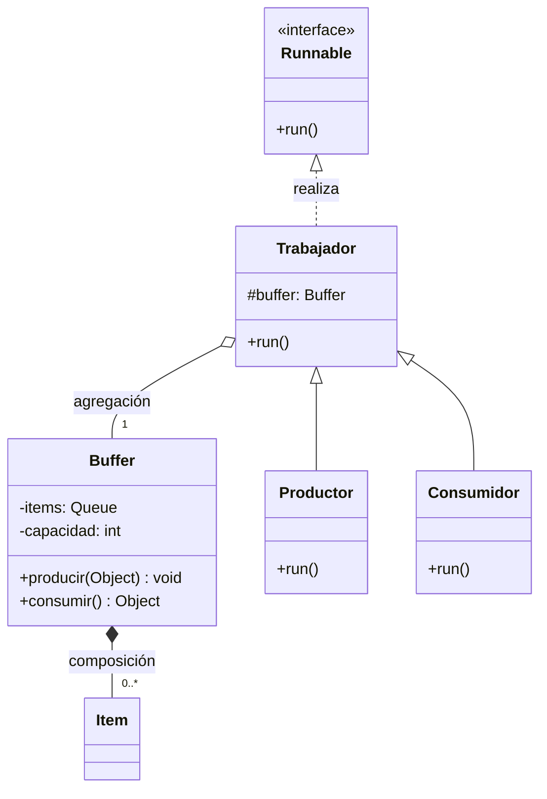

###### **Diagrama de secuencia**
Muestra cómo un grupo de objetos se comunica a lo largo del tiempo; el tiempo avanza de arriba hacia abajo. Se modela uno por caso de uso.

| Elemento                     | Notación                            | Qué representa                                       |
| ---------------------------- | ----------------------------------- | ---------------------------------------------------- |
| Línea de vida                | Línea vertical punteada             | Un participante durante la interacción               |
| Actor                        | Monigote al tope de la línea        | Participante externo al sistema                      |
| Ocurrencia de ejecución      | Rectángulo sombreado sobre la línea | Período en que el participante ejecuta una operación |
| Mensaje sincrónico           | Flecha llena, punta rellena         | Llamada donde el emisor **espera** la respuesta      |
| Mensaje asincrónico          | Flecha llena, punta abierta         | El emisor sigue sin esperar: **arranque de un hilo** |
| Mensaje de retorno           | Flecha punteada                     | Valor devuelto por la llamada                        |
| Mensaje a sí mismo           | Flecha que vuelve a la misma línea  | Llamada a un método propio                           |
| Mensaje de creación          | Flecha a un objeto que nace ahí     | Debe ser el primer mensaje que ese objeto recibe     |
| Evento de destrucción        | `X` al pie de la línea              | El objeto fue eliminado o ya no es accesible         |
| Mensaje perdido / encontrado | Flecha hacia / desde un círculo     | Participante no especificado                         |

Si hay demora entre el envío y la atención, la flecha se dibuja oblicua.

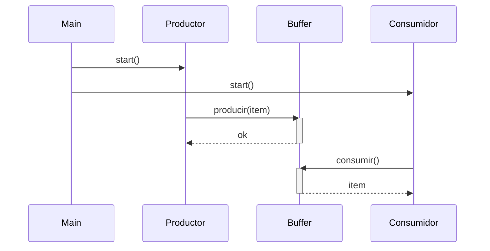

###### **Fragmentos combinados**
Rectángulo con un operador de interacción en la esquina y uno o más operandos separados por línea punteada. Cada operando puede llevar una guarda, que es una expresión booleana entre corchetes que cubre la línea de vida (*interaction constraint*, UML 2.4). Si el operando no tiene guarda, se asume verdadera.

| Operador              | Significado                                                                                                        |
| --------------------- | ------------------------------------------------------------------------------------------------------------------ |
| `alt`                 | Alternativas: se ejecuta **solo uno** de los operandos, el de guarda verdadera                                     |
| `opt`                 | Opción: el único operando ocurre o no ocurre nada (equivale a un `alt` con la otra rama vacía)                     |
| `loop`                | Iteración; admite límites `loop(min, max)` y guarda. Sin límites, bucle potencialmente infinito                    |
| `break`               | Escenario excepcional: si la guarda es verdadera se ejecuta y se **ignora el resto** del fragmento que lo encierra |
| `par`                 | Ejecución paralela: los operandos se **intercalan de cualquier forma**, respetando el orden interno de cada uno    |
| `strict`              | Secuencia estricta de los operandos del primer nivel: la coordenada vertical importa en todo el fragmento          |
| `seq`                 | Secuencia débil: solo se ordena lo que ocurre sobre una misma línea de vida                                        |
| `critical`            | Región crítica: **atómica**, no puede ser intercalada por otras ocurrencias (ni por un `par`)                      |
| `ignore` / `consider` | Mensajes que se descartan / que sí se tienen en cuenta dentro del fragmento                                        |
| `assert`              | La secuencia de operandos es la **única** válida en ese punto                                                      |
| `neg`                 | Traza inválida: lo que **no** debe ocurrir                                                                         |

###### **Por qué UML sirve acá**
- `par` es la representación gráfica del interleaving, con dos operandos concurrentes cuyo entrelazado no está determinado.
- `critical` es literalmente la sección crítica, el fragmento que `par` no puede intercalar. 
  Un caso típico es el de `agregar()` y `eliminar()`, que pueden llamarse en paralelo, pero cada uno debe funcionar como región crítica.
- El mensaje asincrónico modela el `start()` de un hilo; el sincrónico, una llamada común que bloquea al emisor.

###### **Ejemplos**
- **Ej. 1 — préstamo de un libro**: actores *Socio* y *Encargado*, objetos *Libro*, *Ficha socio*, *Ficha libro*, *Préstamo*. Secuencia: coger libro → solicitar préstamo → verificar situación del socio (respuesta punteada "situación socio ok") → verificar situación del libro → introducir préstamo → autorizar préstamo. Es el caso típico de mensajes sincrónicos con su retorno.
- **Ej. 2a/2b — los tres chanchitos** (tracemodeler.com): un fragmento `par` con tres operandos, uno por chanchito construyendo su casa (`new()` de *StrawHouse*, *WoodHouse*, *BrickHouse*). El 2b agrega los elementos que conviene saber etiquetar, que son el **comentario** (nota con la esquina doblada), **fin de la vida de un objeto** (la `X` cuando el lobo sopla y la casa colapsa), **pila de llamadas** (ocurrencias de ejecución apiladas) y **retorno explícito**.
- **Apéndice — pedido de comida**: muestra todos los elementos numerados de la tabla de arriba, incluyendo un fragmento **`ref`** (*Interaction Use*): una caja que **referencia otro diagrama de secuencia** ("Completar pedido y pagar") en lugar de dibujarlo, y mensajes **encontrado** (desde un punto negro, "hambre") y **perdido** (hacia un punto negro, "actualización de existencias").

Las herramientas que recomienda la cátedra son **Visual Paradigm**, **StarUML**, **Trace Modeler** y **Papyrus**. Tutorial: http://www.tracemodeler.com/articles/a_quick_introduction_to_uml_sequence_diagrams/

# Introducción a la Programación Concurrente

## Historia y motivación

###### **Dijkstra: los hitos que fundan la materia**
Casi todo el vocabulario de la asignatura sale de un solo autor. Dijkstra recibió el Premio Turing de la ACM en 1972 por sus contribuciones a la "ciencia y arte" de los lenguajes de programación, y sus aportes atraviesan diseño de algoritmos, lenguajes, sistemas operativos, procesamiento distribuido y verificación formal.

| Año     | Aporte                                                                                                    | Por qué importa acá                                                   |
| ------- | --------------------------------------------------------------------------------------------------------- | --------------------------------------------------------------------- |
| 1960    | ALGOL 60: escribió el primer compilador                                                                   | Segundo lenguaje de alto nivel de la historia                         |
| 1965    | Documento de una página que plantea el problema de la exclusión mutua para $n$ procesos y da una solución | Introduce la noción hoy estándar de sección crítica                   |
| 1965-68 | Sistema operativo THE, organizado en capas identificables                                                 | Primer SO diseñado por niveles de abstracción                         |
| 1968    | *Cooperating Sequential Processes*, ensayo de 70 páginas                                                  | Origina el campo de la programación concurrente                       |
| 1968    | El semáforo                                                                                               | Primer mecanismo de sincronización entre procesos concurrentes        |
| 1968    | Identifica el problema del Deadlock y propone el *algoritmo del banquero*                                 | Prevención de interbloqueo por asignación segura de recursos          |
| 1971    | Problema de los filósofos comensales                                                                      | Ilustra el interbloqueo; abre la línea que termina en el monitor      |
| 1974    | Sistemas autoestabilizadores con control distribuido                                                      | Origen de un enfoque central de la tolerancia a fallas                |
| 1976    | *A Discipline of Programming*                                                                             | Desarrollo sistemático de programas junto con su prueba de corrección |

Su método de trabajo también es parte del legado. Escribía a máquina o a mano, numeraba consecutivamente sus manuscritos y los hacía circular entre colegas en vez de publicarlos en revistas. Su idea de fondo, sostenida en una entrevista de 1985, es que pensar primero sale más barato que codificar rápido, porque el costo desmedido del software viene de apurarse a escribir código.

###### **El problema de la corrección del software**
Garantizar que el software que construimos es correcto siempre es deseable, pero en algunos dominios es directamente crucial, como en el equipamiento médico, el control de vehículos, el control de procesos industriales o las aplicaciones financieras. Son los llamados sistemas críticos, aquellos cuya falla puede provocar pérdida de vidas, catástrofes ecológicas o pérdidas financieras enormes.

Las técnicas de la materia (modelado, verificación, Model checking) apuntan justamente a los sistemas críticos con comportamiento reactivo, concurrente y/o de tiempo real.

| Caso                                                            | Año     | Causa                                                                                                                    |
| --------------------------------------------------------------- | ------- | ------------------------------------------------------------------------------------------------------------------------ |
| Pentium **FDIV**                                                | 1994    | Tabla de división incompleta en el hardware                                                                              |
| **Therac-25**                                                   | 1985-87 | Software de radioterapia: seis personas sobreexpuestas a radiación (condición de carrera entre la interfaz y el control) |
| **Patriot Missile**                                             | 1991    | Error de redondeo acumulado en el reloj del sistema de control                                                           |
| **Ariane 5**                                                    | 1996    | Conversión de punto flotante de 64 bits a entero de 16 bits: **overflow aritmético**                                     |
| **Mars Climate Orbiter**                                        | 1999    | Un módulo usaba sistema imperial y otro sistema métrico                                                                  |
| **HMS Sheffield**, **Airbus A320**, voto electrónico en Florida | varios  | Identificación de amigo/enemigo, software de control, integridad y confidencialidad                                      |

El punto de la lista no es el anecdotario, sino que en varios de estos casos el error no era detectable con testing convencional porque dependía de una combinación puntual de datos o de tiempos.

###### **Límites del testing y de la simulación**
Tanto el testing como la simulación son experimentos previos al uso masivo, en los que se le dan entradas al software y se estudia su **comportamiento** en esos casos. De ahí la frase de Dijkstra que resume el problema: 

>*El testing puede confirmar la presencia de errores, pero nunca garantizar su ausencia*.

La alternativa es la verificación, que sí puede hacerlo en teoría. Pero la verificación automática tiene límites duros, porque decidir si un programa cualquiera termina no es computable (problema de la parada). La salida práctica es restringir el problema — si acotamos las propiedades que queremos verificar, ciertas tareas sí pueden verificarse automáticamente. **Model checking** es exactamente eso, y se estudia más adelante en la materia.

## El enfoque de modelar

###### **Por qué modelar**
Razonar directamente sobre el código concurrente es inviable. La estrategia es construir un **modelo**, una representación abstracta del programa que conserva lo que queremos analizar y descarta el resto.

> Abstracción: aislar conceptualmente una propiedad o función concreta de un objeto, ignorando sus otras propiedades.

Los modelos de la materia representan el comportamiento **verdadero** de programas concurrentes escritos en Java, pero dejan afuera la representación de datos, la asignación de recursos y la interacción con el usuario, para concentrarse solo en la concurrencia. Sobre ese modelo se verifican dos familias de propiedades:

- **Seguridad** (*safety*): nada malo ocurre nunca. Ej.: nunca hay dos procesos en la sección crítica, nunca se viola un invariante.
- **Progreso** (*liveness*): algo bueno termina ocurriendo. Ej.: todo proceso que pide el recurso eventualmente lo obtiene (ausencia de inanición).

La ventaja de tener un modelo formal es que la comprobación puede ser **exhaustiva y mecánica**, porque se recorren todas las secuencias posibles de eventos y acciones, incluso las que ningún test hubiera generado.

###### **Máquinas de estados finitos y Redes de Petri**
Las **FSM** son el primer formalismo. Tienen semántica intuitiva, representación gráfica simple, propiedades matemáticas bien definidas que permiten el análisis formal, y ya conocidas por cualquiera que haya hecho diseño orientado a objetos o circuitos digitales. Su límite es el tamaño. Como el grafo explota, la representación gráfica restringe seriamente la complejidad de los problemas abordables.

Por eso la materia usa **Redes de Petri**, que expresan concurrencia de forma compacta. Ambas pertenecen a la familia de las álgebras de procesos, junto con **CSP**, **CCS**, **ACP** y **LOTOS**, formalismos que se concentran en los eventos en los que cada proceso participa y en los patrones de ocurrencia que siguen.

###### **Sistemas reactivos vs transformacionales**

| Sistema transformacional (funcional)              | Sistema reactivo                                                    |
| ------------------------------------------------- | ------------------------------------------------------------------- |
| Recibe entradas, computa una salida y **termina** | Interactúa **permanentemente** con el ambiente y con otros procesos |
| La corrección es una relación entrada/salida      | En general **no computa un resultado** y no se espera que termine   |
| Ej.: un compilador, un cálculo científico         | Ej.: sistemas operativos, software de control, hardware, servidores |

La programación concurrente casi siempre cae del lado reactivo, y eso cambia qué significa "correcto". Ya no alcanza con verificar el resultado final, sino que hay que razonar sobre secuencias infinitas de interacciones.

## Semántica: transiciones de estado e interleaving

###### **Sistemas de transición de estados**
La semántica típica de un programa concurrente se da con un sistema de transición de estados, que es un grafo dirigido donde

- Los **nodos** son los estados del sistema (posiblemente infinitos),
- Las **aristas** son las transiciones **atómicas** de estado a estado, dadas por las sentencias del programa,
- Hay un nodo distinguido: el **estado inicial**.

Un estado no es solo el valor de las variables globales. Incluye también dos variables implícitas, los program counters de cada proceso, que indican en qué sentencia está parado cada uno. Por eso, con dos variables booleanas `y1`, `y2`, un contador `in_critical` y dos procesos, el espacio de estados es el producto de todos los valores posibles por todas las posiciones posibles de los dos pc.

Cada sentencia atómica define un conjunto de transiciones. `in_critical++`, por ejemplo, relaciona cada estado con aquel en el que `y1` e `y2` no cambian, `in_critical` se incrementa en uno, y el pc del proceso que la ejecutó avanza.

###### **Un ejemplo con `y1`, `y2` e `in_critical`**
Es un intento de exclusión mutua "a mano", escrito primero en Promela (el lenguaje del model checker SPIN):

```c
int y1 = 0;  int y2 = 0;  short in_critical = 0;

active proctype process_1() {        active proctype process_2() {
  do                                   do
  :: true ->                           :: true ->
     y1 = y2 + 1;                         y2 = y1 + 1;
     (y2 == 0) || (y1 <= y2);             (y1 == 0) || (y2 < y1);   // espera (guarda bloqueante)
     in_critical++;                       in_critical++;
     in_critical--;                       in_critical--;
     y1 = 0;                              y2 = 0;
  od                                   od
}                                    }
```

y después en Java, con tres clases, `Variable` (los tres enteros compartidos), y `Process1` / `Process2` que implementan `Runnable` y reciben **la misma** instancia de `Variable`. La guarda de Promela se traduce como espera activa:

```java
public void run() {                       // Process1
    while (true) {
        v.y1 = v.y2 + 1;
        while (!(v.y2 == 0 || v.y1 < v.y2)) { }   // espera activa
        v.inCritical++;
        v.inCritical--;
        v.y1 = 0;
        System.out.print("Process 1 - inCritical  ");
        System.out.println(v.inCritical);
    }
}
```

`Main` crea la `Variable`, los dos procesos y los dos `Thread`, los arranca e imprime "Bye World!" — que sale enseguida, porque `main` no espera a nadie. La propiedad de seguridad que se quiere es `in_critical <= 1` siempre. La asignación `y1 = y2 + 1` **no es atómica** (leer `y2`, sumar, escribir `y1`), así que existen interleavings en los que ambos procesos pasan la guarda y `in_critical` llega a 2; y el test que produzca justo esa intercalación (o el *overflow* de `y1`/`y2` si siguen creciendo) es prácticamente imposible de construir a mano. Es exactamente el tipo de error que el model checking encuentra y el testing no.

###### **Un sistema de transición chiquito**
Para practicar la definición sirve un sistema abstracto de dos variables binarias:

$$(S,\ s_0,\ \rightarrow) \quad S = \{0,1\}\times\{0,1\} \qquad s_0 = (0,0)$$
$$(x,y) \rightarrow (x,0) \qquad (x,y) \rightarrow (x,1) \qquad (x,y) \rightarrow (y,y)$$

Es decir, en un paso se puede poner $y$ en 0, poner $y$ en 1, o copiar $y$ en $x$. Desde $(0,0)$ se alcanzan los cuatro estados. La pregunta es cuáles de estas secuencias son ejecuciones.

| Secuencia (comienzo) | ¿Ejecución? | Por qué |
|---|---|---|
| $(0,0)(0,0)(0,1)(1,1)(1,0)(1,1)(1,0)\dots$ | **Sí** | Cada paso es una de las tres reglas |
| $(0,1)(0,0)\dots$ | **No** | No arranca en $s_0 = (0,0)$ |
| $(0,0)(0,1)(1,0)\dots$ | **No** | De $(0,1)$ a $(1,0)$ cambian **las dos** componentes; la única regla que cambia $x$ es copiar $y$, que daría $(1,1)$ |

El criterio general es que una secuencia es ejecución si arranca en el estado inicial y **cada par consecutivo** está en la relación de transición.

###### **Interleaving**
Este es el concepto central del modelo computacional de la materia:

> Los procesos concurrentes se ejecutan intercalando las acciones atómicas que los componen.

A eso se lo llama interleaving. Dos consecuencias inmediatas:

1. El orden en que se ejecutan las acciones atómicas no puede decidirse en general. No lo controla el programador ni es reproducible.
2. Un mismo par de procesos puede tener distintas ejecuciones en corridas distintas, por el no determinismo en la elección de la próxima acción atómica.

Una ejecución es una secuencia de estados alcanzables desde el inicial siguiendo transiciones. El conjunto de todas las ejecuciones posibles es el comportamiento del programa. Por eso, dada una secuencia de estados cualquiera, la pregunta "¿es una ejecución válida?" se responde verificando que cada paso corresponda a una transición atómica de algún proceso. Si entre dos estados consecutivos cambian dos variables que pertenecen a sentencias distintas, esa traza es imposible.

###### **Por qué razonar sobre esto es tan difícil**
- Distintos interleavings llevan a distintos resultados, y todos son ejecuciones legítimas del mismo programa.
- La cantidad de interleavings posibles es enorme, porque el espacio de estados crece exponencialmente con el número de componentes y de variables (*state explosion*).
- Por eso el testing casi no da confianza. En el ejemplo del overflow es prácticamente imposible construir el test que produzca justo la intercalación que rompe.

```java
// Ejemplo mínimo: dos hilos ejecutando el mismo incremento
int contador = 0;          // compartido

// Cada "contador++" NO es atómico: son tres acciones
//   1. leer contador     (registro <- memoria)
//   2. incrementar       (registro <- registro + 1)
//   3. escribir contador (memoria  <- registro)

// Interleaving posible con dos hilos, partiendo de contador = 0:
//   H1: leer(0)
//   H2: leer(0)          <- todavía ve 0
//   H1: incrementar -> 1, escribir(1)
//   H2: incrementar -> 1, escribir(1)
// Resultado: contador == 1, cuando debería valer 2. Y es una ejecución válida.
```

Este es el mismo fenómeno que en la sección de Java aparece como "`static` es estado compartido". Lo que allá era una advertencia acá es la definición formal del problema.

## Procesos

###### **Definición**
> Un proceso es una unidad de actividad que se caracteriza por la ejecución de una secuencia de instrucciones, un estado actual, y un conjunto de recursos del sistema asociados.

Informalmente, un proceso es un programa en ejecución. La diferencia entre programa y proceso es que el programa es una entidad estática (el archivo, el código) mientras que el proceso es una actividad que contiene el programa, sus entradas/salidas y su estado (Stallings, *Operating Systems*, cap. 3.1).

- Un proceso simple tiene un hilo de ejecución.
- Al ejecutar un programa, el SO inicia un proceso, que a su vez puede crear otros (proceso padre / proceso hijo); una vez creado el hijo, padre e hijo transcurren de manera concurrente.
- **Procesos cooperantes**: interactúan entre sí. **Procesos independientes**: no requieren información de otros.
- El SO es el que provee los servicios necesarios para que el usuario pueda ejecutar procesos, en sistemas de tiempo compartido o **SMP**.

###### **Estados de un proceso**
El modelo mínimo tiene **3 estados**: *Listo* (puede pasar a ejecución), *En ejecución* (tiene el procesador) y *Bloqueado* (espera la respuesta de otro proceso o de una E/S). El modelo estándar de los sistemas operativos usa 5 estados:

| Estado                            | Significado                                                               |
| --------------------------------- | ------------------------------------------------------------------------- |
| **New** (nonato)                  | El proceso está siendo creado: existe pero el SO todavía no lo admitió    |
| **Ready** (preparado)             | Listo para ejecutar, esperando que se libere la CPU                       |
| **Running** (activo / ejecución)  | Tiene el control del procesador. En un monoprocesador, solo uno a la vez  |
| **Waiting / Blocked** (bloqueado) | Espera un evento: fin de una E/S, una señal de sincronización, un mensaje |
| **Terminated** (muerto)           | Terminó su ejecución, o el SO detectó un error fatal                      |

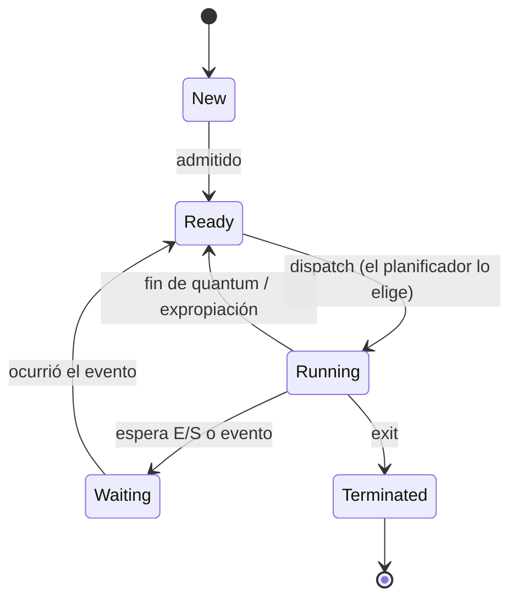

Hay que agregar además la distinción entre procesos activos (ejecución, preparado, bloqueado: compiten por el procesador o están en condiciones de hacerlo) e inactivos, que son los suspendidos y sacados de memoria principal:

- **Suspendido bloqueado**: fue suspendido esperando un evento, y las causas de su bloqueo siguen vigentes.
- **Suspendido programado** (*suspended ready*): fue suspendido, pero ya no tiene causa para estar bloqueado; podría ejecutar si volviera a memoria.

###### **Bloque de Control de Proceso (BCP / PCB)**
Es el registro donde el SO agrupa toda la información que necesita saber de un proceso. Es lo que se guarda y se restaura en cada cambio de contexto, y es lo que hace que un proceso sea caro comparado con un hilo (Stallings, cap. 3.3).

| Campo                                 | Para qué                                       |
| ------------------------------------- | ---------------------------------------------- |
| **PID** (Process Identificator)       | Identifica el proceso ante el SO               |
| **Estado**                            | Listo, en espera, bloqueado, etc.              |
| **Contador de programa**              | Dirección de la próxima instrucción a ejecutar |
| **Valores de registros de CPU**       | Se salvan y restauran en el cambio de contexto |
| **Espacio de direcciones de memoria** | Qué memoria le pertenece                       |
| **Prioridad**                         | Si el algoritmo de planificación la usa        |
| **Lista de recursos asignados**       | Descriptores de archivos, sockets abiertos     |
| **Estadísticas**                      | Tiempo de CPU consumido, etc.                  |
| **Datos del propietario y permisos**  | Control de acceso                              |
| **Señales pendientes**                | Almacenadas en un mapa de bits                 |

La lista es indicativa, porque cada SO agrega lo suyo.

## Hilos
###### **Qué es un hilo**
> Un **hilo** (*thread*) es un flujo secuencial de ejecución dentro de un proceso. Es la unidad que el sistema operativo planifica y a la que le asigna el procesador.

Stallings lo explica separando dos características que en el modelo clásico venían juntas en el proceso. Una es ser **unidad de propiedad de recursos**, porque el proceso tiene su espacio de direcciones, sus archivos abiertos y sus permisos. La otra es ser **unidad de planificación**, es decir, una secuencia de instrucciones con su propio estado de ejecución que el SO puede interrumpir y reanudar. El hilo se queda con la segunda y el proceso conserva la primera. Por eso un proceso puede tener varios hilos que ejecutan partes distintas del mismo programa sobre los mismos datos (Stallings, cap. 4.1).

###### **Qué comparte y qué es propio de cada hilo**
Los hilos de un proceso comparten todo lo que pertenece al proceso:

- El espacio de direcciones, o sea el código, las variables globales y estáticas y el *heap*. En Java eso incluye todos los objetos con sus atributos, y cualquier hilo que tenga una referencia a un objeto puede leerlo y modificarlo.
- Los archivos y sockets abiertos.
- La identidad y los permisos del proceso.

Cada hilo tiene, en cambio, lo necesario para ejecutar por su cuenta:

- El contador de programa, que indica por qué instrucción va.
- El valor de los registros de la CPU, que se salvan y se restauran cada vez que el hilo deja el procesador y lo vuelve a tomar.
- Su propia pila, donde viven las variables locales y los parámetros de los métodos que está ejecutando.
- Su estado (listo, en ejecución o bloqueado).

Para saber si un dato es compartido, conviene preguntarse dónde vive. Una variable local está en la pila de un hilo y ningún otro la ve, mientras que un atributo de un objeto está en el *heap* y lo ve cualquier hilo que tenga la referencia.

Al conjunto de hilos más los recursos que comparten se lo llama proceso, y el proceso sigue vivo mientras al menos uno de sus hilos siga activo.

La consecuencia directa, y la razón de ser de toda la materia, es que cualquier hilo puede modificar los datos compartidos sin pasar por el sistema operativo. Si dos hilos lo hacen a la vez pueden pisarse (una condición de carrera), y por eso hace falta exclusión mutua. Además, sin sincronización ni siquiera está garantizado que un hilo vea a tiempo lo que escribió otro, porque cada núcleo puede estar trabajando con una copia del dato en su caché. En Java, esa garantía de visibilidad la dan `synchronized`, los locks y `volatile`.

###### **Proceso vs hilo**

|                       | Proceso                                                        | Hilo                                                                            |
| --------------------- | -------------------------------------------------------------- | ------------------------------------------------------------------------------- |
| Independencia         | Generalmente independientes                                    | Comparten recursos de forma directa                                             |
| Información de estado | Mucha (BCP completo)                                           | Poca (contexto + pila)                                                          |
| Interacción           | Solo por mecanismos que provee el SO                           | Directa, por memoria compartida                                                 |
| Costo de creación     | Alto                                                           | Bajo — del orden de **10x** más barato según mediciones típicas |
| Costo de terminación  | Hay que liberar el BCP entero                                  | Solo su contexto y su pila                                                      |
| Cambio de contexto    | Caro: el *dispatcher* genera **overhead**                      | Casi despreciable: no cambia el espacio de direcciones                          |
| Comunicación          | Requiere intervenir el **núcleo** (protección + transferencia) | **No requiere** invocar al núcleo                                               |

Por eso Windows y Linux tienen fama de hilos "baratos" y procesos "costosos", y por eso una aplicación que se descompone en unidades de ejecución relacionadas conviene implementarla como una colección de hilos y no de procesos separados (Stallings, cap. 4.1).

###### **Estados de un hilo**
Los mismos tres estados básicos:

- Ejecución.
- Listo.
- Bloqueado.

Un hilo no tiene los estados de suspensión, porque suspender es una operación a nivel de proceso.

Las transiciones:

1. **Creación**: al crearse un proceso se crea un hilo para él; ese hilo puede crear otros dentro del mismo proceso. El hilo nuevo obtiene su propio contador, registros y espacio de pila, y pasa a la cola de listos.
2. **Bloqueo**: cuando debe esperar un suceso, salva sus registros de usuario, contador de programa y punteros de pila, y el procesador pasa a ejecutar otro hilo de la cola de listos.
3. **Desbloqueo**: ocurrido el suceso, el hilo vuelve a la cola de **Listos** — no directamente a ejecución.
4. **Terminación**: se liberan su contexto y su pila.

Cuando un hilo está en ejecución tiene acceso a todos los recursos asignados a la tarea.

###### **Monohilo y multihilo**
Un proceso que tiene un solo hilo de ejecución es **monohilo**, y en ese caso proceso e hilo coinciden. Las ventajas de los hilos aparecen con el **multihilo**, cuando un proceso tiene varios hilos que realizan actividades distintas, cooperativas o no. Cada hilo tiene:

- Su **estado**.
- Su **contexto de procesador**: el punto de ejecución (la instrucción), que se salva para poder reanudarlo si se lo interrumpe.
- Su **pila de ejecución**.
- Un espacio de almacenamiento estático para sus variables (las locales).
- **Acceso a los recursos de la tarea**, compartidos por todos los hilos de la tarea.

El diagrama de estados de un hilo **en Java** (*New → Ready-to-Run ⇄ Running*, con *Sleeping*, *Waiting* y *Blocking* como estados de espera y *Dead* al final) se desarrolla en la sección de `Thread.State`.

## Concurrencia: principios generales

###### **Dónde aparece la concurrencia**

| Escenario                     | Definición                                                                         |
| ----------------------------- | ---------------------------------------------------------------------------------- |
| **Multiprogramación**         | Gestión de varios procesos dentro de un sistema **mono-procesador**                |
| **Multiprocesamiento**        | Gestión de varios procesos dentro de un sistema **multiprocesador**                |
| **Procesamiento distribuido** | Gestión de varios procesos ejecutándose en **múltiples computadores distribuidos** |

La concurrencia es fundamental en las tres, y los problemas se producen incluso cuando hay un único procesador. En un sistema multiprogramado los procesos se intercalan en el tiempo aparentando ejecución simultánea. No hay procesamiento paralelo real y hay sobrecarga por los intercambios, pero la ejecución intercalada igual mejora la eficiencia del procesamiento y la estructuración de los programas.

Los tres contextos donde surge:

- **Múltiples aplicaciones**: la multiprogramación nació para compartir dinámicamente el tiempo de procesador entre varias aplicaciones activas.
- **Aplicaciones estructuradas**: como extensión del diseño modular y la programación orientada a objetos, una aplicación puede implementarse eficazmente como un conjunto de hilos concurrentes.
- **Estructura del sistema operativo**: los mismos beneficios valen para el SO, que suele estar implementado como un conjunto de procesos o hilos.

###### **Cuestiones de diseño y dificultades**
La concurrencia abarca la comunicación entre procesos, la compartición y competencia por los recursos, la sincronización de la ejecución y la asignación del tiempo de procesador. Las dificultades surgen porque la velocidad de ejecución de los procesos no puede predecirse, ya que depende de la actividad de los demás procesos y de cómo el SO trate las interrupciones. De ahí:

- Compartir recursos globales es riesgoso.
- Al SO le resulta difícil gestionar la asignación óptima de recursos.
- Hay que seguir a los procesos activos, asignar y retirar recursos, y proteger datos y recursos físicos.
- **El principio que ordena todo**: los resultados de un proceso deben ser independientes de la velocidad a la que se ejecuten los otros procesos concurrentes. Si el resultado cambia según quién corra más rápido, el programa está mal.

## Interacción entre procesos

###### **Los tres niveles de conocimiento**
Los procesos interactúan según cuánto sepan de la existencia de los demás (Stallings, cap. 5.1):

| Nivel de conocimiento                                                                    | Relación                           | Problemas de control                                              |
| ---------------------------------------------------------------------------------------- | ---------------------------------- | ----------------------------------------------------------------- |
| **1. No se conocen entre sí**                                                            | **Competencia**                    | Exclusión mutua, deadlock (recurso reutilizable), inanición       |
| **2. Conocimiento indirecto**: no se conocen por identificador, pero comparten un objeto | **Cooperación por compartimiento** | Exclusión mutua, deadlock, inanición, **coherencia de los datos** |
| **3. Conocimiento directo**: se comunican por identificador de proceso                   | **Cooperación por comunicación**   | Deadlock (mensaje que no llega), inanición                        |

###### **Competencia por los recursos**
Dos o más procesos entran en conflicto cuando necesitan el mismo recurso durante su ejecución, y cada uno debe dejar el recurso tal como estaba. La ejecución de uno influye en el comportamiento del otro, porque si ambos piden el recurso, el SO se lo asigna a uno y el otro espera.

Los recursos no compartibles se llaman recursos críticos, y la parte del programa que los usa es la sección crítica. Solo un proceso puede estar en su sección crítica a la vez. Tres problemas de control a resolver:

- **Exclusión mutua**: garantizar el acceso de a uno.
- **Deadlock**: hacer cumplir la exclusión mutua **puede provocar interbloqueo** (dos procesos que ya tomaron un recurso cada uno y piden el del otro).
- **Inanición**: si P1 posee el recurso, lo libera y se lo concede a P2, y el SO alterna entre P1 y P2, se le puede negar indefinidamente el acceso a P3.

###### **Cooperación**
En la cooperación por compartimiento los procesos acceden a variables o archivos comunes sin conocerse explícitamente; deben cooperar para que los datos compartidos se gestionen correctamente, y los mecanismos de control tienen que garantizar la integridad de esos datos. En la cooperación por comunicación la interacción es por mensajes, cuyas primitivas de envío y recepción las provee el lenguaje o el núcleo del SO; la comunicación sincroniza y coordina las actividades.

###### **Problemas comunes de los programas concurrentes**

| Problema                                               | Qué pasa                                                                                                                                        |
| ------------------------------------------------------ | ----------------------------------------------------------------------------------------------------------------------------------------------- |
| **Violación de propiedades universales (invariantes)** | Una condición que debería valer siempre deja de valer en algún interleaving (ej.: `in_critical <= 1`)                                           |
| **Deadlock** (interbloqueo)                            | Dos o más procesos **esperan mutuamente** el avance del otro. Nadie ejecuta, nadie avanza                                                       |
| **Starvation** (inanición)                             | Uno o más procesos quedan esperando **indefinidamente** un mensaje o la liberación de un recurso, aunque el sistema en conjunto sí avanza       |
| **Livelock**                                           | Los procesos **no se bloquean**: siguen ejecutando y respondiendo continuamente a los cambios de estado de los otros, pero **ninguno progresa** |
| **Uso no exclusivo de recursos compartidos**           | Falta de exclusión mutua: dos procesos entran a la sección crítica y corrompen el dato                                                          |

La diferencia fina entre **deadlock** y **livelock**: en el deadlock los procesos están detenidos (bloqueados, sin consumir CPU); en el livelock están **activos, consumiendo CPU, y aun así no avanzan** — es el equivalente a dos personas que se cruzan en un pasillo y se corren para el mismo lado una y otra vez.

## Requisitos para la exclusión mutua

Cualquier solución al problema de la sección crítica —sea por software, por hardware, con semáforos o con monitores— tiene que cumplir los seis requisitos (Stallings, cap. 5.2):

1. **Exclusión mutua efectiva**: de todos los procesos que tienen secciones críticas por el mismo recurso compartido, solo uno puede tener permiso para entrar en un momento dado.
2. **No interferencia desde la sección no crítica**: un proceso que se detiene o se interrumpe fuera de su sección crítica debe hacerlo sin interferir con los demás. Si un proceso muere en su código normal, no puede dejar bloqueado a nadie.
3. **Sin demora indefinida**: un proceso no puede pedir acceso a su sección crítica y ser demorado para siempre. No se permite ni interbloqueo ni inanición.
4. **Entrada inmediata si está libre**: si ningún proceso está en su sección crítica, cualquiera que solicite entrar debe poder hacerlo sin demora.
5. **Sin suposiciones sobre velocidad ni cantidad de procesadores**: la solución debe funcionar igual si un proceso corre mil veces más rápido que el otro, y con uno o con muchos procesadores.
6. **Permanencia finita**: un proceso permanece en su sección crítica solo por un tiempo finito. Es responsabilidad del programador, no del mecanismo.

Los requisitos 3, 4 y 6 son propiedades de progreso; el 1 es la propiedad de seguridad. Los requisitos 2 y 5 son los que descartan las soluciones "que funcionan casi siempre".

## Sincronización por pasaje de mensajes

Además de la memoria compartida, el otro gran mecanismo de interacción es el pasaje de mensajes. La comunicación de un mensaje entre dos procesos implica de por sí cierto nivel de sincronización, ya que el receptor **no puede** recibir un mensaje hasta que otro proceso lo haya enviado. Lo que hay que definir es qué le pasa a cada proceso después de ejecutar las primitivas:

- **`send`**: el emisor **se bloquea** hasta que el mensaje se recibe, o **no se bloquea** y sigue.
- **`receive`**: si ya había un mensaje, lo recibe y continúa. Si no hay ninguno esperando, o bien se bloquea hasta que llegue, o bien continúa abandonando el intento de recepción.

| Combinación                                       | Nombre / uso                                                                                             |
| ------------------------------------------------- | -------------------------------------------------------------------------------------------------------- |
| **Envío bloqueante + recepción bloqueante**       | **Rendezvous**: ambos se bloquean hasta que el mensaje llega. Sincronización fuerte entre las dos partes |
| **Envío no bloqueante + recepción bloqueante**    | La combinación **más útil**: el emisor sigue trabajando, el receptor espera lo que necesita              |
| **Envío no bloqueante + recepción no bloqueante** | Nadie espera a nadie                                                                                     |

Un sistema real implementa solo una o dos de las tres. El `send` no bloqueante es lo más natural para programación concurrente, pero tiene el riesgo de que un error lleve a que el proceso genere mensajes repetidamente sin control, consumiendo recursos. Para el `receive`, la versión bloqueante es la más natural, porque en general el proceso que pide un mensaje necesita esa información antes de poder continuar (Stallings, cap. 5.5).

|                      | Memoria compartida                     | Pasaje de mensajes                        |
| -------------------- | -------------------------------------- | ----------------------------------------- |
| Cómo interactúan     | Leen y escriben las mismas variables   | Se envían mensajes explícitos             |
| Qué hay que proteger | La **sección crítica** sobre el dato   | Nada: no hay dato compartido              |
| Sincronización       | Explícita: semáforos, monitores, locks | **Implícita** en el `send`/`receive`      |
| Ámbito natural       | Hilos de un mismo proceso              | Procesos separados, sistemas distribuidos |

## Concurrencia vs paralelismo

No son sinónimos, lo planteamos desde el problema:

- **Sistemas de manejo de eventos** (máquinas expendedoras, telefonía, servidores web, bancos): la concurrencia es inherente al problema y hay que resolver conflictos inevitables entre solicitudes impredecibles. El paralelismo es parte de la solución porque acelera, pero la raíz del problema es la concurrencia.
- **Sistemas de cómputo** (gráficos, visión por computadora, computación científica): la concurrencia no es parte del problema. Se calcula una salida a partir de entradas conocidas de antemano, sin eventos externos. Acá es el paralelismo el que trae los problemas, porque acelera pero puede introducir errores que antes no existían.

**Programación concurrente**: un sistema concurrente correcto es aquel en el que un conjunto de cómputos avanza colaborativamente, con la secuencia de interacciones o comunicaciones entre ellos coordinada y garantizada, así como el acceso a los recursos compartidos.

**Programación paralela**: forma de cómputo en la que muchas instrucciones se ejecutan simultáneamente, sobre el principio de que un problema grande puede dividirse en problemas más chicos que se resuelven al mismo tiempo.

En la síntesis clásica, la concurrencia es una propiedad de la estructura del programa (tareas que podrían ejecutarse en cualquier orden), mientras que el paralelismo es una propiedad de la ejecución (tareas que efectivamente corren al mismo tiempo en distinto hardware). Un programa concurrente en un monoprocesador no es paralelo, y sigue teniendo todos los problemas de la concurrencia (Palma Méndez, *Programación Concurrente*, cap. 1).

## Carl Adam Petri y las redes de Petri

###### **Quién fue**
Matemático e informático alemán (12/07/1926 – 02/07/2010). Inventó las redes de Petri a los 13 años, con sus gráficos y reglas, para describir procesos químicos. En 1941 se enteró del trabajo de Konrad Zuse con máquinas calculadoras a través de su padre, y llegó a construir una pequeña computadora analógica. Su tesis doctoral, *Kommunikation mit Automaten* ("Comunicación con autómatas", 1962), trata entre otras cosas los modelos simultáneos, las *Petri-Netze*.

En su discurso de recepción del Premio Turing, Robin Milner lo señaló como pionero del modelado científico de la concurrencia en sistemas discretos, con un lugar seguro en la raíz de la teoría de la concurrencia. Sus dos principios rectores son:

- **GP1**: La concurrencia debe ser un **punto de partida** del diseño y análisis de sistemas, no algo que se agrega después.
- **GP2**: Un formalismo debe ser consistente con las leyes de la física, sin atajos en el nivel fundamental.

###### **Fundamentos de la red**
Una red de Petri es un grafo dirigido bipartito con dos tipos de nodos, que no pueden conectarse consigo mismos:

| Elemento                | Notación                                       | Qué representa                                              |
| ----------------------- | ---------------------------------------------- | ----------------------------------------------------------- |
| **Lugar** (*place*)     | Círculo                                        | Una condición o estado local (ej.: "el buffer tiene lugar") |
| **Transición**          | Rectángulo o barra                             | Un evento o acción (ej.: "producir un ítem")                |
| **Arco**                | Flecha lugar→transición o transición→lugar     | Relación de entrada/salida, con un peso (por defecto 1)     |
| **Ficha** (*token*)     | Punto dentro de un lugar                       | La condición se cumple; los recursos disponibles            |
| **Marcado** (*marking*) | Vector con la cantidad de fichas de cada lugar | **El estado de la red**. El inicial se llama M₀             |

La dinámica está dada por una sola regla, la **regla de disparo**:

1. Una transición está **habilitada** si **cada uno** de sus lugares de entrada tiene al menos tantas fichas como el peso del arco que los une.
2. Al **dispararse**, la transición **consume** esas fichas de los lugares de entrada y **produce** fichas en los lugares de salida, según el peso de cada arco de salida.
3. El disparo es atómico e instantáneo, y una transición habilitada **puede** dispararse, pero nada obliga a que lo haga, y ahí está el no determinismo.

Los fenómenos que se modelan con esos pocos elementos (Diaz, *Petri Nets: Fundamental Models*):

- **Secuencia**: la salida de una transición habilita a la siguiente.
- **Concurrencia**: dos transiciones habilitadas que no comparten lugares de entrada pueden dispararse en cualquier orden, o "a la vez".
- **Conflicto**: dos transiciones habilitadas que **comparten** un lugar de entrada con una sola ficha — disparar una deshabilita a la otra. Es exactamente la competencia por un recurso.
- **Sincronización**: una transición con varios lugares de entrada solo dispara cuando todos tienen ficha (una barrera).
- **Confusión**: mezcla de concurrencia y conflicto, donde el orden de disparo cambia qué conflictos aparecen.

La ventaja sobre las máquinas de estados es la compacidad, porque el estado global no se dibuja sino que emerge del marcado. Dos procesos de 10 estados cada uno son 100 estados en una FSM producto, y solo 20 lugares en una red de Petri.

###### **Ejemplo: exclusión mutua con un lugar mutex**
Mermaid no tiene un tipo nativo de red de Petri, así que se dibuja con `flowchart`: círculos `((...))` para lugares, rectángulos `[...]` para transiciones. El lugar `mutex` arranca con **una sola ficha**, y esa ficha es la que garantiza la exclusión mutua. Si `t1` la consume, `t3` deja de estar habilitada (conflicto).

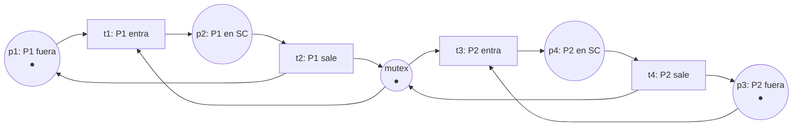

Marcado inicial: `M₀ = (p1=1, p2=0, p3=1, p4=0, mutex=1)`. El invariante de seguridad que se puede **probar** sobre esta red es `p2 + p4 + mutex = 1`, de donde se deduce que `p2 + p4 ≤ 1`, o sea que **nunca** hay dos procesos en la sección crítica. Eso es verificación, no testing.

# Ejercicio 1 — Threads

###### **Enunciado**
Crear y ejecutar un hilo (*thread*) que tenga asignada la ejecución de un objeto que implementa la interfaz `Runnable`. Sobre ese proyecto:

1. Hacer el **debug**.
2. Describir el resultado de ejecutar primero `h1.start()` y luego `h1.run()`.
3. Repetir el debug con ambas opciones: ¿se nota alguna diferencia?
4. Realizar el **diagrama de clases** y el **diagrama de secuencia** del proyecto.

###### **Código**
Una versión posible del ejercicio:

```java
public class MiRunnable implements Runnable {
    private final String tarea;

    public MiRunnable(String tarea) { this.tarea = tarea; }

    @Override
    public void run() {
        for (int i = 0; i < 5; i++) {
            System.out.println(tarea + " - paso " + i
                + " - ejecutando en: " + Thread.currentThread().getName());
        }
    }
}
```

```java
public class Main {
    public static void main(String[] args) {
        MiRunnable r = new MiRunnable("Tarea A");
        Thread h1 = new Thread(r);          // el hilo recibe el objeto a ejecutar

        h1.start();                          // <-- caso 1
        // h1.run();                         // <-- caso 2

        for (int i = 0; i < 5; i++) {
            System.out.println("main - paso " + i
                + " - ejecutando en: " + Thread.currentThread().getName());
        }
    }
}
```

###### **`h1.start()` vs `h1.run()`: la respuesta**

| | `h1.start()` | `h1.run()` |
|---|---|---|
| Qué hace | Le pide a la JVM que cree un **hilo nuevo** del SO y que ejecute `run()` **en ese hilo** | Es una **llamada a método común**, como cualquier otra |
| Hilos en ejecución | **Dos**: `main` y `Thread-0` | **Uno**: solo `main` |
| Quién ejecuta `run()` | El hilo nuevo | El hilo `main` |
| Nombre que imprime | `Thread-0` | `main` |
| Orden de la salida | **Intercalado y no determinista**: cambia entre corridas | **Secuencial y siempre igual**: primero los 5 pasos de la tarea, después los 5 de `main` |
| Retorno | Retorna **inmediatamente**; `main` sigue en paralelo | Retorna **cuando `run()` terminó**; `main` estuvo bloqueado mientras tanto |
| Estado del `Thread` | Pasa a *runnable* y luego a *terminated* | El objeto `h1` **nunca arranca**: queda en estado *new* |

El punto del ejercicio es que **`run()` no crea concurrencia**. Es el método que contiene el trabajo; `start()` es el que le pide al sistema operativo un hilo donde correrlo. Llamar a `run()` directamente compila, no da error y produce la salida "correcta" — por eso es el error clásico, y por eso el ejercicio lo hace ver en el debugger.

Dos detalles que conviene fijar:
- Llamar `h1.start()` **dos veces** lanza `IllegalThreadStateException`, porque un `Thread` no se reinicia. Para volver a ejecutar la tarea hay que crear un `Thread` nuevo sobre el mismo `Runnable`.
- El orden de la salida con `start()` **no está garantizado** ni siquiera al principio, porque `main` puede imprimir todo antes de que el hilo nuevo arranque. Eso **es** el interleaving de la teoría.

###### **Qué se ve en el debug**
- Con **`start()`**: el panel *Threads / Frames* de IntelliJ (o *Debug* en Eclipse) muestra **dos** hilos vivos — `main` y `Thread-0` — y se puede cambiar de uno a otro. Un breakpoint dentro de `run()` detiene al hilo `Thread-0` mientras `main` **sigue corriendo**. La pila de `Thread-0` arranca en `run()`, sin `main` debajo.
- Con **`run()`**: hay un solo hilo. El breakpoint dentro de `run()` detiene a `main`, y la pila de llamadas muestra `main() → run()`, igual que cualquier método.

La diferencia observable está en **la pila de llamadas**. Con `start()` los dos métodos están en pilas **distintas** (cada hilo tiene la suya, como dice la teoría de hilos más arriba); con `run()` están en la **misma** pila.

###### **Diagrama de clases**

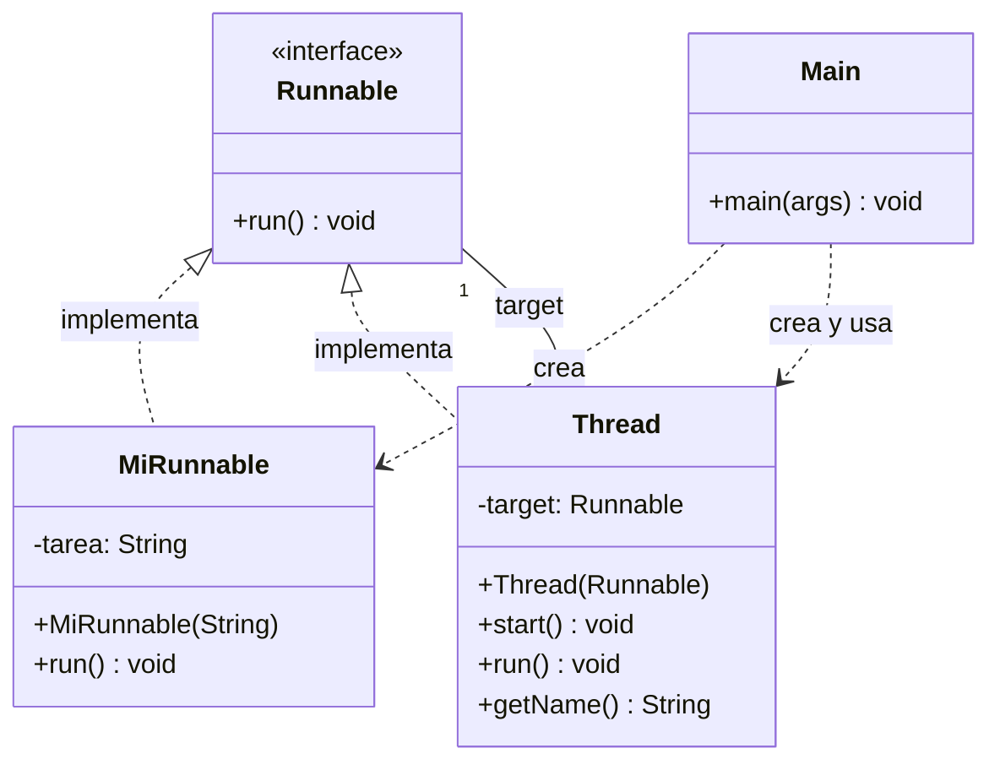

###### **Diagrama de secuencia**
Las dos variantes en un solo diagrama, separadas con un fragmento `alt`. En el caso `start()` el mensaje hacia el hilo nuevo es **asincrónico** (`->>` sin retorno inmediato) y `main` sigue trabajando en paralelo; en el caso `run()` es un mensaje **sincrónico** que bloquea a `main` hasta terminar.

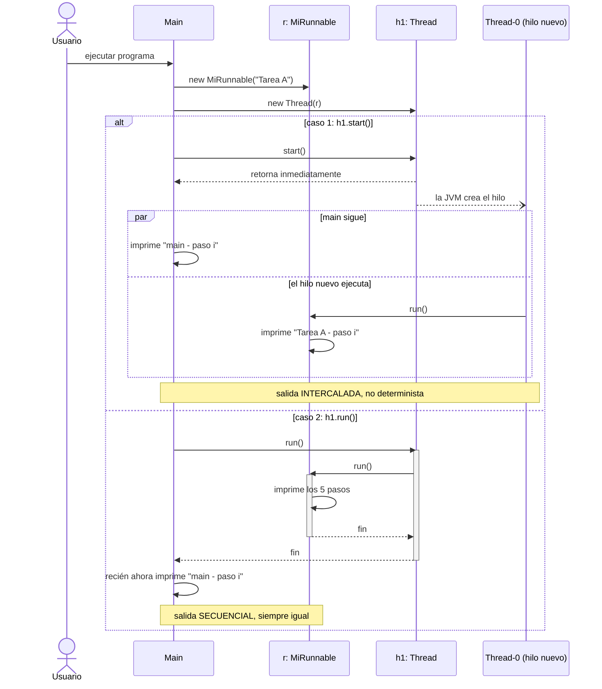

# Gramáticas, Lenguajes y Autómatas

## Motivación: por qué este tema está en Programación Concurrente

###### **Sistemas reactivos, otra vez**
La sección de Introducción ya distinguió sistemas transformacionales de reactivos. Acá aparece el tercer tipo que faltaba, y la diferencia entre los tres está en **quién impone el ritmo**:

| | Transformacional | Interactivo | **Reactivo** |
|---|---|---|---|
| Interacción con el entorno | Ninguna durante el cómputo | Continua | Continua |
| Quién marca el ritmo | Nadie: corre y termina | **El sistema**, a su propio ritmo | **El entorno**, a la velocidad que él determina |
| Salidas | Disponibles al finalizar | Durante la ejecución | Durante la ejecución |
| Terminación | Termina; al terminar su estado ya no importa | Puede no terminar | **Procesos no terminados**, basados en estados |
| Ejemplos | Compilador, cálculo científico | Shell, base de datos, IDE | Embebidos de tiempo real, control, supervisión, procesamiento de señales, protocolos de comunicación, interfaces hombre-máquina |

Los sistemas reactivos interactúan con el entorno para habilitar, aplicar o prevenir cierto comportamiento en él, suelen estar sujetos a requisitos rigurosos de tiempo real y, muy seguido, ejecutan varios procesos en paralelo. Ahí está la conexión, porque un sistema reactivo es concurrente casi por definición, y para verificarlo hay que modelarlo formalmente. El modelo es un autómata, y el autómata se estudia junto con la gramática que genera el mismo lenguaje.

###### **Arquitectura dirigida por eventos (EDA)**
Es el patrón de arquitectura impulsado por la producción, detección, consumo y reacción a eventos.

Una precisión de vocabulario: lo que se produce, publica, propaga, detecta o consume es un mensaje de notificación, no el hecho que generó el evento. Se usa "evento" para nombrar a ese mensaje de notificación del estímulo.

- Hay emisores y consumidores de eventos.
- El consumidor es responsable de reaccionar **tan pronto como el evento está presente**. Puede filtrarlo, transformarlo, reenviarlo a otro componente, o directamente reaccionar.
- Una EDA facilita un mayor grado de reacción porque está diseñada para entornos no predecibles y asincrónicos — justamente las dos condiciones que hacen difícil razonar sobre concurrencia.

## Introducción e historia

###### **De la lingüística a los compiladores**
La Teoría de Lenguajes Formales nace en un campo aparentemente lejano de la informática, la lingüística. Los lingüistas de la escuela estructuralista americana habían elaborado en los años 50 ideas informales sobre la gramática universal, entendida como una gramática que caracteriza las propiedades generales de cualquier lenguaje humano.

El primer trabajo que desarrolló teorías formales sobre gramáticas y lenguajes fue de Avram Noam Chomsky (1928-). El concepto de gramática formal se volvió enseguida central para especificar lenguajes de programación, y con sus teorías se definió la sintaxis de **ALGOL 60** — el mismo lenguaje cuyo primer compilador escribió Dijkstra, según la sección anterior.

Por el otro lado, la Teoría de Autómatas viene de la ingeniería eléctrica. Claude Elwood Shannon (1916-2001) publicó los trabajos que mostraron cómo aplicar la lógica matemática a los circuitos combinatorios y secuenciales.

Las dos teorías terminan siendo la misma cosa vista de dos maneras, porque entre ellas se puede establecer una correspondencia que en álgebra se llama isomorfismo. Toda la sección se apoya en eso — cada clase de gramática tiene su clase de autómata.

###### **Dónde se aplica**
Lógica de circuitos secuenciales · teoría de control de sistemas · teoría de la comunicación · arquitectura de computadoras · redes conmutadoras y codificadoras · sistemas evolutivos y autorreproductivos · reconocimiento de patrones · redes neuronales · reconocimiento y procesado de lenguajes de programación · traducción de lenguajes · sistemas reactivos.

## Definiciones previas

###### **Símbolo, alfabeto, cadena**
- **Símbolo**: entidad abstracta que no se define — se deja como axioma. Normalmente son letras ($a, b, \dots, z$), dígitos ($0,1,\dots,9$) u otros caracteres ($+,-,*,/,?$). Un símbolo también puede estar formado por varias letras (`if`, `then` son un solo símbolo cada uno).
- **Alfabeto** o **vocabulario** $V$: conjunto finito y no vacío de símbolos, definido por enumeración. Se escribe $a \in V$. Las tablas ASCII y EBCDIC son alfabetos perfectamente válidos.
- **Cadena**: secuencia **finita** de símbolos de un alfabeto.
- **Longitud** $|\alpha|$: cantidad de símbolos de la cadena. Por ejemplo $|abba| = 4$.
- **Cadena vacía** $\lambda$: la que no tiene símbolos, con $|\lambda| = 0$. (En muchos libros se la escribe $\varepsilon$; en JFLAP se la carga dejando el campo vacío, o con `!` en las expresiones regulares.)

###### **Concatenación**
Dadas dos cadenas $\alpha$ y $\beta$, su concatenación $\alpha\beta$ es la cadena formada por los símbolos de $\alpha$ seguidos por los de $\beta$. El **elemento neutro** es la cadena vacía:

$$\lambda\alpha = \alpha\lambda = \alpha \qquad\text{y}\qquad |\alpha\beta| = |\alpha| + |\beta|$$

###### **Universo del discurso y clausura**
El **universo del discurso** $W(V)$ es el conjunto de **todas** las cadenas que pueden formarse con los símbolos de $V$. Es siempre un conjunto **infinito**, y contiene a $\lambda$.

$$W(V) = V^* \qquad\text{con}\qquad V = \{a\} \;\Rightarrow\; W(V) = \{\lambda,\, a,\, aa,\, aaa,\, aaaa, \dots\}$$

- **Cierre o clausura** $V^*$: el universo del discurso, **incluyendo** la palabra vacía.
- **Clausura positiva** $V^+$: el universo del discurso **sin** la palabra vacía, es decir $V^+ = V^* - \{\lambda\}$.

###### **Lenguaje**
Un lenguaje sobre un alfabeto $V$ es cualquier subconjunto del universo del discurso: $L \subseteq W(V)$.

Se podría pensar en definir un lenguaje enumerando sus cadenas, pero además de ineficiente es imposible en cuanto el lenguaje tiene infinitas cadenas. Por eso:

> Los lenguajes se definen por las propiedades que cumplen sus cadenas.

Un ejemplo son los palíndromos sobre $\{0,1\}$ — cadenas que se leen igual en los dos sentidos:

$$L = \{\lambda,\ 0,\ 1,\ 00,\ 11,\ 010,\ 0110,\ 000000,\ 101101,\ 111111,\ \dots\}$$

La distinción que siempre se toma mal en el parcial:

|                                            | Notación                 | Cardinalidad | Qué es                                          |
| ------------------------------------------ | ------------------------ | ------------ | ----------------------------------------------- |
| Lenguaje **vacío**                         | $\varnothing$ o $\{\ \}$ | $0$          | No tiene ninguna cadena                         |
| Lenguaje que contiene sólo la cadena vacía | $\{\lambda\}$            | $1$          | Tiene **una** cadena, que resulta ser $\lambda$ |

###### **Gramática y autómata, informalmente**
> **Gramática**: ente formal para especificar, de una manera finita, el conjunto de cadenas de símbolos que constituyen un lenguaje.

> **Autómata**: construcción lógica que recibe una entrada y produce una salida en función de todo lo recibido hasta ese instante.

En el caso de los procesadores de lenguaje, el autómata recibe una cadena de símbolos y su salida indica si esa cadena pertenece o no a un determinado lenguaje. Uno genera, el otro reconoce.

> [!question]- Actividad — Vacío, λ y cardinalidades
> Sea $V = \{a, b\}$. Decidí verdadero o falso y justificá en una línea:
>
> a) $\lambda \in V^+$
> b) $\operatorname{card}(\{\varnothing\}) = \operatorname{card}(\{\lambda\})$
> c) $V^*$ es finito porque $V$ es finito
> d) $\{ \lambda \} \subseteq V^*$
> e) $|\lambda \, ab \, \lambda| = 2$
>
> *Pista: $V^+ = V^* - \{\lambda\}$, y ojo con la diferencia entre "conjunto vacío" y "conjunto cuyo único elemento es la cadena vacía".*

## Definición formal de gramática

Una gramática es una **cuádrupla**:

$$G = (V_T,\ V_N,\ S,\ P)$$

| Componente | Qué es                                                                                                                                |
| ---------- | ------------------------------------------------------------------------------------------------------------------------------------- |
| $V_T$      | Conjunto finito de símbolos terminales. Todas las cadenas del lenguaje se forman con estos símbolos                                   |
| $V_N$      | Conjunto finito de símbolos no terminales: elementos auxiliares para definir la gramática, que no figuran en las cadenas del lenguaje |
| $S$        | Símbolo inicial o axioma, con $S \in V_N$. Desde él se aplican las reglas para obtener las cadenas                                    |
| $P$        | Conjunto de producciones o reglas de derivación                                                                                       |

Con dos condiciones sobre los vocabularios:

$$V_T \cap V_N = \varnothing \qquad\qquad V = V_T \cup V_N$$

A veces importa distinguir si el vocabulario incluye o no la cadena vacía, y ahí se usa $V^+ = V^* - \{\lambda\}$.

La cátedra anota $V_T$ como "estados" y $V_N$ como "eventos", y conviene tenerlo presente. Es su lectura para enganchar la gramática con el modelado de sistemas reactivos, donde lo que se genera es una **traza de eventos**; no es la terminología habitual de los libros de compiladores, así que no la mezcles al estudiar de Jurado Málaga o de Cueva.

###### **Notación convencional**
Toda la bibliografía usa la misma convención, y conviene respetarla porque hace legibles las producciones sin aclarar nada:

| Se representa con | Qué denota |
|---|---|
| Minúsculas del comienzo: $a, b, c, \dots, g$; operadores $+ - * /$; caracteres especiales; dígitos; palabras reservadas en negrita (**if**, **then**) | Símbolos **terminales** |
| Mayúsculas del comienzo: $A, B, \dots, G$, más $S$ para el inicial; o nombres entre paréntesis angulares: `<expresión>`, `<operador>` | Símbolos **no terminales** |
| Mayúsculas del final: $U, V, W, X, Y, Z$ | Símbolos **indiferenciados** (terminal o no terminal) |
| Minúsculas del final: $t, u, v, x, y, z$ | Cadenas compuestas **sólo por terminales** |
| Letras griegas: $\alpha, \beta, \gamma, \dots$ | Cadenas **mixtas** de terminales y no terminales |

###### **Derivación y lenguaje generado**
Aplicar una producción es **derivar**. Si $A \to \gamma$ es una producción, entonces $\alpha A \beta \Rightarrow \alpha \gamma \beta$ (derivación directa), y $\Rightarrow^*$ es su cierre reflexivo-transitivo: cero o más pasos. El lenguaje generado por la gramática es

$$L(G) = \{\, w \in V_T^* \ \mid\ S \Rightarrow^* w \,\}$$

es decir, todas las cadenas **de puros terminales** alcanzables desde el símbolo inicial.

Ejemplo con $G = (\{a,b\},\ \{S,B\},\ S,\ P)$ y $P = \{\, S \to aS,\ \ S \to aB,\ \ B \to bB,\ \ B \to b \,\}$:

$$S \Rightarrow aS \Rightarrow aaB \Rightarrow aabB \Rightarrow aabb$$

y el lenguaje generado es $L(G) = \{\, a^n b^m \ \mid\ n \ge 1,\ m \ge 1 \,\}$, o sea la expresión regular $a\,a^*\,b\,b^*$. Notar que las cuatro producciones tienen la forma $A \to aB$ o $A \to a$: es una gramática **regular**.

## Jerarquía de Chomsky

Chomsky (1959) definió **cuatro tipos** de gramáticas según la forma de sus reglas de derivación. La clasificación arranca de un tipo que pretende ser universal y, aplicando restricciones cada vez más fuertes a las reglas, se obtienen los otros tres. Es **jerárquica**: cada tipo engloba a todos los siguientes.

| Tipo | Nombre | Forma de las reglas | Restricción |
|---|---|---|---|
| **0** | No restringidas, con estructura de frase | $\alpha \to \beta$, con $\alpha \in V^+$ y $\beta \in V^*$ | Ninguna |
| **1** | Sensibles al contexto | $\alpha A \beta \to \alpha \gamma \beta$ | Se puede reemplazar $A$ por $\gamma$ **sólo en el contexto** $\alpha \dots \beta$. Equivalente: $\lvert\text{izquierda}\rvert \le \lvert\text{derecha}\rvert$, la parte derecha nunca se acorta |
| **2** | Libres o independientes de contexto | $A \to \alpha$ | A la izquierda, **un solo** no terminal, sin importar el contexto |
| **3** | Regulares o lineales a la derecha | $A \to aB$ ó $A \to a$ | La regla **comienza por un símbolo terminal**, que puede estar seguido o no por un no terminal |

![[lr-jerarquia-chomsky.svg]]

###### **Correspondencia entre gramáticas y lenguajes**
Se llama **lenguaje de tipo $i$** al generado por una gramática de tipo $i$. Relacionando las clases por inclusión:

$$L_3 \subset L_2 \subset L_1 \subset L_0$$

y las inclusiones son **estrictas**. Los dos testigos clásicos, que conviene recordar de memoria porque son la respuesta a "¿por qué no alcanza con un autómata finito?":

- $\{a^n b^n \mid n \ge 1\}$ es de tipo 2 pero **no** es regular: hay que **contar** las $a$ para exigir la misma cantidad de $b$, y un autómata finito no tiene dónde guardar ese número.
- $\{a^n b^n c^n \mid n \ge 1\}$ es de tipo 1 pero **no** es libre de contexto: una sola pila alcanza para aparear dos bloques, no tres.

> [!question]- Actividad — Clasificar gramáticas
> Indicá de qué tipo es cada gramática, y justificá con la forma de las reglas:
>
> a) $S \to aB$, $B \to bB$, $B \to b$
> b) $S \to aSb$, $S \to ab$
> c) $aSb \to aaSbb$, $S \to c$
> d) $S \to aS$, $S \to Sb$, $S \to \lambda$
>
> *Pista: para (d), fijate que $S \to Sb$ tiene el no terminal a la izquierda de la parte derecha — no cumple la forma $A \to aB$ del tipo 3, aunque el lenguaje generado sí sea regular. Una cosa es el tipo de la **gramática** y otra el tipo del **lenguaje**: un lenguaje regular puede ser generado por una gramática de tipo 2.*

## Expresiones regulares

Los lenguajes definidos por propiedades no siempre son fáciles de escribir de manera condensada. Las **expresiones regulares** son la herramienta para describir los lenguajes de tipo 3, y son un **metalenguaje**, o sea un lenguaje para hablar de otros lenguajes.

###### **Operaciones sobre lenguajes regulares**
Sean $L_1$ y $L_2$ lenguajes sobre el mismo alfabeto:

| Operación | Definición | Fórmula |
|---|---|---|
| **Unión** o alternativa | Cadenas que pertenecen indistintamente a uno u otro | $L_1 \cup L_2 = \{\, x \mid x \in L_1 \ \text{ó}\ x \in L_2 \,\}$ |
| **Concatenación** | Una palabra del primero seguida de una del segundo | $L_1 L_2 = \{\, xy \mid x \in L_1,\ y \in L_2 \,\}$ |
| **Potencia** $i$-ésima | Concatenar el lenguaje consigo mismo $i$ veces | $L^i = L\,L^{i-1}$, con $L^0 = \{\lambda\}$ |
| **Cierre** o estrella | Unión del lenguaje con **todas** sus potencias, incluida $L^0$ | $L^* = \bigcup_{i \ge 0} L^i$ |
| **Cierre positivo** | Igual, pero **excluyendo** $L^0$ | $L^+ = \bigcup_{i \ge 1} L^i = L^* - \{\lambda\}$ |

###### **Operaciones sobre expresiones regulares**
Si $\alpha$ es una expresión regular, $L(\alpha)$ es el conjunto que describe. Como las ER describen lenguajes regulares, sus operaciones se corresponden una a una con las de arriba:

| ER | Lenguaje que denota |
|---|---|
| $\alpha + \beta$ | $L(\alpha) \cup L(\beta)$ — puede aparecer $\alpha$ o $\beta$, indistintamente |
| $\alpha\beta$ | $L(\alpha)\,L(\beta)$ |
| $\alpha^*$ | $L(\alpha)^*$ |
| $\alpha^+$ | $L(\alpha)^+$ |

**Cuidado con la notación**, porque cambia entre libros y herramientas. Acá, igual que en JFLAP, `+` es la **unión** (no el cierre positivo), y otros textos usan `|` para lo mismo. En JFLAP, además, `!` es la forma de escribir la cadena vacía $\lambda$.

**Precedencia** cuando no hay paréntesis:

1. Paréntesis
2. Cierre y cierre positivo ($*$, $+$ como exponente)
3. Concatenación
4. Alternativa (unión)

Por eso $ab+c$ significa $(ab)+c$ y no $a(b+c)$, porque la concatenación se evalúa antes que la unión.

###### **Igualdad y propiedades**
> **Teorema**: dos expresiones regulares son iguales si designan el **mismo conjunto regular**.

| Propiedad | Expresión |
|---|---|
| Conmutatividad de la unión | $\alpha + \beta = \beta + \alpha$ |
| Asociatividad | $(\alpha + \beta) + \gamma = \alpha + (\beta + \gamma)$ ; $(\alpha\beta)\gamma = \alpha(\beta\gamma)$ |
| Idempotencia de la unión | $\alpha + \alpha = \alpha$ |
| Distributividad | $\alpha(\beta + \gamma) = \alpha\beta + \alpha\gamma$ |
| Neutro de la concatenación | $\lambda\alpha = \alpha\lambda = \alpha$ |
| Absorbente | $\varnothing\,\alpha = \alpha\,\varnothing = \varnothing$ |
| Cierre | $(\alpha^*)^* = \alpha^*$ ; $\lambda^* = \lambda$ ; $\alpha^+ = \alpha\alpha^*$ ; $\alpha^* = \alpha^+ + \lambda = \alpha\alpha^* + \lambda$ ; $(\alpha + \lambda)^* = \alpha^*$ |
| Cierre de una unión | $(\alpha + \beta)^* = (\alpha^* + \beta^*)^* = (\alpha^*\beta^*)^*$ |

Y la definición formal que usa JFLAP: dado un alfabeto $\Sigma$, el conjunto $R$ de todas las expresiones regulares es el menor que cumple

$$R = \{\varnothing, \lambda\} \cup \Sigma \cup \{ab \mid a,b \in R\} \cup \{a+b \mid a,b \in R\} \cup \{a^* \mid a \in R\} \cup \{(a) \mid a \in R\}$$

o sea: los casos base (vacío, cadena vacía, cada símbolo) más lo que se arma con concatenación, unión, estrella y paréntesis.

Algunos ejemplos para fijar la lectura de cada operador:

| ER | Lenguaje |
|---|---|
| $a + b + c$ | $\{a,\ b,\ c\}$ |
| $ab$ | $\{ab\}$ — un único elemento |
| $a(b+c)$ | $\{ab,\ ac\}$ |
| $ab + c$ | $\{ab,\ c\}$ |
| $a^*$ | $\{\lambda,\ a,\ aa,\ aaa,\ \dots\}$ |
| $(ab)^*$ | $\{\lambda,\ ab,\ abab,\ ababab,\ \dots\}$ |
| $a + b^*$ | $\{a,\ \lambda,\ b,\ bb,\ bbb,\ \dots\}$ |
| $(a+b)^*$ | $\{\lambda,\ a,\ b,\ aa,\ ab,\ ba,\ bb,\ aaa,\ \dots\}$ — **todas** las cadenas sobre $\{a,b\}$ |
| $(\lambda + a)b$ | $\{b,\ ab\}$ |

> [!question]- Actividad — Escribir y comparar expresiones regulares
> a) Escribí la ER de las cadenas sobre $\{a,b\}$ que **empiezan y terminan** con la misma letra.
> b) Escribí la ER de las cadenas sobre $\{0,1\}$ que contienen **al menos un** `1`.
> c) Escribí la ER de las cadenas sobre $\{a,b\}$ con **cantidad par** de `b` (con cero `b` incluido).
> d) ¿Es cierto que $(a+b)^* = a^*b^*$? Si no, dá una cadena que esté en uno y no en el otro.
>
> *Pista para (c): pensá el patrón "cualquier cantidad de a, después dos b con a en el medio, repetido". Para (d), probá con `ba`.*

## Autómatas

###### **La idea de estado**
Un autómata recibe los símbolos de entrada **uno detrás de otro**, secuencialmente. La clave es que el símbolo de salida que produce en un instante **no depende sólo del último símbolo recibido**, sino de toda la cadena recibida hasta ese momento. Como no se puede guardar la historia completa, se la resume:

> El **estado** de un autómata es toda la información necesaria en un momento dado para poder deducir, dado un símbolo de entrada en ese momento, cuál será el símbolo de salida.

Dicho de otro modo, conocer el estado equivale a conocer la **historia de los símbolos de entrada** más el estado inicial. Dos definiciones que se usan todo el tiempo después:

- **Configuración**: la situación del autómata en un instante.
- **Movimiento**: el tránsito entre dos configuraciones.

Si el autómata está en un estado determinado y recibe un símbolo determinado, produce un símbolo de salida y efectúa una **transición** a otro estado — que también puede ser el mismo.

###### **Definición formal**
$$A = (E,\ S,\ Q,\ f,\ g)$$

| Componente | Qué es |
|---|---|
| $E$ | Conjunto finito de **entradas** (vocabulario de entrada) |
| $S$ | Conjunto finito de **salidas** (vocabulario de salida) |
| $Q$ | Conjunto de **estados**; puede ser finito o infinito |
| $f: E \times Q \to Q$ | **Función de transición** o del estado siguiente: para un par (entrada, estado) devuelve un estado |
| $g: E \times Q \to S$ | **Función de salida**: para un par (entrada, estado) devuelve un símbolo de salida |

Hay dos formas de representarlo, la **tabla de transiciones** (tantas filas como estados y tantas columnas como entradas) y el **diagrama** de estados.

###### **Moore y Mealy**
El modelo general recién definido, con $g$ dependiendo del par entrada-estado, es la **máquina de Mealy**. ¿Qué pasa si se quiere agregar al vocabulario de entrada un elemento vacío $\lambda$, que indica "no hay entrada"?

- Ampliar el dominio de $f$ no trae problemas, porque se conviene que sin entrada no se cambia de estado, $f(\lambda, q) = q$.
- Ampliar el dominio de $g$ **sí** los trae. $g(\lambda, q)$ da una salida **indeterminada**, porque depende del estado anterior a $q$. Por ejemplo, si a $q_2$ se llega desde $q_1$ la salida es 1, pero si se llega desde el propio $q_2$ la salida es 0.

> Sólo se puede ampliar el dominio de $g$ si a cada estado se le puede asociar **una salida y sólo una**.

Esa condición es exactamente la definición de la **máquina de Moore**. Las dos como 6-uplas $(E, S, Q, q_0, f, g)$, y la única diferencia está en $g$:

$$\textbf{Mealy: } g: E \times Q \to S \qquad\qquad \textbf{Moore: } g: Q \to S$$

![[lr-moore-vs-mealy.svg]]

| | Mealy | Moore |
|---|---|---|
| Dónde va la salida | En el **arco** (transición) | En el **estado** (nodo) |
| De qué depende | Del estado **y** de la entrada — o sea, de dónde se viene | **Sólo** del estado |
| Cantidad de estados | Tiende a tener **menos**: hay $n^2$ arcos posibles contra $n$ estados | Tiende a tener **más**: hace falta un estado por cada salida distinta |
| Velocidad de reacción | Reacciona en el **mismo ciclo**, sin esperar el reloj | La salida cambia en el flanco de reloj, siempre un ciclo más tarde |
| Seguridad | Riesgosa al interconectar dos máquinas: un cambio de entrada puede propagarse apenas se resuelve la lógica, y aparece **realimentación asincrónica** | Más segura, justamente por ese retardo de un ciclo |
| Decodificación | Directa | Puede necesitar más lógica para decodificar el estado en salidas |

Las dos son **igualmente expresivas**, porque ambas son máquinas de estados finitos, y cualquiera de las dos sirve para analizar un lenguaje regular. Eso sí, no todo circuito secuencial puede implementarse como Mealy; algunos sólo admiten el modelo Moore.

###### **Accesibilidad, conexión y determinismo**
- Un estado $q_j$ es **accesible** desde $q_i$ si existe una entrada $e \in E^*$ tal que $f(q_i, e) = q_j$. Todo estado es accesible desde sí mismo, con $e = \lambda$.
- Un autómata es **conexo** si todos los estados de $Q$ son accesibles desde el estado inicial $q_0$. Dado uno no conexo, se obtiene otro **equivalente** eliminando los estados inaccesibles — los dos aceptan el mismo lenguaje, porque a los estados que se borran no se llega nunca.
- Es **determinista** cuando la función de cambio de estado $f$ es determinista; **no determinista** en caso contrario.

## Jerarquía de los autómatas

La relación entre el tipo de lenguaje y la estructura de la máquina capaz de reconocerlo se puede leer en dos sentidos:

- Dada una gramática $G$, ¿qué estructura debe tener una máquina $M$ tal que $L(M) = L(G)$?
- Dada una máquina $M$, ¿cuál es la gramática $G$ tal que $L(G) = L(M)$?

La respuesta es la tabla que cierra toda la teoría, y es la misma figura de la jerarquía de Chomsky leída desde el lado de las máquinas:

| Tipo | Gramática | Lenguaje | Autómata que lo reconoce | Memoria que usa |
|---|---|---|---|---|
| **0** | No restringida | Recursivamente enumerable | **Máquina de Turing** | Cinta infinita de lectura/escritura |
| **1** | Sensible al contexto | Dependiente del contexto | **Autómata lineal acotado** | Cinta acotada por el largo de la entrada |
| **2** | Libre de contexto | Libre de contexto | **Autómata de pila** | Una pila |
| **3** | Regular | Regular | **Autómata finito** | Ninguna: sólo el estado |

La columna de la derecha es la que explica todo, porque **la potencia de cada clase de máquina es exactamente la memoria auxiliar que tiene**. Sin memoria sólo se pueden reconocer lenguajes regulares; con una pila se pueden aparear dos bloques; con una cinta completa, cualquier cosa computable.

## Máquina de Turing

Una máquina de Turing, o **autómata de tipo 0**, es una construcción lógica que se representa intuitivamente como un dispositivo mecánico formado por una **cinta infinita** dividida en celdas y un **cabezal de lectura/escritura** que se mueve sobre ella, avanzando una celda por vez.

![[lr-turing.svg]]

Un movimiento depende del símbolo explorado por el cabezal y del estado actual, y su resultado puede ser:

1. Cambio de estado.
2. Imprimir un símbolo en la cinta, **reemplazando** el que se leyó.
3. Mover el cabezal a la izquierda, a la derecha, o pararse.

Los tres fenómenos pueden darse juntos o por separado. Formalmente es un autómata, así que responde a la quíntupla general, pero suele usarse la notación de **7-upla**:

$$MT = (Q,\ \Sigma,\ \Gamma,\ \delta,\ q_0,\ b,\ F)$$

con $\Sigma$ el alfabeto de entrada, $\Gamma$ el alfabeto de la cinta ($\Sigma \subset \Gamma$), $b \in \Gamma$ el símbolo blanco y $F$ los estados finales. Cada transición de una máquina de cinta única se escribe

$$\delta(q,\ r) = (p,\ w,\ d) \qquad d \in \{L,\ R,\ S\}$$

leyendo $r$, escribiendo $w$ sobre él, pasando al estado $p$ y moviendo el cabezal en la dirección $d$.

###### **Lenguaje aceptado**
$$L(MT) = \{\, w \in \Sigma^* \ \mid\ \text{la máquina se PARA en un estado final al procesar } w \,\}$$

El detalle importante es **"se para"**, porque una MT puede no detenerse nunca, y ese es justamente el motivo por el que el problema de la parada no es computable — el punto que la sección de Introducción usó para explicar los límites de la verificación automática.

- **Teorema**: para toda gramática de tipo 0 existe una MT que reconoce el lenguaje que ella genera.
- **Teorema**: para toda MT existe una gramática de tipo 0 que genera el lenguaje que ella reconoce.
- **Corolario**: hay correspondencia entre gramáticas, lenguajes y autómatas de tipo 0.

###### **Ejemplo**
La MT que acepta $\{a^{2^n}\}$ — cadenas de $a$ cuya longitud es una potencia de dos. La estrategia es hacer **pasadas** sobre la cinta de izquierda a derecha; en cada pasada se sobrescribe con `#` la **mitad** de las $a$ restantes. Si la cantidad de $a$ era una potencia de dos, en alguna pasada queda exactamente **una**, y en ese momento la máquina acepta. Si en alguna pasada queda una cantidad impar mayor que uno, rechaza.

###### **Tesis de Church**
> **Algoritmo = máquina de Turing**: todo algoritmo es equivalente a una máquina de Turing.

Los argumentos a favor son que todo programa de MT puede implementarse; todos los algoritmos conocidos pudieron implementarse como MT; todos los otros intentos de formalizar la noción de algoritmo (funciones recursivas, cálculo lambda) resultaron **equivalentes** a las MT, y las reducciones fueron además eficientes.

Hay que saber aclarar que **no es un teorema matemático**. Es una afirmación formalmente **indemostrable** —porque "algoritmo" es una noción intuitiva, no formal— que sin embargo tiene aceptación prácticamente universal.

## Autómatas lineales acotados

Los autómatas de **tipo 1** son los autómatas lineales acotados (*linear bounded automaton*, LBA). Un ALA es una máquina de Turing que cumple tres condiciones:

1. El alfabeto de entrada incluye dos símbolos especiales, `#` y `$`, que son las marcas de **fin de cinta izquierda y derecha**.
2. El cabezal **no puede desplazarse fuera** de esos límites, ni imprimir otro símbolo sobre `#` ni sobre `$`. Las marcas no forman parte de la sentencia a reconocer.
3. El autómata **no puede moverse fuera de la cadena de entrada**. De ahí el nombre, porque la memoria disponible es lineal en el largo de la entrada.

$$ALA = (Q,\ \Sigma,\ \Gamma,\ \delta,\ q_0,\ \#,\ \$,\ F)$$

- **Teorema**: para toda gramática sensible al contexto $G_1$ existe un ALA reconocedor tal que $L(G_1) = L(RALA)$.
- **Teorema**: si $L(RALA)$ es el lenguaje reconocido por un ALA, existe una gramática sensible al contexto $G_1$ tal que $L(RALA) = L(G_1)$.
- **Corolario**: correspondencia entre gramáticas de tipo 1, lenguajes de tipo 1 y autómatas lineales acotados.

## Autómatas de pila

Un autómata de pila (*pushdown automata*, AP) es el que reconoce los lenguajes **libres de contexto**, o de tipo 2. Se puede pensar como una máquina de Turing que sólo puede **leer** de una cinta, pero que puede guardar resultados intermedios en una **pila**.

![[lr-pila.svg]]

Su capacidad de procesamiento es **inferior** a la del ALA, por dos restricciones:

- La cinta se desplaza en **un solo sentido**, y su cabeza sólo puede **leer**.
- La pila está limitada en un extremo por definición. Cuando se lee un elemento **desaparece** (pop), y cuando se escribe se **introduce** uno (push).

###### **Operaciones**
- **Dependientes de la entrada**: se lee $a \in \Sigma$ y se desplaza la cinta; en función de $a$, del estado $q$ y del tope de pila $Z$, el control pasa a otro estado y en la pila se introduce $Z'$, se extrae $Z$, o no se hace nada.
- **Independientes de la entrada**: lo mismo, pero con $\lambda$ en lugar de $a$ — la cinta **no se mueve**, lo que permite manejar la pila sin consumir entrada.

En cualquier caso, si la pila **se vacía**, el autómata se para.

$$AP = (Q,\ \Sigma,\ \Gamma,\ \delta,\ q_0,\ Z_0,\ F)$$

Tal como se define $\delta$, el autómata es en general **no determinista**, porque el resultado de la función puede ser dos o más valores, sin que la función precise cuál va a tomar.

###### **Configuración y movimiento**
La **configuración** es la situación en un instante, y se expresa con un terceto:

$$(q,\ W,\ \alpha)$$

- $q$ es el estado actual, $q \in Q$.
- $W$ es la cadena de entrada **que resta por analizar**; si $W = \lambda$, ya se leyó toda la entrada.
- $\alpha$ es el contenido de la pila; $\alpha = \lambda$ indica pila vacía.

Un **movimiento** es una transición entre configuraciones, y se anota con el operador binario $\vdash$. Si $\delta(q, a, Z) = (q', \gamma)$, entonces

$$(q,\ aW,\ Z\alpha)\ \vdash\ (q',\ W,\ \gamma\alpha)$$

es decir: el autómata estaba en $q$, el cabezal sobre $a$, y la pila con $Z$ en la cabeza; pasa a $q'$, avanza el cabezal al símbolo siguiente y sustituye $Z$ por $\gamma$ en el tope.

###### **Lenguaje reconocido: dos definiciones**
- **a) Por estado final**: el autómata reconoce la cadena cuando alcanza un estado final.
- **b) Por pila vacía**: reconoce la cadena cuando la pila queda vacía, **sin importar** el estado al que llegue.

Se puede demostrar que las dos definiciones son **equivalentes**, en el sentido de que la clase de lenguajes aceptados es la misma en ambos casos.

- **Teorema**: para toda gramática libre de contexto $G_2$ existe un AP reconocedor tal que $L(G_2) = L(RAP)$.
- **Teorema**: para todo AP reconocedor existe una gramática libre de contexto $G_2$ tal que $L(RAP) = L(G_2)$.
- **Corolario**: los lenguajes reconocidos por autómatas de pila son exactamente los de tipo 2.

###### **Ejemplo: PDA determinista para $a^n b^n$**
El lenguaje $L = \{\, a^n b^n \mid n > 0 \,\}$, el testigo de que los AF no alcanzan. La estrategia es directa, **por cada `a` de la entrada se apila una `a`, y por cada `b` se desapila una `a`**. Si al terminar la entrada la pila volvió a quedar sólo con $Z$, las cantidades coincidían.

$$A = (Q,\ \Sigma,\ \Gamma,\ \delta,\ q_0,\ Z,\ F)$$

con $Q = \{q_0, q_1, q_2, q_3\}$, $\Sigma = \{a, b\}$, $\Gamma = \{a, Z\}$, $F = \{q_3\}$, y leyendo cada transición como *(estado actual, entrada, tope de pila, estado próximo, lo que queda en el tope)*:

$$\delta = \{\ (q_0,\,a,\,Z,\ q_1,\,aZ),\quad (q_1,\,a,\,a,\ q_1,\,aa),\quad (q_1,\,b,\,a,\ q_2,\,\lambda),$$
$$(q_2,\,b,\,a,\ q_2,\,\lambda),\quad (q_2,\,\lambda,\,Z,\ q_3,\,Z)\ \}$$

En notación de arco, cada transición se escribe `entrada, tope ; lo que apilo` — por ejemplo `a, Z ; aZ` significa "leo `a`, saco `Z`, apilo `aZ`", que en la práctica es *agregar una `a` sobre `Z`*.

```mermaid
stateDiagram-v2
    direction LR
    [*] --> q0
    q0 --> q1 : a, Z ; aZ
    q1 --> q1 : a, a ; aa
    q1 --> q2 : b, a ; λ
    q2 --> q2 : b, a ; λ
    q2 --> q3 : λ, Z ; Z
    q3 --> [*]
```

> [!question]- Actividad — Traza de configuraciones
> Seguí la ejecución del PDA anterior sobre la entrada `aabb`, escribiendo la secuencia completa de configuraciones $(q,\ W,\ \alpha)$ desde $(q_0,\ aabb,\ Z)$ hasta la aceptación.
>
> Después respondé: ¿qué pasa con la entrada `aab`? ¿Y con `abb`? ¿En qué se diferencian los dos rechazos?
>
> *Pista: la respuesta tiene que arrancar $(q_0, aabb, Z) \vdash (q_1, abb, aZ) \vdash \dots$ y terminar en $q_3$ con la entrada consumida. Para los rechazos, mirá si lo que falla es que **queda entrada sin leer** o que **la pila no volvió a $Z$**.*

###### **Ejemplo: NPDA para $a^n b^m$ con $n \le m \le 3n$**
Otro ejemplo es $L = \{\, a^n b^m \mid n > 0,\ n \le m \le 3n \,\}$, donde por cada `a` tiene que haber **de una a tres** `b`. Se aceptan `aabb`, `aabbb`, `aabbbb`, `aabbbbb`, `aabbbbbb`; se rechazan `bba` y `bab` (las `a` no van primero), `abbbb` (demasiadas `b`), `aa` (falta al menos una `b`) y `bb` (falta al menos una `a`).

Este lenguaje necesita **no determinismo** porque, por cada `a` procesada, habría que saber cuántas `b` (1, 2 o 3) le van a corresponder, pero para saberlo hay que haber examinado **toda** la cadena. Un PDA determinista no puede hacerlo, porque tiene que decidir en el momento. La solución es abrir **tres caminos en paralelo** desde el punto en que todas las `a` están apiladas —uno que aparea una `a` con una `b`, otro con dos `b`, otro con tres— y dejar que el no determinismo elija el que funcione. Cuando la pila queda vacía y la entrada se consumió, se acepta.

Un AP es **no determinista** si se da alguna de estas dos situaciones:
- Hay un estado con una transición sobre $\lambda$ que compite con otra sobre un símbolo.
- Hay dos transiciones de salida con **el mismo símbolo de entrada y el mismo pop**. Por ejemplo `a, b ; λ` y `a, a ; λ` es determinista (distinto pop), pero `a, ab ; λ` y `a, ab ; b` **no** lo es.

## Autómatas finitos

Los autómatas finitos reconocen los lenguajes **regulares**, o de tipo 3. Se representan intuitivamente por una cinta y una cabeza de lectura. La cinta contiene sólo símbolos del alfabeto y se mueve en **una sola dirección**; el control de estados determina el funcionamiento. Una sentencia colocada en la cinta es **reconocida** si el control llega a un **estado final**.

$$AF = (E,\ Q,\ f,\ q_1,\ F)$$

donde $E$ es el vocabulario de entrada, $Q$ el conjunto de estados, $f$ la función de transición, $q_1$ el estado inicial y $F \subseteq Q$ el conjunto de estados finales. Notar que **no hay vocabulario de salida**, porque la única "salida" es aceptar o rechazar.

###### **Representación**
La forma habitual es un **grafo o diagrama de estados**, donde los nodos son los estados y las ramas están marcadas con los símbolos del alfabeto de entrada, construidas según $f$: si $f(q_1, a) = q_2$, hay una rama de $q_1$ a $q_2$ etiquetada $a$. Las convenciones de dibujo:

- Los **estados finales** se marcan con **doble círculo**.
- El **estado inicial** se marca con una flecha suelta que entra, con la palabra *INICIO* encima.

###### **Los teoremas fundamentales**
- **Teorema**: para toda gramática regular $G_3$ existe un autómata finito $AF$ tal que $L(AF) = L(G_3)$.
- **Teorema**: para todo autómata finito $AF$ existe una gramática regular $G_3$ tal que $L(G_3) = L(AF)$.
- **Corolario**: de la doble inclusión se obtiene la igualdad que define la clase entera:

$$\{L_{\text{regulares}}\} = \{L(AF)\} = \{L(G_3)\}$$

###### **AFND: autómatas finitos no deterministas**
La definición coincide con la del AF, salvo por la función de transición:

$$f: E \times Q \to P(Q)$$

donde $P(Q)$ es el **conjunto potencia** de $Q$. Por ejemplo, si $Q = \{1,2,3\}$, entonces $P(Q) = \{\varnothing, \{1\}, \{2\}, \{3\}, \{1,2\}, \{1,3\}, \{2,3\}, \{1,2,3\}\}$.

Las consecuencias:

- Para cada par estado-símbolo puede **no definirse un único estado**, sino un **conjunto** de ellos.
- El **estado inicial puede no ser único**.
- Se admiten **transiciones sobre $\lambda$** (en JFLAP: se crea la transición y se deja el campo vacío).
- El autómata tiene la capacidad de **estar en varios estados a la vez**. Mientras no se lea el resto de la cadena, no es posible determinar en cuál está.
- Se **acepta** si, terminada la lectura, **alguno** de los estados simultáneos es de aceptación.

Los AFND suelen ser **más compactos y más fáciles de diseñar** que los AFD, y siempre se pueden convertir.

###### **AFD: autómatas finitos deterministas**
Caso particular en el que $f$ no presenta **ninguna ambigüedad**: $f: E \times Q \to Q$ es determinista, el estado inicial es **único**, y para cada par estado-símbolo hay a lo sumo un estado destino.

###### **Teorema de transformación AFND → AFD**
> Para todo $AFND = (E, Q, f, q_1, F)$ se puede construir un $AFD = (E, Q', f', q'_1, F')$ tal que $L(AFD) = L(AFND)$.

La construcción se llama **de subconjuntos**, y el procedimiento es mecánico:

1. El estado inicial del AFD es el **conjunto** $\{q_1\}$ (más su clausura-$\lambda$, si hay transiciones vacías).
2. Para cada subconjunto ya construido y cada símbolo de entrada, el destino es la **unión** de los destinos que el AFND da para cada estado del subconjunto.
3. Cada subconjunto nuevo que aparezca se agrega y se repite el paso 2, hasta que no aparezcan subconjuntos nuevos.
4. Son **finales** del AFD todos los subconjuntos que **contengan al menos un** estado final del AFND.

![[lr-afnd-a-afd.svg]]

El precio del determinismo es el tamaño. Un AFND de $n$ estados puede dar un AFD de hasta $2^n$ estados, porque los estados del AFD son subconjuntos del original. En el ejemplo de la figura la explosión no ocurre —quedan 3 de los 8 subconjuntos posibles— porque sólo se construyen los subconjuntos **alcanzables**.

###### **Algoritmo: gramática de tipo 3 → autómata finito**
Dada $G = (V_T, V_N, S, P)$ regular, se busca $AF = (E, Q, f, q_1, F)$ que reconozca $L(G)$. El autómata que sale es, **en general, no determinista**.

| Elemento del AF | Cómo se obtiene |
|---|---|
| $E$ | $E = V_T$ |
| $Q$ | Un estado por cada símbolo **no terminal**, más un estado nuevo $q_f$ |
| $q_1$ | $q_1 = S$ |
| $F$ | $F = \{q_f\}$ — es el **único** estado final |
| $f$ | a) Regla $A \to aB \ \Rightarrow\ f(A, a) = B$  ·  b) Regla $A \to a \ \Rightarrow\ f(A, a) = q_f$ |

**Ejemplo.** Sea $G = (V_T = \{a,b\},\ V_N = \{S, A\},\ S,\ P)$ con

$$P = \{\ S \to aS,\quad S \to aA,\quad A \to bA,\quad A \to b\ \}$$

Aplicando el algoritmo: $E = \{a,b\}$, $Q = \{S, A, q_f\}$, $q_1 = S$, $F = \{q_f\}$, y

| $f$ | $a$ | $b$ |
|---|---|---|
| $S$ | $\{S,\ A\}$ | $\varnothing$ |
| $A$ | $\varnothing$ | $\{A,\ q_f\}$ |
| $q_f$ | $\varnothing$ | $\varnothing$ |

Es no determinista, porque desde $S$ con `a` se puede ir a $S$ o a $A$. Reconoce el conjunto $\{a^*ab^*b\}$, es decir, al menos una `a` seguida de al menos una `b`.

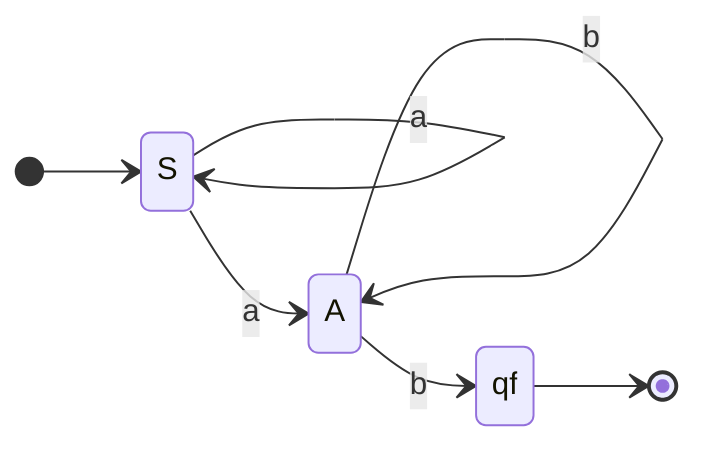

###### **Algoritmo: autómata finito → gramática regular**
El camino inverso, con los casos borde que más se olvidan:

1. Asociar al **estado inicial** el símbolo distinguido $S$.
2. Asociar a **cada estado** del autómata (menos el inicial) un símbolo **no terminal** $\{A, B, C, \dots\}$. Con dos excepciones:
   - Si **al estado inicial llega algún arco**, asociarle **también** un no terminal, además del símbolo distinguido.
   - **No** asociar no terminal a aquellos estados **finales de los que no salen arcos**.
3. Para cada transición definida $f(e_i, a) = e_j$, agregar al conjunto de producciones la regla $A \to aB$, siendo $A$ y $B$ los no terminales asociados a $e_i$ y $e_j$.
   - Si $e_j$ es un **estado final**, agregar **además** la producción $A \to a$.
   - Si $e_j$ es el **estado inicial** —que entonces tiene dos símbolos asociados—, usar el **no terminal**, nunca el distinguido. Así se evita que $S$ aparezca a la derecha de una producción.
4. Si el estado inicial es **también final**, agregar la producción $S \to \lambda$.

El paso 3 es el corazón del algoritmo, porque cada arco del autómata es una producción de la gramática. Y el "agregar además $A \to a$" es lo que permite **terminar** la derivación, porque en la gramática no existe el concepto de estado final.

###### **Ejemplo resuelto**
$$L_3 = \{\, x\,c^{3m} \mid x \in \{a,b\}^*,\ \text{la cantidad de } b \text{ en } x \text{ es par},\ m \ge 0 \,\}$$

Es decir, una cadena de `a` y `b` con una cantidad par de `b`, seguida de una cantidad de `c` múltiplo de 3. El autómata es $M_{3D} = \langle \{e_0,\dots,e_4\},\ \{a,b,c\},\ \delta,\ e_0,\ \{e_0, e_4\} \rangle$:

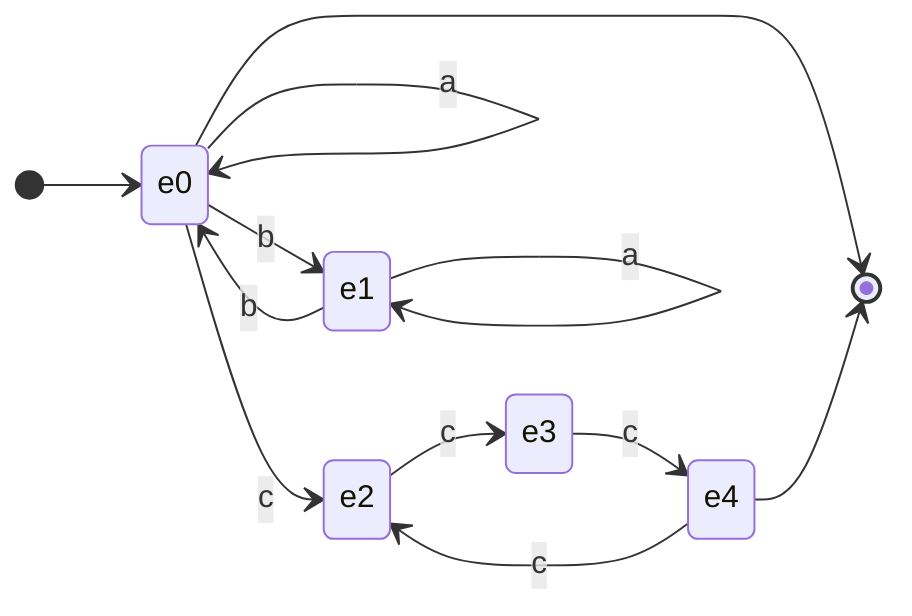

$e_0$/$e_1$ cuentan la paridad de las `b`; $e_2 \to e_3 \to e_4$ cuenta las `c` módulo 3. Asociando $S = e_0$, $A = e_1$, $B = e_2$, $C = e_3$, $D = e_4$, JFLAP da la gramática:

$$S \to aS \mid bA \mid cB \mid \lambda \qquad A \to aA \mid bS \qquad B \to cC \qquad C \to cD \qquad D \to cB \mid \lambda$$

Notar que JFLAP resuelve los estados finales con producciones $X \to \lambda$ ($S \to \lambda$, $D \to \lambda$) en lugar de agregar $A \to a$ por cada arco que entra a un final, y que **sí** deja a $S$ a la derecha ($A \to bS$) aunque al estado inicial le entren arcos. Las dos gramáticas generan el mismo lenguaje; la del algoritmo de la cátedra evita $\lambda$ salvo en $S \to \lambda$ y nunca pone a $S$ a la derecha, que es la forma estricta de tipo 3.

Un segundo ejemplo derivado con JFLAP es $L_7 = \{\, a^{2n} b^{2k+1} \mid n \ge 1,\ k \ge 0 \,\} \cup \{\, ax \mid x \in \{a,b\}^* \text{ y } x \text{ contiene la subcadena } ba \,\}$, con un AFD mínimo de 7 estados ($p_0 \dots p_6$, finales $p_3$ y $p_6$). Es buena práctica rehacerlo aplicando los cuatro pasos.

## Expresiones regulares ↔ autómatas finitos

Dada una expresión regular existe un autómata finito capaz de reconocer el lenguaje que define, y recíprocamente, dado un autómata finito se puede expresar con una ER el lenguaje que reconoce. La conversión arranca de las equivalencias entre las ER **básicas** y sus autómatas:

![[lr-re-af.svg]]

###### **De ER a AFND: el método del GTG**
Es el algoritmo que implementa JFLAP, y es fácil de hacer a mano:

1. Se arranca con un **GTG** (grafo de transición generalizado) de **dos estados**, y una única transición del inicial al final etiquetada con **toda** la expresión regular.
2. Se reemplaza esa transición por nuevos estados conectados por transiciones etiquetadas con los **operandos del operador de nivel superior** de la expresión. El operador de nivel superior es el que debe evaluarse **último**. En $ab+c$ es el `+`, porque la concatenación tiene mayor prioridad.
3. Los operandos se conectan con transiciones-$\lambda$ para reproducir la funcionalidad del operador que se eliminó.
4. Se repite hasta que **cada transición tenga un solo símbolo** o $\lambda$. En ese momento el GTG **ya es** un AFND.

En cada paso el GTG sigue siendo equivalente a la ER original, y por eso el resultado final reconoce exactamente el mismo lenguaje.

###### **De AF a ER: eliminación de estados**
La lógica es la misma al revés. Se toma el AFND como un GTG y se van **eliminando estados sucesivamente**, generando GTG equivalentes. Cada vez que se borra un estado intermedio, las transiciones que pasaban por él se reemplazan por transiciones directas etiquetadas con la ER correspondiente (concatenando lo que entraba, el cierre del bucle propio y lo que salía). Se sigue hasta quedarse con un **único estado inicial y un único estado final**, y la etiqueta que los une es la expresión regular buscada.

###### **JFLAP en la práctica**
La cátedra usa JFLAP en todos los ejemplos, así que conviene tener presente su notación:

| En JFLAP | Significa |
|---|---|
| `*` | Estrella de Kleene |
| Dos expresiones adyacentes | Concatenación (operador implícito) |
| `+` | **Unión**, el operador "o" |
| `!` | La cadena vacía $\lambda$ |
| Transición con el campo **vacío** | Transición-$\lambda$ en un autómata |
| Paréntesis | Fuerzan el orden de las operaciones |

Cualquier carácter es legal en el lenguaje **excepto** `*`, `+`, `(`, `)` y `!`, que están reservados. Ojo con el espacio, que es un carácter legal, así que `a *` (con espacio antes del asterisco) **no** es lo mismo que `a*`. JFLAP también permite **transiciones de varios caracteres**, y una transición etiquetada `aaa` consume tres símbolos de una; si un estado tiene una transición `aaa` y otra `aa`, ese estado es no determinista.

El botón *Do it* de la conversión aplica **un paso** por vez, que es la forma de estudiar el algoritmo, porque se ve cómo cada transición de una sola expresión se descompone.

## Enganches con el resto de la materia

###### **Con el enfoque de modelado y las Redes de Petri**
El autómata finito **es** el formalismo que la sección del enfoque de modelado descarta por no escalar, y ahora se puede decir por qué con números. Si se quiere modelar un sistema de $k$ procesos, cada uno con $n$ estados locales, el comportamiento conjunto es el **autómata producto**, cuyos estados son las tuplas de estados locales, y sus transiciones son todos los **interleavings** posibles.

$$|Q_{\text{producto}}| = n^k$$

Dos procesos de 10 estados dan 100 estados; cinco procesos dan 100.000. Esa es exactamente la **explosión del espacio de estados**. Una red de Petri modela lo mismo con $k \cdot n$ **lugares**, porque el estado global no se dibuja sino que **emerge del marcado**. Por eso la materia usa máquinas de estados para entender la teoría y redes de Petri para modelar de verdad.

###### **Con la concurrencia**
- Un sistema reactivo se **especifica** con un autómata: los eventos del entorno son el alfabeto de entrada, y el lenguaje reconocido es el conjunto de **trazas válidas** del sistema.
- Las propiedades de **seguridad** se expresan como "ninguna traza del sistema pertenece al lenguaje de las trazas malas" — y ahí entra el model checking, que es en el fondo un problema de **intersección de autómatas**.
- El no determinismo del AFND es el mismo no determinismo del scheduler. No se sabe cuál de los caminos posibles se va a tomar, así que hay que verificar que **todos** funcionen.

## Ejercicios Propuestos

1. Sea el lenguaje $L_3 = \{\, x\,c^{3m} \mid x \in \{a,b\}^*,\ \text{la cantidad de } b \text{ es par},\ m \ge 0 \,\}$ (el autómata está resuelto en la sección del algoritmo AF → gramática).

   a) Primero, sólo la parte $x$: construí el AFD de las cadenas sobre $\{a,b\}$ con cantidad par de `b` (alcanza con dos estados).
   b) Escribí la expresión regular de $L_3$ completo.
   c) Obtené la gramática regular aplicando el algoritmo AF → $G_3$ **de la cátedra** (sin $\lambda$ salvo $S \to \lambda$, y sin $S$ a la derecha), con cuidado en los casos borde: el estado inicial es también final y le entran arcos. Comparala con la que da JFLAP.

2. Sea el lenguaje $L_4 = \{\, w \mid w \in \{0,1\}^*,\ w \text{ contiene } 00 \text{ ó } 11 \,\}$.

   a) Construí el autómata finito que lo reconoce.
   b) Aplicá el algoritmo AF → gramática regular y escribí el conjunto $P$ completo.
   c) Derivá la cadena `0100` desde el símbolo distinguido, mostrando cada paso.

3. Dada la gramática $G = (\{a,b\}, \{S, A, B\}, S, P)$ con $P = \{\, S \to aA,\ A \to aA,\ A \to bB,\ B \to bB,\ B \to a,\ B \to \lambda \,\}$:

   a) ¿De qué tipo es? Justificá.
   b) Obtené el AFND que reconoce $L(G)$.
   c) Convertí ese AFND a AFD por construcción de subconjuntos, mostrando la tabla intermedia.
   d) Escribí la expresión regular del lenguaje.

4. Convertí a autómata finito cada una de estas expresiones regulares, usando el método del GTG paso a paso:

   a) $q + a + b^* + cd$
   b) $(a + b)^* abb$
   c) $a(b^*b + a^*b)a^*$

5. Para el AFND de la figura de la sección de AFND → AFD (el que reconoce las cadenas terminadas en `ab`):

   a) Verificá que las cadenas `ab`, `aab` y `babab` son aceptadas, y que `aba` y `ba` no lo son.
   b) ¿Cuántos subconjuntos de $Q$ hay en total, y cuántos aparecieron en la construcción? Explicá la diferencia.

6. Construí el PDA determinista para $L = \{\, a^n b^n \mid n > 0 \,\}$ y respondé:

   a) ¿Qué pasa si se lo intenta reconocer con un autómata finito? Explicá por qué es imposible, en términos de cuánta información hay que recordar.
   b) Modificá el autómata para que reconozca $\{\, a^n b^{2n} \mid n > 0 \,\}$.

7. Para el NPDA de $L = \{\, a^n b^m \mid n > 0,\ n \le m \le 3n \,\}$:

   a) Identificá cuáles estados son no deterministas y por qué.
   b) Mostrá que `aabbbbbb` se acepta y que `abbbb` se rechaza.

8. Clasificá cada lenguaje en el nivel **más bajo** de la jerarquía de Chomsky al que pertenece, y nombrá el autómata que lo reconoce:

   a) $\{\, a^n b^m \mid n, m \ge 1 \,\}$
   b) $\{\, a^n b^n \mid n \ge 1 \,\}$
   c) $\{\, a^n b^n c^n \mid n \ge 1 \,\}$
   d) $\{\, ww \mid w \in \{a,b\}^* \,\}$
   e) El conjunto de palíndromos sobre $\{0,1\}$

9. Diseñá una máquina de Mealy y una de Moore que emitan `1` cada vez que en la entrada aparece la secuencia `101` (con solapamiento: en `10101` debe emitir dos veces).

   a) ¿Cuántos estados usa cada una?
   b) ¿En qué instante emite cada una la salida respecto del último símbolo leído?

10. Tomá el ejercicio 1 y modelá el mismo lenguaje con una **red de Petri**. Compará la cantidad de lugares y transiciones contra la cantidad de estados del AFD. Después hacé lo mismo suponiendo **tres** procesos independientes que reconocen ese lenguaje en paralelo: ¿cuántos estados tiene el autómata producto, y cuántos lugares la red de Petri?

# Threads en Java — atributos, estados y prioridades

*(Los ejemplos de código son del Java 7 Concurrency Cookbook.)*

## Creación de hilos

> Cuando hablamos de concurrencia en el mundo de los procesadores nos referimos a **tareas independientes que se ejecutan simultáneamente** en una computadora. Esta simultaneidad puede ser **real**, si los recursos lo permiten.

Ese "si los recursos lo permiten" es la distinción concurrencia/paralelismo que ya está más arriba. La estructura concurrente existe siempre, y el paralelismo real depende de que haya núcleos disponibles.

En Java **los hilos son objetos**, y hay dos formas de crearlos:

| Forma | Cómo | Cuándo |
|---|---|---|
| **Extender `Thread`** | Heredar de `Thread` y sobrescribir `run()`; después `new MiHilo().start()` | Casi nunca. Gasta la única herencia disponible |
| **Implementar `Runnable`** | Escribir una clase que implemente `Runnable`, y pasarle el objeto al constructor de `Thread` | **La recomendada**: separa la tarea del mecanismo que la ejecuta |

De estas dos maneras podemos "darle vida" a una clase.

```java
// Forma 1: extendiendo Thread
public class MiHilo extends Thread {
    @Override
    public void run() { /* tarea */ }
}
new MiHilo().start();

// Forma 2: implementando Runnable  (preferida)
public class MiTarea implements Runnable {
    @Override
    public void run() { /* tarea */ }
}
new Thread(new MiTarea()).start();
```

## Thread safe

> **Thread safe** es la característica que brinda la posibilidad de ejecutar el código en un entorno con múltiples hilos **garantizando que el recurso no se corrompe**.

Queda una pregunta para pensar:

> **¿Los atributos `static` son thread safe?**

**No.** Es exactamente al revés, porque un atributo `static` pertenece a la **clase**, así que **todos** los hilos del proceso ven la misma variable — es el caso más puro de estado compartido, y por lo tanto el candidato número uno a condición de carrera. Ser `static` no agrega ninguna garantía de sincronización.

Las únicas excepciones son:

- `static final` de un tipo **inmutable** (`String`, `Integer`, un objeto sin setters). Nadie lo puede modificar, así que no hay carrera. Además el JMM garantiza su publicación segura.
- Tipos declarados `volatile`, que garantizan **visibilidad** (que el cambio se vea) pero **no atomicidad** (`contador++` sigue rompiéndose).
- Las clases atómicas de `java.util.concurrent.atomic` (`AtomicInteger`, etc.).

Todo lo demás hay que protegerlo con `synchronized`, un `Lock` o un semáforo — que es justo el tema de la sección siguiente.

###### **El ejemplo del práctico: la red `y1`/`y2` pasada a Java con `static`**
El práctico abre con el mismo ejemplo Promela de la Introducción (`process_1`/`process_2` con `y1`, `y2`, `in_critical`) y lo traduce a Java usando **atributos estáticos** como memoria compartida:

```java
public abstract class Tarea implements Runnable {
    protected static int y1 = 0, y2 = 0;
    protected static int critical = 0;       // un solo valor para TODAS las tareas
}

public class T1 extends Tarea {
    @Override
    public void run() {
        while (true) {
            Tarea.y1 = Tarea.y2 + 1;
            while (!(Tarea.y2 == 0) && !(Tarea.y1 <= Tarea.y2)) { }   // espera activa
            Tarea.critical++;
            Tarea.critical--;
            Tarea.y1 = 0;
            if (Tarea.critical != 0) {
                System.out.println("Valor CRITICAL desde T1 = " + Tarea.critical);
                System.out.println("Valor Y1 desde T1 = " + Tarea.y1);
                System.out.println("Valor Y2 desde T1 = " + Tarea.y2);
            }
        }
    }
}
// T2 es simétrica: y2 = y1 + 1; espera (y1 == 0) || (y2 < y1); usa y2.

public class Proceso {
    public Proceso() {
        new Thread(new T1()).start();
        new Thread(new T2()).start();
    }
}
public class Main {
    public static void main(String[] args) { new Proceso(); }
}
```

Las dos tareas son objetos **distintos**, pero como `y1`, `y2` y `critical` son `static`, comparten las mismas variables. Si el protocolo de entrada funcionara, `critical` sería siempre 0 al salir, y el `if` nunca imprimiría nada. Al correrlo, la consola se llena de líneas `Valor CRITICAL desde T1 = -1` (y `= 1` desde T2), porque los `++`/`--` de los dos hilos se intercalan, se pierden actualizaciones, y la exclusión mutua **no** se cumple. Es la respuesta experimental a la pregunta. Los `static` no son thread-safe, son exactamente lo contrario.

## Atributos de la clase Thread

La clase `Thread` almacena atributos de información que ayudan a identificar un hilo, conocer su estado o controlar su prioridad:

| Atributo | Método | Qué guarda |
|---|---|---|
| **Id** | `getId()` | Identificador único de cada hilo. **No se puede modificar** |
| **Nombre** | `getName()` / `setName()` | Nombre del hilo. Por defecto `Thread-XX` |
| **Prioridad** | `getPriority()` / `setPriority()` | Entero de **1 a 10**. `Thread.MIN_PRIORITY = 1`, `NORM_PRIORITY = 5`, `MAX_PRIORITY = 10` |
| **Estado** | `getState()` | Un valor del enum `Thread.State`. **No se puede modificar** directamente |

Sobre la prioridad, el libro advierte que **no es recomendable cambiarla**. La prioridad es apenas una *sugerencia* al planificador del sistema operativo; no garantiza ningún orden de ejecución, y su efecto real cambia de un SO a otro. Un programa cuya corrección dependa de las prioridades está mal diseñado — recordá el principio de que el resultado debe ser **independiente de la velocidad relativa** de los procesos.

## Estados de un hilo en Java

Acá hay una diferencia que conviene tener clara para el parcial. Es común leer que **"en Java los estados posibles de un hilo son 7"**, pero el enum `Thread.State` de la API tiene **seis** valores, y el libro de la cátedra (Fernández González, cap. 1) también habla de seis:

| `Thread.State` | Significado |
|---|---|
| **NEW** | El objeto `Thread` fue creado pero todavía **no se llamó a `start()`** |
| **RUNNABLE** | Ejecutándose en la JVM, **o** listo esperando el procesador. Java **no distingue** *ready* de *running* |
| **BLOCKED** | Bloqueado esperando un **monitor**: quiere entrar a un `synchronized` que otro hilo tiene tomado |
| **WAITING** | Esperando **indefinidamente** a otro hilo: `wait()`, `join()`, `park()` sin timeout |
| **TIMED_WAITING** | Igual, pero **con plazo**: `sleep(t)`, `wait(t)`, `join(t)` |
| **TERMINATED** | `run()` terminó, por retorno normal o por excepción |

El "séptimo estado" sale de **desdoblar `RUNNABLE`** en *preparado* y *en ejecución*, que es el modelo del sistema operativo que ya vimos en la sección de procesos. Es decir, 7 estados en el modelo del SO y 6 en el enum de Java, porque la JVM no puede saber si el hilo está efectivamente sobre el procesador en este instante.

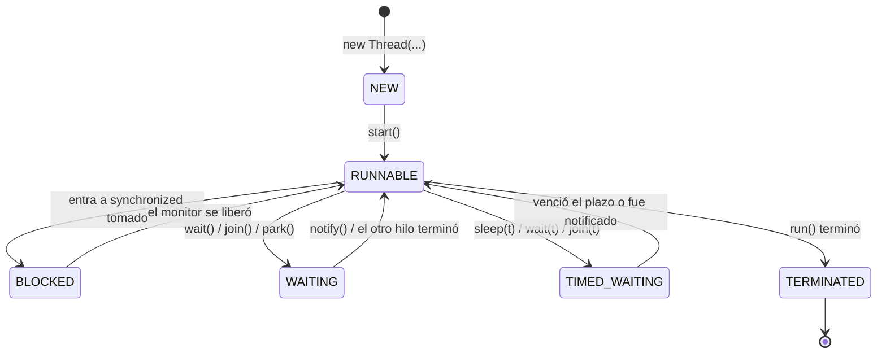

Notar que **de `BLOCKED`, `WAITING` y `TIMED_WAITING` siempre se vuelve a `RUNNABLE`**, nunca directo a ejecución. Es el mismo detalle que en la teoría de hilos del sistema operativo, donde el desbloqueo devuelve el hilo a la **cola de listos**.

## Ejemplo: seguir los estados de 10 hilos

El ejercicio del práctico consiste en crear 10 hilos, fijarles nombre y prioridad —**pares en máxima, impares en mínima**—, y escribir en un archivo LOG cada vez que alguno **cambia de estado**.

La tarea es una clase `Calculator` que implementa `Runnable`. En el libro calcula la tabla de multiplicar de un número; el práctico la cambia por el **cálculo y conteo de números primos hasta un límite**, y el motivo es importante. La tabla de multiplicar termina tan rápido que casi no se alcanzan a ver transiciones de estado. Con los primos, subiendo el límite, el hilo tarda lo suficiente como para que el LOG muestre algo.

```java
public class Calculator implements Runnable {
    private final int limite;

    public Calculator(int limite) { this.limite = limite; }

    @Override
    public void run() {
        int cuenta = 0;
        for (int n = 2; n <= limite; n++) {
            if (esPrimo(n)) cuenta++;
        }
        System.out.printf("%s: %d primos hasta %d%n",
            Thread.currentThread().getName(), cuenta, limite);
    }

    private boolean esPrimo(int n) {
        for (int i = 2; i * i <= n; i++) {
            if (n % i == 0) return false;
        }
        return true;
    }
}
```

```java
public class Main {
    public static void main(String[] args) {
        Thread threads[] = new Thread[10];
        Thread.State status[] = new Thread.State[10];

        // 10 tareas, prioridad máxima a los pares y mínima a los impares
        for (int i = 0; i < 10; i++) {
            threads[i] = new Thread(new Calculator(200000));
            if ((i % 2) == 0) {
                threads[i].setPriority(Thread.MAX_PRIORITY);
            } else {
                threads[i].setPriority(Thread.MIN_PRIORITY);
            }
            threads[i].setName("Thread " + i);
        }

        try (FileWriter file = new FileWriter(".\\data\\log.txt");
             PrintWriter pw = new PrintWriter(file)) {

            // antes de start(): todos en NEW
            for (int i = 0; i < 10; i++) {
                pw.println("Main : Status of Thread " + i + " : " + threads[i].getState());
                status[i] = threads[i].getState();
            }

            for (int i = 0; i < 10; i++) {
                threads[i].start();
            }

            // sondeo: cada vez que un hilo cambia de estado, se registra
            boolean finish = false;
            while (!finish) {
                for (int i = 0; i < 10; i++) {
                    if (threads[i].getState() != status[i]) {
                        writeThreadInfo(pw, threads[i], status[i]);
                        status[i] = threads[i].getState();
                    }
                }
                finish = true;
                for (int i = 0; i < 10; i++) {
                    finish = finish && (threads[i].getState() == Thread.State.TERMINATED);
                }
            }
        } catch (IOException e) {
            e.printStackTrace();
        }
    }

    private static void writeThreadInfo(PrintWriter pw, Thread thread, Thread.State state) {
        pw.printf("Main : Id %d - %s%n", thread.getId(), thread.getName());
        pw.printf("Main : Priority: %d%n", thread.getPriority());
        pw.printf("Main : Old State: %s%n", state);
        pw.printf("Main : New State: %s%n", thread.getState());
        pw.printf("Main : ************************************%n");
    }
}
```

Una variante del ejercicio es un poco distinta. `run()` cuenta primos con `current` de 1 a `max = 200L` (con el comentario "pocos números, ¿qué pasa con prioridad?"), `isPrime` prueba divisores de 2 a `number - 1` y devuelve `true` para `number <= 2`, `main` imprime antes los valores `MIN_PRIORITY`, `NORM_PRIORITY` y `MAX_PRIORITY` (1, 5 y 10) y los hilos se llaman `"My Thread " + i`. En la salida todos terminan con `Number of Primes: 47` (46 primos hasta 200, más el 1 que esa versión de `isPrime` cuenta como primo) y en un orden que **no** respeta las prioridades. El LOG muestra justamente el fenómeno de la "foto": `My Thread 0` pasa de `NEW` directo a `TERMINATED`.

###### **Las preguntas del práctico, respondidas**

**¿Qué sucedió con la prioridad?** En general, **nada de lo que uno esperaría**. Los hilos con `MAX_PRIORITY` no terminan sistemáticamente antes que los de `MIN_PRIORITY`. Tres razones:

1. La prioridad de Java se **mapea** a las prioridades del sistema operativo, y ese mapeo depende de la plataforma; en varios sistemas los 10 niveles se aplastan en muchos menos.
2. Con más de un núcleo, todos los hilos pueden estar corriendo **de verdad al mismo tiempo**, y entonces no hay competencia por el procesador que resolver, así que la prioridad no interviene.
3. Aunque haya competencia, la prioridad influye en la **probabilidad** de ser elegido, no en un orden garantizado.

**¿Qué parámetros conviene modificar para verificar el funcionamiento?** El **límite de primos** (si es chico, los hilos terminan antes de que el bucle de sondeo alcance a registrar nada), la **cantidad de hilos** (más hilos que núcleos fuerza competencia real por el procesador, que es cuando la prioridad empieza a notarse) y la **diferencia de prioridades**.

**Sobre el LOG**: el bucle `while (!finish)` es un **sondeo activo** (*busy waiting*) — consume un núcleo entero preguntando por los estados. Eso es didáctico para ver las transiciones, pero en un programa real sería un error, porque es la definición misma de desperdiciar CPU sin avanzar. En producción se usa `join()`, un `ExecutorService` o un `CountDownLatch`.

Además, `getState()` es **una foto**, porque entre que se lee el estado y se lo escribe, el hilo ya puede haber cambiado. Por eso en el LOG aparecen transiciones "perdidas" — se ve `NEW → RUNNABLE → TERMINATED` sin los estados intermedios, aunque el hilo haya pasado por `TIMED_WAITING`.

> [!question]- Actividad — Predecir el LOG
> Antes de correr el ejemplo, respondé:
>
> a) ¿En qué estado están los 10 hilos en el primer bloque de escritura, antes de los `start()`?
> b) Si la máquina tiene 8 núcleos y se lanzan 10 hilos, ¿cuántos pueden estar en `RUNNABLE` a la vez? ¿Y cuántos efectivamente sobre un procesador?
> c) Si a `Calculator` se le agrega un `Thread.sleep(100)` dentro del bucle, ¿qué estado nuevo va a aparecer en el LOG?
> d) ¿Por qué nunca vas a ver `BLOCKED` en este ejemplo tal como está?
>
> *Pista para (d): `BLOCKED` es específicamente "esperando un monitor". Fijate si en este programa hay algún `synchronized`.*


# Sincronización con `synchronized` — fundamentos

*(Los ejemplos `Account`/`Bank`/`Company` y `Cinema` son del Java 7 Concurrency Cookbook, cap. 2. El de la playa de estacionamiento es del Java 9 Concurrency Cookbook, cap. 2, recipe 1, paquete `com.packtpub.java9.concurrency.cookbook.chapter02.recipe01`.)*

Esta sección es el escalón anterior a `ReadWriteLock` y `Semaphore`, que se desarrollan en la sección siguiente. Antes de esos mecanismos "de biblioteca", Java tiene uno **integrado en el lenguaje**, la palabra reservada `synchronized`.

## El problema y la palabra clave

Una de las situaciones más comunes en programas concurrentes es que **más de un hilo comparta un recurso** — varios hilos que leen y escriben los mismos datos, por ejemplo una fila de una base de datos. El acceso compartido sin control produce errores o inconsistencia.

La solución es la **sección crítica** (SC), un bloque de código que accede al recurso y que **no puede ser ejecutado por más de un hilo a la vez**. Java ofrece varios mecanismos para implementarla; el más básico es `synchronized`.

> Cuando más de un hilo espera a que otro termine dentro de la SC, la JVM elige uno y el resto espera su turno — sin garantía de orden, salvo que se pida explícitamente *fairness*, cosa que `synchronized` no permite y `Lock` sí (se ve en la sección siguiente).

## `synchronized` en un método

```java
public synchronized void addAmount(double amount) { ... }
```

Sólo **un hilo a la vez** puede ejecutar el método de un objeto declarado `synchronized`. Si otro hilo intenta acceder a **cualquier otro** método `synchronized` del **mismo objeto**, queda suspendido hasta que el primero termine — cada método `synchronized` es una sección crítica, y Java sólo permite ejecutar **una** SC por instancia a la vez.

**Detalle sobre `static`**: un método `static synchronized` sincroniza sobre la **clase**, no sobre la instancia. Eso significa que un hilo puede estar ejecutando un método estático sincronizado mientras **otro hilo distinto ejecuta, al mismo tiempo, un método de instancia sincronizado del mismo objeto** — son dos monitores distintos (el de la clase y el del objeto). Si ambos métodos modifican la misma variable, hay inconsistencia igual, aunque los dos estén marcados `synchronized`.

###### **Ejemplo: `Account`**

```java
public class Account {
    private double balance;

    public double getBalance() { return balance; }
    public void setBalance(double balance) { this.balance = balance; }

    public synchronized void addAmount(double amount) {
        double tmp = balance;
        try {
            Thread.sleep(10);           // fuerza la condición de carrera si se saca el synchronized
        } catch (InterruptedException e) {
            e.printStackTrace();
        }
        tmp += amount;
        balance = tmp;
    }

    public synchronized void subtractAmount(double amount) {
        double tmp = balance;
        try {
            Thread.sleep(10);
        } catch (InterruptedException e) {
            e.printStackTrace();
        }
        tmp -= amount;
        balance = tmp;
    }
}
```

```java
public class Bank implements Runnable {          // retira dinero
    private final Account account;
    public Bank(Account account) { this.account = account; }

    @Override
    public void run() {
        for (int i = 0; i < 100; i++) {
            account.subtractAmount(1000);
        }
    }
}

public class Company implements Runnable {       // deposita dinero
    private final Account account;
    public Company(Account account) { this.account = account; }

    @Override
    public void run() {
        for (int i = 0; i < 100; i++) {
            account.addAmount(1000);
        }
    }
}
```

Con `synchronized`, el `Thread.sleep(10)` **adentro** del método no rompe nada, porque mientras un hilo duerme dentro de la sección crítica, ningún otro puede entrar. Sin el `synchronized`, ese mismo `sleep` es lo que expone la condición de carrera. Un segundo hilo lee `balance` mientras el primero todavía tiene el valor viejo en `tmp`, y una de las dos actualizaciones se pierde.

## Sincronizar un bloque en vez de un método completo

Sincronizar el método entero a veces es demasiado. Si el método hace trabajo que no toca el recurso compartido, ese trabajo también queda serializado sin necesidad. Java permite sincronizar sólo el bloque que hace falta, usando un objeto como **llave** (*lock* implícito, también llamado monitor):

```java
synchronized (llave) {
    // sólo esto es sección crítica
}
```

###### **Ejemplo: la playa de estacionamiento**
El ejercicio es una playa de estacionamiento con tres clases —**Caja** (`ParkingCash`, contabiliza el dinero), **Estadística** (`ParkingStats`, cuenta autos y motos, y cuando sale un vehículo ejecuta el pago en la Caja) y **Sensor** (detecta entradas y salidas y actualiza la Estadística). El punto del ejercicio es que **autos y motos son contadores independientes**, así que conviene usar **dos llaves distintas** —una por cada contador— en vez de sincronizar todo el objeto con una sola.

```java
public class ParkingCash {
    private static final int cost = 2;
    private long cash;

    public ParkingCash() { cash = 0; }

    public synchronized void vehiclePay() {        // un solo vehículo a la vez accede a la caja
        cash += cost;
    }

    public void close() {
        System.out.printf("Closing accounting");
        long totalAmmount;
        synchronized (this) {                       // bloque sincronizado sobre el propio objeto
            totalAmmount = cash;
            cash = 0;
        }
        System.out.printf("The total amount is : %d", totalAmmount);
    }
}
```

```java
public class ParkingStats {
    private long numberCars;
    private long numberMotorcycles;
    private final Object controlCars, controlMotorcycles;   // dos llaves independientes
    private ParkingCash cash;

    public ParkingStats(ParkingCash cash) {
        numberCars = 0;
        numberMotorcycles = 0;
        controlCars = new Object();
        controlMotorcycles = new Object();
        this.cash = cash;
    }

    public void carComeIn() {
        synchronized (controlCars) { numberCars++; }
    }
    public void carGoOut() {
        synchronized (controlCars) { numberCars--; }
        cash.vehiclePay();
    }
    public void motoComeIn() {
        synchronized (controlMotorcycles) { numberMotorcycles++; }
    }
    public void motoGoOut() {
        synchronized (controlMotorcycles) { numberMotorcycles--; }
        cash.vehiclePay();
    }

    public long getNumberCars() {
        synchronized (controlCars) { return numberCars; }
    }
    public long getNumberMotorcycles() {
        synchronized (controlMotorcycles) { return numberMotorcycles; }
    }
}
```

```java
public class Sensor implements Runnable {
    private ParkingStats stats;
    public Sensor(ParkingStats stats) { this.stats = stats; }

    @Override
    public void run() {
        for (int i = 0; i < 10; i++) {
            stats.carComeIn();
            stats.carComeIn();
            try { TimeUnit.MILLISECONDS.sleep(50); } catch (InterruptedException e) { e.printStackTrace(); }
            stats.motoComeIn();
            try { TimeUnit.MILLISECONDS.sleep(50); } catch (InterruptedException e) { e.printStackTrace(); }
            stats.motoGoOut();
            stats.carGoOut();
            stats.carGoOut();
        }
    }
}
```

```java
public class Main {
    public static void main(String[] args) {
        ParkingCash cash = new ParkingCash();
        ParkingStats stats = new ParkingStats(cash);

        System.out.println("Parking Simulator");
        int numberSensors = 2 * Runtime.getRuntime().availableProcessors();
        Thread[] threads = new Thread[numberSensors];
        for (int i = 0; i < numberSensors; i++) {
            Sensor sensor = new Sensor(stats);
            Thread thread = new Thread(sensor);
            thread.start();
            threads[i] = thread;
        }

        for (int i = 0; i < numberSensors; i++) {
            try {
                threads[i].join();
            } catch (InterruptedException e) {
                e.printStackTrace();
            }
        }

        System.out.printf("Number of cars: %d\n", stats.getNumberCars());
        System.out.printf("Number of motorcycles: %d\n", stats.getNumberMotorcycles());
        cash.close();
    }
}
```

**Cómo funciona**: cada `Sensor` hace, 10 veces, la secuencia "2 autos entran, 1 moto entra, 1 moto sale, 2 autos salen" —entran y salen la misma cantidad de veces—. La cantidad de sensores es `2 × availableProcessors()`; la cuenta que sigue supone **8 sensores** (una máquina de 4 núcleos):

- **Autos y motos esperados al final**: 0.
- **Recaudación esperada**: hay 3 salidas por vuelta (2 autos + 1 moto) y cada una paga 2: $8 \text{ sensores} \times 10 \text{ vueltas} \times 3 \text{ vehículos} \times 2 = 480$.

Tres salidas posibles:

| Versión | Autos | Motos | Recaudación |
|---|---|---|---|
| Con todos los `synchronized` | 0 | 0 | **480** |
| Sin `synchronized` en `vehiclePay()` | 0 | 0 | **468** — se perdieron 6 pagos en carreras sobre `cash += cost` |
| Sin **ningún** `synchronized` | **−4** | **4** | **416** — también se rompen los contadores |

Es la condición de carrera de `contador++`/`contador--` de la sección de interleaving, ahora medida. El `sleep(50)` entre operaciones es el "delay" que sirve para **forzar** que los hilos se intercalen.

**Regla de diseño**: `synchronized` penaliza el rendimiento porque serializa. Hay que usarlo sólo donde hace falta, y mantener la sección crítica **lo más corta posible** (*SC as short as possible*).

## Ejemplo: `Cinema` — dos recursos independientes con dos llaves

El mismo patrón, ahora con el ejemplo **literal del libro**: un cine con dos salas cuyas vacantes son independientes.

```java
public class Cinema {
    private long vacanciesCinema1;
    private long vacanciesCinema2;
    private final Object controlCinema1, controlCinema2;

    public Cinema() {
        controlCinema1 = new Object();
        controlCinema2 = new Object();
        vacanciesCinema1 = 20;
        vacanciesCinema2 = 20;
    }

    public boolean sellTickets1(int number) {
        synchronized (controlCinema1) {
            if (number < vacanciesCinema1) {
                vacanciesCinema1 -= number;
                return true;
            } else {
                return false;
            }
        }
    }

    public boolean sellTickets2(int number) {
        synchronized (controlCinema2) {
            if (number < vacanciesCinema2) {
                vacanciesCinema2 -= number;
                return true;
            } else {
                return false;
            }
        }
    }

    public boolean returnTickets1(int number) {
        synchronized (controlCinema1) { vacanciesCinema1 += number; return true; }
    }

    public boolean returnTickets2(int number) {
        synchronized (controlCinema2) { vacanciesCinema2 += number; return true; }
    }

    public long getVacanciesCinema1() { return vacanciesCinema1; }
    public long getVacanciesCinema2() { return vacanciesCinema2; }
}
```

```java
public class TicketOffice1 implements Runnable {
    private final Cinema cinema;
    public TicketOffice1(Cinema cinema) { this.cinema = cinema; }

    @Override
    public void run() {
        cinema.sellTickets1(3);
        cinema.sellTickets1(2);
        cinema.sellTickets2(2);
        cinema.returnTickets1(3);
        cinema.sellTickets1(5);
        cinema.sellTickets2(2);
        cinema.sellTickets2(2);
        cinema.sellTickets2(2);
    }
}
```

```java
public class TicketOffice2 implements Runnable {
    private final Cinema cinema;
    public TicketOffice2(Cinema cinema) { this.cinema = cinema; }

    @Override
    public void run() {
        cinema.sellTickets2(2);
        cinema.sellTickets2(4);
        cinema.sellTickets1(2);
        cinema.sellTickets1(1);
        cinema.returnTickets2(2);
        cinema.sellTickets1(3);
        cinema.sellTickets2(2);
        cinema.sellTickets1(2);
    }
}
```

```java
public class Main {
    public static void main(String[] args) throws InterruptedException {
        Cinema cinema = new Cinema();

        Thread thread1 = new Thread(new TicketOffice1(cinema), "TicketOffice1");
        Thread thread2 = new Thread(new TicketOffice2(cinema), "TicketOffice2");

        thread1.start();
        thread2.start();
        thread1.join();
        thread2.join();

        System.out.println("Vacantes sala 1: " + cinema.getVacanciesCinema1());
        System.out.println("Vacantes sala 2: " + cinema.getVacanciesCinema2());
    }
}
```

El **resultado esperado** es `Room 1 Vacancies: 5` y `Room 2 Vacancies: 6`. Se puede verificar a mano. En la sala 1 se venden $3+2+5+2+1+3+2 = 18$ y se devuelven 3, así que quedan $20 - 18 + 3 = 5$; en la sala 2 se venden $2+2+2+2+2+4+2 = 16$ y se devuelven 2, quedan $20 - 16 + 2 = 6$. Como todas las ventas caben (el `if` nunca rechaza en este orden), el resultado no depende del interleaving — **si** la sincronización es correcta.

El diagrama de secuencia del cine dibuja este mismo programa. `Main` crea `Cinema` y las dos boleterías, las arranca y hace `join`; cada venta o devolución aparece dentro de un fragmento **`critical`** con guarda `[controlCinema1]` o `[controlCinema2]`, y las operaciones sobre salas distintas se agrupan en un **`par`** — la notación UML exacta para "dos regiones críticas con llaves distintas pueden correr en paralelo".

Cuando se sincroniza con un objeto como llave, la JVM garantiza que **sólo un hilo a la vez** puede ejecutar **cualquiera** de los bloques que usan esa misma llave — no importa en qué método estén. `sellTickets1` y `returnTickets1` comparten `controlCinema1`, así que se excluyen mutuamente entre sí; pero `sellTickets1` y `sellTickets2` usan llaves distintas, así que **sí pueden ejecutarse en paralelo**, porque protegen recursos independientes.

## El error clásico: sincronizar con el objeto equivocado

Casi todo en Java hereda de `Object`, así que la tentación es usar **cualquier objeto a mano** como llave, y ahí está la trampa. El caso típico es sincronizar con la variable que se está modificando, cuando esa variable es un **wrapper** de un tipo primitivo (`Integer`, `Long`, etc.).

> Un wrapper no es más que un puntero al objeto inmutable que representa ese valor. Sincronizar con un `Integer` en realidad toma el monitor **del objeto al que apunta en ese momento**. Si dentro del bloque se reasigna esa variable a un valor distinto, la próxima vez que otro hilo sincronice con ella va a tomar el monitor de **otro objeto** — porque los `Integer` son inmutables y cada valor nuevo es una instancia distinta.

La cátedra probó cinco variantes del mismo ejercicio del cine, corriendo cada una 100.000 veces:

| Caso | Con qué se sincroniza | Resultado |
|---|---|---|
| 1 | Dos objetos `Object` creados para tal fin (como `controlCinema1`/`controlCinema2` de arriba) | **OK** |
| 2 | La misma variable `Integer vacancies` que el método recibe y modifica | **ERRÓNEO** |
| 3 | Un arreglo de elementos, usando el arreglo completo como llave | **OK** |
| 4 | Un **elemento** de ese mismo arreglo | **ERRÓNEO** |
| 5 | Un objeto nuevo con su propio atributo y métodos para encapsular la operación | **OK** |

El patrón es claro. **Funciona sincronizar con un objeto cuya identidad no cambia** durante la vida del programa (un `Object` dedicado, el arreglo en sí, un objeto propio); **falla sincronizar con algo cuyo valor —y por lo tanto identidad, si es un wrapper— puede cambiar** dentro del bloque protegido.

El detalle inquietante es que con **10 ejecuciones** del caso erróneo, "todo parece funcionar OK". Recién con **100.000** ejecuciones aparecen las inconsistencias — porque hace falta que las dos llaves *coincidan por casualidad* apuntando al mismo valor, algo que en 1000 corridas pasó unas 10 veces.

> **El testing puede engañarte.** Es la misma idea de Dijkstra de la sección de Introducción, con un ejemplo concreto: un bug de concurrencia puede pasar cientos de corridas sin manifestarse.

Referencia: *CERT LCK01-J. Do not synchronize on objects that may be reused* — https://www.securecoding.cert.org/confluence/display/java/LCK01-J.+Do+not+synchronize+on+objects+that+may+be+reused

## Comunicación entre hilos: `wait()`, `notify()`, `notifyAll()`

`synchronized` da exclusión mutua, pero muchas veces hace falta además que un hilo **espere una condición** sin consumir CPU en un bucle de sondeo. Estos tres métodos están definidos en `Object` — los hereda **cualquier** clase — y sólo se pueden llamar **dentro de un bloque `synchronized`** sobre el mismo objeto; si no, la JVM lanza `IllegalMonitorStateException`.

| Método | Qué hace |
|---|---|
| `wait()` | El hilo **libera el monitor** del objeto y pasa al *wait set* (conjunto de espera), dormido, hasta que otro hilo lo despierte |
| `notify()` | Despierta a **un** hilo arbitrario del *wait set*, elegido por el planificador, y lo pasa a *listo* |
| `notifyAll()` | Despierta a **todos** los hilos del *wait set* |

Es exactamente el estado `WAITING` de `Thread.State` que ya vimos en el capítulo de Threads. `wait()` sin plazo lleva a `WAITING`; con plazo (`wait(t)`) lleva a `TIMED_WAITING`.

###### **Ejemplo: productor/consumidor con `wait`/`notifyAll`**
El caso de uso clásico es un buffer acotado donde el productor no puede escribir si está lleno, y el consumidor no puede leer si está vacío.

```java
public class EventStorage {
    private final int maxSize;
    private final List<Date> storage;

    public EventStorage() {
        maxSize = 10;
        storage = new LinkedList<>();
    }

    public synchronized void set() {
        while (storage.size() == maxSize) {     // ¡while, no if! — se explica abajo
            try {
                wait();
            } catch (InterruptedException e) {
                e.printStackTrace();
            }
        }
        storage.add(new Date());
        System.out.printf("Set: %d%n", storage.size());
        notifyAll();
    }

    public synchronized void get() {
        while (storage.size() == 0) {
            try {
                wait();
            } catch (InterruptedException e) {
                e.printStackTrace();
            }
        }
        System.out.printf("Get: %d%n", storage.size());
        storage.remove(0);
        notifyAll();
    }
}
```

Dos detalles de diseño que son la parte que hay que entender, no memorizar:

- **`while`, nunca `if`**. `notifyAll()` despierta a **todos** los hilos dormidos, pero no garantiza que la condición siga siendo válida para cada uno cuando les toque correr — puede que otro hilo se haya adelantado y vuelto a llenar el buffer. Por eso, al despertar, hay que **volver a chequear** la condición; con `if` se seguiría de largo con una condición que ya no vale.
- **`notifyAll()` y no `notify()`**. Con productores y consumidores mezclados en el mismo *wait set*, `notify()` podría despertar a un hilo del tipo equivocado (otro productor, cuando lo que hace falta es despertar a un consumidor). `notifyAll()` es más caro pero seguro, porque despierta a todos, y cada uno vuelve a evaluar su propio `while`.

Esta es, en código, la misma idea que se modela como red de Petri en el capítulo de Redes de Petri (sección de modelos básicos), el buffer con lugares "libres"/"ocupados" donde *producir* y *consumir* se autolimitan por el propio marcado. `wait()`/`notifyAll()` es la implementación en Java de esa misma restricción estructural.

## `synchronized` vs `Lock`: cuándo usar cada uno

`Lock`, `ReentrantLock`, `ReadWriteLock` y `Semaphore` se desarrollan en la sección siguiente. Adelantando, la pregunta natural es cuándo conviene cada mecanismo:

**Ventajas de `Lock` sobre `synchronized`**:
- Permite estructurar bloques de forma más flexible (por ejemplo, tomar el lock en un método y liberarlo en otro — aunque es peligroso y hay que ser muy cuidadoso).
- `tryLock()`: preguntar si el lock está tomado **sin bloquearse**. `synchronized` no tiene equivalente.
- `lockInterruptibly()`: adquirir el lock de forma interrumpible.
- `ReadWriteLock` separa lectura de escritura — `synchronized` no distingue.
- Mejor rendimiento en varios escenarios de alta contención.

Como **regla práctica**, *keep it simple*. Usar `synchronized` por defecto, y reservar `ReentrantLock` para cuando hace falta específicamente alguna de sus capacidades especiales, como consultar sin bloquear (`tryLock`), adquirir de forma interrumpible, esperar con timeout, fairness explícita, o sincronizar bloques que no siguen la estructura anidada que `synchronized` exige.

Y la advertencia de deadlock que ya vale para ambos mecanismos: si el hilo A toma el lock X y espera Y, mientras el hilo B toma Y y espera X, los dos quedan bloqueados para siempre. El problema es el **orden opuesto** de adquisición. La solución de diseño es fijar un orden global y que todo el código lo respete.

## En resumen

- Sección crítica.
- `synchronized` en métodos (con la salvedad de `static`).
- `synchronized` en bloques de código, con una llave explícita.
- Los errores de sincronizar con el objeto equivocado (wrappers, elementos de arreglo).
- `wait()` / `notify()` / `notifyAll()` para comunicación entre hilos.
- `Lock` como alternativa más potente y más peligrosa si se usa mal.

> [!question]- Actividad — Encontrar el bug de sincronización
> Un compañero escribió esta clase para contar accesos concurrentes:
>
> ```java
> public class Contador {
>     private Integer valor = 0;
>
>     public void incrementar() {
>         synchronized (valor) {
>             valor = valor + 1;
>         }
>     }
> }
> ```
>
> a) ¿Por qué esto es exactamente el "Caso 2" de la tabla de arriba?
> b) Proponé una corrección usando una llave que no cambie de identidad.
> c) ¿Por qué con pocas ejecuciones el bug no se nota?
>
> *Pista: `Integer` es inmutable — `valor = valor + 1` no modifica el objeto, crea uno nuevo y reasigna la referencia. El monitor que un segundo hilo va a encontrar en `synchronized(valor)` ya no es el mismo.*

# Sincronización básica en Java — Locks, ReadWriteLocks y Semáforos

*(Los ejemplos son del Java 7 Concurrency Cookbook de Javier Fernández González, caps. 2 y 3.)*

Sincronización es la situación en la que **más de una tarea concurrente comparte un recurso**, y el bloque de código que accede a ese recurso es la **sección crítica**. Los mecanismos que ofrece Java, de más bajo a más alto nivel:

| Mecanismo | Qué da | Limitación |
|---|---|---|
| `synchronized` (método o bloque) | Exclusión mutua sobre el monitor de un objeto | No se puede intentar sin bloquear, ni elegir a quién le toca, ni separar lectura de escritura |
| `Lock` / `ReentrantLock` | Lo mismo, pero explícito: `tryLock()`, `lockInterruptibly()`, condiciones | Sigue siendo "uno a la vez" |
| `ReadWriteLock` | **Varios lectores** simultáneos, un solo escritor | Sólo sirve si se lee mucho más de lo que se escribe |
| `Semaphore` | Permite **N** accesos simultáneos; sin dueño | No es reentrante ni recuerda quién lo tomó |

## Lock: el punto de partida

```java
private final Lock queueLock = new ReentrantLock();

public void printJob(Object document) {
    queueLock.lock();
    try {
        long duration = (long) (Math.random() * 10000);
        System.out.println(Thread.currentThread().getName()
            + ": PrintQueue: Printing a Job during " + (duration / 1000) + " seconds");
        Thread.sleep(duration);
    } catch (InterruptedException e) {
        e.printStackTrace();
    } finally {
        queueLock.unlock();   // SIEMPRE en el finally
    }
}
```

Tres reglas que hay que saber de memoria:

- El `unlock()` va **en el `finally`**. Si una excepción sale de la sección crítica sin liberar el lock, los demás hilos esperan **para siempre**, o sea, deadlock.
- `tryLock()` **no duerme al hilo**, sino que devuelve `true` si consiguió el lock y `false` si no. Es responsabilidad del programador actuar según el valor devuelto. Si devuelve `false` y aun así ejecutás la sección crítica, tenés resultados incorrectos.
- `ReentrantLock` es **reentrante**, o sea que si un hilo que ya tiene el lock lo vuelve a pedir (por ejemplo en una llamada recursiva), se lo dan de inmediato.

Y la advertencia clásica del libro sobre deadlock: si el hilo A toma el lock X y el hilo B toma el lock Y, y después A pide Y mientras B pide X, los dos quedan bloqueados para siempre. El problema es que **toman los locks en orden opuesto**; la solución es fijar un orden global de adquisición.

## ReadWriteLock

La gran ventaja de los `Lock` es la interfaz `ReadWriteLock` y su implementación `ReentrantReadWriteLock`, que tiene **dos locks asociados**: uno de lectura y uno de escritura, implementados de manera que:

- Puede haber **más de un lector** a la vez.
- Sólo puede haber **un escritor**.
- Cuando hay un escritor, **no puede haber lectores** ejecutando.

Es la traducción directa del problema de lectores/escritores. Leer no modifica nada, así que varios pueden hacerlo en simultáneo sin corromper el dato, mientras que escribir sí modifica y necesita exclusión total.

###### **Ejemplo: `PricesInfo`**

```java
public class PricesInfo {
    private double price1;
    private double price2;
    private final ReadWriteLock lock;

    public PricesInfo() {
        price1 = 1.0;
        price2 = 2.0;
        lock = new ReentrantReadWriteLock();
    }

    public double getPrice1() {
        lock.readLock().lock();
        double value = price1;
        lock.readLock().unlock();
        return value;
    }

    public double getPrice2() {
        lock.readLock().lock();
        double value = price2;
        lock.readLock().unlock();
        return value;
    }

    public void setPrices(double price1, double price2) {
        lock.writeLock().lock();
        this.price1 = price1;
        this.price2 = price2;
        lock.writeLock().unlock();
    }
}
```

```java
public class Reader implements Runnable {
    private final PricesInfo pricesInfo;

    public Reader(PricesInfo pricesInfo) { this.pricesInfo = pricesInfo; }

    @Override
    public void run() {
        for (int i = 0; i < 10; i++) {
            System.out.printf("%s: Price 1: %f%n",
                Thread.currentThread().getName(), pricesInfo.getPrice1());
            System.out.printf("%s: Price 2: %f%n",
                Thread.currentThread().getName(), pricesInfo.getPrice2());
        }
    }
}

public class Writer implements Runnable {
    private final PricesInfo pricesInfo;

    public Writer(PricesInfo pricesInfo) { this.pricesInfo = pricesInfo; }

    @Override
    public void run() {
        for (int i = 0; i < 3; i++) {
            System.out.printf("Writer: Attempt to modify the prices.%n");
            pricesInfo.setPrices(Math.random() * 10, Math.random() * 8);
            System.out.printf("Writer: Prices have been modified.%n");
            try {
                Thread.sleep(2);
            } catch (InterruptedException e) {
                e.printStackTrace();
            }
        }
    }
}
```

```java
public class Main {
    public static void main(String[] args) {
        PricesInfo pricesInfo = new PricesInfo();

        Reader readers[] = new Reader[5];
        Thread threadsReader[] = new Thread[5];
        for (int i = 0; i < 5; i++) {
            readers[i] = new Reader(pricesInfo);
            threadsReader[i] = new Thread(readers[i]);
        }

        Writer writer = new Writer(pricesInfo);
        Thread threadWriter = new Thread(writer);

        for (int i = 0; i < 5; i++) {
            threadsReader[i].start();
        }
        threadWriter.start();
    }
}
```

En la salida se ve el efecto. Los cinco lectores imprimen intercalados sin estorbarse, y cuando el escritor toma el `writeLock` todos quedan esperando hasta que termina.

###### **La responsabilidad es del programador**
El libro lo remarca: **es responsabilidad del programador usar los locks para el propósito para el que fueron diseñados**. Si tomás el `readLock` y desde ahí modificás la variable, tenés un error de inconsistencia de datos y el mecanismo no te va a avisar. El lock de lectura permite que **varios hilos entren a la vez** — si uno de ellos escribe, se rompió la exclusión mutua.

###### **¿Cuándo conviene un `ReadWriteLock`?**
Para pensarlo, dos escenarios:

- **A)** Una base de datos cuyos valores se modifican muy esporádicamente y que se consulta continuamente por muchos lectores.
- **B)** Una base de datos en la que los precios cambian continuamente y hay muy poco acceso de consulta.

La respuesta es **A**. El `ReadWriteLock` gana cuando la proporción lectura/escritura es alta, porque ahí los lectores **realmente** corren en paralelo. En el escenario B casi todos los accesos son de escritura, que son exclusivos igual, y encima se paga el costo extra de administrar dos locks y de decidir a quién dar paso.

> Ojo: si el escenario no es el correcto, la implementación del `ReadWriteLock` puede salir **más cara que una sección crítica clásica**.

## Fairness: quién entra primero

Los constructores de `ReentrantLock` y `ReentrantReadWriteLock` admiten un parámetro booleano llamado **`fair`**:

| Modo | Valor | Comportamiento |
|---|---|---|
| **NON-FAIR** | `false` (por defecto) | Cuando se libera el lock y hay varios hilos esperando, se elige uno **sin ningún criterio** |
| **FAIR** | `true` | Se elige el hilo que **hace más tiempo** que está esperando |

Dos aclaraciones importantes:

- Esto vale **sólo** para `lock()` y `unlock()`. Como `tryLock()` no duerme ni bloquea al hilo, el atributo `fair` **no lo afecta**.
- El modo fair evita la inanición, pero cuesta más porque hay que mantener el orden de llegada.

###### **Un experimento**
Se toma el `PrintQueue` anterior, se lo construye con `new ReentrantLock(true)`, y se parte el `printJob()` en **dos bloques protegidos**, liberando el lock entre medio:

```java
public class PrintQueue {
    private final Lock queueLock = new ReentrantLock(true);   // FAIR

    public void printJob(Object document) {
        queueLock.lock();
        try {
            long duration = (long) (Math.random() * 10000);
            System.out.println(Thread.currentThread().getName()
                + ": PrintQueue: Printing a Job during " + (duration / 1000) + " seconds");
            Thread.sleep(duration);
        } catch (InterruptedException e) {
            e.printStackTrace();
        } finally {
            queueLock.unlock();
        }

        queueLock.lock();          // segunda etapa: vuelve a pedirlo enseguida
        try {
            long duration = (long) (Math.random() * 10000);
            System.out.println(Thread.currentThread().getName()
                + ": PrintQueue: Printing a Job during " + (duration / 1000) + " seconds");
            Thread.sleep(duration);
        } catch (InterruptedException e) {
            e.printStackTrace();
        } finally {
            queueLock.unlock();
        }
    }
}
```

Y en `Main` los hilos se lanzan con **100 ms de diferencia**, para que el orden de llegada sea conocido:

```java
for (int i = 0; i < 10; i++) {
    thread[i].start();
    try {
        Thread.sleep(100);
    } catch (InterruptedException e) {
        e.printStackTrace();
    }
}
```

**En FAIR MODE**: `Thread 0` toma el lock y los otros nueve se bloquean. Cuando `Thread 0` termina su primera etapa libera el lock e **inmediatamente lo vuelve a pedir**, así que hay 10 hilos compitiendo. Como el modo es fair, la JVM elige al que hace más tiempo espera: `Thread 1`. Después `Thread 2`, y así. **Ningún hilo ejecuta su segunda etapa hasta que todos pasaron por la primera**; recién ahí vuelve a ser el turno de `Thread 0`.

**En NON-FAIR MODE** no hay criterio. Lo típico es que cada hilo ejecute **sus dos etapas seguidas** antes de soltar el turno, es decir, el mismo hilo que acaba de liberar el lock lo vuelve a adquirir, porque ya está corriendo y es lo más barato para el planificador. Pero esto **no está garantizado**, porque la JVM no promete ningún orden.

Ese contraste es la mejor ilustración del requisito de exclusión mutua que dice "sin demora indefinida". El modo non-fair es más rápido, pero **admite inanición**; el fair la elimina a costa de rendimiento.

## Semáforos

> Un semáforo puede comprenderse como **un contador que protege el acceso a uno o más recursos compartidos**. Concepto introducido por **Edsger Dijkstra en 1965**, y usado por primera vez en el sistema operativo **THE**.

Es el mismo Dijkstra y el mismo año que aparecen en la tabla de hitos de la sección de Introducción, porque el semáforo fue el primer mecanismo de sincronización entre procesos concurrentes.

**Cómo funciona:**

1. Cuando un hilo quiere acceder al recurso compartido, primero debe **adquirir** el semáforo.
2. Si el contador es **mayor que 0**, se decrementa y el hilo **accede** al recurso. Un contador mayor que cero significa que hay recursos libres.
3. Si el contador es **0**, el acceso se niega y el hilo **va a dormir** a una cola del semáforo. Cero significa que todos los recursos están en uso.
4. Cuando el hilo termina de usar el recurso debe **liberar** el semáforo, lo que **incrementa** el contador.

###### **Semáforo binario**
Cuando el semáforo protege un solo recurso, su contador sólo toma los valores 0 y 1. Es un **semáforo binario**, y funciona como un lock.

```java
public class PrintQueue {
    private final Semaphore semaphore;

    public PrintQueue() {
        semaphore = new Semaphore(1);      // binario
    }

    public void printJob(Object document) {
        try {
            semaphore.acquire();                                   // 1. adquirir

            long duration = (long) (Math.random() * 10);           // 2. operar
            System.out.printf("%s: PrintQueue: Printing a Job during %d seconds%n",
                Thread.currentThread().getName(), duration);
            Thread.sleep(duration);

        } catch (InterruptedException e) {
            e.printStackTrace();
        } finally {
            semaphore.release();                                   // 3. liberar
        }
    }
}
```

```java
public class Job implements Runnable {
    private final PrintQueue printQueue;

    public Job(PrintQueue printQueue) { this.printQueue = printQueue; }

    @Override
    public void run() {
        System.out.printf("%s: Going to print a job%n", Thread.currentThread().getName());
        printQueue.printJob(new Object());
        System.out.printf("%s: The document has been printed%n", Thread.currentThread().getName());
    }
}

public class Main {
    public static void main(String args[]) {
        PrintQueue printQueue = new PrintQueue();
        Thread thread[] = new Thread[10];
        for (int i = 0; i < 10; i++) {
            thread[i] = new Thread(new Job(printQueue), "Thread" + i);
        }
        for (int i = 0; i < 10; i++) {
            thread[i].start();
        }
    }
}
```

Los **tres pasos** del método `printJob()` son el patrón completo de uso de un semáforo: adquirir con `acquire()`, operar con el recurso compartido, liberar con `release()` **en el `finally`**. El otro punto clave es la **inicialización** en el constructor, donde el `1` es lo que lo hace binario.

###### **Los semáforos no tienen dueño**
La diferencia conceptual con un lock es esta:

> Los semáforos **no tienen concepto de ownership**: cualquiera que tenga acceso al semáforo puede liberarlo, no hace falta ser el hilo que lo adquirió.

¿Para qué sirve eso? Para los casos en que **quien toma el permiso no es quien lo devuelve**, que es justo lo que un lock no puede modelar:

- **Productor/consumidor**: el productor hace `release()` sobre el semáforo "hay elementos" y el consumidor hace `acquire()`. Nadie devuelve lo que tomó.
- **Señalización entre hilos**: un hilo espera con `acquire()` a que otro le avise con `release()` — un semáforo inicializado en 0 es un mecanismo de espera/aviso.
- **Barreras y control de arranque**: soltar de golpe N permisos para largar N hilos que estaban esperando.

Por eso el semáforo es más general que el lock, que impone que quien entra es quien sale.

###### **Otros métodos de `Semaphore`**

| Método | Qué hace |
|---|---|
| `acquire()` | Adquiere un permiso; si el contador es 0, **bloquea**. Puede lanzar `InterruptedException` |
| `acquireUninterruptibly()` | Igual, pero **ignora la interrupción** del hilo y no lanza excepciones |
| `tryAcquire()` | Intenta adquirir: devuelve `true` y lo toma, o devuelve `false` **sin bloquearse** |
| `release()` | Libera un permiso e incrementa el contador |
| `availablePermits()` | Cantidad de permisos disponibles en este momento |
| `getQueueLength()` | Estimación de cuántos hilos están esperando para adquirir |
| `acquire(int)` / `release(int)` | Sobrecargas que toman o devuelven **varios permisos** de una vez |

Las versiones con parámetro `int` existen también para `acquireUninterruptibly` y `tryAcquire`. Si el contador es **menor** que la cantidad pedida, el hilo se bloquea hasta que llegue a ese valor o más. En eso se basa la implementación de lectores/escritores con semáforos, donde el escritor pide **todos** los permisos de golpe.

###### **Fairness en semáforos**
Es el mismo concepto que en los locks, y por la misma razón el constructor acepta un **segundo parámetro booleano**. `new Semaphore(1)` y `new Semaphore(1, false)` son non-fair; `new Semaphore(1, true)` elige siempre al hilo que hace más tiempo espera.

## Semáforo de N permisos

El semáforo binario protege **un** recurso. Inicializándolo en N protege **N copias** de un recurso, o una sección crítica que pueden ejecutar hasta N hilos a la vez. El ejemplo es una cola de impresión con **tres impresoras**.

```java
public class PrintQueue {
    private final Semaphore semaphore;
    private final boolean freePrinters[];
    private final Lock lockPrinters;

    public PrintQueue() {
        semaphore = new Semaphore(3);          // 3 permisos = 3 impresoras
        freePrinters = new boolean[3];
        for (int i = 0; i < 3; i++) {
            freePrinters[i] = true;
        }
        lockPrinters = new ReentrantLock();
    }

    public void printJob(Object document) {
        try {
            semaphore.acquire();                       // ¿hay impresora libre?
            int assignedPrinter = getPrinter();        // ¿cuál me tocó?

            long duration = (long) (Math.random() * 10);
            System.out.printf("%s: PrintQueue: Printing a Job in Printer %d during %d seconds%n",
                Thread.currentThread().getName(), assignedPrinter, duration);
            TimeUnit.SECONDS.sleep(duration);

            freePrinters[assignedPrinter] = true;      // devuelvo la impresora
        } catch (InterruptedException e) {
            e.printStackTrace();
        } finally {
            semaphore.release();
        }
    }

    private int getPrinter() {
        int ret = -1;
        try {
            lockPrinters.lock();
            for (int i = 0; i < freePrinters.length; i++) {
                if (freePrinters[i]) {
                    ret = i;
                    freePrinters[i] = false;
                    break;
                }
            }
        } catch (Exception e) {
            e.printStackTrace();
        } finally {
            lockPrinters.unlock();
        }
        return ret;
    }
}
```

Las clases `Job` y `Main` **no cambian**.

El **diagrama de secuencia** de este programa vale como ejemplo de cómo se dibuja concurrencia en UML. `Main` crea la `PrintQueue` (que hace `new Semaphore(3)`) y, en un `loop [12]`, crea y arranca los `Job`. Después hay un fragmento **`par [3 Job Threads]`** (sólo tres a la vez, porque el semáforo deja pasar tres), donde cada `Job` llama a `printJob(o)`, que hace `acquire()` sobre el `Semaphore`, después `getPrinter()`, cuyo interior es un fragmento **`critical [lockPrinter]`** con un `loop [3]` y un `alt [si freePrinter]` que elige la impresora; luego `print` y `release()`. El `critical` es el `Lock`, el `par` acotado es el semáforo.

Dos observaciones sobre el diseño, que son el punto del ejercicio:

- El semáforo inicializado en 3 limita el acceso a los **primeros tres hilos** que llamen a `acquire()`; el resto queda bloqueado hasta que alguno haga `release()`. Lo único que hace el semáforo es **contar**.
- Elegir **cuál** de las tres impresoras usar no es trabajo del semáforo. Esa parte usa un `Lock` aparte (`lockPrinters`) para proteger el arreglo `freePrinters`, y está sólo para darle realismo al ejemplo. El semáforo garantiza que **hay** una libre; el lock garantiza que dos hilos no se lleven **la misma**.

Acá aparece el enganche con lo que sigue, porque **este ejemplo es literalmente una red de Petri** con un lugar "recursos" con 3 fichas, una transición de entrada a la sección crítica y una de salida. El invariante que lo hace correcto es $M(\text{en uso}) + M(\text{recursos}) = 3$.

> [!question]- Actividad — Elegir el mecanismo
> Para cada situación decidí qué mecanismo usarías (`synchronized`, `ReentrantLock`, `ReadWriteLock` o `Semaphore`) y justificá en una línea:
>
> a) Un contador de visitas que se incrementa desde muchos hilos y se lee de vez en cuando.
> b) Una caché en memoria que se consulta miles de veces por segundo y se recarga una vez por hora.
> c) Un pool de 5 conexiones a base de datos.
> d) Un hilo que debe esperar a que otro termine de inicializar el sistema antes de arrancar.
> e) Una sección crítica de la que hay que salir si no se puede entrar en 50 ms.
>
> *Pista: (d) y (e) descartan de entrada a `synchronized`. Para (d) pensá en un semáforo inicializado en 0; para (e), en `tryLock(long, TimeUnit)`.*

> [!question]- Actividad — Romper el ReadWriteLock
> Tomá la clase `PricesInfo` y agregale este método:
>
> ```java
> public void bumpPrice1() {
>     lock.readLock().lock();
>     price1 = price1 + 1;      // ¡escribe con el lock de LECTURA!
>     lock.readLock().unlock();
> }
> ```
>
> a) ¿Compila? ¿Da error en tiempo de ejecución?
> b) Con 5 hilos llamando a este método 1000 veces cada uno, ¿cuánto vale `price1` al final? ¿Por qué no vale 5000?
> c) ¿Qué garantía del `ReadWriteLock` se violó exactamente?
>
> *Pista: el `readLock` permite que varios hilos entren a la vez. Volvé a la descomposición de `contador++` en tres acciones atómicas de la sección de interleaving.*


# Interrupción, sleep y join de hilos

*(Los ejemplos son del Java Concurrency Cookbook, cap. 1.)*

Un programa Java con varios hilos termina recién cuando **todos** sus hilos no-daemon terminan su ejecución. A veces hace falta terminar un hilo antes de tiempo —para cortar un programa, o cancelar una tarea— y Java da tres mecanismos relacionados con el ciclo de vida de un hilo: **interrupción**, **sleep** y **join**.

## Interrumpir un hilo

Java ofrece un mecanismo para indicarle a un hilo nuestra **voluntad de detenerlo**, pero con una peculiaridad importante:

> El hilo **puede ignorar** la petición y seguir trabajando. `interrupt()` no mata al hilo, sólo levanta una **bandera** interna. Es una petición gentil, no una orden.

Qué hace exactamente `interrupt()` depende de en qué está el hilo en ese momento:

- Si el hilo está **corriendo código normal**, no pasa nada automáticamente, sólo se pone en `true` el flag interno. El propio código tiene que consultarlo y decidir qué hacer.
- Si el hilo está **bloqueado** en `sleep()`, `wait()` o `join()`, esos métodos **lanzan `InterruptedException`** inmediatamente, y **el flag se borra** (queda en `false`) en el momento de lanzar la excepción.

Hay dos formas de consultar el flag, y la diferencia importa:

| Método | Sobre qué hilo | ¿Borra el flag? |
|---|---|---|
| `isInterrupted()` (de instancia) | El hilo sobre el que se llama | **No** |
| `Thread.interrupted()` (estático) | El hilo **actual** | **Sí**: devuelve el valor y lo deja en `false` |

###### **Ejemplo: `PrimeGenerator`**
El programa crea un hilo que genera números primos y, 10 segundos después, pide su fin con el mecanismo de interrupción:

```java
public class PrimeGenerator extends Thread {
    @Override
    public void run() {
        long number = 1L;
        while (true) {
            if (isPrime(number)) {
                System.out.println("Number" + number + " is Prime");
            }
            if (isInterrupted()) {                       // consulta el flag de ESTE hilo
                System.out.printf("The prime generator has been interrupted\n");
                return;
            }
            number++;
        }
    }

    private boolean isPrime(long number) {
        if (number <= 2) return true;
        for (long i = 2; i < number; i++) {
            if ((number % i) == 0) return false;
        }
        return true;
    }
}
```

```java
public class Main {
    public static void main(String[] args) {
        Thread task = new PrimeGenerator();
        task.start();
        try {
            Thread.sleep(10000);
        } catch (InterruptedException e) {
            e.printStackTrace();
        }
        task.interrupt();
    }
}
```

La salida es una lista de primos (en una corrida típica, hasta alrededor de 148 000) y al final `The prime generator has been interrupted`. Como el hilo consulta el flag en **cada vuelta**, reacciona casi de inmediato.

###### **La versión 2 del cookbook y la pregunta del `sleep`**
La versión 2 agrega, después del `interrupt()`, la impresión del estado del hilo desde `main`. Dos corridas posibles:

| | Sin `sleep` después del `interrupt()` | Con `sleep` después del `interrupt()` |
|---|---|---|
| `Status of the Thread` | `RUNNABLE` | `TERMINATED` |
| `isInterrupted` | `true` | `false` |
| `isAlive` | `true` | `false` |
| Dónde aparece "has been Interrupted" | **Después** de las líneas de `main` | **Antes** |

**Qué pasa si se coloca un `sleep` en el `main` después del `interrupt()`**. Sin la pausa, `main` lee el estado **antes** de que el generador haya llegado a consultar el flag, y el hilo sigue vivo, en `RUNNABLE`, con el flag en `true`. Con la pausa, el generador alcanza a ver el flag, imprimir su mensaje y retornar, así que cuando `main` mira, el hilo ya está `TERMINATED`, no está vivo, y `isInterrupted()` da `false` porque en Java 9 el flag de un hilo **terminado** ya no se informa. Ojo si lo probás con un JDK moderno: desde Java 14 el estado de interrupción se conserva después de terminar, y esa última línea daría `true`. Es el mismo fenómeno de "foto" de `getState()`, donde lo que se lee depende de **cuándo** se lee.

###### **Mecanismo por excepción: `InterruptedException`**
El chequeo manual de flag es adecuado sólo para programas simples. Cuando hay **recursividad** o varios métodos involucrados, conviene usar el mecanismo de excepción: comprobar la interrupción y **lanzar** `InterruptedException` explícitamente, para que se propague y se capture en un solo lugar (en `run()`).

## Ejercicio: buscador de archivos interrumpible

El ejercicio completo es un hilo que busca un archivo por nombre, recorriendo un directorio y sus subdirectorios recursivamente, y que puede cancelarse a mitad de camino.

```java
public class FileSearch implements Runnable {
    private String initPath;
    private String fileName;

    public FileSearch(String initPath, String fileName) {
        super();
        this.initPath = initPath;
        this.fileName = fileName;
    }

    @Override
    public void run() {
        File file = new File(initPath);
        if (file.isDirectory()) {
            try {
                directoryProcess(file);
            } catch (InterruptedException e) {
                System.out.printf("%s: La busqueda ha sido interrumpida",
                    Thread.currentThread().getName());
            }
        }
    }

    private void directoryProcess(File file) throws InterruptedException {
        File list[] = file.listFiles();
        if (list != null) {
            for (int i = 0; i < list.length; i++) {
                if (list[i].isDirectory()) {
                    directoryProcess(list[i]);          // recursión sobre subdirectorios
                } else {
                    fileProcess(list[i]);
                }
            }
        }
        if (Thread.interrupted()) {                     // después de procesar TODO el directorio
            throw new InterruptedException();
        }
    }

    private void fileProcess(File file) throws InterruptedException {
        if (file.getName().equals(fileName)) {
            System.out.printf("%s : %s\n", Thread.currentThread().getName(), file.getAbsolutePath());
        }
        if (Thread.interrupted()) {
            throw new InterruptedException();
        }
    }
}
```

```java
public class Main {
    public static void main(String[] args) {
        FileSearch buscador = new FileSearch("C:\\", "log.txt");
        Thread hilo = new Thread(buscador);

        hilo.start();      // si pongo run, el hilo nunca se detiene, ¿por qué?

        try {
            TimeUnit.SECONDS.sleep(10);
        } catch (InterruptedException e) {
            e.printStackTrace();
        }

        hilo.interrupt();
    }
}
```

Tanto `directoryProcess` como `fileProcess` chequean la interrupción **después** de hacer su trabajo, y **lanzan** la excepción en vez de simplemente cortar. Eso permite que la recursión se **desenrolle limpiamente**, propagando la interrupción hacia arriba en la pila de llamadas hasta el `catch` de `run()`. Usan `Thread.interrupted()`, que **borra** el flag al leerlo, y no importa porque la información ya viaja en la excepción.

###### **La pregunta trampa del ejercicio**
> Si se modifica el código para llamar a `buscador.run()` **desde el main**, en vez de `hilo.start()`, el buscador **SÍ** encuentra el archivo. Si se ejecuta con `start()`, **no** lo encuentra. ¿Cuál es el problema? ¿Alguna solución?

**Con `start()`** la búsqueda corre en un hilo aparte, y `main` sigue, duerme 10 segundos y llama a `hilo.interrupt()`. Recorrer `C:\` completo lleva **mucho más** que 10 segundos, así que el buscador ve el flag en el próximo `fileProcess`, lanza la excepción y termina con "La busqueda ha sido interrumpida" **antes de llegar** al `log.txt`. No es que `main` "no espere", porque la JVM no cierra el proceso mientras quede un hilo no-daemon vivo. Es que `main` **lo corta** a los 10 segundos.

**Con `run()`** la búsqueda se ejecuta **en el hilo `main`**, de forma secuencial y sin límite de tiempo. `main` no llega al `sleep` ni al `interrupt()` hasta que la búsqueda terminó, así que recorre todo el disco y encuentra el archivo. Y cuando por fin se ejecuta `hilo.interrupt()`, es sobre un `Thread` que **nunca arrancó**, así que no tiene ningún efecto. Por eso el comentario del código dice "si pongo run, el hilo nunca se detiene", porque la interrupción nunca le llega a la búsqueda.

**Soluciones**, según lo que se quiera:
- Si lo que se quiere es **encontrar** el archivo, darle más tiempo (o no interrumpir) y usar `hilo.join()` para que `main` espere el final, o `hilo.join(ms)` para esperar con un plazo.
- Si lo que se quiere es un **límite de tiempo**, mantener el `interrupt()` pero arrancar desde un directorio más chico o con menos profundidad.

En los dos casos, `run()` no es solución, porque elimina la concurrencia y, con ella, la posibilidad de cancelar.

## `sleep()`: suspender la ejecución un tiempo

Para suspender un hilo por un tiempo determinado —por ejemplo, un hilo que lee un sensor y después no hace nada durante un minuto— está el método estático `Thread.sleep(long ms)`, o `sleep()` del enumerado `TimeUnit`.

```java
Thread.sleep(1000);                          // milisegundos
TimeUnit.SECONDS.sleep(1);                   // equivalente, más legible
```

Cuando el plazo termina, el hilo **no se ejecuta inmediatamente**, sino que pasa a la cola de listos y continúa con la instrucción siguiente **cuando la JVM le asigne tiempo de CPU**. De `TIMED_WAITING` siempre se vuelve a `RUNNABLE`, no directo a ejecutar.

###### **Ejemplo: `FileClock`**
Un hilo que muestra la fecha por consola cada segundo, diez veces:

```java
public class FileClock implements Runnable {
    @Override
    public void run() {
        for (int i = 0; i < 10; i++) {
            System.out.printf("%s\n", new Date());
            try {
                TimeUnit.SECONDS.sleep(1);
            } catch (InterruptedException e) {
                System.out.printf("The FileClock has been interrupted");
                return;
            }
        }
    }
}

public class FileMain {
    public static void main(String[] args) {
        FileClock clock = new FileClock();
        Thread thread = new Thread(clock);
        thread.start();
        try {
            TimeUnit.SECONDS.sleep(5);
        } catch (InterruptedException e) {
            e.printStackTrace();
        }
        thread.interrupt();
    }
}
```

###### **¿Qué pasa al ejecutar `interrupt()`, y por qué?**
Se imprimen unas cinco fechas y después `The FileClock has been interrupted`. El hilo **termina**, igual que en el ejercicio anterior, pero por un camino distinto. El hilo pasa casi todo el tiempo dormido, así que el `interrupt()` lo encuentra **dentro de `sleep()`**, y el `sleep` se despierta antes de tiempo lanzando `InterruptedException` (y borrando el flag). Lo que decide que el hilo termine es el **`return` del `catch`**, que escribió el programador. Si el `catch` sólo imprimiera el mensaje, el bucle seguiría con la próxima vuelta y el hilo completaría sus diez fechas. La interrupción habría acortado **un** `sleep` y nada más, porque el flag ya está en `false` y nadie lo vuelve a consultar.

Esa es la **gentileza** del mecanismo y la diferencia con el método **deprecado** `Thread.stop()`. `stop()` mataba el hilo de inmediato, en cualquier punto de su ejecución, sin darle chance de liberar recursos, cerrar archivos o dejar datos en un estado consistente —por eso está deprecado desde Java 1.2—. Con `interrupt()`, la decisión de cómo y cuándo terminar queda en manos del código de la tarea.

## `join()`: esperar a que un hilo termine

Para esperar a que otro hilo termine antes de seguir —por ejemplo, un programa que debe inicializar recursos antes del resto de la ejecución— está `join()`.

> Cuando un hilo llama a `hiloB.join()`, el hilo que llama **se suspende** hasta que `hiloB` termina su ejecución.

`join()` puede lanzar `InterruptedException` (si el hilo que espera es interrumpido mientras espera), así que va dentro de un `try/catch`, o el método que lo contiene declara `throws InterruptedException`.

###### **Ejemplo 1: mensajes de grupos en orden**
En una clase hay varios grupos; el programa crea un hilo por grupo para imprimir sus mensajes, y se quiere que se impriman **ordenados**, así que `main` debe esperar que cada grupo haya impreso todo antes de arrancar el siguiente.

```java
public class Grupo implements Runnable {
    String mensaje;

    public Grupo(String nombre) {
        mensaje = "Hola, somos el grupo " + nombre + " y este es nuestro mensaje numero: ";
    }

    @Override
    public void run() {
        for (int i = 1; i < 100; i++) {
            String msj = mensaje + i;
            System.out.println(msj);
        }
    }
}

public class Main {
    public static void main(String[] args) throws InterruptedException {
        Thread teapots   = new Thread(new Grupo("Teapots"));
        Thread venThread = new Thread(new Grupo("VenThread"));
        Thread giA       = new Thread(new Grupo("GiA"));

        teapots.start();
        teapots.join();

        venThread.start();
        venThread.join();

        giA.start();
        giA.join();

        //teapots.join();
        //venThread.join();
        //giA.join();

        System.out.printf("Main: Se finalizo la impresion de mensajes %s\n", new Date());
    }
}
```

Como cada `start()` va seguido de su `join()`, en todo momento hay **un solo** hilo de grupo vivo. Primero salen los 99 mensajes de Teapots, después los de VenThread, después los de GiA, y al final el mensaje de `main`.

###### **Tres preguntas, respondidas**
- **¿Qué pasa si se comenta el primer `join()`?** `main` arranca Teapots y sigue de largo a arrancar VenThread sin esperar, y los mensajes de **Teapots y VenThread se mezclan** entre sí. GiA sí queda ordenado respecto de VenThread, porque `venThread.join()` sigue estando antes de `giA.start()`.
- **¿Y si se comentan todos los `join()` y se los pone después de todos los `start()`?** (las tres líneas comentadas del código). Los tres hilos arrancan casi juntos y sus mensajes **se intercalan**, así que se pierde el orden entre grupos, que era el objetivo. Lo que sí se conserva es que `main` imprime su mensaje final **después** de que los tres terminaron, porque los tres `join()` siguen estando antes de esa línea. En conclusión, `join()` ordena **respecto de lo que viene después del `join`**, no fuerza nada sobre hilos que ya están corriendo.
- **¿Y si no se pone ningún `join()`?** Los grupos se intercalan **y** el mensaje de `main` puede salir en cualquier punto —casi seguro al principio—, porque `main` no espera a nadie. El programa igual no termina hasta que los tres grupos terminen (son hilos no-daemon), pero nada garantiza ningún orden.

###### **Ejemplo 2: cargar la configuración antes de seguir**
El caso del cookbook tiene dos cargadores de recursos que corren **en paralelo**, y `main` que espera a ambos antes de declarar la configuración cargada.

```java
public class DataSourcesLoader implements Runnable {
    @Override
    public void run() {
        System.out.printf("Beginning data sources loading: %s\n", new Date());
        try {
            TimeUnit.SECONDS.sleep(4);
        } catch (InterruptedException e) {
            e.printStackTrace();
        }
        System.out.printf("Data sources loading has finished: %s\n", new Date());
    }
}
// NetworkConnectionsLoader: igual, con sleep(9)
// (el enunciado dice 6 segundos).

public class Main {
    public static void main(String[] args) {
        DataSourcesLoader dsLoader = new DataSourcesLoader();
        Thread thread1 = new Thread(dsLoader, "DataSourceThread");
        NetworkConnectionsLoader ntLoader = new NetworkConnectionsLoader();
        Thread thread2 = new Thread(ntLoader, "NetworkConnectionsLoader Thread");

        thread1.start();
        thread2.start();

        try {
            thread1.join();   // es lo mismo que hacer join sólo con el segundo
            thread2.join();   // el main detiene su ejecución hasta que finalice
        } catch (InterruptedException e) {
            e.printStackTrace();
        }
        System.out.printf("Main: Configuration has been loaded: %s\n", new Date());
    }
}
```

Acá los dos `join()` van **después** de los dos `start()` a propósito, porque se quiere que las cargas sean **concurrentes** (tardan $\max(4, 9) = 9$ s, no $4 + 9 = 13$ s) y sólo sincronizar el final. En una corrida, las dos cargas empiezan a las 16:51:02, la de datos termina a las 16:51:06, la de red a las 16:51:11, y `main` imprime a las 16:51:11. Como el segundo tarda más, `thread1.join()` es en la práctica redundante, aunque conviene dejarlo porque no se puede **saber** de antemano cuál termina último.

Comparando los dos ejemplos, en `Grupo`, `start()` + `join()` intercalados **serializan** los hilos (se busca orden); en `DataSourcesLoader`, todos los `start()` primero y todos los `join()` después **paralelizan** el trabajo y sincronizan sólo el final (se busca velocidad).

## Cómo se relacionan los tres mecanismos

| Mecanismo | Qué resuelve | Estado de `Thread.State` que produce |
|---|---|---|
| `interrupt()` | Pedirle a un hilo que pare, sin forzarlo | No cambia el estado por sí solo; despierta de `WAITING`/`TIMED_WAITING` con excepción |
| `sleep(t)` | Pausar la ejecución un tiempo | `TIMED_WAITING` |
| `join()` | Esperar la finalización de otro hilo | El que llama pasa a `WAITING` (o `TIMED_WAITING` si se usa `join(ms)`) |

Los tres reaparecen constantemente en el resto de la materia: `interrupt()` es la forma correcta de cancelar tareas (en vez de banderas propias o `stop()`), `sleep()` simula trabajo o espera en casi todos los ejemplos de la cátedra, y `join()` es el mecanismo de sincronización de finalización más simple —el que reemplaza al `while (!finish)` de sondeo activo que vimos en el ejercicio de `Calculator`—.

> [!question]- Actividad — Interrupción, sleep y join juntos
> Escribí un programa con un hilo `Contador` que imprime un número cada 500 ms, indefinidamente, hasta que lo interrumpan.
>
> a) Usá `sleep()` para el intervalo, y capturá la `InterruptedException` para salir del bucle limpiamente.
> b) Desde el `main`, arrancá el hilo, esperá 3 segundos, interrumpilo, y usá `join()` para esperar a que efectivamente termine antes de imprimir "Listo".
> c) ¿Qué pasa si en el `catch` de `InterruptedException` sólo hacés `e.printStackTrace()` sin salir del bucle? Probalo y explicá el resultado con lo que ya sabés del flag de interrupción.
>
> *Pista para (c): `sleep()` limpia el flag de interrupción al lanzar la excepción. Si el bucle no chequea nada más y no hace `return`/`break`, ¿qué le impide seguir dando vueltas para siempre?*

# Excepciones no controladas, hilos daemon, variables locales de hilo y CountDownLatch

*(Ejemplos basados en el Java Concurrency Cookbook, cap. 1.)*

## Excepciones no controladas en un hilo

Java clasifica las excepciones en dos familias:

| Tipo | Ejemplos | Verificación |
|---|---|---|
| **Checked** | `IOException`, `FileNotFoundException`, `SQLException` | El compilador **exige** manejarlas: `try/catch` o `throws` en la firma |
| **Unchecked** | `NullPointerException`, `ArrayIndexOutOfBoundsException`, `IllegalArgumentException` | El compilador **no** exige nada; el manejo queda en manos del programador |

Esto tiene una consecuencia concreta para los hilos:

- Si una **checked exception** se produce dentro de `run()`, hay que tratarla **sí o sí**, porque la firma de `run()` (heredada de `Runnable`) **no acepta `throws`**.
- Si una **unchecked exception** se escapa de `run()` sin capturar, la JVM por defecto imprime el *stack trace* en consola **y termina ese hilo**, no todo el programa, sólo el hilo que la lanzó. Eso puede ser peor de lo que parece, porque un hilo que muere silenciosamente puede dejar el sistema en un estado a medio hacer, sin que nadie se entere.

Afortunadamente Java provee un mecanismo para interceptar esto, `Thread.UncaughtExceptionHandler`.

###### **`UncaughtExceptionHandler`**

```java
public class ExceptionHandler implements Thread.UncaughtExceptionHandler {
    @Override
    public void uncaughtException(Thread t, Throwable e) {
        System.out.printf("Excepción no controlada en el hilo %s: %s%n", t.getName(), e.getMessage());
    }
}
```

```java
public class Task implements Runnable {
    @Override
    public void run() {
        int[] arr = new int[3];
        System.out.println(arr[5]);      // fuerza ArrayIndexOutOfBoundsException, no controlada
    }
}
```

```java
public class Main {
    public static void main(String[] args) {
        Thread hilo = new Thread(new Task());
        hilo.setUncaughtExceptionHandler(new ExceptionHandler());   // línea clave
        hilo.start();
    }
}
```

**¿Cómo funciona?** Cuando una excepción unchecked se escapa de un hilo, la JVM busca un manejador en **tres niveles**, en orden:

1. El **handler propio** del objeto `Thread`, seteado con `setUncaughtExceptionHandler()` — como en el ejemplo.
2. Si no hay, el handler del **grupo de hilos** (`ThreadGroup`) al que pertenece — más general.
3. Si tampoco hay, el handler **por defecto para toda la JVM**, seteado con el método **estático** `Thread.setDefaultUncaughtExceptionHandler()` — aplica a **todos** los hilos del programa que no tengan uno propio.

Si ninguno de los tres existe, se cae al comportamiento original, en el que se imprime el *stack trace* y el hilo termina.

Probar variantes del ejemplo sirve para recorrer esos tres niveles. Comentar la línea que setea el handler propio hace que se busque el del grupo o el default; envolver la línea que produce la excepción en un `try/catch` hace que **nunca llegue** a ser "no controlada", y el handler ni se entera, porque la excepción se resolvió antes.

## Hilos daemon

Java tiene una categoría especial de hilo, el **daemon**:

- Tiene una prioridad de ejecución muy baja, en la práctica se ejecuta cuando **ningún otro hilo** del programa lo está haciendo.
- Cuando los **únicos** hilos vivos de un programa son daemons, la JVM **los termina** y cierra el programa — no espera a que un daemon "termine solo".
- Se usan para dar **servicios en segundo plano** (limpieza, monitoreo, *garbage collection* interno), nunca para tareas importantes, justamente por la incertidumbre de cuándo van a tener CPU.

###### **Ejemplo: limpiador de eventos viejos**
$n$ hilos principales escriben eventos en una cola compartida; un hilo **daemon** se encarga de ir sacando los eventos que ya tienen más de 10 segundos.

```java
public class EventQueue {
    private final Queue<Long> eventos = new ConcurrentLinkedQueue<>();

    public void agregar() { eventos.add(System.currentTimeMillis()); }

    public void limpiarViejos(long maxAntiguedadMs) {
        long ahora = System.currentTimeMillis();
        eventos.removeIf(t -> (ahora - t) > maxAntiguedadMs);
    }

    public int size() { return eventos.size(); }
}
```

```java
public class Writer implements Runnable {
    private final EventQueue cola;
    public Writer(EventQueue cola) { this.cola = cola; }

    @Override
    public void run() {
        while (true) {
            cola.agregar();
            try { TimeUnit.SECONDS.sleep(1); } catch (InterruptedException e) { return; }
        }
    }
}

public class Cleaner implements Runnable {
    private final EventQueue cola;
    public Cleaner(EventQueue cola) { this.cola = cola; }

    @Override
    public void run() {
        while (true) {
            cola.limpiarViejos(10_000);
            try { TimeUnit.SECONDS.sleep(1); } catch (InterruptedException e) { return; }
        }
    }
}
```

```java
public class Main {
    public static void main(String[] args) throws InterruptedException {
        EventQueue cola = new EventQueue();

        for (int i = 0; i < 12; i++) {
            new Thread(new Writer(cola)).start();
        }

        Thread limpiador = new Thread(new Cleaner(cola));
        limpiador.setDaemon(true);      // ¡ANTES de start()!
        limpiador.start();

        TimeUnit.SECONDS.sleep(30);
        System.out.println("Tamaño final de la cola: " + cola.size());
        // main termina; como el limpiador es daemon, la JVM lo mata y cierra el programa
    }
}
```

El código de arriba es una versión simplificada. La del cookbook, que es la de los diagramas UML de este ejemplo, usa un `Deque<Event>` compartido, donde `Event` guarda una fecha y un texto:

- **`WriterTask`** (implementa `Runnable`): en un bucle de 100 vueltas crea un `Event`, le pone la fecha y el texto, lo agrega al **principio** del deque (`addFirst`) y duerme 1 segundo. `Main` lanza **tantos `WriterTask` como procesadores** tenga la máquina (12 en la corrida que se analiza abajo).
- **`CleanerTask`** (extiende `Thread`, con `setDaemon(true)` en el constructor): en un bucle infinito toma la fecha actual y llama a `clean(date)`, que mira el **último** elemento del deque (el más viejo): si tiene más de 10 segundos (`diferencia > 10000` ms) lo saca con `removeLast` y repite; si borró algo, imprime el tamaño de la cola.

El diagrama de clases lo resume. `Main` 1→1..* `WriterTask` (que realiza `Runnable`), `Main` 1→1 `CleanerTask` (que hereda de `Thread`), los dos asociados al mismo `Deque`, y el `Deque` compuesto por `Event`. El de secuencia muestra el `loop [3]` de creación de escritores, el `par` con el `loop [100]` de cada uno, y el `loop [infinito]` del limpiador con un `alt [d > 10000]` para el `removeLast`.

**Cómo funciona la ejecución** (con 12 hilos escritores creando un evento por segundo cada uno):

- Durante los primeros 10 segundos, **nadie borra nada** (todavía ningún evento tiene más de 10 segundos), así que la cola crece, y con 12 escritores llega a **120 eventos** justo al pasar el umbral.
- A partir de ahí, el *cleaner* empieza a encontrar eventos viejos para borrar. En régimen estable, borra **12 por segundo** —los que se crearon 10 segundos atrás— mientras los 12 escritores crean **1 cada uno** por segundo, y la cola **mantiene su tamaño**, oscilando en un rango (108–119 en la corrida de ejemplo, en vez de un número fijo, por la falta de sincronía exacta entre escritura y limpieza). También puede aparecer un pico de **139** eventos al principio, que probablemente corresponde al momento en que los escritores ya superaron los 10 segundos pero el limpiador —que tiene muy baja prioridad— todavía no había tenido CPU para ponerse al día.

Vale la pena jugar con el tiempo de antigüedad para borrar. Con un umbral de $t$ segundos y $n$ escritores, el tamaño en régimen ronda $n \cdot t$.

Dos detalles de la API:

- `setDaemon(true)` **sólo puede llamarse antes de `start()`**. Una vez arrancado el hilo, su condición de daemon queda fija — llamarlo después lanza `IllegalThreadStateException`.
- `isDaemon()` consulta si un hilo es daemon (`true`/`false`).

## Variables locales de hilo (`ThreadLocal`)

Uno de los puntos más delicados de la concurrencia son las **variables compartidas**, y esto se vuelve crítico específicamente cuando **varios hilos comparten el mismo objeto `Runnable`**:

> Si creás un objeto de una clase que implementa `Runnable` y lanzás **varios hilos con ese mismo objeto** como argumento, **todos los hilos comparten los mismos atributos** del objeto `Runnable`. Si un hilo modifica un atributo, afecta a **todos**.

###### **El problema, sin `ThreadLocal`**

```java
public class UnsafeTask implements Runnable {
    private Date startDate;         // ¡un solo atributo, compartido por los 3 hilos!

    @Override
    public void run() {
        startDate = new Date();
        System.out.printf("%s: inicio: %s%n", Thread.currentThread().getName(), startDate);
        try {
            TimeUnit.SECONDS.sleep((long) (Math.random() * 10));
        } catch (InterruptedException e) {
            e.printStackTrace();
        }
        // startDate puede haber sido pisado por OTRO hilo mientras este dormía
        System.out.printf("%s: fin, inicio registrado: %s%n", Thread.currentThread().getName(), startDate);
    }
}
```

```java
public class Main {
    public static void main(String[] args) throws InterruptedException {
        UnsafeTask tarea = new UnsafeTask();       // UN SOLO objeto Runnable
        for (int i = 0; i < 3; i++) {
            new Thread(tarea).start();
            TimeUnit.SECONDS.sleep(2);
        }
    }
}
```

Como resultado, cada hilo imprime un **inicio distinto** (porque `System.out.printf` corre justo después de asignar), pero el **valor final** de `startDate` que cada uno imprime está **corrompido**, porque `startDate` es un solo campo del único objeto `tarea`, y el último hilo en escribirlo pisa el valor que los demás creían que era el suyo.

###### **La solución: `ThreadLocal<T>`**
Java provee un mecanismo para tener, dentro del **mismo** objeto, un valor **distinto por cada hilo** que lo toca:

```java
public class SafeTask implements Runnable {
    private final ThreadLocal<Date> startDate = new ThreadLocal<Date>() {
        @Override
        protected Date initialValue() { return new Date(); }
    };

    @Override
    public void run() {
        System.out.printf("%s: inicio: %s%n", Thread.currentThread().getName(), startDate.get());
        try {
            TimeUnit.SECONDS.sleep((long) (Math.random() * 10));
        } catch (InterruptedException e) {
            e.printStackTrace();
        }
        // startDate.get() devuelve el valor de ESTE hilo, nunca el de otro
        System.out.printf("%s: fin, inicio registrado: %s%n", Thread.currentThread().getName(), startDate.get());
    }
}
```

`ThreadLocal<T>` guarda, internamente, **un mapa por hilo**, donde cada `Thread` tiene su propia copia del valor, indexada por la instancia de `ThreadLocal`. `initialValue()` define qué valor tiene la variable la primera vez que un hilo la consulta con `get()`, antes de que ese hilo la haya seteado explícitamente con `set()`. Con `SafeTask`, aunque los tres hilos compartan el **mismo objeto** `tarea`, cada uno ve **su propio** `startDate`, sin pisarse.

Esto se conecta directamente con lo que ya vimos en la teoría de hilos. Lo que **no** se comparte entre hilos es el contador de programa, la pila y los registros; `ThreadLocal` es la forma de agregar, **a mano**, un cuarto tipo de dato "privado por hilo" a una clase que de otro modo compartiría todo.

## Esperar múltiples eventos concurrentes: `CountDownLatch`

`join()` sirve para esperar a que **un hilo puntual** termine. `CountDownLatch` generaliza la idea a esperar a que se completen **N acciones**, sin que esas acciones tengan que ser hilos completos.

- Se inicializa con un entero: la cantidad de acciones a esperar.
- Los hilos que necesitan esperar llaman a `await()`, que los duerme hasta que el contador llega a 0.
- Cada acción que se completa llama a `countDown()`, que decrementa el contador en uno.
- Cuando el contador llega a 0, **todos** los hilos dormidos en `await()` se despiertan.

###### **Ejemplo: sala de videoconferencia**
El sistema debe esperar la llegada de **todos** los participantes antes de empezar.

```java
public class VideoConference implements Runnable {
    private final CountDownLatch latch;

    public VideoConference(int numeroDeParticipantes) {
        latch = new CountDownLatch(numeroDeParticipantes);
    }

    public void arrive(String nombre) {
        System.out.printf("%s ha llegado.%n", nombre);
        latch.countDown();
        System.out.printf("Faltan %d participantes.%n", latch.getCount());
    }

    @Override
    public void run() {
        System.out.printf("Esperando %d participantes.%n", latch.getCount());
        try {
            latch.await();
        } catch (InterruptedException e) {
            e.printStackTrace();
        }
        System.out.println("Todos los participantes han llegado. Comenzando la reunión.");
    }
}
```

```java
public class Participant implements Runnable {
    private final VideoConference conferencia;
    private final String nombre;

    public Participant(VideoConference conferencia, String nombre) {
        this.conferencia = conferencia;
        this.nombre = nombre;
    }

    @Override
    public void run() {
        conferencia.arrive(nombre);
    }
}
```

```java
public class Main {
    public static void main(String[] args) {
        VideoConference conferencia = new VideoConference(10);
        Thread hiloConferencia = new Thread(conferencia);
        hiloConferencia.start();

        for (int i = 0; i < 10; i++) {
            Thread participante = new Thread(new Participant(conferencia, "Participante " + i));
            participante.start();
            try { TimeUnit.SECONDS.sleep(1); } catch (InterruptedException e) { e.printStackTrace(); }
        }
    }
}
```

###### **Detalles que hay que saber**
- El `CountDownLatch` tiene **tres elementos**: el valor inicial (cuántos eventos espera), `await()` (llamado por quien espera) y `countDown()` (llamado por cada evento que termina).
- El contador **no se puede resetear ni modificar** salvo decrementarlo. Una vez que llega a 0, **queda en 0**: nuevas llamadas a `countDown()` no tienen ningún efecto, y `await()` retorna **inmediatamente** para cualquiera que lo llame después.
- **No protege un recurso compartido ni una sección crítica** — no es un sustituto de `Lock` o `synchronized`. Sirve para **sincronizar la finalización** de un conjunto de tareas con quien las espera, que es un problema distinto.
- **Uso único**: no se puede reutilizar el mismo objeto para una segunda ronda de sincronización. Si hace falta repetir el patrón, hay que crear **otro** `CountDownLatch`.
- Existe una sobrecarga de `await(long, TimeUnit)` que acepta un plazo, y el hilo se duerme hasta que el contador llega a 0 **o** se cumple el plazo, lo que pase primero.

| | `join()` | `CountDownLatch` |
|---|---|---|
| Qué espera | Un hilo específico | N eventos, no necesariamente N hilos completos |
| Quién dispara el aviso | La JVM, automáticamente al terminar `run()` | El código, explícitamente con `countDown()` |
| Reutilizable | No aplica (el hilo ya terminó) | No — un solo uso por objeto |

> [!question]- Actividad — Combinar los cuatro mecanismos
> Diseñá un programa que simule el arranque de un servidor: 5 módulos se inicializan en paralelo (cada uno tarda un tiempo aleatorio entre 1 y 4 segundos), y sólo cuando **todos** terminaron, un hilo `Dashboard` empieza a imprimir el estado del sistema cada segundo — para siempre, hasta que lo interrumpan.
>
> a) Usá `CountDownLatch` para que el `Dashboard` espere a los 5 módulos.
> b) Hacé que `Dashboard` sea un hilo **daemon**, para que el programa pueda cerrarse sin tener que interrumpirlo explícitamente.
> c) Si un módulo lanza una excepción unchecked durante la inicialización, ¿qué pasa con el `countDown()` de ese módulo? ¿Cómo asegurarías que el `Dashboard` no quede esperando para siempre?
>
> *Pista para (c): un `finally` que llame a `countDown()` incondicionalmente, tanto si el módulo inicializó bien como si lanzó una excepción, es el patrón seguro.*

# Thread Factory y Executors

*(Ejemplos del Java 9 Concurrency Cookbook, cap. 1, recipe 10 (ThreadFactory) y cap. 4, recipe 1 (Executor).)*

Hasta acá cada ejemplo crea sus hilos a mano con `new Thread(...)` y los arranca con `start()`. Este capítulo presenta las dos formas que da Java de **sacar la creación y la gestión de hilos del código de la aplicación**: centralizarla en una fábrica (`ThreadFactory`), o directamente delegarla en un administrador de hilos (`Executor`).

## El patrón Factory

El **Factory** es uno de los patrones más usados en programación orientada a objetos. Es un patrón **creacional**, que provee una interfaz para crear una familia de objetos **sin especificar la clase concreta**, y abstrae al usuario de los tipos concretos que existen. Para crear una instancia se le pide al Factory, en lugar de usar `new`.

Centralizar la creación tiene ventajas concretas:

- Es fácil **cambiar** la clase de los objetos creados, o la manera en que se crean.
- Es fácil **limitar** la creación de objetos de recursos limitados (por ejemplo, permitir sólo $n$ objetos de una clase).
- Es fácil generar **información estadística** sobre la creación de objetos.

###### **Ejemplo: facturas**
Una clase abstracta `Factura` (con `id`, `importe` y el método abstracto `getImporteIva()`) y dos concretas que calculan el IVA distinto:

```java
public abstract class Factura {
    protected int id;
    protected double importe;

    public abstract double getImporteIva();

    public Factura(int id, double importe) {
        this.id = id;
        this.importe = importe;
    }
    public int getId() { return id; }
}

public class FacturaA extends Factura {
    public FacturaA(int id, double importe) { super(id, importe); }
    @Override
    public double getImporteIva() { return this.importe * 1.07; }
}

public class FacturaB extends Factura {
    public FacturaB(int id, double importe) { super(id, importe); }
    @Override
    public double getImporteIva() { return this.importe * 1.21; }
}
```

```java
public class FacturasFactory {
    private int facturasContador;

    public FacturasFactory() { this.facturasContador = 1; }

    public Factura getFactura(String tipoCliente, double importe) {
        Factura factura;
        if (tipoCliente.equals("monotributista") || tipoCliente.equals("responsable inscripto")) {
            factura = new FacturaA(facturasContador, importe);
        } else {
            factura = new FacturaB(facturasContador, importe);
        }
        this.facturasContador++;
        return factura;
    }
}

public class Main {
    public static void main(String[] args) {
        FacturasFactory facturasFactory = new FacturasFactory();
        Factura f1 = facturasFactory.getFactura("monotributista", 1000);
        Factura f2 = facturasFactory.getFactura("comun", 1000);
        System.out.println(String.format("ID de f1: %d. Importe IVA: %.2f", f1.getId(), f1.getImporteIva()));
        System.out.println(String.format("ID de f2: %d. Importe IVA: %.2f", f2.getId(), f2.getImporteIva()));
    }
}
// Salida:  ID de f1: 1. Importe IVA: 1070.00
//          ID de f2: 2. Importe IVA: 1210.00
```

El Factory tiene como responsabilidades conocer los tipos de factura que existen; crear la factura que corresponde según el cliente; llevar la cuenta y asignar los identificadores; y **abstraer** a las demás clases, que sólo usan `Factura` sin saber cuál es la concreta. Centraliza, encapsula y simplifica la creación.

## `ThreadFactory`: crear hilos con una fábrica

Java trae una interfaz para aplicar este patrón a la creación de hilos: **`java.util.concurrent.ThreadFactory`**. Tiene **un solo método**:

```java
Thread newThread(Runnable r);
```

que recibe el `Runnable` y devuelve el `Thread` que lo va a ejecutar. Muchas fábricas son de una línea (`return new Thread(r);`), pero el punto es la flexibilidad para crear hilos **personalizados** (nombre, prioridad, daemon, *handler* de excepciones), **guardar estadísticas**, o **validar** la cantidad de hilos creados con algún criterio.

###### **Ejemplo: fábrica que lleva estadísticas**

```java
public class MyThreadFactory implements ThreadFactory {
    private int counter;
    private String name;
    private List<String> stats;

    public MyThreadFactory(String name) {
        counter = 0;
        this.name = name;
        stats = new ArrayList<String>();
    }

    @Override
    public Thread newThread(Runnable r) {
        Thread t = new Thread(r, name + "-Thread_" + counter);    // crea el hilo con un nombre propio
        counter++;
        stats.add(String.format("Created thread %d with name %s on %s\n",
            t.getId(), t.getName(), new Date()));                 // registra la creación
        return t;
    }

    public List<String> getStats() { return stats; }
}

public class Task implements Runnable {
    @Override
    public void run() {
        try {
            TimeUnit.SECONDS.sleep(1);
        } catch (InterruptedException e) {
            e.printStackTrace();
        }
    }
}

public class Main {
    public static void main(String[] args) {
        MyThreadFactory factory = new MyThreadFactory("MyThreadFactory");
        Task task = new Task();
        Thread thread;

        System.out.printf("Starting the Threads\n");
        for (int i = 0; i < 10; i++) {
            thread = factory.newThread(task);
            thread.start();
        }

        System.out.printf("Factory stats:\n");
        List<String> stats = factory.getStats();
        stats.forEach(System.out::println);
    }
}
```

La salida lista diez líneas `Created thread 10 with name MyThreadFactory-Thread_0 on ...` hasta `Thread_9`. Si se usa un Factory, hay que asegurarse de que **todos** los hilos del programa se creen de la misma manera. Si algunos se crean con `new Thread` por fuera, las estadísticas y las políticas de la fábrica dejan de valer.

Notar que `stats` es una `ArrayList` común, y funciona porque `newThread` sólo se llama desde `main`. Si varios hilos pidieran hilos a la misma fábrica, `newThread` tendría que ser `synchronized` (o usar contadores y listas concurrentes).

## Executors: un pool de hilos administrado

En una aplicación concurrente "a mano" hay que implementar **todo** el código de creación y manejo de hilos, y crear **un hilo por tarea**; con muchas tareas, eso afecta el rendimiento —crear un hilo es caro, y miles de hilos compiten por pocos núcleos—. Java resuelve esto con el **Executor framework** y la clase **`ThreadPoolExecutor`**:

- El programador sólo se ocupa de crear los objetos **`Runnable`** (las tareas) y **enviarlos** al executor.
- El executor es responsable de la **ejecución**: crea, reutiliza y administra los hilos necesarios.
- Mejora la performance con un **pool** de hilos: cuando llega una tarea, intenta ejecutarla con un hilo **ocioso** del pool, en vez de crear uno nuevo.

El ciclo de uso:

1. **Crear** el executor. La clase `Executors` tiene métodos de fábrica para distintos tipos; el del ejemplo es **`Executors.newFixedThreadPool(n)`**, que crea y **reutiliza como máximo $n$ hilos**. La ventaja de reutilizar es ahorrarse el tiempo de creación.
2. **Enviar** tareas con `execute(Runnable)`. Si todos los hilos del pool están ocupados, la tarea espera en una cola interna.
3. Opcionalmente, asignarle un **handler** para las tareas que el executor **no puede** ejecutar.
4. **Finalizar** el executor. Es obligatorio, porque un executor sin tareas **sigue esperando** que lleguen nuevas, y sus hilos (no-daemon) impiden que el programa termine.

| Método | Qué devuelve / hace |
|---|---|
| `getPoolSize()` | Cantidad actual de hilos en el pool |
| `getActiveCount()` | Cantidad de hilos que están efectivamente ejecutando una tarea |
| `getTaskCount()` | Cantidad de tareas que alguna vez fueron enviadas para ejecutarse |
| `getCompletedTaskCount()` | Cantidad de tareas que el executor ya terminó |
| `shutdown()` | Deja de **aceptar** tareas nuevas; termina las que ya tiene (las en ejecución **y** las encoladas) y después se cierra |
| `shutdownNow()` | Finaliza **de inmediato**: no ejecuta las pendientes y las **devuelve** en una lista; a las que están corriendo las **interrumpe** (terminan sólo si su código responde a la interrupción) |
| `isTerminating()` / `isTerminated()` | Si está en proceso de cierre / si ya cerró del todo |

###### **Ejemplo: un servidor que recibe 100 pedidos**

```java
public class Server {
    private final ThreadPoolExecutor executor;

    public Server() {
        executor = (ThreadPoolExecutor) Executors.newFixedThreadPool(
            Runtime.getRuntime().availableProcessors());
        RejectedTaskController controller = new RejectedTaskController();
        executor.setRejectedExecutionHandler(controller);     // handler para tareas rechazadas
    }

    public void executeTask(Task task) {
        System.out.printf("Server: A new task has arrived\n");
        executor.execute(task);
        System.out.printf("Server: Pool Size: %d\n", executor.getPoolSize());
        System.out.printf("Server: Active Count: %d\n", executor.getActiveCount());
        System.out.printf("Server: Task Count: %d\n", executor.getTaskCount());
        System.out.printf("Server: Completed Tasks: %d\n", executor.getCompletedTaskCount());
    }

    public void endServer() { executor.shutdown(); }
}
```

```java
public class Task implements Runnable {
    private final Date initDate;
    private final String name;

    public Task(String name) {
        initDate = new Date();
        this.name = name;
    }

    @Override
    public void run() {
        System.out.printf("%s: Task %s: Created on: %s\n", Thread.currentThread().getName(), name, initDate);
        System.out.printf("%s: Task %s: Started on: %s\n", Thread.currentThread().getName(), name, new Date());
        try {
            Long duration = (long) (Math.random() * 10);
            System.out.printf("%s: Task %s: Doing a task during %d seconds\n",
                Thread.currentThread().getName(), name, duration);
            TimeUnit.SECONDS.sleep(duration);
        } catch (InterruptedException e) {
            e.printStackTrace();
        }
        System.out.printf("%s: Task %s: Finished on: %s\n", Thread.currentThread().getName(), new Date(), name);
    }
}
```

```java
public class RejectedTaskController implements RejectedExecutionHandler {
    @Override
    public void rejectedExecution(Runnable r, ThreadPoolExecutor executor) {
        System.out.printf("RejectedTaskController: The task %s has been rejected\n", r.toString());
        System.out.printf("RejectedTaskController: %s\n", executor.toString());
        System.out.printf("RejectedTaskController: Terminating: %s\n", executor.isTerminating());
        System.out.printf("RejectedTaskController: Terminated: %s\n", executor.isTerminated());
    }
}

public class Main {
    public static void main(String[] args) {
        Server server = new Server();

        System.out.printf("Main: Starting.\n");
        for (int i = 0; i < 100; i++) {
            Task task = new Task("Task " + i);
            server.executeTask(task);
        }

        System.out.printf("Main: Shuting down the Executor.\n");
        server.endServer();

        System.out.printf("Main: Sending another Task.\n");
        Task task = new Task("Rejected task");
        server.executeTask(task);                   // el executor ya está apagado

        System.out.printf("Main: End.\n");
    }
}
```

**Qué muestra la salida**:

- Las tareas corren en hilos con nombres `pool-1-thread-1`, `pool-1-thread-2`, … —los crea el executor, no el programador—. `Pool Size` crece de a uno con las primeras tareas hasta el tamaño fijo, y a partir de ahí **se mantiene**, porque las tareas siguientes reutilizan los mismos hilos.
- `Task Count` cuenta las tareas **enviadas** (incluidas las que esperan en cola), no las que están corriendo; por eso puede ser mucho mayor que `Active Count`.
- Después de `shutdown()`, la tarea "Rejected task" **no se ejecuta**. El executor la rechaza y llama al `rejectedExecution()` del handler, que informa `Terminating: true` y `Terminated: false` —el executor está cerrándose, pero todavía tiene tareas en curso—.
- Un detalle del código es que en el último `printf` de `Task` los argumentos están **invertidos** (`new Date(), name`), por eso la salida dice `Task Sat May 16 21:38:06 ART 2020: Finished on: Task 1`.
- `Main: End.` se imprime **antes** de que terminen las tareas, porque `shutdown()` no bloquea. Si `main` necesitara esperar, el método es `awaitTermination(timeout, unidad)`.

###### **Executor vs hilos a mano**

| | `new Thread(r).start()` por tarea | `ThreadPoolExecutor` |
|---|---|---|
| Creación de hilos | Uno por tarea, siempre | Un pool acotado, reutilizado |
| Cantidad de hilos vivos | Sin límite | Como máximo el tamaño del pool |
| Qué pasa si no hay hilo libre | Se crea otro | La tarea espera en la cola del executor |
| Finalización | El programa termina cuando terminan los hilos | Hay que llamar a `shutdown()` explícitamente |
| Qué escribe el programador | Tareas **y** gestión de hilos | Sólo las tareas |

El executor es, en el fondo, otra aplicación del Factory, porque internamente usa una `ThreadFactory` para crear los hilos del pool, y se le puede pasar una propia —por ejemplo `MyThreadFactory`— para que esos hilos tengan nombres o estadísticas a medida.

> [!question]- Actividad — Pool fijo y tareas rechazadas
> Con el ejemplo del servidor, en una máquina de 4 núcleos:
>
> a) ¿Cuánto vale `Pool Size` después de la tarea 10? ¿Y después de la 100?
> b) Justo después de enviar la tarea 100, ¿puede `Active Count` ser mayor que 4? ¿Y `Task Count`?
> c) Si en `endServer()` se usa `shutdownNow()` en lugar de `shutdown()`, ¿qué cambia en la salida? ¿Las tareas que estaban en `sleep` terminan su mensaje de *Finished*?
> d) Modificá `Server` para que use `MyThreadFactory` (hay un `newFixedThreadPool(n, threadFactory)`) y explicá qué cambia en los nombres de los hilos.
>
> *Pista para (c): `shutdownNow()` interrumpe a los hilos activos, y el `catch` de `Task` sólo imprime el stack trace y sigue.*

# Redes de Petri

*(Basado en el libro de la cátedra, Diaz (ed.), Petri Nets, cap. 1 y 3, y en David & Alla, de donde viene la terminología de redes autónomas y no autónomas.)*

La sección de Introducción ya anticipó por qué la materia usa este formalismo. Las máquinas de estados finitos son fáciles de leer pero su representación gráfica **limita seriamente la complejidad** de lo que se puede abordar. Las redes de Petri expresan lo mismo de forma compacta, porque el estado global no se dibuja sino que **emerge del marcado**.

## Definición y elementos

Una red de Petri es un **grafo bipartito dirigido**, en el que los lugares y las transiciones **se alternan** en cualquier camino formado por arcos consecutivos. Es obligatorio que cada arco tenga un nodo en cada uno de sus extremos, y entre un nodo $k$ y un nodo $h$ hay **como máximo un arco** (la multiplicidad se expresa con el **peso**, no con arcos repetidos).

| Elemento | Notación | Qué representa |
|---|---|---|
| **Lugar** (*place*) | Círculo | Una condición o estado local |
| **Transición** | Barra o rectángulo | Un evento o acción |
| **Arco** | Flecha lugar→transición o transición→lugar | Relación de entrada/salida, con un **peso** (por defecto 1) |
| **Ficha** (*token*) | Punto dentro de un lugar | Que la condición se cumple; recursos disponibles |
| **Marcado** $M$ | Vector con la cantidad de fichas de cada lugar | **El estado** de la red |

###### **Vocabulario de vecindad**
Conviene fijarlo, porque después todo se define en estos términos:

- El lugar $P_3$ es **upstream** (aguas arriba) o **entrada** de la transición $T_3$ si hay un arco dirigido de $P_3$ a $T_3$.
- El lugar $P_5$ es **downstream** (aguas abajo) o **salida** de $T_3$ si hay un arco dirigido de $T_3$ a $P_5$.
- Lo mismo al revés: una transición puede ser entrada o salida de un lugar.
- Una transición **sin lugar de entrada** es una **transición fuente** (*source*). Siempre está sensibilizada y genera fichas de la nada.
- Una transición **sin lugar de salida** es una **transición sumidero** (*sink*), que consume fichas y no produce nada.

###### **Definición formal**
$$R = \langle P,\ T,\ Pre,\ Post \rangle$$

con $P$ el conjunto finito de lugares, $T$ el de transiciones ($P \cap T = \varnothing$), y dos aplicaciones de incidencia:

$$Pre: P \times T \to \mathbb{N} \qquad Post: P \times T \to \mathbb{N}$$

$Pre(p,t)$ es el peso del arco de $p$ a $t$ (0 si no hay arco), y $Post(p,t)$ el del arco de $t$ a $p$. La **matriz de incidencia** es la diferencia:

$$C = Post - Pre$$

Una **red marcada** es el par $\langle R,\ M_0 \rangle$, donde $M_0$ es el marcado inicial. En la práctica **siempre** se trabaja con redes marcadas, y por eso se las llama simplemente "redes de Petri"; cuando una red **no** está marcada, se aclara.

## Sensibilización y disparo

$$t \text{ está sensibilizada en } M \iff \forall p \in P:\ M(p) \ge Pre(p,t)$$

es decir, **cada uno** de sus lugares de entrada tiene al menos tantas fichas como el peso del arco que los une. Al dispararse, la transición consume las fichas de **todas** sus entradas y produce en **todas** sus salidas:

$$M' = M - Pre(\cdot,t) + Post(\cdot,t) = M + C(\cdot,t)$$

![[pn-disparo.svg]]

Tres propiedades del disparo que suelen malinterpretarse:

1. **Sensibilizada no significa que va a disparar.** Sigue siendo sólo una posibilidad. Si en una red se habilitan $T_1$ y $T_3$, no sabemos cuándo van a dispararse, pero sí sabemos que la siguiente evolución del marcado corresponderá **al disparo de $T_1$ o al de $T_3$** — ninguna otra evolución es posible. Ese es el no determinismo, acotado.
2. **El disparo es indivisible.** No hay estados intermedios, así que o la transición no disparó o disparó completa.
3. **Duración cero.** En una red no temporizada no existe el concepto de duración; conviene considerar que el disparo dura cero justamente para que la indivisibilidad se entienda sin ambigüedad. Lo que lleva tiempo es la *espera* en los lugares, no el disparo.

## Redes autónomas y no autónomas

![[pn-autonomas.svg]]

Cuando una RdP describe un sistema que evoluciona **por sí solo** —los instantes de disparo son desconocidos o no están indicados— se dice que es una **red de Petri autónoma**. La palabra no es estrictamente necesaria, pero permite distinguirla claramente de las **no autónomas**.

| Tipo | Qué gobierna el disparo | Ejemplo |
|---|---|---|
| **Autónoma** | Nada externo. Sólo sabemos **qué** puede pasar, no **cuándo** | El **ciclo estacional**: un lugar por estación, una transición por cambio. Con la ficha en primavera, la única transición sensibilizada es $T_1$, así que el próximo marcado será verano — pero no hay ninguna indicación de cuándo |
| **No autónoma — sincronizada** | Un **evento externo** | Un **motor** que se detiene y arranca: con la ficha en "detenido" la única transición habilitada es $T_1$, pero dispara cuando llega la *orden de inicio* |
| **No autónoma — temporizada** | El **tiempo** | Un **semáforo**: con la ficha en $P_1$ la luz está en verde y $T_1$ habilitada; $T_1$ dispara **60 s después** de haberse sensibilizado. Al dispararse saca la ficha de $P_1$ y la pone en $P_2$: se vuelve ámbar y se habilita $T_2$ |

La red es **la misma** en los tres casos; lo que cambia es la interpretación del disparo. Una RdP autónoma describe el comportamiento de manera **cualitativa**.

## Grafo de accesibilidad

El conjunto de todos los marcados alcanzables desde $M_0$, con las transiciones entre ellos, forma el **grafo de accesibilidad** o **grafo de marcados**. Y acá está el puente exacto con la sección de autómatas:

> El grafo de accesibilidad de una red de Petri **es** un autómata, cuyos estados son los marcados y sus transiciones son los disparos.

La red es la **descripción compacta**; el grafo de accesibilidad es la **expansión**. Modelar con redes no elimina la explosión de estados, la **posterga**. Permite escribir el modelo en un tamaño manejable y razonar sobre él con álgebra (invariantes) sin construir el grafo completo. Cuando el model checking sí necesita recorrerlo, la explosión reaparece.

## Grafos de estado y grafos de eventos

![[pn-estado-vs-eventos.svg]]

###### **Grafo de estado**
> Una RdP no marcada es un **grafo de estado** si y sólo si **cada transición tiene exactamente un lugar de entrada y un lugar de salida**.

Como cada transición tiene una sola entrada y una sola salida, la representación clásica de un grafo de estado (o diagrama de estados) contiene **la misma información**, porque a cada transición junto con su arco de entrada y su arco de salida le corresponde un único arco dirigido del diagrama clásico.

El detalle fino, que es lo que hay que saber contestar:

- Si marcamos ese grafo de estado con **exactamente un token**, su comportamiento **sí** es equivalente a un autómata en el sentido clásico — el que está en un solo estado a la vez. El token *es* el estado actual.
- Con **más de un token** ya **no** es equivalente. Una red de 3 lugares con 2 tokens genera 6 marcados distintos según los disparos, y eso no lo representa un autómata de 3 estados.

Ahí se ve, en chiquito, la diferencia entre las dos formas de modelar. El autómata guarda **un** estado global, la red guarda una **distribución** de fichas.

###### **Grafo de eventos**
> Una RdP es un **grafo de eventos** si y sólo si **cada lugar tiene exactamente una transición de entrada y una de salida**.

También se lo llama grafo de transición o **grafo marcado** (esta última expresión puede confundirse con "red marcada", así que ojo). Es el **dual** del grafo de estado, porque donde uno restringe las transiciones, el otro restringe los lugares.

Su propiedad central es que **las transiciones nunca entran en conflicto**, porque un lugar es entrada (y salida) de una única transición. No hay elecciones reales en estas redes, sino distintas **planificaciones**. Cuando se cumple la condición previa de un disparo, se mantiene hasta que la transición dispara o vuelve a empezar.

###### **Invariante de los circuitos**
En un grafo de eventos, **el número de tokens de un circuito elemental es invariante**, porque el circuito no tiene transiciones que le agreguen ni le quiten fichas desde afuera, y toda transición del circuito consume una ficha de un lugar del circuito y deposita una en otro. Por lo tanto los lugares de un circuito elemental constituyen un **P-semiflow**, y ese hecho es el punto de partida de toda la teoría de los grafos de eventos.

Recordatorio de la terminología de grafos que usa esa demostración:

- **Ciclo**: cadena simple cuyos dos vértices extremos, inicial y terminal, coinciden (sin tener en cuenta la orientación). Si querés describir la orientación, se anota $u^+ = \{u_i : u_i$ orientada en el sentido del ciclo$\}$ y $u^- = \{u_i : u_i$ orientada en sentido contrario$\}$.
- **Ciclo elemental**: ciclo donde no se repite ningún vértice, salvo el primero que coincide con el último. Se anota $u_E = (u_1, \dots, u_n)$.
- **Propiedad 1**: todo ciclo $u_C$ es una suma de ciclos elementales sin aristas comunes.
- **Propiedad 2**: un ciclo es elemental si y sólo si es **minimal** — no se pueden deducir otros ciclos suprimiendo aristas.
- **Seudociclo**: cadena donde los extremos coinciden pero una misma arista puede figurar más de una vez, incluso consecutivamente.
- **Circuito elemental**: camino *dirigido* en el que sólo el primer y el último vértice son idénticos.

## Clases de redes ordinarias

Los grafos de estado y de eventos son las dos primeras **estructuras particulares** de RdP. Hay varias más, y todas se obtienen **restringiendo la estructura** del grafo, y la idea es que, a cambio de modelar menos casos, cada restricción permite demostrar más propiedades. Todas se definen sobre la red **no marcada**, con la notación $p^\bullet$ (transiciones de salida del lugar $p$) y $^\bullet t$ (lugares de entrada de $t$).

| Clase | Condición | Lo que se puede encontrar | Lo que **no** |
|---|---|---|---|
| **Grafo de estado** (máquina de estado, SM) | $\forall t:\ \lvert{}^\bullet t\rvert = \lvert t^\bullet\rvert = 1$ | Conflictos | Sincronizaciones (una transición con dos entradas) |
| **Grafo de eventos** (grafo marcado, GM) | $\forall p:\ \lvert{}^\bullet p\rvert = \lvert p^\bullet\rvert = 1$ | Sincronizaciones | Conflictos |
| **Libre de conflicto** | Cada lugar tiene **como máximo una** transición de salida | Un lugar con varias entradas | Un lugar con dos transiciones de salida |
| **Libre elección** (*free choice*, FC) | $p_1 \ne p_2,\ p_1^\bullet \cap p_2^\bullet \ne \varnothing \Rightarrow \lvert p_1^\bullet\rvert = \lvert p_2^\bullet\rvert = 1$ | Conflictos, si el lugar del conflicto es la **única** entrada de las transiciones en conflicto | Una transición en conflicto que además tenga otra entrada |
| **Libre elección extendida** (EFC) | $p_1^\bullet \cap p_2^\bullet \ne \varnothing \Rightarrow p_1^\bullet = p_2^\bullet$ | Transiciones en conflicto con **el mismo conjunto** de lugares de entrada | Transiciones en conflicto con entradas distintas |
| **Simple** | $p \ne p',\ p^\bullet \cap p'^\bullet \ne \varnothing \Rightarrow \lvert p^\bullet\rvert \le 1 \ \text{o}\ \lvert p'^\bullet\rvert \le 1$ | Cada transición involucrada en **a lo sumo un** conflicto | Una transición que pertenezca a dos conflictos distintos |
| **Simple extendida** | $p^\bullet \cap p'^\bullet \ne \varnothing \Rightarrow p^\bullet \subseteq p'^\bullet \ \text{o}\ p'^\bullet \subseteq p^\bullet$ | Conjuntos de salida anidados | Conjuntos de salida que se cruzan sin incluirse |

Lo que hay que entender de cada una:

- **Libre de conflicto**: para tener un conflicto estructural hace falta un lugar con al menos dos transiciones de salida —un conflicto se caracteriza por el par (lugar, conjunto de transiciones de salida de ese lugar)—; si no hay tal lugar, no hay conflictos. En estas redes la **vivacidad y la accesibilidad son decidibles**, y el número máximo de fichas que puede recibir un lugar es ilimitado o está acotado **linealmente** por el tamaño del marcado inicial: existe una constante $c$ tal que, para un marcado inicial arbitrario con $k$ fichas, la marca máxima de cada lugar acotado es a lo sumo $c \cdot k$. El algoritmo para decidir si una red libre de conflicto está acotada es exponencial.
- **Libre elección**: en un conflicto $\langle P_1, \{T_1, T_2, \dots\}\rangle$, ninguna de las transiciones tiene otra entrada que no sea $P_1$. En la **extendida**, si $T_1$ tiene como entradas a $P_1$ y $P_2$, entonces $T_2$ también. La consecuencia práctica, común a las dos, es que **si se habilita una de las transiciones del conflicto, se habilitan todas**. La elección es "libre" porque no depende de otra parte del marcado, y es exactamente la clase donde se aplica el teorema de Commoner.
- **Simple**: si existe una transición $T_1$ y dos conflictos $\langle P_1, \{T_1, T_2, \dots\}\rangle$ y $\langle P_2, \{T_1, T_3, \dots\}\rangle$, la red **no** es simple.

###### **Relaciones entre las clases**
Son subconjuntos anidados del conjunto de RdP ordinarias:

$$\text{Grafos de eventos} \subset \text{Libres de conflicto} \subset \text{Libre elección} \subset \text{Simples} \subset \text{Ordinarias}$$
$$\text{Grafos de estado} \subset \text{Libre elección}$$

(y cada clase "extendida" contiene a la suya). En un grafo de estado **puede** haber conflictos pero no sincronizaciones; en un grafo de eventos puede haber sincronizaciones pero no conflictos. La barbería de la cátedra, para tener una referencia, **no** es grafo de estado, ni grafo marcado, ni de libre elección (ni extendida), sino **simple** (y simple extendida).

###### **Red pura**
Un par $(P_i, T_j)$ es un **auto-loop** (bucle propio) si $P_i$ es a la vez lugar de entrada y de salida de $T_j$. Una red es **pura** si **no tiene auto-loops**.

> **Propiedad 1.1**: toda RdP impura se puede convertir en una pura.

La conversión consiste en "partir" la transición del bucle en dos con un lugar intermedio: $T_j$ se reemplaza por $T_j'$ (que consume de $P_i$ y deposita en un lugar nuevo) y $T_j''$ (que consume del lugar nuevo y devuelve a $P_i$). La pureza importa porque, en una red pura, **la matriz de incidencia $C$ alcanza para reconstruir la red**. Con un auto-loop, $Pre(P_i,T_j) = Post(P_i,T_j)$ y la columna de $C$ da 0, así que el arco desaparece de la matriz.

## Invariantes: verificar sin recorrer

Un **P-invariante** (o P-semiflow) es un vector $y$ de pesos sobre los lugares tal que

$$y^{\,T} \cdot C = 0 \qquad\Longrightarrow\qquad y^{\,T} \cdot M = y^{\,T} \cdot M_0 \quad \text{para todo marcado alcanzable } M$$

En castellano, es una **combinación lineal de fichas que no cambia nunca**, dispare lo que dispare. Es la herramienta que permite **probar** propiedades de seguridad sin construir el grafo de accesibilidad.

Es exactamente lo que ya usamos en la red de exclusión mutua de la sección de Introducción. De $M(P_2) + M(P_4) + M(mutex) = 1$ se deduce $M(P_2) + M(P_4) \le 1$, o sea que **nunca** hay dos procesos en la sección crítica. Eso es verificación, no testing, y no hizo falta enumerar ni un solo estado.

## Modelos básicos

![[pn-modelos-basicos.svg]]

###### **Co-begin y co-end**
El **co-begin** (arranque paralelo) es una transición con un lugar de entrada y **varios** de salida, y un solo disparo pone fichas en todas las ramas, que a partir de ahí evolucionan de forma independiente. El **co-end** (terminación sincronizada) es la simétrica, con varios lugares de entrada y uno de salida, y sólo dispara cuando **todas** las ramas depositaron su ficha. Es una **barrera**.

###### **Sincronización por señal**
Un lugar compartido "señal" que una rama produce y la otra consume. La transición del proceso que espera tiene **dos** entradas, su propio lugar de control y la señal. Mientras la señal no tenga ficha, esa transición no está sensibilizada, por más que el proceso esté listo. Es la contracara exacta del semáforo inicializado en 0 del capítulo de semáforos.

![[pn-mutex-buffer.svg]]

###### **Exclusión mutua con N recursos**
Un lugar "recursos" compartido por las dos ramas, del que cada una toma una ficha para entrar a su sección crítica y a la que la devuelve al salir.

- Con **una** ficha: exclusión mutua estricta. Es el patrón que modela dos partes de un programa que usan el mismo recurso, por ejemplo una memoria común.
- En el caso general puede haber **varios recursos idénticos** (varias fichas en el lugar). Entonces cada parte puede usar varios recursos simultáneamente. Con tres fichas, en algún momento la parte izquierda puede estar usando dos recursos mientras la derecha usa uno, o los tres pueden estar tomados por la misma parte.

Y esto es, ficha por ficha, **el semáforo de 3 impresoras del capítulo de semáforos**: `new Semaphore(3)` es el lugar con tres fichas, `acquire()` es la transición de entrada y `release()` la de salida. El invariante $M(\text{SC}_1) + M(\text{SC}_2) + M(\text{recursos}) = 3$ es la prueba de que el semáforo hace lo que promete.

###### **Buffer acotado**
Dos lugares complementarios, "libres" y "ocupados", cuya suma es constante e igual a la capacidad. La transición *producir* tiene a "libres" como entrada, así que no puede disparar si el buffer está lleno; la transición *consumir* tiene a "ocupados" como entrada, así que no puede disparar si está vacío. El bloqueo del productor y del consumidor sale **solo**, del propio modelo, sin escribir una línea de control.

El libro de la cátedra desarrolla estos tres casos —exclusión mutua (§1.5.3), lectores/escritores (§1.5.4) y buffers acotados (§1.5.5)— más el co-begin/co-end y la sincronización por señal (§1.5.1 y §1.5.2).

## Conceptos modelados con RdP

Estos son los fenómenos elementales que se modelan con lugares, transiciones y fichas. Los modelos básicos de la sección anterior son combinaciones de éstos.

| Concepto | Estructura | Qué hay que observar |
|---|---|---|
| **Secuencia** | $P_1 \to T_1 \to P_2 \to T_2 \to P_3$ | Es obvio: varias cosas suceden en orden |
| **Conflicto** | Un lugar marcado con **varias** transiciones de salida | No es tan obvio: la ficha de $P_4$ habilita tres transiciones, pero cuando una dispara, la ficha se va y las otras quedan deshabilitadas. Salvo que se controle el tiempo de disparo, **no sabemos cómo se resuelve** |
| **Concurrencia** (bifurcación, *fork*) | Una transición con varios lugares de salida | Muchas actividades concurrentes, cada una con su ficha |
| **Sincronización** (*join*) | Una transición con varios lugares de entrada | Cuando terminan los procesos que llevan a $P_8$, $P_9$ y $P_{10}$, los tres se sincronizan disparando la transición que pone ficha en $P_{11}$ |
| **Sincronización con proceso en espera** | La transición del proceso que espera tiene una entrada extra que pone el otro | Un proceso espera hasta que otro le indique que puede continuar |
| **Sincronización con reconocimiento** | Ida y vuelta de señales | El proceso espera la señal, y cuando el destinatario la recibió y hizo lo que se le pedía, le devuelve una señal de reconocimiento: recién ahí el primero se desbloquea |
| **Confusión simétrica** | $t_1$ y $t_3$ concurrentes, y las dos en conflicto con una $t_2$ que comparte un lugar con cada una | Mezcla de conflicto y concurrencia: si dispara $t_1$, $t_2$ deja de estar habilitada aunque $t_1$ y $t_3$ "no tenían nada que ver"; disparar $t_1$ o $t_3$ decide el conflicto del otro lado |
| **Confusión asimétrica** | $t_1$ concurrente con $t_2$, y $t_2$ en conflicto con $t_3$ sólo si $t_1$ dispara antes | El **orden** entre dos transiciones concurrentes cambia qué conflictos aparecen |
| **Paralelismo** | Después de $T_1$ hay dos evoluciones concurrentes, $P_1 \to P_3$ por un lado y $P_2 \to P_4$ por el otro | Lo mismo que la concurrencia, leído como dos procesos |
| **Recurso compartido / exclusión mutua** | Un lugar $P_1$ marcado, entrada de las dos regiones críticas y salida de sus finales | $P_1$ es la disponibilidad del recurso; con una ficha, exclusión mutua; con $k$ fichas, $k$ recursos idénticos |
| **Rendez-vous** (reunión) | Una transición común con una entrada de cada proceso | Sincronización **recíproca**: el que llega primero espera al otro; $T_1$ dispara sólo cuando **los dos** lugares tienen marca |
| **Semáforo** (señal) | Una evolución deposita una ficha en $P_2$, que es entrada de $T_2$ en la otra | Sincronización **en un solo sentido**: la parte izquierda evoluciona independiente; la derecha espera la autorización. Si $T_1$ disparó cuando la derecha todavía no llegó, $P_2$ **memoriza** la autorización |
| **Memoria de un disparo** | Un lugar que recibe ficha cuando dispara $T_1$ y es entrada de $T_2$ | El lugar recuerda que $T_1$ ya disparó y autoriza el futuro disparo de $T_2$ (es el caso anterior visto como memoria) |
| **Memoria de múltiples disparos** | Varias fichas en el lugar | Se memoriza un **número**: por ejemplo, la cantidad de piezas en un buffer (5 fichas = 5 piezas) |
| **Capacidad limitada** | Un lugar complementario, entrada de la transición que llena | Cada disparo de $T_1$ consume de $P_1$; el número de fichas en $P_1$ es la capacidad restante. Con 0, $T_1$ no puede dispararse |
| **Presencia** (lectura) | Un arco de ida y vuelta entre $P_1$ y $T_1$ | $T_1$ necesita que haya ficha en $P_1$ para dispararse, pero no la consume: el disparo no cambia el marcado de $P_1$. Es un **test de presencia**, y es un auto-loop (la red deja de ser pura) |

Dos detalles que vale la pena retener. El primero es que el **conflicto** es el punto donde una red deja de ser determinista, y por eso todo lo que sigue —prioridades, tiempo, políticas del monitor— son maneras de **resolver** conflictos. El segundo es que la **confusión** es lo que hace difícil razonar sobre concurrencia y conflicto por separado, porque el orden de dos eventos "independientes" cambia qué elecciones quedan disponibles.

## La cena de los filósofos

El problema que propuso Dijkstra (1971) para ilustrar el interbloqueo es un buen ejemplo de modelado:

> Cinco filósofos se sientan a comer alrededor de una mesa redonda. Cada uno tiene un plato y entre cada par de platos hay **un** tenedor, así que hay cinco tenedores. Para comer, un filósofo necesita **los dos** tenedores que tiene a sus lados. Cada filósofo alterna entre **pensar** y **comer**: cuando tiene hambre intenta tomar los dos tenedores; si lo consigue come un rato, los deja y vuelve a pensar. El problema consiste en diseñar un algoritmo (un protocolo) que permita que los filósofos coman sin bloquearse, y sin que ninguno se muera de hambre.

Con una RdP, para cada filósofo $i$ (con $i$ módulo 5):

- Lugares $Pensando_i$ (marca inicial 1) y $Comiendo_i$ (0), y un lugar $Tenedor_i$ por tenedor (marca inicial 1).

**Versión ingenua, tomando los tenedores de a uno.** Hay una transición $TomaIzq_i$ (consume $Pensando_i$ y $Tenedor_i$, deposita en $ConUno_i$) y otra $TomaDer_i$ (consume $ConUno_i$ y $Tenedor_{i+1}$, deposita en $Comiendo_i$). Si los cinco disparan $TomaIzq$ antes que cualquier $TomaDer$, el marcado queda con cinco fichas en los $ConUno$ y **ningún tenedor libre**, así que ninguna transición está habilitada. Es un **deadlock** alcanzable, y el grafo de marcados lo encuentra.

**Versión correcta — tomar los dos a la vez**: una sola transición $Toma_i$ con **tres** entradas ($Pensando_i$, $Tenedor_i$, $Tenedor_{i+1}$) y salida $Comiendo_i$, y $Suelta_i$ que devuelve todo. Como el disparo es atómico, nadie se queda con un tenedor a medias. Los P-invariantes prueban la seguridad sin construir el grafo:

$$M(Pensando_i) + M(Comiendo_i) = 1 \qquad M(Tenedor_i) + M(Comiendo_i) + M(Comiendo_{i-1}) = 1$$

El segundo dice que dos filósofos **vecinos nunca comen a la vez** (comparten el tenedor $i$). La red no tiene deadlock, porque en cualquier marcado, o alguien está comiendo (y puede soltar), o todos piensan (y cualquiera puede tomar). Lo que **no** garantiza es la ausencia de inanición, porque dos vecinos de un filósofo pueden turnarse para siempre de modo que él nunca encuentre sus dos tenedores libres. Para eso hace falta una **política** que resuelva los conflictos (prioridades, turnos, un monitor), que es justamente el tema de los capítulos finales.

## Redes de Petri coloreadas

![[pn-coloreada.svg]]

Cuando hay muchos procesos idénticos, la red ordinaria se llena de copias del mismo subgrafo. Las **redes coloreadas** resuelven eso poniendo la identidad **en la ficha**, y cada token lleva un **color**.

Por ejemplo, cada vagón se asocia con un token de color. El lugar $P_1$, que representa el conjunto $\{P_{1b}, P_{1g}\}$, contiene dos tokens, uno de color $\langle b \rangle$ y otro $\langle g \rangle$. La transición $T_1$, que representa el conjunto $\{T_{1b}, T_{1g}\}$, puede dispararse **respecto de cualquier color** del conjunto $\{\langle b \rangle, \langle g \rangle\}$.

Las condiciones de disparo se definen mediante **funciones asociadas a cada arco**. Con la función **identidad** en los arcos $P_1 \to T_1$ y $T_1 \to P_2$, para el color $\langle b \rangle$ la transición está habilitada si hay al menos un token $\langle b \rangle$ en $P_1$, y el disparo consiste en quitar un token $\langle b \rangle$ de $P_1$ y agregar uno del mismo color a $P_2$, que es exactamente el disparo de $T_{1b}$ en la red desplegada.

En el caso general un color puede ser una **n-tupla**, y las funciones asociadas pueden ser complejas, y los tokens consumidos y los depositados **no necesariamente tienen el mismo color**.

| Operación | Qué hace |
|---|---|
| **Plegado** (*folding*) | Fusionar un conjunto de lugares y/o transiciones en uno solo, coloreado |
| **Despliegue** (*unfolding*) | La operación inversa |

Un lugar (o una transición) de una red coloreada corresponde **siempre** a un conjunto de lugares (o transiciones) de una red ordinaria, y el **despliegue completo** de una red coloreada da como resultado una **única** red ordinaria. Es decir, las redes coloreadas no agregan poder expresivo, agregan **compacidad**.

## Abreviaturas y extensiones

Hay dos tipos de agregados al modelo ordinario:

- Las **abreviaturas** (redes generalizadas, coloreadas) **no** agregan poder de modelado, sólo permiten escribir lo mismo de forma más compacta. Todas las propiedades de las redes ordinarias **se mantienen**, con algunas adaptaciones.
- Las **extensiones** son reglas nuevas que **sí** enriquecen la capacidad de modelado, para tratar una mayor diversidad de casos. A cambio, **no todas** las propiedades de las redes ordinarias se mantienen.

###### **Redes generalizadas: arcos con peso**
Una RdP **generalizada** admite pesos enteros $\ge 1$ en los arcos (son las que venimos usando desde la definición con $Pre$ y $Post$ en $\mathbb{N}$). La red **ordinaria** es el caso particular con todos los pesos en 1.

> **Propiedad**: toda RdP generalizada se puede transformar en una RdP ordinaria equivalente.

La transformación existe pero es **sumamente compleja**, porque hay que desdoblar cada lugar con arcos de peso $k$ en varios lugares y transiciones que "cuenten" de a una ficha. Por eso, en la práctica, se trabaja con pesos y se usa la propiedad sólo para saber que la teoría de redes ordinarias sigue valiendo. Un ejemplo es un recurso con un arco de peso 2 que representa "se necesitan dos unidades del recurso".

Las coloreadas, de la sección anterior, también son una abreviatura: **toda RdP coloreada con un número finito de colores se puede convertir en una ordinaria** (el despliegue).

###### **Redes extendidas: arcos inhibidores y de prueba**
Como ejemplo, una administración con una **puerta de entrada**:

- **Caso a**: la administración deja entrar a los clientes y **cierra la puerta** antes de empezar a trabajar. Una vez servidos, los clientes salen por otra puerta. La puerta de entrada se vuelve a abrir sólo cuando **todos** los que entraron se fueron.
- **Caso b**: una variante en la que, cerrada la puerta, se puede **reabrir** sólo si hay **no más de dos** clientes esperando o siendo atendidos.

"Abrir la puerta cuando el lugar *clientes adentro* está **vacío**" es un **test a cero**, y una red ordinaria **no puede** expresarlo, porque una transición se habilita por la **presencia** de fichas, nunca por su ausencia. Para eso está el **arco inhibidor**, un arco de un lugar a una transición, dibujado con un **círculo** en la punta en lugar de una flecha, que habilita la transición **sólo si el lugar tiene 0 fichas** (o menos que el peso del arco). Con un arco inhibidor de peso 3, el caso b se puede modelar directamente: la puerta puede abrirse mientras haya menos de 3 clientes adentro.

El precio de la extensión es grande, porque con arcos inhibidores las RdP alcanzan el poder de una **máquina de Turing**, y propiedades como la acotación o la alcanzabilidad dejan de ser decidibles en general. Los arcos inhibidores, los **arcos lectores** (habilitan si hay fichas, sin consumirlas) y los **arcos reset** (vacían el lugar al disparar) se desarrollan con la ecuación de estado generalizada en el capítulo de RdP con tiempo. La **barbería** de la cátedra los usa.

###### **Redes con prioridades**
Se usan cuando, entre varias transiciones habilitadas, se quiere **elegir** cuál dispara. Una RdP con prioridades está formada por:

1. una red de Petri, y
2. una **relación de orden parcial** sobre las transiciones de la red.

Por ejemplo, en una red con dos conflictos estructurales, $\langle P_1, \{T_1, T_2\}\rangle$ y $\langle P_2, \{T_2, T_3, T_4\}\rangle$, se puede asignar un orden estricto en cada uno, $T_2 < T_1$ y $T_4 < T_2 < T_3$. Cuando están habilitadas varias transiciones de un mismo conflicto, dispara la de **mayor** prioridad. Por eso el capítulo repasa los órdenes parciales, ya que la prioridad no tiene por qué comparar transiciones que nunca compiten.

El segundo ejemplo es un **puente de una sola mano**. Los autos que van de izquierda a derecha (como B y C) y los que van en sentido contrario (A, D y E) tienen que cruzar un puente donde entra como máximo un auto (entre los puntos L y R). Si hay autos esperando en los dos extremos, se da **prioridad a los que esperan en L**, es decir, a los que van de izquierda a derecha. En la red, el lugar "puente libre" es un recurso compartido con un conflicto entre "entra desde L" y "entra desde R", y la prioridad entre esas dos transiciones lo resuelve. Se puede dibujar una red **equivalente sin prioridades**, que logra el mismo efecto agregando lugares y arcos de control, así que en este caso puntual la prioridad es sólo una forma más compacta de escribirlo. En general, en cambio, las prioridades —igual que los inhibidores— sí aumentan el poder de modelado.

###### **Redes no autónomas**
Son las **sincronizadas** (disparo condicionado por eventos externos) y/o **temporizadas** (disparo condicionado por el tiempo), ya presentadas en la sección de redes autónomas y no autónomas. Esta categoría es importante desde el punto de vista práctico, porque es la que se implementa. Y queda claro que **una RdP no autónoma no puede convertirse en una ordinaria**, porque el evento o el reloj externos no se pueden representar con fichas.

###### **Redes continuas e híbridas**
En una RdP **continua** el marcado de un lugar es un **número real** (positivo), no un entero. Sirve cuando el sistema tiene un **flujo** continuo, o cuando la cantidad de fichas es tan grande que no tiene sentido contarlas de a una. Se modela el sistema ignorando el número entero exacto y se trabaja con cantidades fraccionarias. Una RdP **híbrida** combina una parte **discreta** (marcado entero) y una **continua**. En el libro de David y Alla ocupan los capítulos 4 y 5. Algunas propiedades —por ejemplo, ser segura— no se aplican a las continuas, justamente porque el marcado no es entero.

## Órdenes parciales y semántica del paralelismo

Los conjuntos parcialmente ordenados aparecen con las redes con prioridades (la prioridad **es** un orden parcial sobre las transiciones), y no son un adorno, porque también son la base de la otra semántica posible para la concurrencia.

> Una relación $\preceq$ sobre un conjunto $A$ es un **orden parcial** si es
> - **reflexiva**: $\forall a,\ a \preceq a$
> - **transitiva**: $\forall a,b,c,\ (a \preceq b \ \wedge\ b \preceq c) \Rightarrow a \preceq c$
> - **antisimétrica**: $\forall a,b,\ (a \preceq b \ \wedge\ b \preceq a) \Rightarrow a = b$
>
> El par $(A, \preceq)$ se llama **conjunto parcialmente ordenado** o **poset**.

La noción de orden parcial es mucho más intuitiva que la de preorden — de hecho es un caso particular, el que no admite ciclos.

¿Para qué aparece acá? Porque hay **dos formas** de darle semántica a una red concurrente:

- **Semántica de interleaving**: se impone un orden **total** sobre los disparos; la concurrencia se representa como todas las intercalaciones posibles. Es la que usa la sección de Introducción, y la que hace explotar el espacio de estados.
- **Semántica de orden parcial** (*true concurrency*): dos disparos que no compiten por fichas **simplemente no están ordenados entre sí**. No se dice que uno va antes que el otro, sino que son incomparables. Eso evita generar las $n!$ intercalaciones equivalentes.

Por eso las redes de Petri son un formalismo de concurrencia y no sólo un autómata dibujado distinto, porque pueden expresar "estos dos eventos son independientes" sin tener que enumerar los dos órdenes.

## Propiedades de las redes de Petri

*(Redes de Petri Case #2, FCEFyN-UNC. Basado en David & Alla,* Discrete, Continuous and Hybrid Petri Nets*, cap. 2 — el mismo libro de donde sale la terminología de redes autónomas/no autónomas que ya vimos.)*

Hasta ahora vimos **cómo construir** una red y **cómo dispara**. Esta sección da el vocabulario para responder algo más importante: dado un modelo, **¿es correcto?** ¿Puede quedarse trabado? ¿Puede crecer sin límite? ¿Hay una combinación de fichas que nunca cambia? Estas son las propiedades que se demuestran con álgebra, sin tener que simular la red.

###### **Notación**
El marcado se escribe como vector fila, en la forma $m = (m_1, m_2, \dots, m_n)$, donde $m_i$ es la cantidad de fichas del lugar $P_i$. Dada una marca inicial $m_0$, el conjunto de marcas alcanzables por **alguna** secuencia finita de disparos se denota $M(m_0)$. Una cadena como $T_1T_2$ es una **secuencia de disparo** si $T_1$ dispara desde $m_0$ y $T_2$ desde el marcado resultante; si en algún punto la transición que sigue en la cadena no está habilitada, esa cadena **no** es una secuencia de disparo válida.

Para comparar marcados, con $z_j(i)$ la componente $i$ del vector $z_j$:

- $z_1 \ge z_2$ si $z_1(i) \ge z_2(i)$ para **cada** componente $i$;
- $z_1 > z_2$ (mayor) si además $z_1(i) > z_2(i)$ para **al menos una** componente;
- $z_1 \gg z_2$ (estrictamente mayor) si $z_1(i) > z_2(i)$ para **todas** las componentes.

El ejemplo de partida es el **buffer acotado con exclusión mutua**, con dos tipos de procesos (productores y consumidores), inicialmente inactivos, que pueden intentar entrar a la zona de exclusión mutua de a uno (el productor sólo si hay huecos, el consumidor sólo si hay productos). La pregunta que ordena todo el capítulo es cuáles son las propiedades de esta red, y cómo se relacionan con el software que la implementa.

###### **Secuencias infinitas, terminación y estado inevitable**
Un primer problema es saber si el comportamiento del sistema **termina** o no.

> **Secuencia de disparos infinita**: existe una secuencia infinita $\sigma$ tal que **cualquier prefijo** finito de $\sigma$ es una secuencia de disparo desde $m_0$.

En el buffer acotado, la repetición de (*poniendo*, *consumiendo*) es una secuencia infinita. Una red **sin** secuencias infinitas cumple la propiedad de **terminación**. Para un sistema transformacional eso es lo deseable; para uno **reactivo** es al revés, porque un sistema operativo **nunca** debe detenerse, sea cual sea el comportamiento de sus usuarios, es decir, desde **cualquier** marca alcanzable al menos una transición tiene que poder dispararse (es la ausencia de deadlock de más abajo). Y se habla de un **estado inevitable** cuando existe un marcado que no se puede evitar: la red pasa necesariamente por él, lo que implica que tiene que **reinicializarse**.

## Acotación y seguridad

> **Lugar acotado**: $P_i$ está acotado para $m_0$ si existe un entero $k$ tal que, para toda marca alcanzable desde $m_0$, el número de fichas en $P_i$ nunca supera $k$. Una red está **acotada** si todos sus lugares lo están.

> **Red segura**: caso particular donde $k=1$ para todos los lugares — nunca hay más de una ficha por lugar. Toda red segura es acotada; no toda red acotada es segura.

Dos observaciones que valen para el parcial:

- La acotación es una propiedad que depende de $m_0$, porque la misma red puede estar acotada con un marcado inicial y no estarlo con otro. Si una transición sólo **agrega** fichas a un lugar y nunca las saca (por ejemplo, si le falta el arco de vuelta), ese lugar crece sin límite y la red **no** está acotada.
- Una red es **estructuralmente acotada** si está acotada para **cualquier** marcado inicial finito — es una propiedad más fuerte, independiente de $m_0$.
- Si una red no está acotada para $m_0$, tampoco lo está para ningún $m_1 \ge m_0$, ya que agregar fichas nunca arregla una falta de acotación.
- La seguridad también depende de $m_0$, porque basta con que algún lugar arranque con 2 fichas para que la red no sea segura. Y al revés, una red puede estar acotada sólo porque su marcado inicial deja una transición muerta. Por ejemplo, en una red de dos lugares, si $m_0 = (0, N)$ la única transición nunca se habilita, y $M(m_0) = \{m_0\}$ para cualquier $N \ge 0$.
- La acotación se aplica a todas las redes y extensiones; la seguridad también, salvo a las **continuas**, cuyas marcas no son enteras. Una red **generalizada** que es segura **degenera** en una ordinaria, porque si nunca hay más de una ficha por lugar, un arco de peso 2 de entrada nunca puede habilitar su transición (en el ejemplo, $T_3$ necesita dos fichas en $P_1$ y no se habilita nunca), y la red se comporta como la ordinaria que resulta de borrar esa transición; si en cambio un arco de **salida** tiene peso 2 (como $T_4$, que agregaría 2 fichas a $P_2$), la red deja de ser segura.

## Vivacidad y punto muerto

![[pn-vida-deadlock.svg]]

La vivacidad mide algo más fino que "la red no se traba", porque mide si **cada transición en particular** mantiene la posibilidad de volver a disparar, sea cual sea la evolución.

| Nivel | Definición | Qué garantiza |
|---|---|---|
| **Quasi-viva** | Cada transición dispara **al menos una vez** en alguna secuencia desde $m_0$ | El diseño es sintácticamente correcto: nada quedó de adorno, sin usarse nunca |
| **Pseudo-viva** | Existen transiciones vivas, aunque no todas — la red **no está totalmente trabada** | Parcial: alguna actividad sigue siendo posible siempre |
| **Viva** ($T_j$ está viva) | Para **toda** marca alcanzable, existe una secuencia de disparo que contiene a $T_j$ | Sea cual sea la evolución, **siempre** queda la posibilidad de volver a disparar $T_j$ |
| **Viva** (la red) | Todas sus transiciones están vivas | La red nunca "gasta" ninguna de sus capacidades |

> **Deadlock** (o marca sumidero): una marca desde la que **ninguna** transición puede dispararse. Una red es **libre de interbloqueo** para $m_0$ si ninguna marca alcanzable es un deadlock.

Las relaciones entre estos conceptos son las que hay que saber de memoria:

- **Quasi-vivacidad y libertad de deadlock son independientes**: una red puede ser quasi-viva y tener un deadlock (cada transición disparó su vez única, y después todo se traba), y puede ser libre de deadlock sin ser quasi-viva (una transición nunca dispara, pero el resto de la red sigue funcionando para siempre).
- **Vivacidad y libertad de deadlock NO son independientes**: si la red es viva, es libre de deadlock. Es directo por la propia definición, porque si hubiera un deadlock, ninguna transición podría volver a dispararse desde ahí, así que ninguna transición estaría "viva". La recíproca no vale, ya que libre de deadlock no implica viva (puede no trabarse nunca y aun así tener alguna transición que dejó de estar disponible para siempre).
- **Todo depende de $m_0$**. Una transición quasi-viva para $m_0$ sigue siendo quasi-viva para cualquier $m_1 \ge m_0$ (más fichas no le quitan la chance de haber disparado ya). Pero si $T_j$ está **viva** para $m_0$, **no necesariamente** lo está para $m_1 \ge m_0$, porque agregar fichas puede desbalancear un conflicto y dejar a una transición sin volver a habilitarse nunca. Lo mismo pasa con la libertad de deadlock, que **no se hereda** al aumentar el marcado.

> **Red "bien comportada"**: una red marcada es *well-behaved* si es a la vez **viva y acotada**. Es el estándar mínimo para confiar en un modelo de concurrencia — sin acotación el modelo no es implementable con recursos finitos, y sin vivacidad puede perder funcionalidad para siempre.

###### **Home state**
Una marca $m$ es un ***home state*** si desde **cualquier** marca alcanzable existe una secuencia de disparo que vuelve a $m$. Si $m_0$ es un home state de sí misma, se dice que la red es **reversible** (o *reinicializable*), porque siempre se puede volver al estado de arranque. El conjunto de home states se llama *home space*, y su existencia —igual que todo lo anterior— depende del marcado inicial elegido.

## Conflictos: estructural, efectivo y general

Ya definimos el **conflicto estructural**, dos transiciones que comparten al menos un lugar de entrada. Pero que dos transiciones compitan **en el papel** no significa que compitan **en la práctica**, y para eso hace falta mirar el marcado.

- **Conflicto efectivo**: hay conflicto estructural entre $T_1$ y $T_2$ (comparten $P_i$ como entrada), **y además** el marcado de $P_i$ no alcanza para dispararlas a **ambas**, es decir, el número de fichas en $P_i$ es menor que la suma de los pesos de los arcos de salida de $P_i$ hacia esas transiciones. Recién ahí el conflicto es real, porque disparar una **efectivamente** le quita la posibilidad a la otra.
- **Conflicto no efectivo**: hay conflicto estructural, pero el marcado tiene fichas de sobra para las dos — **ambas pueden dispararse**, y el orden no compromete nada. Formalmente esto se reduce al caso de **transiciones concurrentes**.

> **Transiciones concurrentes (o simultáneas)**: dos transiciones habilitadas son concurrentes si son **causalmente independientes** — una puede dispararse antes, después o al mismo tiempo que la otra, sin que el resultado cambie. Lo más común es que no compartan ningún lugar de entrada; pero también pueden compartirlo, siempre que haya fichas suficientes para las dos (conflicto no efectivo).

Cuando dos transiciones concurrentes disparan "juntas", se anota como **disparo múltiple** $[T_1T_2]$, y el resultado es el mismo sin importar el orden relativo. Si **para toda marca alcanzable** no hay conflicto efectivo en la red, entonces en todo momento las transiciones habilitadas son concurrentes entre sí. Es la condición más fuerte de "no hay competencia real por recursos" que puede tener una red.

###### **Persistencia**
> Una red es **persistente** si, para cada marca alcanzable, cualquier par de transiciones habilitadas $T_j$, $T_k$ cumple: la secuencia $T_jT_k$ es una secuencia de disparo válida (y por simetría, también $T_kT_j$).

Dicho de otro modo, **una transición habilitada sólo puede dejar de estarlo por su propio disparo**, nunca porque otra transición la "desactive" al disparar antes. Una red **sin conflicto estructural** es persistente para cualquier $m_0$ (es *estructuralmente persistente*), porque si nadie compite por los mismos lugares de entrada, nadie le puede quitar la habilitación a nadie más. Y si una red no tiene conflicto **efectivo** en ningún marcado alcanzable —las habilitadas son siempre concurrentes— también es persistente. La persistencia es más débil que la concurrencia, porque puede haber persistencia sin que las transiciones sean concurrentes (las dos secuencias $T_jT_k$ y $T_kT_j$ son posibles, pero el disparo simultáneo $[T_jT_k]$ no).

###### **Grado de habilitación y conflicto general**
En vez de tratar la habilitación como booleana, se puede contar **cuántas veces seguidas** podría dispararse una transición con el marcado actual — su **grado de habilitación**. Si $T_1$ tiene grado 2, significa que hay ficha para dos disparos consecutivos de $T_1$ antes de que se agoten sus entradas.

> **Conflicto general**: existe conflicto estructural entre un conjunto de transiciones $\{T_1, \dots, T_r\}$ que comparten a $P_i$ como entrada, y una marca $m$ tal que el número de fichas en $P_i$ **no alcanza** para disparar todas esas transiciones según sus respectivos grados de habilitación — aunque cada una, tomada de a una o de a pares, sí podría dispararse.

Es una noción más fina que el conflicto efectivo de a dos, porque puede no haber conflicto efectivo entre $T_1$ y $T_2$ tomados de a dos (ambos caben en el marcado), pero sí conflicto general entre los tres si $T_1$ dos veces **y** $T_2$ una vez ya no entran juntos. Por eso un conflicto general que involucra tres o más transiciones **no siempre** se explica por conflictos de a pares.

## Sifones y trampas

![[pn-sifon-trampa.svg]]

Estos dos conceptos son **estructurales** (no dependen del marcado) y sirven para razonar sobre **qué conjuntos de lugares pueden quedarse sin fichas para siempre**. Para un conjunto de lugares $P' = \{P_1, \dots, P_r\}$, se llama $^{\bullet}P'$ al conjunto de transiciones de entrada de esos lugares, y $P'^{\bullet}$ al de transiciones de salida.

> **Sifón**: un conjunto de lugares $P'$ tal que $^{\bullet}P' \subseteq P'^{\bullet}$ — **toda** transición que le da fichas a $P'$ también es una transición que le **saca** fichas.
>
> **Trampa**: la propiedad dual, $P'^{\bullet} \subseteq {}^{\bullet}P'$ — toda transición que le saca fichas a $P'$ también es una que se las **da**.

Un conjunto de lugares es **deficiente** para un marcado cuando ninguna de sus transiciones de entrada o salida puede activarse por el marcado de esos lugares. En una red **ordinaria**, un lugar es **no deficiente** si y sólo si está **marcado**, y un conjunto es no deficiente si **al menos uno** de sus lugares lo es. En una red generalizada hay que afinar, y un lugar es no deficiente si está marcado y, además, o bien no tiene transiciones de salida, o bien tiene fichas suficientes para habilitar al menos una de ellas. Para las generalizadas la definición de sifón no cambia, pero la de trampa se complica para garantizar la no deficiencia.

La consecuencia práctica de cada una:

- Un sifón **sólo puede perder fichas**, nunca ganarlas desde afuera de sí mismo. Si en algún momento el sifón queda **vacío** (todos sus lugares en 0), se queda vacío **para siempre** — ninguna de sus transiciones de salida puede volver a habilitarse, porque cualquier camino para recuperar fichas también pasa por una transición de salida del propio sifón. Un sifón vacío es un problema de diseño **permanente**.
- Una trampa **sólo puede ganar fichas**. Si en algún momento tiene **al menos una** ficha, la conserva para siempre, sin importar la evolución futura.
- La unión de dos sifones es un sifón; la unión de dos trampas es una trampa. Se pueden buscar los sifones y trampas **mínimos**, que son la base a partir de la cual se arman los demás.
- Algunos ejemplos. En la figura a, $P' = \{P_1, P_2\}$ es un sifón porque $^\bullet P' = \{T_1, T_2\} \subseteq P'^\bullet = \{T_1, T_2, T_3\}$. Una ficha circula entre $P_1$ y $P_2$, y si cuando está en $P_2$ se dispara $T_3$, el sifón queda vacío y ninguna de sus salidas vuelve a habilitarse. En la figura b, $\{P_1, P_2\}$ es una trampa ($P'^\bullet = \{T_2, T_3\} \subseteq {}^\bullet P' = \{T_1, T_2, T_3\}$), que tiene una ficha en $P_1$ y no se vacía nunca; y si arrancara vacía, apenas se dispara $T_1$ queda marcada para siempre. En la figura c, $\{P_1, P_2\}$ es un sifón, $\{P_4, P_5, P_6\}$ una trampa, y $m = (0, 0, 1, 0, 0, 0)$ es un punto muerto. Sifón y trampa son **estructurales**, el punto muerto depende de $m_0$.

###### **Teorema de Commoner**
> Una red de libre elección extendida ordinaria es **viva** si **cada sifón contiene una trampa no deficiente** para el marcado inicial.

En criollo, si todo sifón de la red tiene "adentro" una trampa que nunca se queda sin fichas, entonces ningún sifón puede vaciarse del todo, y por lo tanto la red nunca pierde la posibilidad de disparar sus transiciones. Buscar sifones y trampas —igual que buscar invariantes— no es trivial en general, pero el álgebra lineal ayuda.

## Ecuación fundamental e invariantes de marcado

Usando la matriz de incidencia $C = W^+ - W^-$ ya definida (con $W^-(p,t) = Pre(p,t)$ y $W^+(p,t) = Post(p,t)$), toda secuencia de disparo $S$ que lleva de $m_i$ a $m_k$ cumple la **ecuación fundamental**:

$$m_k = m_i + C \cdot \vec{s}$$

donde $\vec{s}$ es el **vector característico** de $S$, cuya componente $j$ cuenta cuántas veces se disparó $T_j$ en $S$. Dos observaciones importantes:

- **No todo vector de enteros no negativos es un vector característico posible.** Que la aritmética cierre no significa que exista una secuencia real que la produzca — hace falta que en algún punto cada transición involucrada esté efectivamente habilitada.
- **Distintas secuencias con el mismo vector característico llevan siempre a la misma marca** (el orden no importa para el resultado final, aunque sí haya importado para que cada paso fuera válido). Lo inverso es falso, porque dos secuencias que llegan a la misma marca pueden tener vectores característicos distintos.

###### **P-invariantes: la generalización del truco que ya usamos**
Un **P-invariante** es un vector de pesos $x = (q_1, \dots, q_n)$, con cada $q_i$ entero no negativo, tal que

$$x^{T} \cdot C = 0$$

Por la ecuación fundamental, esto implica $x^T \cdot m_k = x^T \cdot m_0$ para **toda** marca alcanzable, o sea que la combinación pesada de fichas $\sum q_i \cdot m_i$ es **constante**, dispare lo que dispare. Al conjunto de lugares con $q_i > 0$ se lo llama **soporte** del invariante, y se dice que $P(x)$ es un **componente conservador**. Es exactamente lo que ya usamos para probar la exclusión mutua, donde $q=(1,1,1)$ sobre $\{P_2, P_4, mutex\}$ daba $M(P_2)+M(P_4)+M(mutex)=1$.

Conviene saber que ser componente conservador es una propiedad **estructural** (no depende de $m_0$, sólo de que exista **algún** $x$ con $x^TC=0$); la **constante** del invariante sí depende de $m_0$ (si $m_0(P_2) + m_0(P_2') = N$, entonces $m(P_2) + m(P_2') = N$ en toda marca alcanzable). Todos los lugares de un componente conservador están acotados. Una red no marcada es **conservadora** si y sólo si existe un invariante $x > 0$ (todas las componentes positivas) con $x^TC = 0$; y si existe $x > 0$ con $x^TC \le 0$ —la suma pesada puede bajar pero nunca subir—, la red es **estructuralmente acotada**. Existen invariantes **mínimos** —de soporte mínimo— a partir de los cuales se construyen todos los demás por combinación.

Algunos ejemplos. En el **ciclo estacional**, $m_1 + m_2 + m_3 + m_4 = 1$ (en todo momento se está en una y sólo una estación); con un lugar complementario $P_2'$ que garantiza que nunca haya más de 2 fichas en $P_2$, $m_2 + m_2' = 2$; y en una red con dos ramas, $m_1 + m_2 + m_3 = 1$ y $m_1 + m_4 + m_5 = 1$, cuya suma $2m_1 + m_2 + m_3 + m_4 + m_5 = 2$ también es invariante (pero no mínimo). En general un componente conservador tiene un **significado físico**, como que el sistema está en un solo estado a la vez, o se conserva una cantidad de entidades.

###### **T-invariantes y componentes repetitivos**
La contraparte para las **transiciones** es un vector $y$ tal que $C \cdot y = 0$ es un **T-invariante**. Si $D$ es el conjunto de transiciones con $y_j>0$, y existe una secuencia de disparo cuyo vector característico es (un múltiplo de) $y$, a $D$ se lo llama **componente repetitivo**, porque dispararlo completo devuelve la red **a la misma marca** de la que partió.

Una **secuencia repetitiva** es la que vuelve al estado inicial (o a uno mayor o igual, en el caso *creciente*); es **mínima** si ninguno de sus prefijos propios ya es repetitivo, y es **completa** si contiene **todas** las transiciones de la red al menos una vez. Que exista una secuencia repetitiva completa y estacionaria es una condición necesaria para que la red sea **consistente**, es decir, que cada transición pueda formar parte de un ciclo que vuelve al punto de partida. La existencia de un T-invariante es una condición **necesaria** (no suficiente) para esto. El cálculo algebraico ayuda a **buscar** candidatos, pero hay que verificar después que correspondan a una secuencia real.

###### **Avance sincrónico**
Las secuencias repetitivas describen el comportamiento **cíclico** de una red. Una información complementaria es cuánto puede **adelantarse** una transición respecto de otra. Si $N_k(T_j)$ es la cantidad de disparos de $T_j$ en una secuencia $S_k$, el **avance sincrónico** de $T_1$ sobre $T_2$ es el máximo de $N_k(T_1) - N_k(T_2)$ sobre todas las secuencias de disparo posibles.

Por ejemplo, supongamos que $T_1$ y $T_2$ forman un ciclo con dos lugares: $P_1$ (entrada de $T_1$) con **una** ficha y $P_2$ (entrada de $T_2$) con **tres**. Entonces $T_1$ puede dispararse como máximo **una** vez antes de que dispare $T_2$, y $T_2$ como máximo **tres** veces antes de que dispare $T_1$. Para cualquier secuencia:

$$N_k(T_1) - N_k(T_2) \le 1 \qquad\qquad N_k(T_2) - N_k(T_1) \le 3$$

El avance sincrónico es una medida de **cuánto se pueden desacoplar** dos actividades. Con un buffer de capacidad 3 entre productor y consumidor, el productor puede adelantarse a lo sumo 3 productos.

## Grafo de marcas y árbol de cobertura

Son los dos métodos **enumerativos** de análisis, el método básico, que se complementa después con el álgebra lineal y los métodos de reducción.

###### **Grafo de marcas**
El **grafo de marcas** (o de alcanzabilidad, o de accesibilidad) tiene un vértice por cada **marca alcanzable** y un arco por cada **disparo** de una transición entre dos marcas. Por ejemplo, una red de dos lugares con $m_0 = (2, 0)$. Desde $m_0$ sólo puede dispararse $T_1$, que lleva a $m_1 = (1,1)$. En $m_1$ están habilitadas las dos: $T_1$ lleva a $m_2 = (0,2)$ y $T_2$ a $m_3 = (0,1)$. Tanto $m_2$ como $m_3$ son **puntos muertos**. El grafo tiene esas cuatro marcas y esos tres arcos, y de él se leen **todas** las propiedades de la red. Es acotada (y no segura, porque hay un 2), tiene deadlock y no es viva.

En otro ejemplo, del grafo se lee que la red es **segura, viva y reversible**, que $T_1T_2T_3$ y $T_1T_4T_5$ son **secuencias repetitivas** (vuelven a $m_0$), y que $S = T_1T_2T_3T_1T_4T_5$ es una secuencia **completa** que cumple $m_0 \xrightarrow{S} m_0$, así que la red es **consistente**.

El límite es obvio, porque el grafo de marcas sólo es finito si la red es **acotada**. Una red donde cada disparo de $T_1$ agrega una ficha a $P_1$ tiene infinitas marcas alcanzables, y el grafo no se puede construir.

###### **Árbol de cobertura**
Para redes potencialmente **no acotadas** se construye el **árbol raíz de cobertura** (*coverability root tree*). Su idea es el símbolo $\omega$. Cuando una secuencia lleva de una marca $m$ a otra $m' \ge m$ (y distinta), esa secuencia **se puede repetir** tantas veces como se quiera, y los lugares que crecieron pueden alcanzar cualquier valor. En esas componentes se escribe $\omega$, con

$$\forall n \in \mathbb{N}: \quad \omega > n, \qquad \omega \pm n = \omega, \qquad \omega \ge \omega$$

A una marca con $\omega$ se la llama **macro-marca**, porque representa un **conjunto** (infinito) de marcas.

**Algoritmo de construcción** (cada vértice es una marca o una macro-marca):

- **Paso 1.** Desde la marca inicial $m_0$, se indican todas las transiciones habilitadas y las marcas sucesoras. Si alguna de esas marcas es **mayor** que $m_0$, se pone $\omega$ en cada componente que sea mayor que la de $m_0$.
- **Paso 2.** Para cada vértice nuevo $m_i$ del árbol se aplica 2.1 o 2.2:
  - **2.1.** Si en el camino de $m_0$ a $m_i$ (sin contar $m_i$) hay un vértice $m_j = m_i$, entonces $m_i$ **no tiene sucesores** (ya se exploró).
  - **2.2.** Si no, el árbol se amplía con todos los sucesores de $m_i$. Para cada sucesor $m_k$: (1) una componente $\omega$ de $m_i$ sigue siendo $\omega$ en $m_k$; (2) si en el camino de $m_0$ a $m_k$ hay un vértice $m_j$ con $m_k > m_j$, se pone $\omega$ en cada componente de $m_k$ mayor que la de $m_j$.

**Ejemplo.** Tres lugares, $m_0 = (1,0,0)$, y cuatro transiciones. $T_1$ pasa la ficha de $P_1$ a $P_2$; $T_2$ es un bucle sobre $P_1$ que además deposita **2** fichas en $P_3$; $T_3$ consume la ficha de $P_1$ y no produce nada; $T_4$ es un bucle sobre $P_2$ que deposita **3** fichas en $P_3$.

| Vértice | Marca | Cómo se obtiene |
|---|---|---|
| a | $m_0 = (1,0,0)$ | Raíz |
| b | $m_1 = (0,1,0)$ | $T_1$ desde a |
| c | $(1,0,\omega)$ | $T_2$ desde a da $(1,0,2) > (1,0,0)$ → $\omega$ en $P_3$ |
| d | $m_2 = (0,0,0)$ | $T_3$ desde a: **punto muerto** |
| e | $(0,1,\omega)$ | $T_4$ desde b da $(0,1,3) > (0,1,0)$ → $\omega$ |
| f | $(0,1,\omega)$ | $T_1$ desde c |
| g | $(1,0,\omega)$ | $T_2$ desde c: ya está en el camino (c) → sin sucesores (2.1) |
| h | $(0,0,\omega)$ | $T_3$ desde c: **punto muerto** |
| i, j | $(0,1,\omega)$ | $T_4$ desde e y desde f: ya están en el camino → sin sucesores |

De ahí se ve que $P_1$ y $P_2$ están acotados, $P_3$ **no**; hay una **infinidad de interbloqueos** ($m_2$ y todas las $(0,0,k)$ que cubre $h$); y la red es **quasi-viva** (cada transición aparece en algún arco).

###### **Lo que el árbol no puede responder**
El árbol de cobertura **siempre tiene un número finito de vértices**, y toda marca alcanzable está **cubierta** por alguna marca del árbol. Pero **pierde información**, porque $\omega$ representa "un número no acotado", no "cualquier número":

- En el nodo e, $m(P_3)$ es en realidad $3N$ (sólo disparó $T_4$); en el nodo f es un número **par** (sólo disparó $T_2$).
- La secuencia $T_2 T_1 T_4^7$ es disparable desde $m_0$ y da $(0, 1, 2 + 21) = (0,1,23)$, que está cubierta por la macro-marca $(0,1,\omega)$ del nodo j.
- ¿Es alcanzable $(1, 0, 23)$? **No**, porque si $m(P_1) = 1$, no se disparó ni $T_1$ ni $T_4$, sólo $T_2$, así que $m(P_3)$ es **par**. Pero el árbol tiene el nodo $(1,0,\omega)$, que "cubre" a $(1,0,23)$, así que esa información **no se puede obtener del árbol**.

Por eso, para redes no acotadas, ni el **problema de alcanzabilidad** (¿es alcanzable esta marca?) ni el de **vivacidad** se pueden resolver sólo con el árbol de cobertura. Para una red **acotada**, en cambio, el árbol contiene todas las marcas alcanzables —se lo llama **árbol de alcanzabilidad**— y, fusionando los vértices iguales, se obtiene el grafo de marcas. Aun así, el árbol puede ser enorme incluso para redes chicas.

## Propiedades estructurales

Las propiedades vistas hasta acá dependen de $m_0$. Las **estructurales** dependen sólo de la red no marcada, y se deciden con álgebra lineal sobre $C$. La tabla resume los criterios:

| Propiedad | Definición | Criterio algebraico | Consecuencia |
|---|---|---|---|
| **Estructuralmente acotada** | Acotada para **cualquier** $M_0$ | $\exists X > 0:\ X^T C \le 0$ | $(N, M_0)$ es acotada para todo $M_0$ |
| **Conservadora** | $\exists X > 0$ tal que $X^T M = X^T M_0$ para todo $M$ alcanzable y todo $M_0$ | $\exists X > 0:\ X^T C = 0$ | Es acotada. Una red es conservadora si **todos** sus lugares están cubiertos por algún P-invariante |
| **Repetitiva** | Existe $M_0$ y una secuencia disparable en la que **cada** transición aparece infinitas veces | $\exists Y > 0:\ C Y \ge 0$ | Toda red **viva** es repetitiva |
| **Consistente** | Existe $M_0$ y una secuencia $s$ con $\vec{s} > 0$ tal que $M_0 \xrightarrow{s} M_0$ | $\exists Y > 0:\ C Y = 0$ | Toda red **viva con un home state** es consistente; toda red **viva y acotada** es consistente |

(Acá $X > 0$ e $Y > 0$ significan **todas** las componentes estrictamente positivas.)

La intuición de los criterios sale de la ecuación fundamental $M = M_0 + C\vec{s}$:

- Si $X^TC \le 0$, entonces $X^T M = X^T M_0 + X^T C \vec{s} \le X^T M_0$, o sea que una suma pesada de fichas, con **todos** los pesos positivos, nunca crece. Cada lugar queda acotado por $X^T M_0 / x_i$.
- Si $CY \ge 0$, disparar la secuencia de vector $Y$ no le quita fichas a ningún lugar, así que puede repetirse; si $CY = 0$, además vuelve **exactamente** a la marca de partida.

Un resultado que combina las dos familias es que una red **viva y estructuralmente acotada** es **conservadora** y **consistente**.

## Cálculo de P-invariantes y T-invariantes

Hay un algoritmo para encontrar los **P-invariantes mínimos** (y, aplicándolo a $C^T$, los T-invariantes). Es la eliminación de Farkas:

1. Se arma la matriz $[\,I_n \mid C\,]$: a la izquierda la identidad de $n \times n$ (una fila por lugar, que lleva la cuenta de qué combinación de lugares es cada fila), a la derecha la matriz de incidencia.
2. Para **cada columna** de $C$ (cada transición), se toman todos los **pares de filas** que tienen en esa columna valores de **signo opuesto**, y se agrega una fila nueva que es la combinación lineal **positiva** de las dos que anula esa columna.
3. Se **eliminan** todas las filas que tienen un valor distinto de cero en esa columna.
4. Cuando se procesaron todas las columnas, la parte derecha es toda cero, y cada fila que queda tiene en la parte **izquierda** un P-invariante. Se descartan los que no son de soporte mínimo.

Por ejemplo, con 4 lugares y 3 transiciones pueden quedar dos filas, $P_1 + P_2$ y $P_3 + 2P_4$, es decir los invariantes $m_1 + m_2 = \text{cte}$ y $m_3 + 2m_4 = \text{cte}$.

Sobre los invariantes valen las siguientes propiedades:

- Si $x_1$ y $x_2$ son P-invariantes y $\alpha, \beta$ son enteros no negativos, $\alpha x_1 + \beta x_2$ es un P-invariante; si $\alpha, \beta > 0$, su soporte es la unión de los soportes. Si $x_1 - x_2 \ge 0$, también es un P-invariante.
- **Todo P-invariante es combinación lineal no negativa de P-invariantes mínimos**, así que los mínimos son una base.
- En modelos de sistemas reales, cada P-invariante mínimo suele tener un **significado físico** claro —un recurso, una estrategia de control— y muchas veces se lo encuentra **a ojo**, inspeccionando recursos y procesos.
- Para los T-invariantes vale lo mismo: $Y \ge 0$ entero con $CY = 0$; el soporte $\|Y\|$; todo T-invariante es combinación no negativa de mínimos; y si una secuencia $\sigma$ cumple $M_0 \xrightarrow{\sigma} M_0$, su vector de conteo es un T-invariante. En general, **un T-invariante mínimo corresponde a un proceso que puede repetirse para siempre**, y se los identifica ignorando los recursos.

La existencia de un T-invariante cuya secuencia sea disparable desde $m$ es **condición necesaria** para que la red sea **reversible**. Y la consistencia es estructural: una red no marcada es consistente si hay un T-invariante $y > 0$ con $Cy = 0$; si hay $y > 0$ con $Cy \ge 0$, es estructuralmente repetitiva.

## Métodos de reducción

El grafo de marcas es eficiente para redes chicas, pero se vuelve largo y tedioso con muchas marcas; el álgebra lineal también se complica cuando la red crece. Los **métodos de reducción** transforman la red en otra **más simple** que **conserva algunas propiedades** de la original (vivacidad, acotación, home state). Las redes simplificadas **no son "equivalentes"**, así que no hay que buscarles semántica.

Las dos reducciones del ejemplo:

- **Sustitución de un lugar**: se elimina un lugar $P_2$ "de paso", fusionando su transición de entrada con la de salida. Es posible porque se cumplen ciertas condiciones; la principal es que la **transición de salida de $P_2$ no tenga otro lugar de entrada**. Si se deposita una ficha en $P_2$, tarde o temprano se dispara $T_2$ y la ficha pasa a $P_3$, así que $P_2$ no agrega comportamiento.
- **Lugar implícito**: un lugar cuya marca **nunca** es un obstáculo para el disparo de sus transiciones de salida, y que además se puede **deducir** del marcado de los otros lugares. En el ejemplo, $m_5 = 1$ implica $m_3 = 1$, y $m_3 = m_4 + m_5$, así que $P_3$ es implícito y se elimina.

Aplicando sustituciones sucesivas se llega a una red trivial que es viva, acotada y con home state, y como esas reducciones **preservan** esas tres propiedades, la red original también las tiene.

## Grafos de eventos fuertemente conexos

Una red es **fuertemente conexa** si entre cualquier par de nodos hay un camino dirigido. Para un **grafo de eventos** (cada lugar con exactamente una transición de entrada y una de salida) fuertemente conexo, con transiciones $T = \{T_1, \dots, T_m\}$ y circuitos elementales $\{C_1, \dots, C_k, \dots\}$:

- **a)** A cada circuito elemental $C_k$ le corresponde un **P-invariante mínimo**: si $P(C_k) = \{P_1, \dots, P_r\}$ son sus lugares, $m(P_1) + \dots + m(P_r) = m_0(P_1) + \dots + m_0(P_r) = m_0(C_k)$. (Vale también para circuitos de grafos de eventos no fuertemente conexos.)
- **b)** El **único T-invariante mínimo** es $Y = (1, 1, \dots, 1)$. Si hay varias secuencias repetitivas mínimas, **cada una contiene cada transición la misma cantidad de veces**.
- **c)** La red es **viva si y sólo si cada circuito elemental contiene al menos una ficha**: $m_0(C_k) \ge 1$ para todo $k$.

Por ejemplo, en una red con dos circuitos, $P_1T_1P_2T_2P_3T_4P_1$ y $P_1T_1P_4T_3P_5T_4P_1$, con invariantes $m_1 + m_2 + m_3 = 1$ y $m_1 + m_4 + m_5 = 1$, hay dos secuencias repetitivas mínimas, $T_1T_2T_3T_4$ y $T_1T_3T_2T_4$, que corresponden al mismo T-invariante $(1,1,1,1)$. La propiedad c se ve directo, porque si el circuito $P_1T_1P_2T_2P_3T_4P_1$ se quedara sin fichas, $T_1$, $T_2$ y $T_4$ no se habilitarían nunca.

Estos grafos corresponden a clases de redes **sin conflictos**, lo que los hace importantes en la práctica (sistemas de producción, *pipelines*). Los **grafos de estado** fuertemente conexos tienen las propiedades **duales**, con un T-invariante mínimo por cada circuito elemental, un **único** P-invariante mínimo para toda la red ($Y = (1,\dots,1)$ sobre los lugares, porque la cantidad total de fichas es constante), y la red es viva si tiene al menos una ficha.

## Vivacidad y "buen comportamiento"

Cerrando el capítulo, los resultados que conectan todo lo anterior:

- **Commoner** (sección de sifones y trampas): una red de libre elección extendida es viva si cada sifón contiene una trampa no deficiente.
- Una red **persistente** es viva **si y sólo si** hay un marcado alcanzable desde el cual es aplicable una secuencia repetitiva **completa** (estacionaria o creciente). La persistencia por sí sola no garantiza vivacidad.
- En general la vivacidad **no** se hereda al agregar fichas, pero para algunas clases sí. En las redes **libres de conflicto** (y sus extendidas), si $\langle Q, m_0 \rangle$ es viva, $\langle Q, m_0' \rangle$ es viva para cualquier $m_0' \ge m_0$.
- La vivacidad casi siempre se pide **junto con** la acotación, porque un modelo no acotado no corresponde a un sistema implementable, y uno que no es vivo puede perder funcionalidad de forma irreversible. Una red marcada $\langle Q, m_0\rangle$ que es **viva y acotada** se dice que **se comporta bien** (*well-behaved*), y una red **no marcada** $Q$ está **bien formada** si **existe** algún $m_0$ con el que se comporta bien.

## Estructuración: refinamiento y composición

Modelar un sistema real complejo con una sola red de Petri "de un tirón" produce una red tan grande que se vuelve inutilizable. Por eso hace falta **estructurar** la especificación, y analizar en cada etapa garantizando que los resultados valgan para el modelo completo. Hay dos enfoques:

###### **Refinamiento sucesivo (descendente)**
Se describe primero el comportamiento del sistema con una red **simple**, donde cada transición representa una operación compleja, y se la analiza. Después se **refina** reemplazando cada transición por una porción de red llamada **bloque bien formado**, que **preserva** acotación, vivacidad, etc. Se pueden encadenar varios niveles de descripción, y el modelo final hereda las propiedades conservadas por los bloques.

Por ejemplo, si la red básica es un ciclo de dos lugares y dos transiciones ($P_1$ con ficha, $T_1$, $P_2$, $T_2$), viva y segura, $T_1$ se puede reemplazar por un bloque **"secuencia"** ($T_{in}(1) \to P_\alpha \to T_{out}(1)$) y $T_2$ por un bloque **"si-entonces-si no"** (desde $T_{in}(2)$, un lugar con dos alternativas $T_a$ / $T_b$ que se reúnen antes de $T_{out}(2)$). La red resultante sigue siendo **viva y segura**.

###### **Composición (por especificaciones parciales)**
Cuando no se puede refinar de arriba hacia abajo, se dan **especificaciones parciales** del sistema y la red global se obtiene **componiendo** las subredes. Dos mecanismos:

- **Por lugares compartidos**: los subsistemas tienen lugares en común (típicamente recursos), que aparecen en cada subred, y el modelo general se arma **fusionando** esos lugares. Este enfoque mantiene la vivacidad.
- **Por *rendez-vous* (encuentro)**: los subsistemas tienen una o más **transiciones comunes** que los sincronizan, y el modelo global se obtiene **fusionando** las transiciones comunes. En el ejemplo, la subred 1 ($P_1$, $P_2$, $T_1$, $T_2$) y la subred 2 ($P_3$, $P_4$, $T_2$, $T_3$) comparten $T_2$, que en la red global queda con entradas y salidas de las dos. Este enfoque mantiene la vivacidad y la acotación.

En los dos casos la preservación de propiedades vale bajo las condiciones que da el libro de David y Alla; la idea de fondo es poder verificar cada pieza por separado.

## Software de análisis y otras herramientas

El análisis de una red —llamado **validación**— comprueba las propiedades principales (acotada, viva, reversible…) y propiedades específicas como la exclusión mutua o los límites de recursos. Un software de análisis tiene dos partes, la **edición** del modelo (textual o gráfica; la gráfica es más cómoda pero sólo viable para modelos chicos) y el **análisis** propiamente dicho, con los métodos del capítulo: grafo de marcas (o árbol de cobertura), álgebra lineal y reducción. Suelen incluir también una **biblioteca** de modelos básicos ya diseñados para armar el modelo general.

La cátedra usa **PIPE** (*Platform Independent Petri net Editor*). De ahí salen el modelo de la barbería, la clasificación (*state machine*, *marked graph*, *free choice*…), el análisis del espacio de estados (*bounded*, *safe*, *deadlock*) y el análisis de invariantes que se usa en el capítulo de expresiones regulares. Hay más herramientas en la base de redes de Petri de la Universidad de Aarhus (`www.daimi.au.dk/PetriNets/tools`).

###### **Grafos de eventos para simulación (no confundir)**
Hay otro uso de la expresión "grafo de eventos", el de la **simulación de eventos discretos** (Schruben, 1992-1995). **No** es la subclase de RdP de este capítulo.

- Es una forma de representar la **lista de eventos futuros** de un modelo de eventos discretos. Cada **nodo** es un evento (una transición de estado) y cada **arco** representa la **programación** de otro evento, con una **condición** booleana y/o un **retardo** de tiempo opcionales: "la ocurrencia de A programa B dentro de $t$, si la condición es verdadera".
- Es un paradigma minimalista —nodos de evento y arcos de programación— con el que se puede representar **cualquier** modelo de eventos discretos. El precio es una abstracción mayor, porque el grafo representa la relación de **programación** entre eventos, no el movimiento físico de los clientes.
- Para arrancar la simulación hace falta al menos un evento programado, un evento **Run** que inicializa las variables (por ejemplo, el contador de llegadas $N = 0$) y programa el primer arribo.
- Los **eventos simultáneos** (dos eventos programados para el mismo instante) son el problema central, porque según el orden, pueden aparecer trayectorias de estado inválidas. La metodología permite **priorizar arcos** de programación para fijar el orden.
- Ejemplos: el **proceso de llegada** (un solo evento, `Arrival`, que incrementa $N$ y se reprograma), la **cola con $k$ servidores** (parámetros: tiempos entre arribos $\{t_A\}$, de servicio $\{t_S\}$ y $k$; variables de estado: $Q$ clientes en cola y $S$ servidores libres; eventos `Arrival`, `StartService`, `EndService`) y la **cola en tándem** (dos estaciones; tras la primera, el cliente pasa a la segunda con probabilidad $p$ o se va con $1-p$).

## Elementos de teoría de grafos

Un repaso para las demostraciones de este capítulo. Un grafo es un par $G = (X, U)$ de **vértices** (nodos) $X$ y **arcos** $U$.

| Concepto | Definición |
|---|---|
| Sucesores / predecesores de $x$ | $\Gamma^+(x)$ / $\Gamma^-(x)$ |
| Vértices adyacentes | Son los extremos de un mismo arco |
| Arcos adyacentes | Tienen un extremo en común |
| **Cadena** de longitud $L$ | Secuencia de $L$ arcos, cada uno con un extremo común con el anterior y el otro con el siguiente (**sin** importar la orientación) |
| **Camino** | Cadena en la que el extremo **terminal** de cada arco es el **inicial** del siguiente (respeta la orientación) |
| **Ciclo** | Cadena cuyo extremo inicial coincide con el final |
| **Circuito** | Camino cuyo extremo inicial coincide con el final (todo circuito es un ciclo; no al revés) |
| **Elemental** | Que no repite vértices (salvo el primero = último) |
| **Conexo** | Para todo par $(x, y)$ hay una **cadena** entre ellos |
| **Fuertemente conexo** | Para todo par $(x, y)$ hay un **camino** de $x$ a $y$ |

Un grafo es fuertemente conexo si y sólo si existe un circuito que pasa por todos los vértices. Y para un grafo conexo, el número de **circuitos (ciclos) elementales independientes** es

$$|U| - |X| + 1$$

(el número ciclomático): forman una **base** a partir de la cual se obtienen los demás. Por ejemplo, con 7 arcos y 5 vértices hay $7 - 5 + 1 = 3$, que son $adeba$, $bcdeb$ y $aeba$.

## El problema de la barbería

*(El modelo está hecho con PIPE, y los resultados de clasificación y de espacio de estados son los que da esa herramienta.)*

###### **Enunciado**
Implementar el problema de la barbería, para ver cómo funciona un problema típico de concurrencia. En una barbería hay $n$ barberos, cada uno con su sillón, y una sala de espera con $m$ bancos donde los clientes esperan su turno. Reglas de funcionamiento:

- Si no hay clientes que atender, el barbero espera.
- Los clientes entran de a uno a la barbería.
- Si hay clientes en espera y algún barbero está libre, atiende a un cliente.
- Si llega un cliente mientras los barberos están ocupados, se sienta en un banco de espera.
- Si llega un cliente y **todos** los barberos y **todos** los bancos están ocupados, se va sin ser atendido.
- Los clientes se atienden **sobre demanda**, y no se respeta necesariamente el orden de entrada.
- Para cobrar hay **una sola caja**, y tiene que atenderla un barbero; mientras cobra, ese barbero **no puede cortar el pelo**.

La barbería tiene **dos barberos** y una caja, con puerta de entrada, sala de espera, los dos sillones, la caja y puerta de salida. Es el ejercicio clásico de concurrencia (*the sleeping barber problem*, Dijkstra), con una complicación extra, la caja única, que es un **segundo** recurso compartido entre los barberos.

###### **El modelo de la cátedra**
La red tiene **14 lugares** ($P_0 \dots P_{13}$) y **10 transiciones** ($T_0 \dots T_9$), con $n = 2$ barberos, $m = 5$ bancos y una población de 17 clientes. Todos los arcos tienen peso 1, y **cuatro** son **inhibidores** (se dibujan con un círculo en la punta).

| Lugar | Significado | $M_0$ |
|---|---|---|
| $P_0$ | Clientes afuera (población) | 17 |
| $P_{12}$ | Puerta de entrada libre (se entra de a uno) | 1 |
| $P_1$ | Cliente pasando por la puerta | 0 |
| $P_3$ | Bancos libres en la sala de espera | 5 |
| $P_2$ | Clientes en la sala de espera | 0 |
| $P_4$ / $P_6$ | Peluquero 1 / peluquero 2 libre | 0 / 0 |
| $P_7$ / $P_5$ | Peluquero 1 / peluquero 2 atendiendo un cliente | 1 / 1 |
| $P_9$ | Caja libre | 1 |
| $P_8$ | Cobrando (un peluquero en la caja con su cliente) | 0 |
| $P_{13}$ | Cobro terminado: hay un peluquero para devolver a su sillón | 0 |
| $P_{11}$ | Puerta de salida libre | 1 |
| $P_{10}$ | Cliente saliendo | 0 |

| Transición | Consume de | Produce en | Significado |
|---|---|---|---|
| $T_0$ | $P_0$, $P_{12}$, $P_3$ | $P_1$ | Un cliente entra: toma la puerta y reserva un banco |
| $T_1$ | $P_1$ | $P_2$, $P_{12}$ | Pasa a la sala de espera y libera la puerta |
| $T_2$ | $P_2$, $P_4$ | $P_7$, $P_3$ | El peluquero 1 toma un cliente; se libera el banco |
| $T_3$ | $P_2$, $P_6$ | $P_5$, $P_3$ | Ídem con el peluquero 2 |
| $T_4$ | $P_7$, $P_9$; **inhibidor** desde $P_{13}$ | $P_8$ | El peluquero 1 va a la caja a cobrar |
| $T_5$ | $P_5$, $P_9$; **inhibidor** desde $P_{13}$ | $P_8$ | Ídem con el peluquero 2 |
| $T_6$ | $P_8$, $P_{11}$ | $P_{10}$, $P_9$, $P_{13}$ | Termina el cobro: el cliente sale, se libera la caja, se avisa |
| $T_7$ | $P_{10}$ | $P_0$, $P_{11}$ | El cliente se va (vuelve a la población) |
| $T_8$ | $P_{13}$; **inhibidor** desde $P_4$ | $P_4$ | El peluquero vuelve al sillón 1, si está vacío |
| $T_9$ | $P_{13}$; **inhibidor** desde $P_6$ | $P_6$ | El peluquero vuelve al sillón 2, si está vacío |

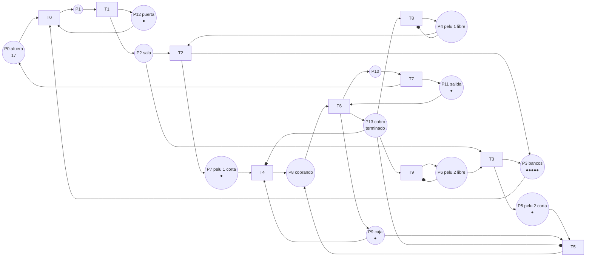

(En el diagrama, las aristas que terminan en `o` son los arcos **inhibidores**.)

Tres decisiones de modelado que conviene leer en la red:

- **"Si no hay banco, se va"** se modela haciendo que $T_0$ **necesite** un banco libre ($P_3$). Con los 5 bancos reservados, ningún cliente más puede entrar, y queda en $P_0$. Como $P_0$ es la población de clientes "afuera", quedarse afuera y irse son lo mismo para el modelo. No hace falta testear que $P_3$ esté en cero.
- **La caja le saca el peluquero al sillón**. Un peluquero que cobra pasa de $P_7$ (o $P_5$) a $P_8$, así que mientras está en la caja **no** está ni en "libre" ni en "atendiendo", y no puede tomar otro cliente. Recién cuando termina de cobrar ($T_6$) se deposita una ficha en $P_{13}$, y $T_8$ o $T_9$ lo devuelven a un sillón.
- **Los arcos inhibidores** resuelven dos tests a cero que una red ordinaria no puede expresar. Los de $P_4 \multimap T_8$ y $P_6 \multimap T_9$ dicen "devolvé el peluquero al sillón **sólo si está vacío**", y garantizan que nunca haya dos peluqueros en el mismo sillón. Los de $P_{13} \multimap T_4$ y $P_{13} \multimap T_5$ dicen "no empieces otro cobro mientras haya un peluquero pendiente de volver", y ordenan la devolución antes del próximo cobro. Como la ficha de $P_{13}$ no recuerda **qué** peluquero cobró, el modelo trata a los peluqueros como **intercambiables**, y lo que se conserva es que haya uno por sillón.

El marcado inicial tiene una particularidad, porque los dos peluqueros arrancan en $P_7$ y $P_5$, es decir **atendiendo**, como si la barbería abriera con dos clientes ya sentados en los sillones. Por eso, en total circulan $17 + 2 = 19$ fichas de cliente.

###### **Invariantes**
De la tabla de pre y post se leen seis componentes conservadores, uno por cada recurso o población:

$$
\begin{aligned}
M(P_{12}) + M(P_1) &= 1 && \text{puerta de entrada: de a uno}\\
M(P_3) + M(P_1) + M(P_2) &= 5 && \text{bancos: reservado al entrar, liberado al ser atendido}\\
M(P_4) + M(P_6) + M(P_7) + M(P_5) + M(P_8) + M(P_{13}) &= 2 && \text{peluqueros: libre, atendiendo, cobrando o volviendo}\\
M(P_9) + M(P_8) &= 1 && \text{caja: un solo cobro a la vez}\\
M(P_{11}) + M(P_{10}) &= 1 && \text{puerta de salida}\\
M(P_0) + M(P_1) + M(P_2) + M(P_7) + M(P_5) + M(P_8) + M(P_{10}) &= 19 && \text{clientes}
\end{aligned}
$$

Cada uno **prueba** una regla del enunciado sin construir el grafo de marcas. Nunca hay más de un cliente en la puerta, nunca hay más de 5 clientes reservando banco o esperando, nunca hay más de 2 peluqueros "activos" sumando los que cortan, los que cobran y los que vuelven (la caja le resta un peluquero a los sillones), y nunca hay dos cobros a la vez. Además **todos** los lugares están cubiertos por algún P-invariante, así que la red es **conservadora** y, por lo tanto, **acotada** (aun con los inhibidores, porque cada marca alcanzable cumple los seis invariantes).

###### **Lo que dice PIPE**
Los dos análisis automáticos de PIPE dan:

| Clasificación | | Espacio de estados | |
|---|---|---|---|
| State Machine | false | **Bounded** | **true** |
| Marked Graph | false | **Safe** | **false** |
| Free Choice Net | false | **Deadlock** | **false** |
| Extended Free Choice Net | false | | |
| Simple Net | **true** | | |
| Extended Simple Net | **true** | | |

Cómo se explica cada resultado con lo visto:

- **No es máquina de estados**: hay transiciones con varias entradas ($T_0$ tiene tres) o varias salidas ($T_6$ tiene tres).
- **No es grafo marcado**: hay lugares con dos transiciones de salida ($P_2$ alimenta a $T_2$ y a $T_3$; $P_9$ a $T_4$ y $T_5$; $P_{13}$ a $T_8$ y $T_9$).
- **No es de libre elección (ni extendida)**: en el conflicto de $P_2$ entre $T_2$ y $T_3$, cada transición tiene **otra** entrada distinta ($P_4$ y $P_6$). Qué peluquero atiende depende de cuál está libre, no de una elección libre. Lo mismo con $P_9$, $T_4$ y $T_5$.
- **Es simple**: cada transición participa de **un solo** conflicto ($T_2$ y $T_3$ del de $P_2$, $T_4$ y $T_5$ del de $P_9$, $T_8$ y $T_9$ del de $P_{13}$; $T_2$ también sale de $P_4$, pero $P_4$ tiene una sola transición de salida).
- **Acotada pero no segura**: los invariantes la acotan, pero $P_0$ arranca con 17 fichas y $P_3$ con 5.
- **Sin deadlock**: siempre hay algo que hacer —si nadie está adentro, puede entrar un cliente; si hay clientes esperando y un sillón libre, se los atiende; si hay alguien atendido, puede ir a la caja—. Es lo que se espera de un sistema **reactivo**.

###### **Leyendo la red con el vocabulario del capítulo**
- **Conflicto**: $T_2$ y $T_3$ compiten por los clientes de $P_2$, y es **efectivo** cuando hay un solo cliente esperando y los dos peluqueros libres. El enunciado lo deja abierto a propósito ("sobre demanda", sin respetar el orden de llegada), así que la red **no** lo resuelve. Lo resuelve el scheduler o, en la implementación con monitor, la **política**.
- **Sincronización**: $T_2$/$T_3$ (cliente + peluquero libre), $T_4$/$T_5$ (peluquero + caja) y $T_6$ (cobro + puerta de salida) son transiciones con varias entradas, con el mismo patrón que el *join* y el *rendez-vous*.
- **Recursos compartidos**: puerta, bancos, caja y puerta de salida son lugares-recurso con su invariante, exactamente el patrón de exclusión mutua con $N$ recursos de los modelos básicos.

###### **De la red al código**
El problema de la barbería es la versión "de enunciado" de lo que se resolvió en código en la sección de sincronización. Cada componente conservador es un **semáforo** (la puerta de entrada y la caja, binarios, y los bancos, de 5 permisos), y cada transición con varias entradas es un punto donde un hilo tiene que adquirir varios recursos. Si se quisiera que el cliente **se vaya** en vez de esperar afuera, en Java se usaría `tryAcquire()` sobre el semáforo de los bancos, el método que **no bloquea** y devuelve `false` si no hay permiso.

$$
\begin{aligned}
\text{puerta de entrada} &\longrightarrow \texttt{new Semaphore(1)}\\
\text{bancos} &\longrightarrow \texttt{new Semaphore(5)}\\
\text{caja} &\longrightarrow \texttt{new Semaphore(1)}\\
\text{cliente rechazado} &\longrightarrow \texttt{if (!bancos.tryAcquire()) \{ irse(); return; \}}
\end{aligned}
$$

Pero los **inhibidores** no tienen un semáforo equivalente directo (un semáforo bloquea cuando **no** hay permisos, no cuando **sí** los hay), y el conflicto entre peluqueros necesita una política. Por eso, en el trabajo práctico, la red no se traduce a mano, sino que se ejecuta **la red misma** dentro de un **monitor**, que calcula qué transiciones están sensibilizadas —con la ecuación de estado generalizada, que incluye los arcos inhibidores— y decide a qué hilo despertar. Es el tema de los dos capítulos siguientes. El modelo formal y el código concurrente son **dos representaciones del mismo objeto**, y por eso se pueden verificar propiedades sobre uno (con invariantes, sin ejecutar nada) y tener la garantía de que valen para el otro.

## Ejercicios Propuestos

1. Para la red del disparo (figura de esta sección), con $Pre(P_1,T_1)=1$ y $Pre(P_2,T_1)=2$:

   a) Escribí las matrices $Pre$, $Post$ y $C$.
   b) Si $M_0 = (1, 2, 0)$, calculá $M_1$ tras disparar $T_1$ usando $M' = M + C(\cdot,T_1)$.
   c) ¿Está $T_1$ sensibilizada en $M_1$? ¿Y si $M_0$ fuera $(2, 5, 0)$, cuántas veces podría dispararse seguido?

2. Modelá con una red de Petri el semáforo de 3 impresoras del capítulo de semáforos (`new Semaphore(3)` + `freePrinters` + `lockPrinters`).

   a) Dibujá la red con 10 hilos y 3 recursos.
   b) Escribí el P-invariante que prueba que nunca hay más de 3 hilos imprimiendo.
   c) ¿Cómo modelarías el `Lock` que protege el arreglo `freePrinters`? ¿Hace falta un lugar aparte?

3. Dada la red del **buffer acotado** con capacidad 3:

   a) Escribí el marcado inicial y el P-invariante.
   b) ¿Qué marcado corresponde a "buffer lleno"? ¿Qué transición queda sin sensibilizar?
   c) Agregá un segundo productor. ¿Sigue valiendo el invariante? ¿Aparece algún conflicto?

4. Decidí si cada red es un grafo de estado, un grafo de eventos, ambos o ninguno, y justificá con la definición:

   a) Un ciclo simple de 4 lugares y 4 transiciones alternados.
   b) La red de co-begin / co-end.
   c) La red de exclusión mutua con lugar `mutex`.
   d) La red del ciclo estacional.

5. Tomá la red de exclusión mutua con **una** ficha en el lugar de recursos.

   a) Construí el **grafo de accesibilidad** completo. ¿Cuántos marcados alcanzables hay?
   b) Repetí con **dos** procesos más (cuatro en total). ¿Cuántos marcados hay ahora? ¿Cuántos lugares tiene la red?
   c) Compará las dos curvas de crecimiento y explicá con eso por qué la materia modela con redes y no con autómatas.

6. Un sistema tiene 4 vagones idénticos que recorren el mismo circuito de 5 lugares.

   a) ¿Cuántos lugares y transiciones tiene la red **ordinaria**?
   b) ¿Y la red **coloreada** equivalente, con un color por vagón?
   c) ¿Qué se pierde al plegar? ¿Se puede recuperar?

7. Clasificá cada sistema como red autónoma, sincronizada o temporizada, y justificá:

   a) Un ascensor que se mueve al recibir una llamada.
   b) Un horno que apaga la resistencia después de 12 minutos.
   c) El ciclo de vida de un proceso en el modelo de 5 estados del sistema operativo.
   d) Un protocolo de comunicación con retransmisión por *timeout*.

8. Modelá con una red de Petri el problema de **lectores y escritores** con $N$ lectores simultáneos permitidos y un solo escritor.

   a) Dibujá la red (mirá §1.5.4 del libro de la cátedra si te trabás).
   b) Escribí el invariante que garantiza que no hay lectores mientras escribe alguien.
   c) Relacioná cada lugar y transición con el código del `ReentrantReadWriteLock` del capítulo de locks.

9. Para la red de la **barbería** de la cátedra (14 lugares, 10 transiciones):

   a) Escribí las columnas de $Pre$ y $Post$ de $T_0$, $T_2$ y $T_6$, y verificá con $C$ que el vector de pesos del invariante de peluqueros cumple $x^T C = 0$ en esas tres columnas.
   b) ¿Es un sifón el conjunto $\{P_9, P_8\}$ (caja)? ¿Es una trampa? Justificá con las definiciones de $^{\bullet}P'$ y $P'^{\bullet}$.
   c) Si se cambian los bancos a $m = 3$ y se agrega un tercer peluquero, ¿qué lugares y transiciones hay que agregar? ¿Qué invariantes cambian de constante y cuáles de forma?
   d) Sacá el arco inhibidor $P_4 \multimap T_8$. Mostrá una secuencia de disparos que lleve a $M(P_4) = 2$, y explicá qué regla del enunciado se rompe.

10. Para la red de exclusión mutua de dos procesos con un lugar `mutex` (sección de Introducción):

    a) ¿Es viva? ¿Es segura? Justificá con las definiciones de esta sección.
    b) Encontrá un P-invariante distinto del ya usado ($M(P_2)+M(P_4)+M(mutex)=1$), si existe alguno.
    c) ¿El conjunto $\{P_1, P_3\}$ (los lugares "fuera de la sección crítica" de ambos procesos) es un sifón, una trampa, ninguno o ambos?

11. Tomá el buffer acotado de capacidad 3 (sección de modelos básicos) y determiná:

    a) ¿Es persistente? Es decir, ¿puede una transición dejar de estar habilitada por el disparo de otra?
    b) ¿"producir" y "consumir" están en conflicto estructural? ¿Y en conflicto efectivo?
    c) Construí el árbol de cobertura si se **elimina** el lugar "libres" (dejando que "producir" dispare sin límite). ¿Aparece algún $\omega$?

12. Clasificá cada red como grafo de estado, grafo de eventos, libre de conflicto, libre elección, libre elección extendida, simple, o ninguna, y justificá con la condición de la tabla de clases:

    a) La red de exclusión mutua con lugar `mutex`.
    b) El buffer acotado con exclusión mutua (productor/consumidor con `mutex`, `huecos` y `productos`).
    c) La cena de los filósofos en la versión que toma los dos tenedores a la vez.

13. Para la cena de los filósofos con **tres** filósofos:

    a) Construí el grafo de marcas de la versión ingenua (tomar de a un tenedor) y señalá el deadlock.
    b) Para la versión atómica, escribí los P-invariantes y demostrá con ellos que dos vecinos no comen a la vez.
    c) ¿Hay sifones que puedan vaciarse en la versión ingenua? Relacionalo con el deadlock.

14. Una red tiene $m_0 = (1, 0)$, una transición $T_1$ que es un bucle sobre $P_1$ y deposita una ficha en $P_2$, y una transición $T_2$ que consume de $P_1$ y no produce nada.

    a) Construí el árbol de cobertura paso a paso, indicando qué regla (1, 2.1 o 2.2) aplicás en cada vértice.
    b) ¿Qué lugares están acotados? ¿Hay deadlocks? ¿Cuántos?
    c) Verificá con el criterio algebraico que la red **no** es estructuralmente acotada.

# Redes de Petri con tiempo y ecuación de estado generalizada

*(Basado en "Modelado e implementación de sistemas de tiempo real mediante redes de Petri con tiempo", de F. J. García Izquierdo, y en el paper de la cátedra "Ecuación de estado generalizada para redes de Petri no autónomas con distintos tipos de arcos y semánticas temporales", Micolini, Cebollada y Verdaguer, Eschoyez, Ventre y Schild, LAC-FCEFyN-UNC.)*

Las redes autónomas dicen **qué** puede pasar, no **cuándo** ni **cuál** de varias cosas posibles. Para implementar un sistema real —y en particular uno de **tiempo real**— hay que reducir ese indeterminismo. Este capítulo junta las dos herramientas que usa la materia para eso, el **tiempo** asociado a las transiciones, y la **ecuación de estado generalizada**, que permite ejecutar una red con eventos, guardas, distintos tipos de arcos y tiempo con una sola fórmula, y que es la base del monitor del trabajo práctico.

## Por qué redes de Petri para tiempo real

Las redes de Petri tienen una gran base matemática que permite verificar propiedades de **vivacidad** (las cosas pasan) y de **corrección** (pasan de manera adecuada). Estudiarlas permite validar los requisitos **funcionales y temporales** del sistema en etapas tempranas, teniendo en cuenta la asignación de prioridades de la planificación, así que los comportamientos erróneos se detectan antes de la puesta a punto. Además, la red permite incluir en el modelo **elementos redundantes** que comprueben, en ejecución, el comportamiento del sistema, lo que facilita el mantenimiento y la prueba.

###### **Formalismo e interpretación**
Hay una familia de formalismos de RdP, de alto a bajo nivel. El formalismo matemático solo **no asocia significado** a los objetos, y un lugar no tiene por qué ser un dato o un estado. La conexión con la realidad la da la **interpretación**. Las RdP autónomas son **semi-interpretadas**. Los lugares describen variables de estado, las transiciones los transformadores de esos estados, y la regla de sensibilización/disparo describe el comportamiento dinámico.

Las interpretaciones agregan restricciones, y con ellas **restringen** el comportamiento del modelo:

- Si una transición modela la **finalización de una actividad**, puede haber restricciones temporales para su disparo una vez sensibilizada.
- Si dos o más transiciones están en **conflicto**, su política puede indicar cómo resolverlo.

## Grado de sensibilización y prioridad

- **Grado de sensibilización** $E(t)$: el número de veces que una transición puede dispararse **concurrentemente** con el marcado actual (el grado de habilitación del capítulo de propiedades). Da lugar a dos semánticas: **servidor único** (aunque el grado sea mayor, la transición dispara de a una vez) o **servidor múltiple**.
- **Redes con prioridad**: se asocia un entero positivo $\pi(t)$ a cada transición. Entre las transiciones que cumplen la condición de sensibilización, **sólo** se dispara la de mayor prioridad. La prioridad sirve para resolver conflictos.

## Interpretaciones con tiempo

Una red autónoma tiene dos fuentes de **indeterminismo**. No especifica **cuándo** se disparará una transición sensibilizada (ni siquiera si se disparará), y no especifica **cuál** de un grupo de transiciones en conflicto lo hará. Las interpretaciones con tiempo atacan la primera de distintas formas:

- Las **estocásticas** (*Stochastic PN*) introducen una estimación probabilística del instante de disparo. No son admisibles para tiempo real, donde hace falta **garantizar** plazos, no promediarlos.
- Las **temporizadas** (*Timed PN*) asocian un tiempo fijo.
- Las *fuzzy-timing PN* acotan los instantes en que la transición puede o debe dispararse.

###### **Tiempo de sensibilización vs tiempo de disparo**
El parámetro temporal de una transición se puede interpretar de dos maneras, según se mantenga o no la **atomicidad** del disparo:

| | Tiempo de **sensibilización** (*enabling time*) | Tiempo de **disparo** (*firing time*) |
|---|---|---|
| Qué mide | Lo que debe transcurrir desde que la transición queda sensibilizada **hasta** que dispara | Lo que transcurre entre la **retirada** de las fichas de entrada y la **colocación** de las de salida |
| Disparo | **Atómico** e instantáneo: retirar y colocar se hace a la vez | **No atómico**: tres fases (retirar, disparar, colocar); el disparo tiene una "duración" (**semántica de duración**) |
| Dónde esperan las fichas | En los lugares de entrada | "Adentro" de la transición |

La segunda es un caso particular de la primera, porque se simula con *disparo inmediato de comienzo* + *lugar de actividad en curso* + *disparo de fin después de $n$ unidades*. Pero la semántica de tiempo de disparo **no permite modelar actividades interrumpibles** (una vez retiradas las fichas, nada puede abortar el disparo), lo que la descalifica para tiempo real. Por eso se elige la semántica de **tiempo de sensibilización**.

###### **Formas de especificar el tiempo**
- **Redes con *delay***: el tiempo asociado al disparo representa la **duración** de la actividad que la transición finaliza; se puede hacer depender de *timestamps* o de colores de las fichas.
- **Redes con tiempo**: se asocia a cada transición un **intervalo** que abarca todas las duraciones posibles de la actividad. Permite el análisis del **peor caso** y el cálculo de límites de tiempo de ejecución.

###### **Semántica fuerte y débil**
- **Fuerte** (*strong time semantics*): se indica en qué momento y con qué condiciones **se debe** disparar. Es la apropiada para tiempo real.
- **Débil** (*weak time semantics*): la transición **no está obligada** a disparar, pero si lo hace, tiene que ser dentro del intervalo. Sirve para acciones que pueden ocurrir sólo durante un período pero que no necesariamente ocurren. Igualmente, eso se puede modelar con semántica fuerte agregando una transición **en conflicto** que aborte la posibilidad de ejecución, y esa alternativa es más clara.

## Redes de Petri con Tiempo (RdPT)

> **Definición**: una Red de Petri con Tiempo es una tupla $N = \langle P, T, Pre, Post, M_0, CIS \rangle$, donde $P$ y $T$ son conjuntos finitos y no vacíos de lugares y transiciones, $Pre, Post: P \times T \to \mathbb{N}$ son las funciones de incidencia, $M_0: P \to \mathbb{N}$ es el marcado inicial, y $CIS: T \to \mathbb{Q}^+ \times (\mathbb{Q}^+ \cup \{\infty\})$ es la **correspondencia de intervalos estáticos**, que asocia a cada transición un par $CIS(t_i) = [\alpha_i, \beta_i]$ con $0 \le \alpha_i \le \beta_i$.

($\mathbb{Q}^+$ son los racionales positivos más el cero.)

###### **Regla de disparo**
Si la transición $t_i$ empieza a estar sensibilizada en el instante $\tau_i$ y **continúa** sensibilizada, su disparo se producirá **no antes** de $\tau_i + \alpha_i$ y **no más tarde** de $\tau_i + \beta_i$. El intervalo de disparos válidos es

$$[\,\tau_i + \alpha_i,\ \tau_i + \beta_i\,]$$

Las fichas permanecen en los lugares de entrada durante el tiempo necesario, y una vez que se produce el disparo, éste **no consume tiempo**, es instantáneo.

###### **Casos particulares**
- $\alpha_i$ es el **instante de disparo más cercano** (EFT, *earliest firing time*) y $\beta_i$ el **más lejano** (LFT, *latest firing time*).
- **Intervalo puntual** $[\alpha, \alpha]$: transición con tiempo de sensibilización **fijo**.
- **Intervalo sin restricción** $[0, \infty)$, que es el formalismo **autónomo**. Por conveniencia, no suele dibujarse.

###### **Estado de una RdPT**
Para decidir si una transición puede dispararse ya no alcanza con el marcado, porque hace falta saber **cuánto tiempo** lleva sensibilizada. Por eso el estado es un par

$$E = (M, I)$$

con $M$ el marcado e $I$ el vector de intervalos de disparo posibles de **todas** las transiciones sensibilizadas por $M$.

###### **Otros formalismos**
- **TER** (*Time Environment/Relationship nets*): de alto nivel, parecidos a las coloreadas, más generales que las RdPT. Las fichas llevan un *timestamp* (variable `chronos`); el disparo está condicionado por el `chronos` de las fichas de entrada y produce el de las de salida según una expresión de la transición (todas las fichas producidas con el mismo valor, nunca menor que el mayor de las entradas).
- **TB** (*Time Basic nets*): caso particular de las TER en el que lo único que guardan las fichas es `chronos`.

El formalismo elegido es el de **RdPT**, porque es simple, adecuado para tiempo real, y otros formalismos temporales se pueden modelar con él (no alcanza para lo que requiere redes coloreadas). Para reducir todavía más el indeterminismo se le agregan **predicados** asociados a las transiciones (que dependen de datos del sistema no representados en la red) y **prioridades** para resolver conflictos; a las transiciones sin intervalo explícito se les supone $[0, \infty)$ (en algunos casos, $[0, 0]$).

## Modelado de sistemas de tiempo real con RdPT

En un sistema de tiempo real hay que representar sin ambigüedad los **eventos** (internos y externos) a los que responde el sistema; sus **patrones temporales** (periodicidad o aperiodicidad); las **acciones** que disparan y sus características temporales (tiempo de cómputo en el mejor y peor caso); y las **interacciones** entre acciones (sincronización, comunicación, precedencia).

###### **Tres tipos de transiciones**
| Tipo | Representa | Etiqueta | Prioridad |
|---|---|---|---|
| **CODE** | La ejecución de un código o actividad, que comienza en el momento en que la transición se sensibiliza | $[\alpha, \beta]$: menor y mayor tiempo de ejecución | Relacionada con la **planificación** del sistema |
| **TIME** | Una actividad temporal: un *timeout*, la activación periódica de un proceso | El intervalo en que se producirá el evento después de sensibilizarse; provoca acciones de **control** | Se usa para resolver conflictos |
| **SYCO** | El resto: sin significado temporal explícito; sincronizaciones, eventos no temporales, excepciones | Implícita $[0, 0]$: disparo **inmediato** | Se usa para resolver conflictos |

###### **Situaciones habituales**
- **Ejecución de código secuencial**: una transición CODE con sus lugares de entrada, caracterizada por los tiempos mínimo y máximo. Ojo, porque **la ejecución de todos los elementos en su peor caso no equivale al peor caso del sistema completo**. Por ejemplo, en una red donde la transición $T$ tiene esos extremos, si tarda su peor caso (10 u.t.) la red completa tarda 20 u.t., pero si tarda su mejor caso (4 u.t.) la red tarda **24** u.t., porque un componente más rápido cambia qué otra rama termina siendo la crítica.
- **Eventos de activación**: de **entorno** (vienen del exterior, por ejemplo interrupciones), **internos** (cambios de estado del propio sistema) y **temporales** (el paso del tiempo). Los temporales se caracterizan por su patrón de llegada: **periódico** (período $T$), irregular, **acotado** (separación mínima entre ocurrencias), en ráfaga, o no acotado.
- **Activación periódica** y **aperiódica**: modelables con todas las interpretaciones temporales.
- **Suspensión o aborto de una actividad**: *timeout* en ejecución (se abandona si no termina antes de un instante), **transferencia asíncrona de control** (se abandona si ocurre un evento) y *timeout* en una comunicación (para evitar una espera infinita). Las tres se modelan con una transición TIME **en conflicto** con la CODE de la actividad, y la que dispare primero gana. Las tres **sólo** se pueden modelar con semántica de **tiempo de sensibilización**, porque con tiempo de disparo, la actividad no es interrumpible.

###### **Restricciones del modelo**
Se admiten pesos de arco unitarios o enteros; arco inhibidor (sí o no); lugares limitados; que toda transición pueda dispararse al menos una vez (todas las partes del sistema ejecutables; las condiciones iniciales se modelan con un lugar en 1 y las de finalización con un lugar limitado en 1); el **grado de sensibilización** (1 para sistemas secuenciales sin código reentrante, 2 o más para código reentrante en paralelo); transiciones sin lugares de entrada que introducen fichas; y que cada lugar tenga **una sola** transición CODE de salida (un sistema no ejecuta simultáneamente dos códigos distintos), aunque puede tener varias TIME y SYCO.

###### **Ejemplos**
- **Fragmento de un sistema de tiempo real**: un proceso **periódico** ($T = 100$ u.t.) que adquiere un recurso para ejecutar un código CODE con *timeout* T.O.1 $= 75$ u.t., lo libera, y después se comunica con un segundo proceso sincronizándose en un *entry* A, con *timeout* T.O.2 $= 5$ u.t. La red se arma con tres "cajas": activación periódica, código y comunicación síncrona con *timeout*.
- **Caso de estudio: la bomba de la mina.** Un sistema que bombea a la superficie el agua del sumidero de una mina, con el requisito de seguridad de que **la bomba no funcione si el nivel de metano es alto** (riesgo de explosión).
  - **Requisitos funcionales**: accionamiento de la bomba (encender si el agua llega al nivel superior o lo pide el operador, y sólo si el metano está bajo el valor crítico; apagar en el nivel inferior), monitorización del entorno (metano, monóxido de carbono y flujo de aire, con alarma ante valores críticos), interacción con el operador (consola en superficie) y registro de todos los eventos.
  - **Requisitos de tiempo** (período / plazo, en ms): sensor de CH₄ 80 / 30; sensor de CO 100 / 60; flujo de aire 100 / 100; flujo de agua 1000 / 40; detector de nivel de agua, esporádico, separación mínima 6000 / plazo 200. El sensor de flujo de agua confirma el estado real de la bomba con dos lecturas a los 960 y 1040 ms de apagarla. El plazo de parada ante metano es de 200 ms desde que supera el umbral. Al operador se le informa cada 1 s de CO y metano altos, y cada 2 s de flujo de aire bajo.
  - Se modela con dos RdPT, la del **controlador de la bomba** (encendida, apagada, "no arrancar por gas", y deshabilitada mientras el metano esté alto, volviendo al estado anterior cuando baja) y la de la **lectura de sensores**, con los plazos de apagado y de información al operador, y un *timeout* que protege el acceso a cada dispositivo, de modo que si no responde, la lectura se suspende y se informa al operador.

## Planificación, análisis e implementación

- **Planificación**: el modelo teórico de concurrencia de las RdP supone **infinitos recursos** (todo lo que puede ejecutarse en paralelo, se ejecuta). La implementación tiene restricciones de **hardware** (procesadores, memoria), de **software** (*scheduling* del sistema operativo, primitivas de concurrencia y tiempo real del lenguaje) y de **prioridades** (hay que asignarlas para que se cumplan todos los requisitos de tiempo real). No se conocen trabajos de RdPT con prioridades dinámicas.
- **Análisis**: ¿se cumplen todos los requisitos temporales? Los métodos se basan en técnicas **enumerativas** (el grafo de alcanzabilidad), pero con tiempo el número de estados (estado + instante) es enorme, e **infinito** en tiempo continuo. Se resuelve con **discretización** del tiempo o con el **grafo de clases de estados** (*State Class Graph*), que agrupa estados en clases.
- **Implementación**: el software tiene que simular el disparo de las transiciones respetando la regla de evolución del marcado, es decir, determinar qué transiciones están sensibilizadas, disparar, y actualizar el marcado. Se adoptan como simplificaciones el **servidor único**, disparo **inmediato** de las SYCO, comienzo inmediato del código de las CODE, semántica de tiempo de sensibilización. También se fija una **política de resolución de conflictos**, con primero las SYCO (instantáneas; entre varias, por prioridad); después CODE y TIME, disparando antes la que termina antes (tiempo de sensibilización menor), y ante igualdad, TIME es más prioritaria.
- **Secuencial o concurrente**: la concurrencia en el disparo puede interpretarse como **entrelazado**, y entonces se puede implementar secuencialmente con procedimientos; pero en una implementación secuencial, el **orden** en que se disparan las transiciones concurrentes importa mucho para el comportamiento del modelo.

## La ecuación de estado generalizada

El paper de la cátedra parte de la observación de que implementar sistemas concurrentes con semáforos penaliza el tiempo de ejecución y es difícil de verificar; en cambio, si el sistema está modelado con una RdP, se lo puede **ejecutar directamente**, en software o en hardware (un **procesador de Petri**, implementado como IP-Core en una FPGA). Para eso hace falta una forma **algebraica** de calcular el siguiente estado y las transiciones sensibilizadas que incluya **todo** lo que agrega semántica: eventos, guardas, arcos inhibidores, lectores y reset, y tiempo.

###### **El punto de partida**
La ecuación de estado de una red con $|P|$ plazas, $|T|$ transiciones y pesos enteros:

$$m_{j+1} = m_j + I \cdot \sigma$$

con $I = Post - Pre$ la matriz de incidencia ($|P| \times |T|$) y $\sigma$ el **vector de disparo** (un 1 en la transición que se dispara). Las transiciones **sensibilizadas** se calculan como un vector **binario** $E$ de dimensión $|T|$. Para cada transición $t_j$ se calcula el estado que resultaría de dispararla, $m_j + I \cdot \sigma_j$ (la columna $j$ de $I$ sumada al marcado), y $E_j = 1$ si **ninguna** componente queda negativa, 0 si alguna lo hace. La matriz de incidencia se lee como una **evaluación conjuntiva**: cada columna (transición) contra las restricciones que imponen las filas (plazas).

###### **Lo que se agrega**
| Elemento | Semántica | Efecto sobre la sensibilización |
|---|---|---|
| **Arco inhibidor** $P_i \multimap T_j$ | $T_j$ **no** está sensibilizada si $P_i$ tiene fichas | Exige $m(P_i) = 0$ |
| **Arco lector** | $T_j$ necesita fichas en $P_i$, pero su disparo **no las consume** | Exige $m(P_i) \ge 1$ |
| **Arco reset** | El disparo de $T_j$ **pone en cero** a $P_i$ | No cambia la sensibilización; cambia el disparo |
| **Guarda** | Variable lógica asociada a $T_j$, que comunica la red con el medio | Exige que la guarda sea verdadera |
| **Evento** | Una **cola** (un contador) asociada a $T_j$, que se incrementa cuando llega un evento y se decrementa cuando $T_j$ dispara | Exige al menos un evento en la cola |
| **Tiempo** | Un intervalo $[\alpha_j, \beta_j]$ y un cronómetro implícito que mide el tiempo desde que $T_j$ se sensibilizó | Exige que el cronómetro esté dentro del intervalo |

Los arcos inhibidores y lectores, además, permiten modelar **prioridades**. Las guardas y los eventos son lo que hacen a la red **no autónoma**. Y como política de selección del disparo, el paper usa la de **servidor único**, en la que se calcula el nuevo estado considerando un solo disparo; si hacen falta varios, se hace una secuencia. Si la elección entre sensibilizadas fuera aleatoria el sistema sería no determinista; para hacerlo determinista se usan prioridades, probabilidades, arcos inhibidores o lectores.

###### **El vector de sensibilizado extendido**
La idea central es que todas las ampliaciones sólo cambian **cuáles transiciones están sensibilizadas**. Una vez elegida la transición, el disparo se hace con la ecuación original (salvo el reset). Así que se calcula un vector binario por cada tipo de restricción, con un 0 en las transiciones que esa restricción **des-sensibiliza** y un 1 en las demás:

- $B$ (**inhibidores**): con $H$ la matriz binaria que indica qué plaza está unida a qué transición por un arco inhibidor, y $Q$ el vector con $q_i = 1$ si $m_i \ne 0$, $B$ tiene un 0 en cada transición con algún inhibidor desde una plaza marcada. En notación booleana, $B = \lnot(H^T \cdot Q)$.
- $L$ (**lectores**): con $H_L$ la matriz binaria de arcos lectores y el vector $W$ con $w_i = 1$ si $m_i = 0$, $L$ tiene un 0 en cada transición que lee una plaza vacía: $L = \lnot(H_L^T \cdot W)$.
- $G$ (**guardas**): directamente el valor de las guardas.
- $V$ (**eventos**): 1 si la cola de la transición tiene al menos un evento.
- $Z$ (**tiempo**): 1 si el contador de la transición está dentro de su intervalo. El contador arranca cuando la transición queda sensibilizada (y se pone en cero si no lo está), y avanza un paso por cada pulso de la base de tiempo; los límites inferior y superior de cada ventana están en una matriz de intervalos.

El **vector de sensibilizado extendido** es la **conjunción lógica** de todos:

$$E_x = E \wedge B \wedge L \wedge G \wedge V \wedge Z$$

y la **ecuación de estado extendida** dispara con él, multiplicando elemento a elemento (#) por un vector $A$ que, para los arcos reset, convierte un disparo en tantos disparos como fichas haya que sacar de la plaza a resetear:

$$m_{j+1} = m_j + I \cdot \big( (\sigma \wedge E_x) \;\#\; A \big)$$

Su importancia práctica está en que es **lógica conjuntiva** pura, sin variables dentro de las matrices, así que se implementa directamente como un **circuito combinacional** en una FPGA (y, en software, como unas pocas operaciones vectoriales). Además es **modular**, porque cada tipo de arco, evento, guarda o tiempo es un vector más que se agrega a la conjunción.

###### **Caso de aplicación del paper**
Una máquina procesa tres tipos de trabajo, J1, J2 y J3. **J1 tiene prioridad** sobre J2 y J3, y para procesar un J3 tiene que haberse procesado **al menos un J2**. En la red, $t_0$, $t_1$, $t_2$ son las llegadas de pedidos (fichas en $p_0$, $p_1$, $p_2$); una ficha en $p_3$, $p_4$ o $p_5$ indica que el trabajo correspondiente se está haciendo; $t_6$, $t_7$, $t_8$ tienen etiqueta de **tiempo** (la duración de cada trabajo) y su disparo es la finalización; $p_6$ es la **máquina**; $p_7$ totaliza los trabajos hechos, y $t_9$, con un **arco reset** desde $p_7$, lo pone en cero. Según el paper, la **prioridad** de J1 se modela con **arcos inhibidores** y la **secuencia** entre J2 y J3 con **arcos lectores**. La implementación de la ecuación para este modelo necesita **seis** matrices; para redes grandes, la cátedra propone **dividir** la red según su localidad estructural para trabajar con matrices más chicas.

## Del modelo al monitor

El diagrama de secuencia "monitor con tiempo" muestra cómo se usa todo esto dentro del monitor del trabajo práctico. Cuando un hilo llama a `disparar()` sobre la red:

1. La red pregunta `estaSensibilizado()` (con el vector de sensibilizadas) y, si la transición es temporal, `testVentanaTiempo()`: compara $\alpha < (\text{ahora} - \text{timeStamp}) < \beta$.
2. **Dentro de la ventana y sin nadie esperando**: se puede disparar ($k = \text{true}$). Si ya hay un hilo esperando esa transición, $k = \text{false}$.
3. **Antes de la ventana**: el hilo **libera el mutex** (`release()`), se marca como esperando, **duerme** `sleep(timeStamp + α − ahora)` —exactamente lo que falta para que se abra la ventana— y vuelve a intentar.
4. **Después de la ventana**: $k = \text{false}$, no se dispara.
5. Si $k$ es verdadero, se calcula el nuevo **vector de estado** con la ecuación de estado (estado $=$ estado $+$ columna de la matriz de incidencia), se recalculan las sensibilizadas y se actualizan los **timestamps** de las transiciones que acaban de sensibilizarse.

El paso 3 es la clave de la semántica de tiempo de sensibilización. Un hilo que llega **antes** del instante $\alpha$ no consume CPU ni bloquea a los demás, porque soltó el mutex, y tampoco pierde su lugar, ya que se despierta justo a tiempo.

# Monitores

*(Basado en M. del Mar Gallardo Melgarejo, "Comunicación y Sincronización con Monitores", Universidad de Málaga, 2002, y en los diagramas de secuencia del monitor con red de Petri, sin y con tiempo.)*

> La noción de **monitor** fue presentada inicialmente por **Dijkstra** (1971), después por **Brinch Hansen** (1973), y refinada por **Hoare** (1974).

Es el mecanismo que cierra la línea que empezó con el semáforo. El problema de los filósofos (1971) mostró lo difícil que es sincronizar bien con primitivas de bajo nivel, y eso llevó a buscar mecanismos de **alto nivel**.

## Por qué no alcanza con semáforos

Los semáforos son primitivas con las que es difícil expresar la solución de problemas de concurrencia grandes, y su presencia **aumenta** la ya existente dificultad para probar que los programas son correctos. Sus debilidades:

- **La omisión de una sola primitiva** puede corromper la operación de todo el sistema concurrente, ya sea un `release()` olvidado, o un `acquire()` de más.
- El control de la concurrencia es **responsabilidad del programador**.
- Las primitivas de control están **esparcidas por todo el sistema**.

Y en consecuencia:

- Llevan fácilmente a **errores transitorios**, los que aparecen sólo en ciertos interleavings.
- Cada sección crítica tiene que **empezar** con `wait()` y **terminar** con `signal()` (en Java, `acquire()`/`release()`), pero nada **restringe el tipo de operación** que se hace sobre el recurso entre medio.
- Hay que acordarse de incluir **todas** las sentencias críticas dentro de la sección crítica.
- La **exclusión mutua** y la **sincronización por condición** se implementan con las **mismas** primitivas, así que después cuesta distinguir cuál es cuál.
- Los programas son difíciles de **mantener**, porque el código de sincronización está repartido entre los distintos procesos.

###### **Ejemplo: buffer acotado con semáforos**
El productor/consumidor con los **tres semáforos** clásicos corresponde a esta red de Petri (lugares *Productores*, *Consumidores*, *Buffer-Huecos*, *Buffer-Producto* y un *Mutex*):

```java
public interface BufferI {
    public abstract void insert(Object item);   // inserta un ítem; puede ser bloqueante o no
    public abstract Object remove();            // saca un ítem; puede ser bloqueante o no
}

public class Buffer implements BufferI {
    private static final int BUFFER_SIZE = 3;   // tamaño máximo del arreglo
    private int count;                           // cantidad de ítems en el buffer
    private int in;                              // próxima posición libre
    private int out;                             // primera posición ocupada
    private Object[] buffer;
    private Semaphore mutex;                     // acceso exclusivo al buffer
    private Semaphore empty;                     // cuenta los lugares VACÍOS
    private Semaphore full;                      // cuenta los lugares LLENOS

    public Buffer() {
        count = 0; in = 0; out = 0;
        buffer = new Object[BUFFER_SIZE];
        mutex = new Semaphore(1);                // 1 para exclusión mutua
        empty = new Semaphore(BUFFER_SIZE);      // arranca con todos los lugares vacíos
        full = new Semaphore(0);                 // arranca sin elementos
    }

    public void insert(Object item) {
        try {
            empty.acquire();     // ¿hay lugar? si no, el productor se bloquea
            mutex.acquire();     // exclusión mutua sobre el arreglo
        } catch (InterruptedException e) {
            System.out.println("ERROR in insert(): " + e);
        }
        ++count;
        buffer[in] = item;
        in = (in + 1) % BUFFER_SIZE;             // buffer circular
        System.out.println("Producer inserted \"" + item + "\" count=" + count
            + ", in=" + in + ", out=" + out);
        mutex.release();
        full.release();          // hay un elemento más; despierta a un consumidor
    }

    public Object remove() {
        Object item = null;
        try {
            full.acquire();      // ¿hay elementos? si no, el consumidor se bloquea
            mutex.acquire();
        } catch (InterruptedException e) {
            System.out.println("ERROR in remove(): " + e);
        }
        --count;
        item = buffer[out];
        out = (out + 1) % BUFFER_SIZE;
        System.out.println("Consumer removed \"" + item + "\" count=" + count
            + ", in=" + in + ", out=" + out);
        mutex.release();
        empty.release();         // hay un lugar libre más; despierta a un productor
        return item;
    }
}
```

```java
public class Productor implements Runnable {
    private Buffer buffer;
    public Productor(Buffer b) { buffer = b; }

    public void run() {
        Date message;
        while (true) {
            System.out.println("Producer napping");
            SleepUtilities.nap();
            message = new Date();                       // produce un ítem
            System.out.println("Producer produced \"" + message + "\"");
            buffer.insert(message);
        }
    }
}
// Consumidor: simétrico, con message = (Date) buffer.remove();
// SleepUtilities.nap(): duerme un tiempo aleatorio entre 0 y NAP_TIME = 5 segundos.
// ThreadApp2: crea el Buffer compartido, un Productor y un Consumidor, y los arranca.
```

Funciona, y la correspondencia con la red es exacta. `empty` es el lugar *Huecos*, `full` es *Producto*, `mutex` es el lugar de exclusión mutua. Pero ilustra todos los problemas de la lista. El **orden** de los `acquire` importa (si se invierte `empty.acquire()` con `mutex.acquire()`, un productor puede bloquearse **con el mutex tomado** y el sistema entra en deadlock), y nada en el código distingue cuál semáforo es de exclusión mutua y cuál de sincronización por condición.

## Qué buscamos: recursos compartidos

La alternativa es razonar en términos de **recursos compartidos** especificados. Especificar un recurso compartido permite:

- Definir la **interacción** entre procesos independientemente del lenguaje o técnica de programación.
- Que la **comunicación** entre procesos se haga mediante las **operaciones** sobre el recurso compartido.
- Que la **exclusión mutua** se produzca entre **todas** las operaciones del recurso.
- Que la **sincronización por condición** se defina a través de las **precondiciones** (CPRE) de las operaciones del recurso, de modo que una operación sólo puede ejecutarse si su precondición se cumple.

¿Cómo se implementa un recurso compartido especificado? Con métodos `synchronized`, con **monitores**, o con **paso de mensajes**.

## Definición

> Un **monitor** es un mecanismo de software, de **alto nivel**, para el control de concurrencia, que contiene los **datos** y los **procedimientos** necesarios para realizar la asignación de un determinado recurso, o grupo de recursos compartidos, reutilizables en serie.

Un monitor contiene **variables** que representan el estado del recurso y **procedimientos** que implementan las operaciones sobre él. Se usa para manejar **todas** las funciones de concurrencia, como la comunicación entre procesos y la localización física de los recursos en una región crítica. Dicho en términos de objetos, **un monitor es una instancia de una clase que puede ser usada de forma segura por múltiples hilos**.

El monitor puede verse como una **aduana**, que permite o no el acceso a un recurso compartido, o hace esperar por un trámite. Su código tiene dos partes lógicas, el **algoritmo** de manipulación del recurso y de sincronización, y el **mecanismo** que asigna el orden en que los procesos comparten el recurso o se sincronizan. Desde el punto de vista de los procesos activos, el monitor ofrece un conjunto de procedimientos para usar recursos compartidos y sincronizar actividades. Y se cumple que:

- **Todos los métodos del monitor se ejecutan en exclusión mutua.**
- Cada método tiene definida su **sincronización por condición**, que consiste en **bloquear** a los procesos hasta que se cumplan las condiciones para ejecutar, y **notificar** (señalizar) a un proceso bloqueado que puede continuar cuando se cumplen sus condiciones.

Una regla de diseño importante es que, para asegurar que un proceso obtenga el recurso que está esperando, el monitor tiene que darle **prioridad sobre los procesos nuevos** que piden entrar. Si no, los nuevos se llevan el recurso antes que el que esperaba, que puede quedar en **postergación indefinida** (inanición).

###### **Elementos que lo componen**
```
Monitor nombre_monitor
    var variables_locales;               // permanentes: el estado interno del recurso
    export procedimientos_exportados;    // los que pueden llamar los procesos activos

    procedure proc1(parametros)
        var variables locales;
    begin
        // código del procedimiento
    end

    procedure proc2(parametros) ...

begin
    // código de inicialización (el constructor)
end
```

- Un conjunto de **variables locales permanentes**, que almacenan el estado interno del recurso.
- El **código de inicialización** (constructor).
- Un conjunto de **procedimientos internos** que manejan las variables permanentes.
- La **declaración** de los procedimientos **exportados**, los únicos que pueden invocar los procesos activos.

###### **Gestión del acceso exclusivo**
La exclusión mutua se basa en la **cola de entrada** del monitor:

- Si un proceso está ejecutando un procedimiento del monitor (está "adentro") y otro proceso intenta ejecutar el mismo u otro procedimiento, el código de acceso **bloquea** la llamada y lo manda a la **cola**.
- Cuando un proceso abandona el monitor, éste toma al proceso que está al frente de la cola y lo desbloquea.
- Si la cola está vacía, el monitor queda **libre**.

El responsable de garantizar la exclusión mutua es **el monitor**, no el programador, y esa es la diferencia de fondo con los semáforos.

## Variables de condición

Cada proceso puede requerir una sincronización **distinta**, así que hay que programar cada caso, y para eso están las **variables de condición**. Una variable de condición es un **contenedor de hilos** que esperan una determinada condición sobre el estado del monitor. El monitor permite que un hilo **ceda temporalmente** el acceso exclusivo mientras espera que se cumpla una condición, y lo **recupere** antes de seguir con su tarea.

- **`wait`** sobre una condición: el proceso que la ejecuta queda **dormido** y pasa a la **cola asociada** a esa variable, esperando ser despertado. Al dormirse, **libera** el monitor.
- **`signal`** sobre una condición:
  - si la cola de la condición está **vacía**, no pasa nada y el proceso que señalizó sigue; al terminar, el monitor queda disponible para otro;
  - si **no** está vacía, el primer proceso de la cola se **despierta** (se saca de la cola) pero **no avanza todavía**. Qué pasa a continuación con el que señalizó y con el despertado **depende de la política** implementada.

Es la diferencia con `wait`/`notify` de Java, donde hay **una sola** condición implícita por objeto (su *wait set*), por eso hace falta `notifyAll()` y re-chequear con `while`. Un monitor con varias variables de condición —en Java, un `Lock` con varias `Condition`— puede despertar **exactamente** al tipo de proceso que corresponde.

## Clasificación y políticas de señalización

Los monitores se clasifican por la operación de señal:

- **Señal explícita**: el monitor declara explícitamente las variables de señal (condición).
- **Señal implícita**: monitor de señal **automática**, sin ninguna declaración, donde el propio monitor reevalúa las condiciones.

Y, dentro de eso, por las **prioridades relativas** de las tres colas que intervienen, la **cola de entrada** (procesos que quieren entrar), la **cola de espera** de cada condición, y la **cola de señalización** o "de cortesía" (procesos que señalizaron y quedaron esperando). Las políticas que interesan:

| Política | Qué pasa con el que **señaliza** | Qué pasa con el **despertado** |
|---|---|---|
| **Signal and Continue** (SC) | **Mantiene** el mutex y sigue ejecutando | Debe **competir** por el mutex: se mueve a la cola de entrada (no hace falta cola de cortesía) |
| **Signal and Wait** (SW) | Se **bloquea**, y debe competir de nuevo por el mutex (va a la cola de entrada, por orden de llegada) | **Adquiere** el mutex y continúa de inmediato |
| **Signal and Urgent Wait** (SU) | Se bloquea, pero en una cola especial (*s*) con **prioridad** sobre la de entrada: será el **primero** en recuperar el mutex cuando el despertado lo libere | Adquiere el mutex y continúa de inmediato |
| **Signal and Exit** (SX) | **Sale** del método (el `signal` es lo último que hace) | Toma **directamente** el mutex y ejecuta |
| **Wait and Notify** (la de Java) | Sigue (como SC) | Pasa a competir por el mutex |

En SC, la cola de entrada tiene que dar **más prioridad** a los procesos que vienen desde una cola de condición que a los que esperan entrar por primera vez, por la regla anti-inanición de la definición. En SU hay entonces dos colas por monitor, $e$ (entrada) y $s$ (los que señalizaron), más una cola $c.q$ por cada variable de condición $c$; la variante **SW** es la misma sin cola $s$, y el que señaliza espera en la de entrada.

¿Por qué importa? Porque cambia **qué** puede suponer el despertado. Con **SW/SU/SX**, el despertado entra **inmediatamente** después del `signal`, así que la condición por la que esperaba **sigue siendo verdadera**, y alcanza con un `if`. Con **SC** (y con Java), entre el `signal` y el momento en que el despertado consigue el mutex pueden entrar otros y cambiar el estado, así que hay que volver a chequear con `while`.

## El monitor de la materia: un monitor guiado por una red de Petri

El objetivo de la cátedra es resolver problemas de concurrencia que serían **muy difíciles con semáforos**, con un monitor que facilite identificar, separar y gestionar:

- la **lógica** del sistema,
- la **política** del sistema —que emerge de la relación entre las colas de entrada, de condición y de cortesía, y de las propias colas de condición—, y
- las **acciones** que se ejecutan.

Concretamente, hay que decidir (1) una **estructura general** para los métodos que implementan acciones sobre el recurso compartido, (2) qué **condición** en las colas se requiere para los bloqueos, y (3) una **estrategia** para efectuar los desbloqueos cuando hay varios hilos candidatos.

La solución es separar esas tres cosas en objetos distintos:

| Componente | Responsabilidad |
|---|---|
| **Mutex** | La exclusión mutua de entrada al monitor (un semáforo binario) |
| **Red de Petri** | La **lógica**: el estado (marcado), qué transiciones están sensibilizadas, y el disparo con la ecuación de estado |
| **Colas** | Una **cola de condición por transición**: los hilos que quisieron disparar una transición no sensibilizada esperan ahí |
| **Política** | La **estrategia**: cuando hay varios hilos que se pueden despertar, elige cuál |
| **Monitor** (gestor) | Coordina a los demás; es el único punto de entrada para los hilos |

Cada hilo del sistema ejecuta su tarea como una secuencia de **disparos de transiciones** (típicamente, la secuencia de un T-invariante), y cada disparo pasa por el monitor.

###### **El algoritmo de `dispararTransicion` (monitor sin tiempo)**
Es el diagrama de secuencia del "monitor sin tiempo":

1. El hilo llama a `dispararTransicion(t)` y el monitor hace `acquire()` sobre el **mutex**.
2. Mientras el hilo intenta disparar (**loop**):
   - El monitor pide a la red `intentarDisparo(t)`. Si $t$ está sensibilizada, la red dispara y **actualiza el marcado**; si no, devuelve `false`.
   - **Si el disparo fue exitoso**, el monitor obtiene de la red las **transiciones sensibilizadas** ($V_s$) y de las colas los **hilos esperando** ($V_c$, un vector con 1 en cada transición que tiene hilos en su cola). Calcula los **despertables**: $m = V_s \wedge V_c$.
     - Si hay alguno ($m \ne 0$), le pide a la **política** que `seleccionarHilo(m)` (en el diagrama original, `cual()`), y **despierta** a ese hilo en su cola. El hilo actual **sale del monitor sin liberar el mutex**, y el despertado **continúa con el control**. Es la política **Signal and Exit**, en la que el mutex pasa "de mano en mano", y nadie de la cola de entrada puede colarse.
     - Si no hay ninguno, el monitor hace `release()` del mutex, porque nadie que esté esperando puede continuar.
   - **Si el disparo no fue exitoso** (la transición no estaba sensibilizada), el monitor libera el mutex y el hilo queda **bloqueado en la cola asociada a su transición** (`esperar(t)`). Cuando otro hilo lo despierte, vuelve al loop **ya con el mutex** (se lo pasaron) e intenta de nuevo.
3. Cuando el disparo fue exitoso, el hilo sale del monitor y sigue con su tarea.

```java
// Esquema del monitor (estructura, no implementación completa)
public boolean dispararTransicion(int t) throws InterruptedException {
    mutex.acquire();
    while (true) {
        if (red.intentarDisparo(t)) {                        // dispara y actualiza el marcado
            boolean[] despertables = and(red.sensibilizadas(), colas.quienesEstan());
            if (hayAlguno(despertables)) {
                int elegida = politica.cual(despertables);   // la política resuelve el conflicto
                colas.despertar(elegida);                    // pasa el mutex: NO hago release
            } else {
                mutex.release();
            }
            return true;
        } else {
            mutex.release();
            colas.esperar(t);   // bloquea en la cola de t; al despertar ya tiene el mutex
        }
    }
}
```

Con esta estructura, la **corrección** de la sincronización queda en la red, que se puede **verificar** con invariantes, sifones y vivacidad antes de escribir código. La **política** queda aislada en un objeto, y se puede cambiar (prioridades, alternancia, equidad) sin tocar ni la red ni los hilos; y los hilos sólo saben **qué transiciones disparan**, nunca cómo se sincronizan. Es la respuesta a la lista de inconvenientes de los semáforos, porque la sincronización no está esparcida, no se puede omitir una primitiva, y la exclusión mutua es responsabilidad del monitor.

Con **tiempo**, el monitor es el mismo, pero `intentarDisparo` también verifica la **ventana temporal** de la transición, y un hilo que llega antes de $\alpha$ suelta el mutex y duerme lo que falta. Es el diagrama "monitor con tiempo", desarrollado al final del capítulo de RdP con tiempo.

> [!question]- Actividad — Del buffer con semáforos al monitor
> a) En el `Buffer` con semáforos, intercambiá el orden de `empty.acquire()` y `mutex.acquire()` en `insert`. Construí un escenario (con `BUFFER_SIZE = 3`) que lleve a deadlock, y señalá en la red de Petri equivalente qué cambió.
> b) Modelá el mismo productor/consumidor como red para el monitor. ¿Qué transiciones dispara el productor? ¿y el consumidor? ¿Cuál es el T-invariante de cada uno?
> c) Si hay 2 productores y 2 consumidores, y en un momento hay un productor y un consumidor esperando y ambas transiciones quedan sensibilizadas, ¿quién decide a cuál se despierta? Proponé dos políticas distintas y explicá qué propiedad favorece cada una.
> d) ¿Por qué en el esquema el hilo que despierta a otro **no** hace `release()`? ¿Qué podría pasar si lo hiciera?
>
> *Pista para (d): pensá en un tercer hilo que esté esperando en la cola de entrada del mutex, y en si la transición del despertado sigue sensibilizada cuando por fin le toca.*

# Expresiones regulares en la práctica: verificar T-invariantes

*(Los scripts y las corridas de ejemplo están verificados con Python 3.)*

El capítulo de lenguajes formales presentó las expresiones regulares como **metalenguaje** para los lenguajes de tipo 3. Este capítulo muestra su uso práctico en la materia, como herramienta para **analizar el log** de una ejecución y comprobar que una red de Petri implementada con hilos cumplió con sus **T-invariantes**.

## Expresiones regulares como herramienta

> Una expresión regular es una **descripción compacta** que representa un lenguaje regular. En la práctica se usan para expresar **patrones de búsqueda** —combinaciones de caracteres— dentro de cadenas.

Los lenguajes de programación (Python, Java, JavaScript) usan una sintaxis más rica que la de JFLAP, aunque describen los mismos lenguajes. Los **metacaracteres** son los que **no** se interpretan literalmente:

$$[\ ]\quad \hat{}\quad \{\ \}\quad .\quad |\quad ?\quad *\quad +\quad (\ )\quad \backslash\quad \$$$

| Metacarácter | Significado | Ejemplos |
|---|---|---|
| `[ ]` | Lista de caracteres posibles **en una posición** | `[abc]` alguno de `a`, `b`, `c`; `[a-z]` cualquiera entre `a` y `z`; `7[Pp][Mm]` → `7pm`, `7PM`, `7pM`… |
| `[^ ]` | Un carácter que **no** esté en la lista | `[^ab]` cualquier carácter que no sea `a` ni `b` |
| `{n}` / `{n,}` / `{n,m}` | Repetición: exactamente $n$ / al menos $n$ / entre $n$ y $m$ veces | `a{4}` → `aaaa` |
| `.` | Cualquier carácter, **salvo** el salto de línea (comodín) | `T.` → `T0`, `T1`, `Tx`… |
| `\|` | Alternativa (el "o"; en JFLAP era `+`) | `T1\|T2` |
| `( )` | Agrupa (y **captura** lo que coincidió) | `(abc)+` |
| `\` | Escapa un metacarácter para usarlo literal | `\.` un punto |
| `^` / `$` | Comienzo / fin de la cadena (o de la línea) | `^T0` |

###### **Cuantificadores**
| Cuantificador | Coincide | Equivale a |
|---|---|---|
| `?` | Cero o una vez | `{0,1}` |
| `*` | Cero o más veces | `{0,}` |
| `+` | Una o más veces | `{1,}` |

Por ejemplo, `(abc)+` es una o más veces la cadena `abc`, y `(a|b)*` es cero o más veces `a` o `b`. Ojo con el cambio de notación respecto de la teoría y de JFLAP, porque acá `+` es el **cierre positivo**, no la unión.

###### **Codicioso vs perezoso (*greedy* vs *lazy*)**
Los cuantificadores `*`, `+` y `?` son **codiciosos**, o sea que coinciden con la **mayor** cantidad de texto posible. Con el patrón `<.*>` sobre la cadena `<a>b<c>`, el resultado es **toda** la cadena, no `<a>`, porque el `.*` se come todo lo que puede y retrocede sólo lo necesario para que el `>` final coincida.

Poniendo un `?` **después** de un cuantificador, su comportamiento pasa a ser **perezoso** (*lazy*, o mínimo) y coincide con la **menor** cantidad posible. Con `<.*?>` sobre `<a>b<c>`, el resultado es `<a>`. Para analizar logs esta diferencia es clave, porque un `.*` codicioso entre dos transiciones salta por encima de invariantes enteros.

###### **Herramientas**
- **Python**: el módulo `re` (https://docs.python.org/es/3/library/re.html). Funciones a conocer: `re.match` (coincidencia al **principio** de la cadena), `re.search` (la primera coincidencia en **cualquier** posición), `re.sub` (reemplaza todas las coincidencias) y `re.subn` (igual, pero devuelve también **cuántos** reemplazos hizo).
- Para **ver** gráficamente una expresión como autómata: Debuggex (https://www.debuggex.com/).
- Para probar expresiones: Regex101 (https://regex101.com/) y RegExr (https://regexr.com/). Sobre *greedy* y *lazy*: https://javascript.info/regexp-greedy-and-lazy

## Expresiones regulares y redes de Petri

###### **El problema**
Como ejemplo sirve un **productor/consumidor con buffer acotado y múltiples agentes**. La red tiene lugares para los *Productores* y los *Consumidores* (con varias fichas cada uno, una por agente), los *huecos* y los *productos* del buffer, y un *mutex*. Cada productor recorre $T_0 \to T_1 \to T_2$ (con $T_1$ depositando en *productos*) y cada consumidor $T_3 \to T_4 \to T_5$ (con $T_3$ tomando de *productos*). El análisis de invariantes de PIPE da un **único T-invariante**:

| $T_0$ | $T_1$ | $T_2$ | $T_3$ | $T_4$ | $T_5$ |
|---|---|---|---|---|---|
| 1 | 1 | 1 | 1 | 1 | 1 |

y PIPE agrega: *"The net is covered by positive T-Invariants, therefore it might be bounded and live"*. Es decir, un ciclo completo es un productor **y** un consumidor completando su trabajo. Sólo el productor no devuelve la red al marcado de partida, porque pasó una ficha de *huecos* a *productos*.

Supongamos que se implementa esa red con hilos (cada hilo dispara su secuencia de transiciones a través del monitor) y se registra en un **log** cada transición disparada. **¿Cómo se puede asegurar que, después de $n$ disparos, la ejecución cumplió con los T-invariantes?** Por la ecuación fundamental, si el log se puede **descomponer** en invariantes completos, la red volvió al marcado inicial; si sobran transiciones, sobra un "pedazo" de invariante en curso, o hubo un disparo que no debería haber ocurrido.

###### **El método**
Escribir un script (por ejemplo en Python) que lea el log —un archivo de texto con las transiciones, como `T0T1T3T0T4...`— y lo procese con una expresión regular que reconozca un invariante **completo**, aunque esté **intercalado** con transiciones de otros. Las transiciones intercaladas se capturan con `(.*?)` **perezosos** y se conservan; el invariante reconocido se borra; y se repite hasta que no haya más coincidencias.

**Importante**: si la red tiene **más de un T-invariante**, hay que agruparlos en **una sola** expresión regular.

###### **Por qué una sola expresión**
Supongamos una red con dos invariantes que **comparten su transición inicial**: $T_0T_1T_2$ y $T_0T_2T_3$. Si se busca primero el invariante 1 con una regex y después el 2 con otra, se corre el riesgo de asignarle a un invariante transiciones que pertenecían al otro. Un ejemplo corto donde se ve el error:

```python
import re

def quitar(patron, log):
    """Borra invariantes completos hasta que no haya más; conserva lo intercalado."""
    total = 0
    while True:
        log, n = patron.subn(lambda m: "".join(g for g in m.groups() if g), log)
        if n == 0:
            return log, total
        total += n

log = "T0T2T0T1T2T3"     # válido: T0 T2 ... T3 (inv. 2) con T0 T1 T2 (inv. 1) en el medio

inv1 = re.compile(r"T0(.*?)T1(.*?)T2")
inv2 = re.compile(r"T0(.*?)T2(.*?)T3")
resto, a = quitar(inv1, log)
resto, b = quitar(inv2, resto)
print(a, b, resto)       # 1 0 'T2T0T3'  ->  ¡falso error!

unica = re.compile(r"T0(.*?)(?:T1(.*?)T2|T2(.*?)T3)")
print(quitar(unica, log))  # ('', 2)    ->  correcto
```

Con regex **separadas**, la del invariante 1 toma el primer `T0`, salta por encima del `T2` y del segundo `T0` hasta encontrar `T1`, y se lleva el `T2` siguiente, así que le "robó" el `T0` al invariante 2. Lo que queda, `T2T0T3`, ya no es un invariante, y el script informa un error que no existe. Con **una sola** expresión, el motor prueba las alternativas **a cada largo** del hueco perezoso. Apenas después del primer `T0` encuentra un `T2`, así que reconoce primero el invariante 2 (con `T0T1T2` intercalado adentro), y la siguiente pasada reconoce el 1. La conclusión es usar **una sola regex con todos los caminos posibles** (los invariantes o sus combinaciones).

###### **Las combinaciones del mismo invariante**
El segundo problema es que **un mismo** invariante puede aparecer en el log en **distinto orden**. En el productor/consumidor, el consumidor puede empezar en cuanto hay un producto, o sea después de $T_1$; así que el $T_2$ del productor puede quedar **antes**, **entre** o **después** de $T_3$, $T_4$ y $T_5$. La regex se construye por pasos, agregando una alternativa cada vez que aparece otra combinación posible del mismo invariante, hasta cubrir todas:

```python
import re

# T0 T1 y después: T2 T3 T4 T5 | T3 T2 T4 T5 | T3 T4 T2 T5 | T3 T4 T5 T2
PATRON = re.compile(
    r"T0(.*?)T1(.*?)"
    r"(?:T2(.*?)T3(.*?)T4(.*?)T5"
    r"|T3(.*?)(?:T2(.*?)T4(.*?)T5"
    r"|T4(.*?)(?:T2(.*?)T5"
    r"|T5(.*?)T2)))"
)

def quitar_invariantes(log):
    total = 0
    while True:
        log, n = PATRON.subn(lambda m: "".join(g for g in m.groups() if g), log)
        if n == 0:
            return log, total
        total += n

with open("log.txt") as f:
    resto, n = quitar_invariantes(f.read().strip())
print(f"Invariantes completos: {n}")
print(f"Transiciones sobrantes: '{resto}'")
```

Probado con algunos logs:

| Log | Invariantes | Resto |
|---|---|---|
| `T0T1T2T3T4T5` | 1 | (vacío) |
| `T0T1T3T4T5T2` | 1 | (vacío) |
| `T0T1T0T3T2T1T4T3T5T2T4T5` (dos intercalados) | 2 | (vacío) |
| `T0T1T3T4T5T2T0T1` (un ciclo en curso al cortar) | 1 | `T0T1` |

Si el resto no está vacío, hay que poder explicarlo con transiciones de invariantes que quedaron **a medias** cuando se cortó la ejecución (como el `T0T1` del último caso), y nada más. Cualquier otra cosa indica que se disparó una transición fuera de lugar.

Dos cuidados prácticos. Primero, la regex tiene que ser **perezosa** en todos los huecos, porque un `.*` codicioso se saltearía invariantes enteros. Segundo, con más de 10 transiciones, `T1` coincide también con el comienzo de `T10`, `T11`…, así que hay que usar un separador en el log (`T1-T10-…`) o anclar el número, por ejemplo `T1(?!\d)`.

> [!question]- Actividad — Escribir la regex de un invariante
> a) Para la red de exclusión mutua de la Introducción (dos procesos que entran y salen de la sección crítica con un `mutex`), ¿cuáles son los T-invariantes? Escribí **una sola** regex que los reconozca intercalados.
> b) Probá el script con el log `T0T2T1T3` y con `T0T0T1T1`. ¿Qué resto queda en cada caso? ¿Alguno de los dos logs es imposible para la red? ¿Lo detecta el script?
> c) Explicá por qué, en el productor/consumidor, no hace falta una alternativa con `T3` **antes** de `T1`.
>
> *Pista para (c): mirá qué lugar es la entrada de $T_3$ y qué transición le pone fichas.*

# Bibliografía

###### **Material de cátedra**
- Ventre, L. O. — *Introducción a la Programación Concurrente*, 2013 / 2017 / 2018 / 2020.
- Ventre, L. O. — *Modelado de un Sistema con Diagramas UML*, Programación Concurrente, 2020 (reeditada 2025).
- Ventre, L. O. — *Ejercicio Práctico Clase 1* / *CreacionHilo*, Programación Concurrente, 2020.
- Cátedra — *Gramáticas, Lenguajes y Autómatas*, Programación Concurrente, FCEFyN-UNC, 2020.
- Cátedra — *Threads en Java*, Práctico Clase 2, 2025.
- Ventre, L. O.; Ludemann, M. — *Basic Thread Synchronization*, Programación Concurrente, 2021 (fundamentos de `synchronized`) y 2026 (ReadWriteLocks y Semáforos).
- Ventre, L. O.; Ludemann, M. — *Threads – Java Concurrency Cookbook: Interrupting, Sleeping & Resuming, Waiting for Finalization*, Programación Concurrente, 2024.
- Ventre, L. O.; Ludemann, M. — *Uncontrolled Exceptions, Daemon Threads, Local Thread Variables, Count Down Latch*, Práctico Clase 7, 2026.
- Cátedra — *Redes de Petri*, Case #1, Programación Concurrente, 2020/2026.
- Cátedra — *Redes de Petri: Properties of Petri Nets (Case #2, con el problema de la barbería)*, Programación Concurrente.
- Cátedra — *Java: Conceptos Básicos*, 2024.
- Ventre, L. O.; Ludemann, M. — *Thread Factory, Executors*, Programación Concurrente, 2024.
- Cátedra — *Monitores*, Programación Concurrente (con los diagramas de secuencia del monitor con red de Petri, con y sin tiempo).
- Ventre, L. O. — *Expresiones Regulares*, Programación Concurrente, 2021.
- García Izquierdo, F. J. — *Modelado e Implementación de Sistemas de Tiempo Real Mediante Redes de Petri con Tiempo*.
- Diagramas de secuencia y de clases de la cátedra: monitor con red de Petri (sin y con tiempo), `Cinema`, `PrintQueue` con semáforo, y el ejemplo de hilos daemon (`WriterTask`/`CleanerTask`).


###### **Libros de referencia**
- Stallings, W. — *Operating Systems: Internals and Design Principles*, 6.ª ed. — cap. 3 (Process Description and Control), cap. 4 (Threads, SMP and Microkernels), cap. 5 (Concurrency: Mutual Exclusion and Synchronization), cap. 6 (Concurrency: Deadlock and Starvation). Hay además la 5.ª ed. en español.
- Palma Méndez, J. T. et al. — *Programación Concurrente*.
- Fernández González, J. — *Java 7 Concurrency Cookbook* — cap. 1 (Thread Management, incluida la recipe 10 de `ThreadFactory`), cap. 2 (Basic Thread Synchronization), cap. 3 (Thread Synchronization Utilities), cap. 4 (Thread Executors). También la 2.ª ed., *Java 9 Concurrency Cookbook*.
- Diaz, M. (ed.) — *Petri Nets: Fundamental Models, Verification and Applications* — cap. 1 (Basic Semantics; §1.5 modelos básicos), cap. 3 (Analysis Methods; §3.3 invariantes lineales, §3.5.2 máquinas de estado, §3.5.3 grafos de eventos).
- David, R.; Alla, H. — *Discrete, Continuous and Hybrid Petri Nets* (de donde viene la terminología de redes autónomas / no autónomas, sincronizadas y temporizadas).
- Ben-Ari, M. — *Principles of Concurrent and Distributed Programming*, 2.ª ed. (interleaving, sección crítica).
- Dijkstra, E. W. — *Cooperating Sequential Processes*, 1968, y *A Discipline of Programming*, 1976; archivo EWD completo en http://www.cs.utexas.edu/users/EWD/
- Micolini, O.; Cebollada y Verdaguer, M.; Eschoyez, M.; Ventre, L. O.; Schild, M. I. — *Ecuación de estado generalizada para redes de Petri no autónomas con distintos tipos de arcos y semánticas temporales*, Laboratorio de Arquitectura de Computadoras, FCEFyN-UNC.
- Gallardo Melgarejo, M. del M. — *Comunicación y Sincronización con Monitores*, notas de clase de Programación Concurrente, Universidad de Málaga, 2002.
- Hoare, C. A. R. — *Monitors: An Operating System Structuring Concept*, Communications of the ACM, 1974.
- Merlin, P. M. — *A Study of the Recoverability of Computing Systems*, University of California, 1974 (origen de las redes de Petri con tiempo por intervalos).
- Schruben, L. — *Event Graph Modeling* (grafos de eventos para simulación de eventos discretos).
- PIPE — *Platform Independent Petri net Editor*, la herramienta de análisis que usa la cátedra.

###### **Lenguajes formales y autómatas**
- Jurado Málaga, E. — *Teoría de autómatas y lenguajes formales*, 2008.
- Cueva, J. M.; Izquierdo, R.; Juan, A. A.; Luengo, M. C.; Ortín, F.; Labra, J. E. — *Lenguajes, Gramáticas y Autómatas en Procesadores de Lenguaje*, 2003.
- Chomsky, N. — *On Certain Formal Properties of Grammars*, 1959 (la jerarquía de los cuatro tipos).
- Hopcroft, J.; Motwani, R.; Ullman, J. — *Introduction to Automata Theory, Languages and Computation*, 3.ª ed. (complemento clásico para la construcción de subconjuntos y el lema de bombeo).
- **JFLAP**: https://www.jflap.org/

###### **Java y UML**
- Gosling, Joy, Steele, Bracha, Buckley — *The Java Language Specification* (§6.6 control de acceso, §17.5 campos `final`).
- Bloch, J. — *Effective Java*, 3.ª ed. (ítems 15, 17 y 20).
- Goetz, B. et al. — *Java Concurrency in Practice*, caps. 2 y 3.
- Fowler, M. — *UML Distilled*, 3.ª ed., caps. 1, 3 y 4.
- OMG — *Unified Modeling Language Specification*, v2.5.1 (fragmentos combinados).
- Oracle — API de Java SE 8: https://docs.oracle.com/javase/8/docs/api/ · JEP 444 (Virtual Threads) · JEP 453 (Structured Concurrency).
- Python — módulo `re`: https://docs.python.org/es/3/library/re.html · Debuggex: https://www.debuggex.com/ · Regex101: https://regex101.com/ · RegExr: https://regexr.com/
